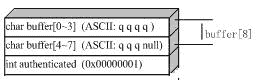
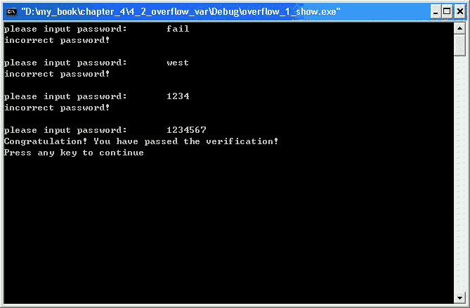
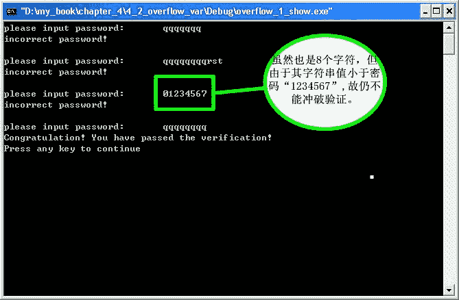

# 软件漏洞分析入门\_2\_ 初级栈溢出 A\_ 初识数组越界

> 原文：[`www.pediy.com/kssd/pediy09/pediy09-343.htm`](https://www.pediy.com/kssd/pediy09/pediy09-343.htm)

> 2\_ 初级栈溢出\_A  
>   
> To be the apostrophe which changed “Impossible” into “I'm possible”  
> —— failwest  
>   
> 今夜月明星稀  
>   
> 本想来点大道理申明下研究思路啥的，看到大家的热情期待，稍微调整一下讲课的顺序。从今天开始，将用 3～4 次给大家做一下栈溢出的扫盲。  
>   
> 栈溢出的文章网上还是有不少的（其实优秀的也就两三篇），原理也不难，读过基本上就能够明白是怎么回事。本次讲解将主要集中在动手调试方面，更加着重实践。  
>   
> 经过这 3～4 次的栈溢出扫盲，我们的目标是：  
>   
> 领会栈溢出攻击的基本原理  
> 能够动手调试简易的栈溢出漏洞程序，并能够利用漏洞执行任意代码（最简易的 shellcode）  
>   
> 最主要的目的其实是激发大家的学习兴趣——寡人求学若干年，深知没有兴趣是决计没有办法学出名堂来的。  
>   
> 本节课的基本功要求是：会 C 语言就行（大概能编水仙花数的水平）  
>   
> 我会尽量用最最傻瓜的文字来阐述这些内存中的二进制概念。为了避免一开始涉及太多枯燥的基础知识让您失去了兴趣，我并不提倡从汇编和寄存器开始，也不想用函数和栈开头。我准备用一个自己设计的小例子开始讲解，之后我会以这个例子为基础，逐步加码，让它变得越来越像真实的漏洞攻击。  
>   
> 您需要的就是每天晚上看一篇帖子，然后用十分钟时间照猫画虎的在编译器里把例子跟着走一遍，坚持一个星期之后您就会发现世界真奇妙了。  
>   
> 不懂汇编不是拒绝这门迷人技术的理由——今天的课程就不涉及汇编——并且以后遇到会随时讲解滴  
>   
> 所以如果你懂 C 语言的话，不许不学，不许说学不会，也不许说难，哈哈  
>   
> 开场白多说了几句，下面是正题。今天我们来一起研究一段暴简单无比的 C 语言小程序，看看编程中如果不小心出现数组越界将会出现哪些问题，直到这个单元结束您能够用这些数组越界漏洞控制远程主机。  
>   
>   
> #include <stdio.h>  
> #define PASSWORD "1234567"  
> int verify\_password (char \*password)  
> {  
>   int authenticated;  
>   char buffer\[8\];  // add local buff to be overflowed  
>   authenticated=strcmp(password,PASSWORD);  
>   strcpy(buffer,password);  //over flowed here!    
>   return authenticated;  
> }  
> main()  
> {  
>   int valid\_flag=0;  
>   char password\[1024\];  
>   while(1)  
>   {  
>     printf("please input password:       ");  
>     scanf("%s",password);  
>     valid\_flag = verify\_password(password);  
>     if(valid\_flag)  
>     {  
>       printf("incorrect password!\\n\\n");  
>     }  
>     else  
>     {  
>       printf("Congratulation! You have passed the verification!\\n");  
>       break;  
>     }  
>   }  
> }  
>   
>   
> 对于这几行乱简单无比的程序，我还是稍作解释。  
> 程序运行后将提示输入密码  
> 用户输入的密码将被程序与宏定义中的“1234567”比较  
> 密码错误，提示验证错误，并提示用户重新输入  
> 密码正确，提示正确，程序退出（真够傻瓜的语言）  
>   
> 所谓的漏洞在于 verify\_password（）函数中的 strcpy(buffer,password)调用。  
> 由于程序将把用户输入的字符串原封不动的复制到 verify\_password 函数的局部数组 char buffer\[8\]中，但用户的字符串可能大于 8 个字符。当用户输入大于 8 个字符的缓冲区尺寸时，缓冲区就会被撑暴——即所谓的缓冲区溢出漏洞。  
>   
> 缓冲区给撑暴了又怎么样？大不了程序崩溃么，有什么了不起！  
>   
> 此话不然，如果只是导致程序崩溃就不用我在这里浪费大家时间了。根据缓冲区溢出发生的具体情况，巧妙的填充缓冲区不但可以避免崩溃，还能影响到程序的执行流程，甚至让程序去执行缓冲区里的代码。  
>   
> 今天我们先玩一个最简单的。函数 verify\_password（）里边申请了两个局部变量  
> int authenticated;  
> char buffer\[8\];   
>   
> 当 verify\_password 被调用时，系统会给它分配一片连续的内存空间，这两个变量就分布在那里（实际上就叫函数栈帧，我们后面会详细讲解），如下图  
>   
>    
>   
>   
> 变量和变量紧紧的挨着。为什么紧挨着？当然不是他俩关系好，省空间啊，好傻瓜的问题，笑：）  
>   
> 用户输入的字符串将拷贝进 buffer\[8\]，从示意图中可以看到，如果我们输入的字符超过 7 个（注意有串截断符也算一个），那么超出的部分将破坏掉与它紧邻着的 authenticated 变量的内容！  
>   
> 在复习一下程序，authenticated 变量实际上是一个标志变量，其值将决定着程序进入错误重输的流程（非 0）还是密码正确的流程（0）。  
>   
> 下面是比较有趣的部分：  
> 当密码不是宏定义的 1234567 时，字符串比较将返回 1 或-1（这里只讨论 1，结尾的时候会谈下-1 的情况）  
> 由于 intel 是所谓的大顶机，其实就是内存中的数据按照 4 字节（DWORD）逆序存储，所以 authenticated 为 1 时，内存中存的是 0x01000000  
> 如果我们输入包含 8 个字符的错误密码，如“qqqqqqqq”，那么字符串截断符 0x00 将写入 authenticated 变量  
> 这溢出数组的一个字节 0x00 将恰好把逆序存放的 authenticated 变量改为 0x00000000。  
> 函数返回，main 函数中一看 authenticated 是 0，就会欢天喜地的告诉你，oh yeah 密码正确！这样，我们就用错误的密码得到了正确密码的运行效果  
>   
> 下面用 5 分钟实验一下这里的分析吧。将代码用 VC6.0 编译链接，生成可执行文件。注意，是 VC6.0 或者更早的编译器，不是 7.0，不是 8.0，不是.net，不是 VS2003，不是 VS2005。为什么，其实不是高级的编译器不能搞，是比较难搞，它们有特殊的 GS 编译选项，为了不给咱们扫盲班增加负担，所以暂时飘过，用 6.0！  
>   
>   按照程序的设计思路，只有输入了正确的密码”1234567”之后才能通过验证。程序运行情况如下：  
>   
>   
>     
>    
>       
>   要是输入几十个字符的长串，应该会崩溃。多少个字符会崩溃？为什么？卖个关子，下节课慢慢讲。现在来个 8 个字符的密码试下：   
>    
>   
>   
> 注意为什么 01234567 不行？因为字符串大小的比较是按字典序来的，所以这个串小于“1234567”，authenticated 的值是-1，在内存里将按照补码存负数，所以实际村的不是 0x01000000 而是 0xffffffff。那么字符串截断后符 0x00 淹没后，变成 0x00ffffff，还是非 0，所以没有进入正确分支。  
>   
> 总结一下，由于编程的粗心，有可能造成程序中出现缓冲区溢出的缺陷。  
>   
> 这种缺陷大多数情况下会导致崩溃，但是结合内存中的具体情况，如果精心构造缓冲区的话，是有可能让程序作出设计人员根本意向不到的事情的  
>   
> 本节只是用一个字节淹没了邻接变量，导致了程序进入密码正确的处理流程，使设计的验证功能失效。  
>   
> 其实作为 cracker，大家可能会说这有什么难的，我可以说出一堆方法做到这一点：  
> 直接查看 PE，找出宏定义中的密码值，得到正确密码  
> 反汇编 PE，找到爆破点,JZ JNZ 的或者 TEST EAX,EAX 变 XOR EAX,EAX 的在分支处改它一个字节  
> ……  
>   
> 但是今天介绍的这种方法与 crack 的方法有一个非常重要的区别，非常非常重要～～  
>   
> 就是～～～我们是在程序允许的情况下，用合法的输入数据（对于程序来说）得到了非法的执行效果（对于程序员来说）——这是 hack 与 crack 之间的一个重要区别，因为大多数情况下 hack 是没有办法直接修改 PE 的，他们只能通过影响输入来影响程序的流程，这将使 hack 受到很多限制，从某种程度上讲也更加困难。这个区别将在后面几讲中得到深化，并被我不断强调。  
>   
> 好了，今天的扫盲课程暂时结束，作为栈溢出的开场白，希望这个自制的漏洞程序能够给您带来一点点帮助。  
>   
> 顺便预告一下下一讲的内容：  
>   
> 初级溢出 B：将讲述函数调用时怎样和系统栈配合的，然后在本讲的基础上淹没栈帧寄存器，直接改变程序流程  
>   
> 初级溢出 C：手把手的教你写一段超简单的 shellcode（可执行的机器代码），并把这段代码做为密码输入，最后引导程序跳去执行这段代码  
>   
> 下次再见：）
> 
>  

> VS2005 默认的编译选项包括栈保护机制 GS，不能像上面这样搞滴，要不关掉那个选项用 Ollydbg 重新确认内存中的变量分布情况，要不埃到高级班听对抗 GS 的办法，在要不～～呵呵，用 VC6.0 吧，这个系列基本都会使用 VC6.0 来讲解的 

>  

 4dd466d0e1e0cc123afbe504da2462ca