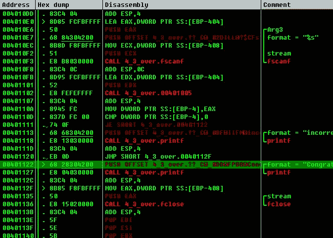
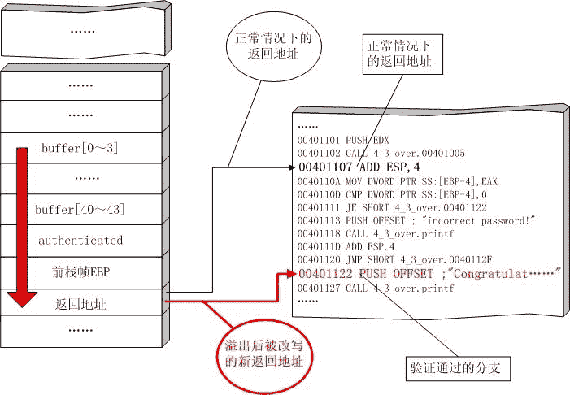
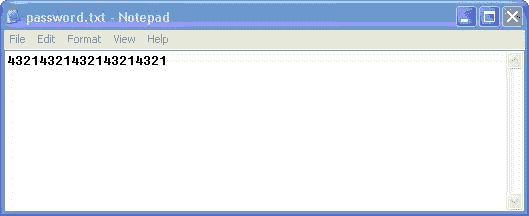
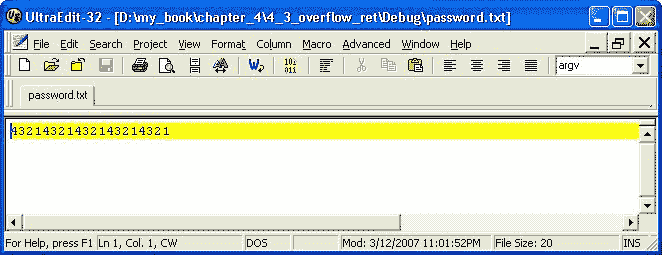
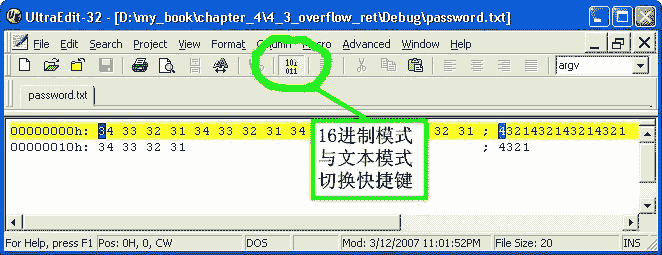
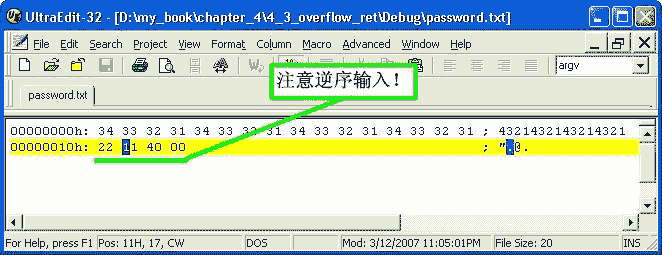
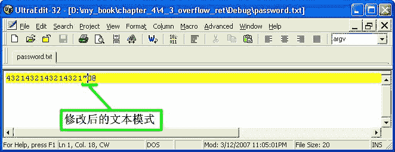
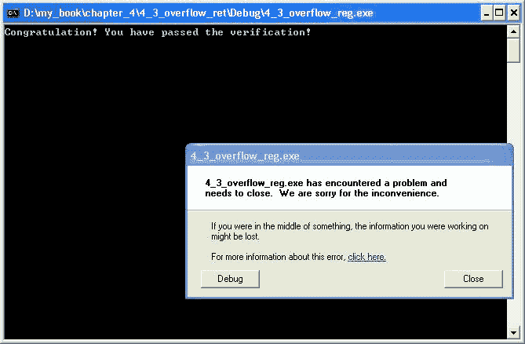

# 软件漏洞分析入门\_4\_ 初级栈溢出 C\_ 修改程序流程

> 原文：[`www.pediy.com/kssd/pediy09/pediy09-346.htm`](https://www.pediy.com/kssd/pediy09/pediy09-346.htm)

> 第 4 讲  初级栈溢出 C  
>   
> To be the apostrophe which changed “Impossible” into “I'm possible”  
> —— failwest  
>   
> 没有星星的夜里，我用知识吸引你  
>   
> 上节课没有操练滴东西，不少蠢蠢欲动的同学肯定已经坐不住了。悟空，不要猴急，下面的两堂课都是实践课，用来在实践中深入体会上节课中的知识，并且很有趣味性哦  
>   
>   
>   信息安全技术是一个对技术性要求极高的领域，除了扎实的计算机理论基础外、更重要的是优秀的动手实践能力。在我看来，不懂二进制就无从谈起安全技术。  
>   
>   
>   缓冲区溢出的概念我若干年前已经了然于胸，不就是淹个返回地址把 CPU 指到缓冲区的 shellcode 去么。然而当我开始动手实践的时候，才发现实际中的情况远远比原理复杂。  
>   
>   国内近年来对网络安全的重视程度正在逐渐增加，许多高校相继成立了“信息安全学院”或者设立“网络安全专业”。科班出身的学生往往具有扎实的理论基础，他们通晓密码学知识、知道 PKI 体系架构，但要谈到如何真刀实枪的分析病毒样本、如何拿掉 PE 上复杂的保护壳、如何在二进制文件中定位漏洞、如何对软件实施有效的攻击测试……能够做到的人并不多。  
>   
>   虽然每年有大量的网络安全技术人才从高校涌入人力市场，真正能够满足用人单位需求的却聊聊无几。捧着书本去做应急响应和风险评估是滥竽充数的作法，社会需要的是能够为客户切实解决安全风险的技术精英，而不是满腹教条的阔论者。  
>   
>   
>   我所知道的很多资深安全专家都并非科班出身，他们有的学医、有的学文、有的根本没有学历和文凭，但他们却技术精湛，充满自信。  
>   
>   这个行业属于有兴趣、够执着的人，属于为了梦想能够不懈努力的意志坚定者。如果你是这样的人，请跟着我把这个系列的所有实验全部完成，之后你会发现眼中的软件，程序，语言，计算机都与以前看到的有所不同——因为以前使用肉眼来看问题，我会教你用心和调试器以及手指来重新体验它们。  
>   
> 首先简单复习上节课的内容：  
>   
> 高级语言经过编译后，最终函数调用通过为其开辟栈帧来实现  
>   
> 开辟栈帧的动作是编译器加进去的，高级语言程序员不用在意  
>   
> 函数栈帧中首先是函数的局部变量，局部变量后面存放着函数返回地址  
>   
> 当前被调用的子函数返回时，会从它的栈帧底部取出返回地址，并跳转到那个位置（母函数中）继续执行母函数  
>   
> 我们这节课的思路是，让溢出数组的数据跃过 authenticated，一直淹没到返回地址，把这个地址从 main 函数中分支判断的地方直接改到密码验证通过的分支！  
>   
> 这样当 verify\_password 函数返回时，就会返回到错误的指令区去执行（密码验证通过的地方）  
>   
>   
> 由于用键盘输入字符的 ASCII 表示范围有限，很多值如 0x11，0x12 等符号无法直接用键盘输入，所以我们把用于实验的代码在第二讲的基础上稍加改动，将程序的输入由键盘改为从文件中读取字符串。  
>   
> #include <stdio.h>  
> #define PASSWORD "1234567"  
> int verify\_password (char \*password)  
> {  
>   int authenticated;  
>   char buffer\[8\];  
>   authenticated=strcmp(password,PASSWORD);  
>   strcpy(buffer,password);//over flowed here!    
>   return authenticated;  
> }  
> main()  
> {  
>   int valid\_flag=0;  
>   char password\[1024\];  
>   FILE \* fp;  
>   if(!(fp=fopen("password.txt","rw+")))  
>   {  
>     exit(0);  
>   }  
>   fscanf(fp,"%s",password);  
>   valid\_flag = verify\_password(password);  
>   if(valid\_flag)  
>   {  
>     printf("incorrect password!\\n");  
>   }  
>   else  
>   {  
>     printf("Congratulation! You have passed the verification!\\n");  
>   }  
>   fclose(fp);  
> }  
>   
>   程序的基本逻辑和第二讲中的代码大体相同，只是现在将从同目录下的 password.txt 文件中读取字符串而不是用键盘输入。我们可以用十六进制的编辑器把我们想写入的但不能直接键入的 ASCII 字符写进这个 password.txt 文件。  
>     
>   用 VC6.0 将上述代码编译链接。我这里使用默认编译选项，BUILD 成 debug 版本。鉴于有些同学反映自己的用的是 VS2003 和 VS2005，我好人做到底，把我 build 出来的 PE 一并在附件中双手奉上——没话说了吧！不许不学，不许学不会，不许说难，不许不做实验！呵呵。  
>   
> 要 PE 的点这里： [stack\_overflow\_ret.rar](http://bbs.pediy.com/attachment.php?attachmentid=10382&d=1197651392)  
>   
>   
>   
> 在与 PE 文件同目录下建立 password.txt 并写入测试用的密码之后，就可以用 OllyDbg 加载调试了。  
>   
> 停～～～啥是 OllyDbg，开玩笑，在这里问啥是 Ollydbg 分明是不给看雪老大的面子么！如果没有这个调试器的话，去工具版找吧，帖子附件要挂出个 OD 的话会给被人鄙视的。  
>   
>   在开始动手之前，我们先理理思路，看看要达到实验目的我们都需要做哪些工作。  
>   
>   要摸清楚栈中的状况，如函数地址距离缓冲区的偏移量，到底第几个字节能淹到返回地址等。这虽然可以通过分析代码得到，但我还是推荐从动态调试中获得这些信息。  
>   要得到程序中密码验证通过的指令地址，以便程序直接跳去这个分支执行  
>   要在 password.txt 文件的相应偏移处填上这个地址  
>   
>   这样 verify\_password 函数返回后就会直接跳转到验证通过的正确分支去执行了。  
>   
>   
>   首先用 OllyDbg 加载得到的可执行 PE 文件如图：  
>   
>    
> 图 1    
>   
>   
>   
>   阅读上图中显示的反汇编代码，可以知道通过验证的程序分支的指令地址为 0x00401122。  
>   
> 简单解释一下这段汇编与 C 语言的对应关系，其实凭着 OD 给出的注释，就算你没学过汇编语言，读懂也应该没啥问题。  
>   
> 0x00401102 处的函数调用就是 verify\_password 函数，之后在 0x0040110A 处将 EAX 中的函数返回值取出 ，在 0x0040110D 处与 0 比较，然后决定跳转到提示验证错误的分支或提示验证通过的分支。提示验证通过的分支从 0x00401122 处的参数压栈开始。  
>   
> 啥？用 OllyDbg 加载后找不到 verify\_password 函数的位置？这个嘛，我这里只说一次啊。  
>   
> OllyDbg 在默认情况下将程序中断在 PE 装载器开始处，而不是 main 函数的开始。如果您有兴趣的话可以按 F8 单步跟踪一下看看在 main 函数被运行之前，装载器都做了哪些准备工作。一般情况下 main 函数位于 GetCommandLineA 函数调用后不远处，并且有明显的特征：在调用之前有 3 次连续的压栈操作，因为系统要给 main 传入默认的 argc、argv 等参数。找到 main 函数调用后，按 F7 单步跟入就可以看到真正的代码了。  
>   
> 我相信你，你一定行的，找到了吗？什么？还找不到？好吧，按 ctr+g 后面输入截图中的地址 0x00401102，这回看到了吧。建议你按 F2 下个断点记住这个位置，别一会儿又在 PE 里边迷路了。  
>   
> 这步完成后，您应该对这个 PE 的主要代码有了一个把握了。这才牙长一点指令啊，真正的漏洞要对付的是软件，那个难缠～～～好，不泼冷水了  
>   
> 如果我们把返回地址覆盖成这个地址，那么在 0x00401102 处的函数调用返回后，程序将跳转到验证通过的分支，而不是进入 0x00401107 处分支判断代码。这个过程如下图所示：  
>   
>     
>    
> 图 2  
>   
>   
>   
>   通过动态调试，发现栈帧中的变量分布情况基本没变。这样我们就可以按照如下方法构造 password.txt 中的数据：  
>   
>   仍然出于字节对齐、容易辨认的目的，我们将“4321”作为一个输入单元。  
>   
>   buffer\[8\]共需要 2 个这样的单元  
>   第 3 个输入单元将 authenticated 覆盖  
>   第 4 个输入单元将前栈帧 EBP 值覆盖  
>   第 5 个输入单元将返回地址覆盖  
>   
>   为了把第 5 个输入单元的 ASCII 码值 0x34333231 修改成验证通过分支的指令地址 0x00401122，我们采取如下方式借助 16 进制编辑工具 UltraEdit 来完成（0x40，0x11 等 ASCII 码对应的符号很难用键盘输入）。  
>     
>   步骤 1：创建一个名为 password.txt 的文件，并用记事本打开，在其中写入 5 个“4321”后保存到与实验程序同名的目录下：  
>    
>   
> 图 3  
>   
>   
>   
> 步骤 2：保存后用 UltraEdit\_32 重新打开，如图：  
>    
>   
>   
> 图 4  
>   
>   
> 啥？问啥是 UltraEdit？去工具版找吧，多的不得了，这里是看雪！  
>   
>   
> 步骤 3：将 UltraEdit\_32 切换到 16 进制编辑模式，如图：  
>    
>   
> 图 5  
>   
> 步骤写到这个份上了，您不会还跟不上吧。  
>   
>   
>   步骤 4：将最后四个字节修改成新的返回地址，注意这里是按照“内存数据”排列的，由于“大顶机”的缘故，为了让最终的“数值数据”为 0x00401122，我们需要逆序输入这四个字节。如图：  
>    
>   
> 图 6  
>   
>   
>   
> 步骤 5：这时我们可以切换回文本模式，最后这四个字节对应的字符显示为乱码：  
>    
>   
> 图 7  
>   
>   
>   
> 最终的 password.txt 我也给你附上。  
>   
> 要 txt 的点这里：  [password.txt](http://bbs.pediy.com/attachment.php?attachmentid=10381&d=1197651364)  
>   
>   
>   
>   
>   
> 将 password.txt 保存后，用 OllyDbg 加载程序并调试，可以看到最终的栈状态如下表所示：  
>   
> 局部变量名  内存地址  偏移 3 处的值  偏移 2 处的值  偏移 1 处的值  偏移 0 处的值  
> buffer\[0~3\]  0x0012FB14  0x31 (‘1')  0x32 (‘2')  0x33 (‘3')  0x34 (‘4')  
> buffer\[4~7\]  0x0012FB18  0x31 (‘1')  0x32 (‘2')  0x33 (‘3')  0x34 (‘4')  
> authenticated  
> （被覆盖前）  0x0012FB1C  0x00  0x00  0x00  0x01  
> authenticated  
> （被覆盖后）  0x0012FB1C  0x31 (‘1')  0x32 (‘2')  0x33 (‘3')  0x34 (‘4')  
> 前栈帧 EBP  
> （被覆盖前）  0x0012FB20  0x00  0x12  0xFF  0x80  
> 前栈帧 EBP  
> （被覆盖后）  0x0012FB20  0x31 (‘1')  0x32 (‘2')  0x33 (‘3')  0x34 (‘4')  
> 返回地址  
> （被覆盖前）  0x0012FB24  0x00  0x40  0x11  0x07  
> 返回地址  
> （被覆盖后）  0x0012FB24  0x00  0x40  0x11  0x22  
>   
>   
> 程序执行状态如图：  
>   
>    
>   
>   由于栈内 EBP 等被覆盖为无效值，使得程序在退出时堆栈无法平衡，导致崩溃。虽然如此，我们已经成功的淹没了返回地址，并让处理器如我们设想的那样，在函数返回时直接跳转到了提示验证通过的分支。  
>   
>   
> 同学们，你们成功了么？  
>   
> 最后再总结一下这个实验的内容：  
> 通过 Ollydbg 调试 PE 文件确定密码验证成功的分支的指令所处的内存地址为 0x00401122  
> 通过调试确定 buffer 数组距离栈帧中函数返回地址的偏移量  
> 在 password.txt 相应的偏移处准确的写入 0x00401122，当 password.txt 被读入后会同样准确的把 verify\_password 函数的返回地址从分支判断处修改到 0x00401122（密码正确分支）  
> 函数返回时，笨笨的返回到密码正确的地方  
> 程序继续执行，但由于栈被破坏，不再平衡，故出错  
>   
> 试想一下，如果我们在 buffer\[\]中填入一些可执行的机器码，然后用溢出的数据把返回地址指向 buffer\[\]，那么函数返回后这些代码是不是就会执行了？  
>   
> 答案是肯定的，下一讲我将用类似的叙述方式，同样手把手的和您一起完成这段机器代码的编写，并把它们准确的布置在 password.txt 中，这样原本用来读取密码文件的程序读了这样一个精心构造的“黑文件”之后，就会做出一些“出格”的事情了。  
>   
> 明天见，顺便说一下，我一般会在凌晨 1 点左右发文，想坐沙发的同学注意了呦。

> 引用:
> 
> | 
> 
> * * *
> 
> *最初由 **阿南**发布* (帖子 392505) 看了这个 收获很大,早出 2 个月就更好了 当时在看 The\_Shellcoder's\_Handbook  
> 可惜里面基础部分和中级部分都是在 LINUX 上实现的 想装 LINUX 可惜硬盘容量不够...挣扎很久  
> 才放弃的.....终于有在 WINDOWS 上的 基础教程了....特地还原了机器 恢复了删除的 VC...
> 
> * * *
> 
>  |
> | --- |
> 
>   
> 1：检查你写入的正确 EBP 的字节序，大顶机需要按 DWORD 字节逆序  
> 2：检查填入字节的值，fscan 函数会对一些敏感字节值（文件 EOF）做出其他响应，如 0x00 等，前面有一层的朋友说过这个问题。这会 password.txt 中的字符串被截断。  
> 3：当然乱码了，我们是按 2 进制形式填入的机器代码，肯定很多不在 ASCII 范围内的。  
> 4：只恢复 EBP 是不够的，还有 ESP，还有要让 EIP 返回到原先的位置。最后 EAX 这些寄存器也可能会引起错误。要修复所有相关寄存器才能恢复到原先的流程上去，这虽然困难，但却是可以做到的，取决于 shellcode 的质量和你的汇编编程技巧以及对系统的了解程度～～～～其实还有 SEH 退出等方法可以用  
>   
> 这个属于比较高级的问题，会在后面的讲座中逐渐加入。我还是主张一步一个脚印的学习方式，虽然可以看到很多鸟儿已经跃跃欲试，准备振翅高飞了：） 

 4dd466d0e1e0cc123afbe504da2462ca