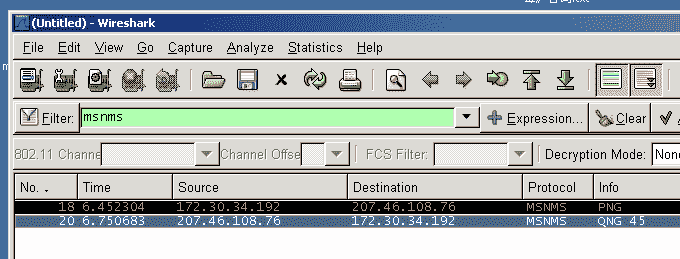
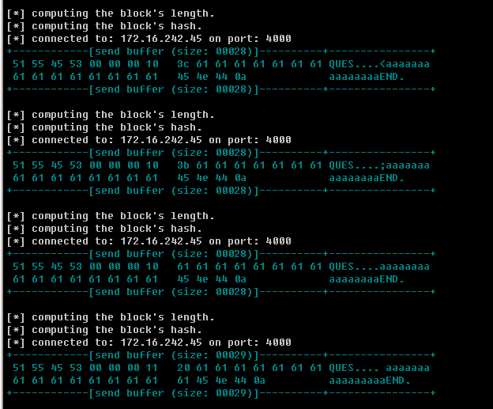
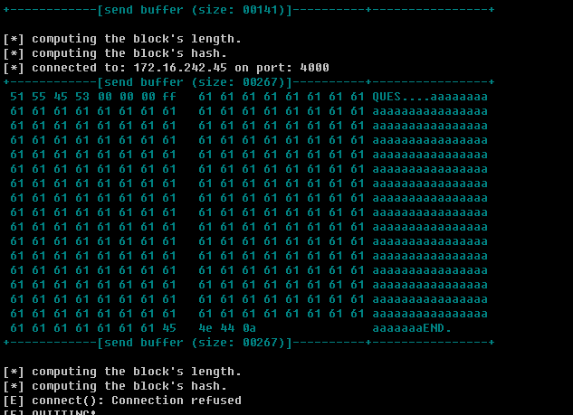

# 【看雪读书月】软件漏洞挖掘 Fuzz 工具之五-autodafe

> 原文：[`www.pediy.com/kssd/pediy10/70319.html`](https://www.pediy.com/kssd/pediy10/70319.html)

庆祝奥运，决定今天把这个整理完。。。。断断续续写了好多天了。。。。

## 安装

1. `make sure you have libxml2`
2. `make sure you have gdb`
3. `make sure you have gcc >= 3.3.4`
4. `./configure`
5. `make`
6. `make install`

安装时候可以看到 产生 fuzz 变异数据的过程-\_-

```
Fuzz:/usr/local/condor/Fuzz/autodafe-0.1 # make install
cd ./etc/generator; ./generator.sh /usr/local/etc[*] creating directory: ./autodafe[*] creating file: ./autodafe/string.fuzz[*] creating file: ./autodafe/hex.fuzz[*] processing: "a" 0%[............................ transição]100%[*] processing: "d" 0%[............................ transição]100%[*] processing: "A" 0%[............................ transição]100%[*] processing: "D" 0%[............................ transição]100%[*] processing: "%s" 0%[............................ transição]100%[*] processing: "%n" 0%[............................ transição]100%[*] processing: ">" 0%[............................ transição]100%[*] processing: "<" 0%[............................ transição]100%[*] processing: "(" 0%[............................ transição]100%[*] processing: ")" 0%[............................ transição]100%[*] processing: "/" 0%[............................ transição]100%[*] processing: "&" 0%[............................ transição]100%[*] processing: ";" 0%[............................ transição]100%[*] processing: "|" 0%[............................ transição]100%[*] processing: "\\" 0%[............................ transição]100%
```

```
make[1]: Entering directory `/data/Fuzz/autodafe-0.1/src'
make[2]: Entering directory `/data/Fuzz/autodafe-0.1/src/adbg'
cp ./adbg /usr/local/bin
make[2]: Leaving directory `/data/Fuzz/autodafe-0.1/src/adbg'
make[2]: Entering directory `/data/Fuzz/autodafe-0.1/src/adc'
cp ./adc /usr/local/bin
make[2]: Leaving directory `/data/Fuzz/autodafe-0.1/src/adc'
make[2]: Entering directory `/data/Fuzz/autodafe-0.1/src/autodafe'
cp ./autodafe /usr/local/bin
cp -r ../../etc/generator/autodafe /usr/local/etc
make[2]: Leaving directory `/data/Fuzz/autodafe-0.1/src/autodafe'
make[2]: Entering directory `/data/Fuzz/autodafe-0.1/src/pdml2ad'
cp ./pdml2ad /usr/local/bin
make[2]: Leaving directory `/data/Fuzz/autodafe-0.1/src/pdml2ad'
make[1]: Leaving directory `/data/Fuzz/autodafe-0.1/src'
```

简单介绍：特点是支持 sniffer 包 自动生成测试数据，基于 block，自动计算 block 的大小，带调试器，能自动监控 危险函数和测试用例间的情况。包括四大组件：`adbg` `adc` `autodafe` `pdml2ad`。下面开始逐个介绍：

### 第一步，Pdml2ad :转化 PDML 文件为 Autodafe 支持的脚本语言 (*.ad) 文件。

Tips: `PDML` 可以 wireshark 抓包获得到: `file->export` 选择保持的文件类型 `pdml` 。

首先，使用 wiresshark 抓包，过滤 msn 的消息，导出 pdml 格式的 msnms.pdml



```
root@SEC39_89_sles10:/usr/local/condor/fuzz/autodafe-0.1/src/pdml2ad# ./pdml2ad -d -v -p msnms.pdml msnms.ad
```

注意这里的要加个 `-p` 参数，可以解析协议格式。现在就来看看转化好的这个 msn 包的格式 autodafe 脚本的描述：

```
root@SEC39_89_sles10:/usr/local/condor/fuzz/autodafe-0.1/src/pdml2ad# cat msnms.ad
```

```
/*--------------------------------------------------------------------------*
 * xml autodafe's parser v.0.1 (c) Martin Vuagnoux - 2004-2006            *
 * auto-generated script using PDML (Packet Details Markup Language) source *
 *--------------------------------------------------------------------------*/
block_begin("packet_1");
   block_begin("packet_1.6.54.msnms");
      // name    :
      // showname: (null)
      // show    : UUN 42 smant1286@hotmail.com 3 573\r\n
      // size: 0x36 (54)
      hex(
      55 55 4e 20 34 32 20 73    6d 61 6e 74 31 32 38 36
      40 68 6f 74 6d 61 69 6c    2e 63 6f 6d 20 33 20 35
      37 33 0d 0a
      );

      // name    :
      // showname: (null)
      // show    : INVITE MSNMSGR:smant1286@hotmail.com MSNSLP/1.0\r\n
      // size: 0x49 (73)
      hex(
      49 4e 56 49 54 45 20 4d    53 4e 4d 53 47 52 3a 73
      6d 61 6e 74 31 32 38 36    40 68 6f 74 6d 61 69 6c
      2e 63 6f 6d 20 4d 53 4e    53 4c 50 2f 31 2e 30 0d
      0a
      );

      // name    :
      // showname: (null)
      // show    : To: <msnmsgr:smant1286@hotmail.com>\r\n
      // size: 0x37 (55)
      hex(
      54 6f 3a 20 3c 6d 73 6e    6d 73 67 72 3a 73 6d 61
      6e 74 31 32 38 36 40 68    6f 74 6d 61 69 6c 2e 63
      6f 6d 3e 0d 0a
      );

      // name    :
      // showname: (null)
      // show    : From: <msnmsgr:linshifei@live.cn>\r\n
      // size: 0x35 (53)
      hex(
      46 72 6f 6d 3a 20 3c 6d    73 6e 6d 73 67 72 3a 6c
      69 6e 73 68 69 66 65 69    40 6c 69 76 65 2e 63 6e
      3e 0d 0a
      );

      // name    :
      // showname: (null)
      // show    : Via: MSNSLP/1.0/TLP ;branch={F56C917C-AA07-4D3E-A2E9-FE701B079FD0}\r\n
      // size: 0x68 (104)
      hex(
      56 69 61 3a 20 4d 53 4e    53 4c 50 2f 31 2e 30 2f
      54 4c 50 20 3b 62 72 61    6e 63 68 3d 7b 46 35 36
      43 39 31 37 43 2d 41 41    30 37 2d 34 44 33 45 2d
      41 32 45 39 2d 46 45 37    30 31 42 30 37 39 46 44
      30 7d 0d 0a
      );

      // name    :
      // showname: (null)
      // show    : CSeq: 0  \r\n
      // size: 0x10 (16)
      hex(
      43 53 65 71 3a 20 30 20    0d 0a
      );

      // name    :
      // showname: (null)
      // show    : Call-ID: {F13B5C79-0126-458F-A29D-747C79C56530}\r\n
      // size: 0x49 (73)
      hex(
      43 61 6c 6c 2d 49 44 3a    20 7b 46 31 33 42 35 43
      37 39 2d 30 31 32 36 2d    34 35 38 46 2d 41 32 39
      44 2d 37 34 37 43 37 39    43 35 36 35 33 30 7d 0d
      0a
      );

      // name    :
      // showname: (null)
      // show    : Max-Forwards: 0\r\n
      // size: 0x17 (23)
      hex(
      4d 61 78 2d 46 6f 72 77    61 72 64 73 3a 20 30 0d
      0a
      );

      // name    :
      // showname: (null)
      // show    : Content-Type: application/x-msnmsgr-transreqbody\r\n
      // size: 0x50 (80)
      hex(
      43 6f 6e 74 65 6e 74 2d    54 79 70 65 3a 20 61 70
      70 6c 69 63 61 74 69 6f    6e 2f 78 2d 6d 73 6e 6d
      73 67 72 2d 74 72 61 6e    73 72 65 71 62 6f 64 79
      0d 0a
      );

      // name    :
      // showname: (null)
      // show    : Content-Length: 236\r\n
      // size: 0x21 (33)
      hex(
      43 6f 6e 74 65 6e 74 2d    4c 65 6e 67 74 68 3a 20
      32 33 36 0d 0a
      );

      // name    :
      // showname: (null)
      // show    : \r\n
      // size: 0x2 (2)
      hex(
      0d 0a
      );

      // name    :
      // showname: (null)
      // show    : Bridges: TRUDPv1 TCPv1 SBBridge TURNv1\r\n
      // size: 0x40 (64)
      hex(
      42 72 69 64 67 65 73 3a    20 54 52 55 44 50 76 31
      20 54 43 50 76 31 20 53    42 42 72 69 64 67 65 20
      54 55 52 4e 76 31 0d 0a
      );

      // name    :
      // showname: (null)
      // show    : NetID: 0\r\n
      // size: 0x10 (16)
      hex(
      4e 65 74 49 44 3a 20 30    0d 0a
      );

      // name    :
      // showname: (null)
      // show    : Conn-Type: Firewall\r\n
      // size: 0x21 (33)
      hex(
      43 6f 6e 6e 2d 54 79 70    65 3a 20 46 69 72 65 77
      61 6c 6c 0d 0a
      );

      // name    :
      // showname: (null)
      // show    : TCP-Conn-Type: Firewall\r\n
      // size: 0x25 (37)
      hex(
      54 43 50 2d 43 6f 6e 6e    2d 54 79 70 65 3a 20 46
      69 72 65 77 61 6c 6c 0d    0a
      );
```


// name :  
// showname: (null)  
// show : UPnPNat: false\r\n  
// size: 0x16 (22)  
```
hex(
55 50 6e 50 4e 61 74 3a    20 66 61 6c 73 65 0d 0a  
);
```
// name :  
// showname: (null)  
// show : ICF: false\r\n  
// size: 0x12 (18)  
```
hex(
49 43 46 3a 20 66 61 6c    73 65 0d 0a  
);
```
// name :  
// showname: (null)  
// show : Hashed-Nonce: {F1F21DDF-8B9B-2D34-3784-F628AD58F40E}\r\n  
// size: 0x54 (84)  
```
hex(
48 61 73 68 65 64 2d 4e    6f 6e 63 65 3a 20 7b 46  
31 46 32 31 44 44 46 2d    38 42 39 42 2d 32 44 33  
34 2d 33 37 38 34 2d 46    36 32 38 41 44 35 38 46  
34 30 45 7d 0d 0a  
);
```
// name :  
// showname: (null)  
// show : SessionID: 0\r\n  
// size: 0x14 (20)  
```
hex(
53 65 73 73 69 6f 6e 49    44 3a 20 30 0d 0a  
);
```
// name :  
// showname: (null)  
// show : SChannelState: 0\r\n  
// size: 0x18 (24)  
```
hex(
53 43 68 61 6e 6e 65 6c    53 74 61 74 65 3a 20 30  
0d 0a  
);
```
// name :  
// showname: (null)  
// show : Capabilities-Flags: 1\r\n  
// size: 0x23 (35)  
```
hex(
43 61 70 61 62 69 6c 69    74 69 65 73 2d 46 6c 61  
67 73 3a 20 31 0d 0a  
);
```
// name :  
// showname: (null)  
// show : \r\n  
// size: 0x2 (2)  
```
hex(
0d 0a  
);
```
block_end("packet_1.6.54.msnms");
```
block_end("packet_1");
```
send("packet_1");  /* tcp */

以上演示了如果通过抓包，得到 `.ad` 脚本的例子。

Wiresshark 自动识别很多软件的协议，所以你可以通过抓包自动生成 autodafe 需要的 fuzz 的协议格式，即 `.ad` 脚本。

当然你也可以对这个描述协议的脚本进行修改，还可以不通过抓包，自己写协议脚本文件。

### 语法说明

#### 定义一个字符串
```
string("hello world"); /* just an ASCII string limited to 255 characters */
```

#### 定义十六进制
```
hex(fa);   /* hexadecimal value with three possible notations */
```
```
hex(\xfa); /* fa == \xfa == 0xfa */
```
```
hex(0xfa); /* you can write up to 4GBytes of hex values */
```

#### 定义块
```
block_begin("my block"); /* start a block */
```
```
block_end("my block");   /* close a block */
```
```
block_size_b32("my block"); /* 32-bit big endian size of the block "my block" */
```
```
block_crc32_b("my blcok");  /* 32-bit big endian crc32 of the block "my block" */
```

#### 发送包
```
send("my block"); /* send the block "my block" */
```

#### 定义 fuzz 变量
``` 
/* when you want to fuzz a string, you replace the "string" with "fuzz_string"  
   * then, Autodaf?will know which string you want to fuzz */
```
```
fuzz_string("hello world");
```
``` 
/* you can do the same thing with hexadecimal values */
```
```
fuzz_hex(0x00 00 \x00 ff);
```

### 示例

协议的格式：


# cat vuln2.c 见文章后面。

用脚本文件描述：
```
#> cat ./vuln2.ad
```
```
block_begin("packet_1");/* 定义块 */
```
```
string("QUES");/* 协议头标识 以这个字符串开头 */
```
```
block_size_b32("string_1"); /* big endian 32 bits size  表示下个 block 的大小 动态计算的值*/
```
```
block_begin("string_1");/*  */
```
```
fuzz_string("AAA");/* fuzz 变量 这个变量会变异 */
```
```
block_end("string_1");/*  */
```
```
string("END"); /* \n  协议的结尾标识 */
```
```
hex(0a); /* \n */
```
```
block_end("packet_1");
```
```
send("packet_1");  /* tcp */
```

#### 第二步：ADC: 将协议脚本文件 (*.ad) 转化成 binary file (*.adc)
演示： `/usr/local/condor/autodafe-0.1/src/adc/adc ./vuln2.ad`
```
[!] block: "string_1" size: 3 (0x3)
[!] block: "packet_1" size: 15 (0xf)
```

#### 第三步：使用 ADBG
使用 gdb 跟踪 fuzz 过程中的危险函数的调用,来决定各个 fuzz 变量（`fuzz_string` or `fuzz_hex`）变异的权值。我的理解就是编译是否有效，该如何继续如何变异。

启动我们 fuzz 的对象 vuln2，也就是使用也是协议的应用程序
```
Fuzz:/usr/local/condor/Fuzz/autodafe-0.1/docs/tutorials/dummy # ./vuln2 4000
[*] wait for a connection on port: 4000
```

启动成功。Ps 看下 id
```
Fuzz:/data/Fuzz/autodafe-0.1/src/adbg # ps -wef
```
```
UID        PID  PPID  C STIME TTY          TIME CMD
root     25479 24953  0 13:39 pts/0    00:00:00 ./vuln2 4000
root     25545 25009  0 13:44 pts/1    00:00:00 ps -wef
```
id 是 `25479`，下面会用到。

启动 adbg：
```
： /usr/local/condor/autodafe-0.1/src/adbg/adbg -vv -p 25479 ./vuln2 4000
```
```
Fuzz:/data/Fuzz/autodafe-0.1/src/adbg # ./adbg -vv p8000 ../../docs/tutorials/dummy/vuln2 4000
[*]-+-> breakpoint on: "strcpy"
    +-> id  : 2
    +-> addr: 0x7fffffff
    +-> esp : 0x08
    +-> type: 0x01
[*]-+-> breakpoint on: "strcat"
    +-> id  : 3
    +-> addr: 0x7fffffff
    +-> esp : 0x08
    +-> type: 0x01
[*]-+-> breakpoint on: "gets"
    +-> id  : 4
    +-> addr: 0x7fffffff
    +-> esp : 0x04
    +-> type: 0x01
[*]-+-> breakpoint on: "sprintf"
    +-> id  : 5
    +-> addr: 0x7fffffff
    +-> esp : 0x08
    +-> type: 0x01
[*]-+-> breakpoint on: "getenv"
    +-> id  : 6
    +-> addr: 0x7fffffff
    +-> esp : 0x04
    +-> type: 0x01
[*]-+-> breakpoint on: "stpcpy"
    +-> id  : 7
    +-> addr: 0x7fffffff
    +-> esp : 0x08
    +-> type: 0x01
[*]-+-> breakpoint on: "printf"
    +-> id  : 8
    +-> addr: 0x7fffffff
    +-> esp : 0x04
    +-> type: 0x01
[*]-+-> breakpoint on: "syslog"
    +-> id  : 9
    +-> addr: 0x7fffffff
    +-> esp : 0x04
    +-> type: 0x01
[*] waiting for a connection on port: 25479
```
清楚看到，在几个危险函数地方设置断点。

一切都准备好了，该是开始 fuzzing 时候了

AUTODAFE :fuzz 的核心引擎，解析 `.adc` 文件，生成 fuzz 数据，发包。

演示： `/usr/local/condor/autodafe-0.1/src/autodafe/autodafe  -b -vv -p 4000 -r localhost -P 8000 -D localhost ./vuln2.adc`
```
[*] Autodafe's debugger mode activated.
[*] mode *client* - connection to localhost on port: 4000 (tcp)
[*] parsing file: "./vuln2.adc"
[*] debugger connected: localhost on port 305
[!] source: "/usr/local/etc/autodafe/string/string-1-x3"        (3 bytes)
[!] source: "/usr/local/etc/autodafe/string/string-1-sp-x3"     (4 bytes)
[!] source: "/usr/local/etc/autodafe/string/string-1-x4"        (4 bytes)
[!] source: "/usr/local/etc/autodafe/string/string-1-sp-x4"     (5 bytes)
[!] source: "/usr/local/etc/autodafe/string/string-1-x15"       (15 bytes)
[!] source: "/usr/local/etc/autodafe/string/string-1-sp-x15"    (16 bytes)
[!] source: "/usr/local/etc/autodafe/string/string-1-x16"       (16 bytes)
...
[*] computing the block's length.
[1] waiting 1 seconds before opening connection...
[*] connected to: localhost on port: 4000
[*] computing the block's length.
[*] computing the block's hash.
[*] connected to: 172.16.242.45 on port: 4000
+------------[send buffer (size: 00017)]----------+----------------+
 51 55 45 53 00 00 00 05   3c 61 61 61 61 45 4e 44  QUES....<aaaaEND
 0a                                                .              
+------------[send buffer (size: 00017)]----------+----------------+
[*] computing the block's length.
[*] computing the block's hash.
[*] connected to: 172.16.242.45 on port: 4000
+------------[send buffer (size: 00017)]----------+----------------+
 51 55 45 53 00 00 00 05   3b 61 61 61 61 45 4e 44  QUES....;aaaaEND
 0a                                                .              
+------------[send buffer (size: 00017)]----------+----------------+
[*] computing the block's length.
[*] computing the block's hash.
[*] connected to: 172.16.242.45 on port: 4000
+------------[send buffer (size: 00027)]----------+----------------+
 51 55 45 53 00 00 00 0f   61 61 61 61 61 61 61 61  QUES....aaaaaaaa
 61 61 61 61 61 61 61 45   4e 44 0a                aaaaaaaEND.     
+------------[send buffer (size: 00027)]----------+----------------+
[*] computing the block's length.
[*] computing the block's hash.
[*] connected to: 172.16.242.45 on port: 4000


+------------\[send buffer (size: 00028)\]----------+----------------+  

 51 55 45 53 00 00 00 10   20 61 61 61 61 61 61 61 QUES.... aaaaaaa  

 61 61 61 61 61 61 61 61   45 4e 44 0a             aaaaaaaaEND.      

+------------\[send buffer (size: 00028)\]----------+----------------+  

可以看到说 fuzz 不断在增加 `fuzz` 变量的大小。



终于期望的事情发生了：



\[\*\] computing the block's length.  
\[\*\] computing the block's hash.  
\[\*\] connected to: 172.16.242.45 on port: 4000

```
+------------[send buffer (size: 00267)]----------+----------------+
51 55 45 53 00 00 00 ff   61 61 61 61 61 61 61 61 QUES....aaaaaaaa
...
```

\[\*\] computing the block's length.\[\*\] computing the block's hash.

\[E\] connect(): Connection refused  
\[E\] QUITTING!

看到 `adbg` 输出:

\[\*\] connection from: 127.0.0.1\[\*\] fuzzer authenticated and connected. (v.0.1)  
\[+\]-+-> add monitored string: "aaa" //会监控危险函数的变量是否包含 fuzz 的数字？？？  
    +-> id: 0\[\*\] targeted software running... (analysis in progress)\[\*\]-+-> breakpoint on: "getenv"  
    +-> check the string: "LANGUAGE"\[\*\]-+-> breakpoint on: "stpcpy"  
    +-> check the string: "LC\_MESSAGES"  

……..  

   \[\*\*\*\] SEGMENTATION FAULT!  
   \[\*\*\*\] EIP: 0x61616161  

应用程序 `vuln2` 输出\[\*\] wait for a connection on port: 4000\[\*\] connection from: 172.16.242.45  
SIZE:129  
OK\[\*\] wait for a connection on port: 4000\[\*\] connection from: 172.16.242.45  
SIZE:129  
OK\[\*\] wait for a connection on port: 4000\[\*\] connection from: 172.16.242.45  
SIZE:255  
CONNECTION CLOSED BY FOREIGN HOST  
ERROR:BAD\_ENDER  
Segmentation fault

恩，我想你已经找到你想要得东西了-\_-  

好了，一年前写的读书笔记，今天又整理实践了下，好乱，不过总算完了。

为了不耽搁 8 月 8 日 8 点这个重要时间，就先到这里了。Go home！！

### 补充，各命令选项含义如下：

`./autodafe-v.0.1` - This is the Autodafe Fuzzer Engine

`./autodafe-v.0.1` (c) 2004-2006 Martin Vuagnoux <autodafe@vuagnoux.com>

Usage: `./autodafe [OPTION...] <file.adc>`

  List of the basic functions:

    `-h`, `--help`          display this help and exit.  
    `-V`, `--version`       output version information and exit.  
    `-v`, `--verbose`       verbose output. Use twice for more verbose.  
    `-d`  `--debug`         print debug info. Use 2x or 3x for more debug info.

  List of the autodafe's functions:

    `-t`  `--timeout=SEC`   if no response, wait SEC seconds before go on.  
    `-u`  `--udp`           use an udp connection - default is tcp.  
    `-f`  `--file=DIR`      create multiple fuzzed files in directory DIR.  
    `-r`  `--remote=HOST`   mode \*client\*: HOST = hostname/ip address.  
    `-p`  `--port=PORT`     mode \*client\*: PORT = port to connect to.  
                        mode \*server\*: PORT = listening port \[-r not defined\].  
    `-D`  `--with-dbg=HOST` debugger: HOST = hostname/ip of the debugger.  
    `-P`  `--dbg-port=PORT` debugger: PORT = listening port of the debugger.

  List of the internal's autodafe's functions:

    `-b`  `--bruteforce`    fuzz every fields.  
    `-i`  `--invert`        send() becomes recv() and recv() becomes send().  
    `-w`  `--wait=SEC`      wait SEC seconds before opening connection.

`<file.adc>` is a type of file used by the fuzzer.

The standard output gives the results of the fuzzing.

Fuzz:/data/Fuzz/autodafe-0.1/src/adbg # `./adbg`

`./adbg-v.0.1` - debugger which listen the targeted software.

`./adbg-v.0.1` - (c) 2004-2006 Martin Vuagnoux <autodafe@vuagnoux.com>

Usage: `./adbg [OPTION...] [<program>] ["<args>"]`

  List of the basic functions:

    `-h`, `--help`             display this help and exit.  
    `-V`, `--version`          output version information and exit.  
    `-v`, `--verbose`          verbose output (use twice for more verbose info).  
    `-d`  `--debug`            debug output (use 2x or 3x for more debug info).

  List of the internal's debugger' s functions:

    `-G`  `--gdb-dump=FILE`    copy the gdb's output in a file.  
    `-s`  `--string-dump=FILE` copy the vulnerables strings in a file.

  List of the debugger's functions:

    `-p`  `--port=NUM`         The listening TCP port of the debugger.  
    `-P`  `--pid=NUM`          the pid of the program you want to debug.  
    `-i`  `--input=FILE`       file which contains the strings used to break.

The standard output give the informations.

### # cat vuln2.c

```c
#include <string.h>
#include <strings.h>
#include <stdio.h>
#include <stdlib.h>
#include <netinet/in.h>
#include <sys/types.h>
#include <sys/socket.h>
#include <arpa/inet.h>
#include <stdlib.h>
#include <unistd.h>
#define QUES "QUES"
#define END "END\n"
void read_(int fd, void *buf, size_t count) {
  if (read(fd, buf, count) <= 0) {
    fprintf(stdout, "CONNECTION CLOSED BY FOREIGN HOST\n");
  }
}
void function(int socket) {
  char string[128];
  char buffer4[4];
  unsigned int size;
  /* init */
  bzero(buffer4, 4);
  bzero(string, 128);
  /* read buffer4 */
  read_(socket, buffer4, 4);
  /* check header */
  if (strncmp(buffer4, QUES, strlen(QUES)) != 0) {
    fprintf(stdout, "ERROR:BAD_HEADER\n");
    return;
  }
  /* check size */
  size = 0;
  read_(socket, &size, 4);
  size = ntohl(size);
  fprintf(stdout, "SIZE:%d\n", size);
  /* read string */
  read_(socket, string, size);
  /* read end */
  bzero(buffer4, 4);
  read_(socket, buffer4, 4);
  /* check header */
  if (strncmp(buffer4, END, strlen(END)) != 0) {
    fprintf(stdout, "ERROR:BAD_ENDER\n");
    return;
  }
  fprintf(stdout, "OK\n");
}
int main(int argc, char **argv) {
  unsigned int port;
  struct sockaddr_in server;
  struct sockaddr_in client;
  int serv_sock;
  int sock;
  unsigned int len;
  int yes = 1;
  if (argc != 2) {
    printf("%s <listening_port>\n", argv[0]);
    exit(-1);
  }
  /* port */
  port = atoi(argv[1]);
  /* init */
  bzero((char *) &server, sizeof(server));
  server.sin_family = AF_INET;
  server.sin_port = htons((unsigned short)port);
  server.sin_addr.s_addr=inet_addr("172.16.242.45");
  /* socket */
  serv_sock = socket(PF_INET, SOCK_STREAM, 0);
  if (serv_sock < 0) {
    perror("socket(): ");
    exit(-1);
  }
  if (setsockopt(serv_sock, SOL_SOCKET, SO_REUSEADDR, (char *)&yes, sizeof(yes)) < 0) {
    perror("setsockopt(): ");
    exit(-1);
  }
  /* bind */
  if ((bind(serv_sock, (struct sockaddr *)&server, sizeof(server))) < 0) {
    perror("bind(): ");
    exit(-1);
  }
  /* listen */
  if ((listen(serv_sock, 1)) < 0) {
    perror("listen(): ");
    exit(-1);
  }
```


```
  while(1) {
    /* wait for connection */
    printf("[*] wait for a connection on port: %d\\n", port);
    len = sizeof(client);
    sock = accept(serv_sock, (struct sockaddr *)&client, &len);
    /* connection */
    printf("[*] connection from: %s\\n", inet_ntoa(client.sin_addr));
    /* parse the data */
    function(sock);
  }
  /* shutdown connection */
  shutdown(sock, SHUT_RDWR);
  close(sock);
  return 0;
}
```
