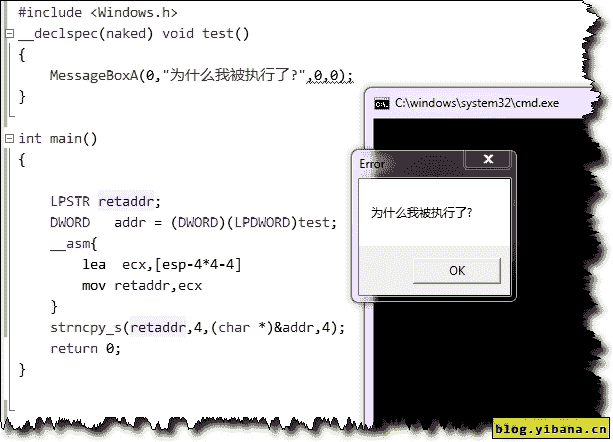
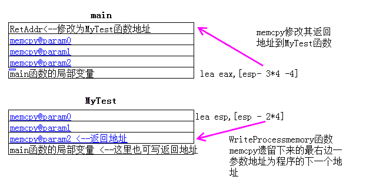

# 利用传值 API 修改返回地址到指定代码处执行

> 原文：[`www.pediy.com/kssd/pediy12/136174.html`](https://www.pediy.com/kssd/pediy12/136174.html)

刚在看一个拥有传值的 API 时(什么是传值?就是 API 参数有\_\_out 属性的),想到这么一个猥琐的方法,也真的实现了,觉得蛮新奇蛮好玩的,分享给大家,代码如下:  

代码:

```
.386
.model flat, stdcall
option casemap :none

;>>>>>>>>>>>>>>>>>>>>>>>>>>>>>>>>>>>>>>>>>>>>>>>>>>>>>>>>>>>>>>>>>>>>
; Include 文件定义
;>>>>>>>>>>>>>>>>>>>>>>>>>>>>>>>>>>>>>>>>>>>>>>>>>>>>>>>>>>>>>>>>>>>>
include        windows.inc
include        user32.inc
includelib    user32.lib
include        kernel32.inc
includelib    kernel32.lib
.data
fmt    db "%s",0
msgtxt db "我怎么被执行了?",0
.code
New\_OEP:
invoke MessageBox,0,addr msgtxt,0,0
invoke ExitProcess,0
start proc
local @temp
mov    @temp,New\_OEP
lea    ecx,\[esp-3\*4-4\]
invoke wsprintf,ecx,addr fmt,addr @temp

start endp
end start

```

**当你执行 wsprintf 之后**,代码并没有去执行下一条语句,而是去执行了上面的信息框,嘿嘿~~这里我用 wsprintf 是因为它的返回值比较容易控制,但必须要注意的是,因为 wsprintf 输出的是字符串,所以它输出的最后一个值必定是 00,所以你需要一个地址是 00 结尾的新返回地址,当然你也可以自己找个容易控制的傀儡 API,哈哈,,就到这了....如果你感兴趣,马上找到一个属于自己的傀儡 API,把代码 Show 上来~~~大家分享分享!!  
**  
PS(以下内容均为之后添加):中间有个小错误,就是 mov  @temp,New\_OEP 新地址被存放里,因为数值是倒过来存放的,所以例子中的 00401000 在内存中是 00 10 40 00 存放的,首字节变成了 0,wsprintf 只会覆盖一个 0 到返回地址,正确的方式应该是在"New\_OEP:"前面加上一句 nop,使最地位地址不为 0!**  
  
**注意,请不要把这个代码当成是溢出利用,完全是两回事!!**  
  
C++版:  
代码:

```
#include <Windows.h>
\_\_declspec(naked) void test()
{
    MessageBoxA(0,"为什么我被执行了?",0,0);
}

int main()
{

    LPSTR outb;
    DWORD    addr = (DWORD)(LPDWORD)test;
    \_\_asm{
        lea  ecx,\[esp-3\*4-4\]
        mov    outb,ecx
    }
    wsprintfA(outb,"%s",&addr);
    return 0;
}

```

如果你还是认为这是溢出代码,请看这个:  
代码:

```
#include <Windows.h>
\_\_declspec(naked) void test()
{
    MessageBoxA(0,"为什么我被执行了?",0,0);
}

int main()
{

    LPSTR retaddr;
    DWORD    addr = (DWORD)(LPDWORD)test;
    \_\_asm{
        lea  ecx,\[esp-4\*4-4\]
        mov    retaddr,ecx
    }
    strncpy\_s(retaddr,4,(char \*)&addr,4);//这个不会溢出了吧~
    return 0;
}

```



上传的附件
|  || 傀儡 API.zip  
 |

代码:

```

.code
New\_OEP:
invoke MessageBox,0,addr msgtxt,0,0
jmp \_Retn-3
start proc
local @temp
mov  @temp,New\_OEP
lea  ecx,\[esp-3\*4-4\]
invoke wsprintf,ecx,addr fmt,addr @temp
\_Retn::
ret
start endp

```

如果你改这样,wsprintf 执行能返回,这样,调试都根本想不到中间执行了什么,不过我因为我中间执行的是一个信息框,所以才会被你发现~

上传的附件
|  || API 傀儡 2.zip  
 |

返回地址补充下，不过感觉怪怪的。  

代码:

```

DWORD g\_dwRetEip = 0;

\_\_declspec(naked) void \_\_stdcall MyTest(int a, int b, int c = 3\*4)
{
    DWORD dwWrite;
    printf("This is my test！\\r\\n");
    \_asm
    {
        lea eax, \[esp + 2\*4 \]   //地址具体见图
        mov dwWrite, eax
    }
    WriteProcessMemory(GetCurrentProcess(), (DWORD\*)dwWrite, &g\_dwRetEip, sizeof(DWORD), &dwWrite);    
    \_asm
    {
        lea esp, \[esp + 2\*4\]   //地址具体见图
        ret                 
    }
}

int \_tmain(int argc, \_TCHAR\* argv\[\])
{   
    \_asm
    {
        call HOUHOU
HOUHOU:
        pop eax
        sub eax, HOUHOU
        add eax, RET\_HERE
        mov g\_dwRetEip, eax
    }
    DWORD dwAddr = (DWORD)(LPDWORD)MyTest;
    LPDWORD myRet = NULL;
    \_asm
    {
        xor eax, eax
        lea eax, \[esp - 3\*4 - 4\]   //地址具体见图
        mov myRet, eax
    }
    memcpy(myRet, &dwAddr, sizeof(DWORD));

RET\_HERE:    
    printf("just test！\\r\\n");

```



我也来贴一个类似的...  
  

引用: #pragma optimize("", off)  
  
DWORD  g\_dwRetEip = 0;  
\_\_declspec(naked) void MyTest()  
{  
  printf("This is %s\\n", \_\_FUNCTION\_\_);  
  \_\_asm  
  {  
    jmp    g\_dwRetEip  
  }  
}  
  
void Test(DWORD dwV)  //  必须存在一个以上参数用来获取返回地址  
{  
  PDWORD pdwEsp = &dwV;  
  g\_dwRetEip = \*(pdwEsp - 1);  
  \*(pdwEsp - 1) = (DWORD)MyTest;  
}  
  
#pragma optimize("", on)  
  
int \_tmain(int argc, \_TCHAR\* argv\[\])  
{  
  Test(0);  
  return 0;  
}