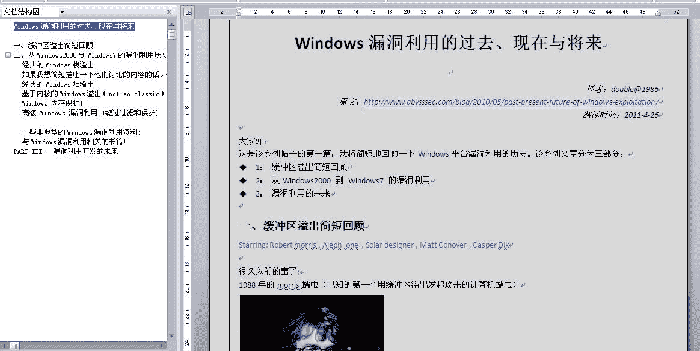

# Past, Present, Future of Windows Exploitation

> 原文：[`www.pediy.com/kssd/pediy12/132969.html`](https://www.pediy.com/kssd/pediy12/132969.html)

前两天看到这篇帖子，其中列举了不少 Windows 平台漏洞利用的相关资料，包括栈、堆和内核的溢出利用研究，特别适合于了解了 Windows 平台缓冲区溢出基础知识的人员进一步提高自己对 Windows 下漏洞的研究与利用水平。文章中同时提供了不少此领域名人的靓照...  
大概翻译了一下，做成 Word 文档方便保存。  
  
我在论坛搜索得到下面三个相关链接：  
[`bbs.pediy.com/showthread.php?t=118911`](http://bbs.pediy.com/showthread.php?t=118911)  
[`bbs.pediy.com/showthread.php?t=112724`](http://bbs.pediy.com/showthread.php?t=112724)  
[`bbs.pediy.com/showthread.php?t=127803`](http://bbs.pediy.com/showthread.php?t=127803)  
嘿...看来我确实来得有点晚了。  
  
原帖链接：[`www.abysssec.com/blog/2010/05...-exploitation/`](http://www.abysssec.com/blog/2010/05/past-present-future-of-windows-exploitation/)  
  
预览：  

上传的附件
|  || Past\_Present\_Future\_Of\_Windows\_Exploition.rar  
 |