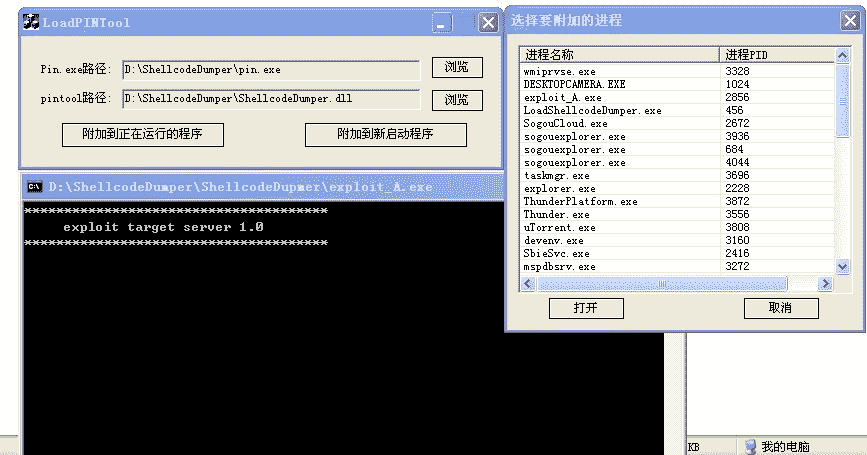
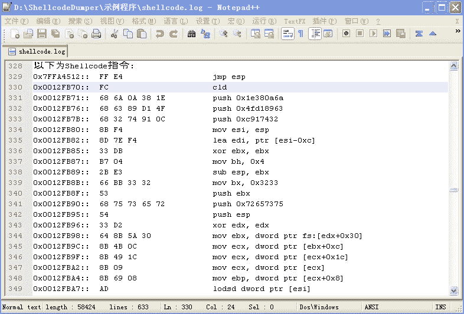

# POC 分析助手-ShellcodeDumper

> 原文：[`www.pediy.com/kssd/pediy12/131265.html`](https://www.pediy.com/kssd/pediy12/131265.html)

用于提取 POC 中的 shellcode 部分，并以反汇编代码显示(包含符号信息)  
用法:  
1。选择正确 pin.exe 和 ShellcodeDumper.dll 的正确路径  
2。点击“附加到正在运行的程序”，从进程列表选择要分析的有漏洞的程序进行附加  或者点击“附加到新启动程序”来创建并附加一个新进程  
3。使用 POC 对目标程序进行攻击，在同目录下会生成一个 shellcode.log 文件 里面包含提取出来的 shellcode 的相关信息  
  
本工具可以成功提取远程缓冲区溢出漏洞或者文档类型溢出漏洞 POC 中的 shellcode  
Windows XP sp3 测试通过  
ShellcodeDumper 下载地址：http://u.115.com/file/ajtvoyaq#

上传的附件
|  || ShellcodeDumper.rar  
 |

截图:  
..............................................................  
  
  
