# FC 游戏 炸弹人续关码逆向 编码部分

> 原文：[`www.pediy.com/kssd/pediy12/131806.html`](https://www.pediy.com/kssd/pediy12/131806.html)

4 年前做的，现在有空整理一下发出来混个邀请码….  
  
    FC 游戏-炸弹人 1 代，相信很多 80 后都玩过吧,我小时候挺喜欢玩的，游戏玩的不怎么样，但是对那个续关码很感兴趣，曾经记了 20 多页纸试图找出其中的规律，只知道最后一位是校验位 -\_-!  
    要想知道续关码的算法，首先要知道它的处理器，一搜才知道，原来 NES 用的是 6502，这可是一款经典的 CPU，Apple 一代和二代都是用的它，还有国产的文曲星…说到文曲星，当年(2003 年)表哥送我一台文曲星(具体什么型号忘了)，我上网查到可以用数据线升级 BASIC 功能，就满泰安城找数据线去了，把跟我去的同学都逛烦了，最后也没有找到，不然也许能早入门个几年……:）  
  
用到的资源:  
**炸弹人 ROM 文件**     Bomber Man (J).nes  [`www.romnation.net/srv/roms/28...mberman-J.html`](http://www.romnation.net/srv/roms/28411/nes/Bomberman-J.html)  
  
**6502 指令集**                  [`www.laogu.com/laogubbs/shared...p?id=270&srv=1`](http://www.laogu.com/laogubbs/sharedown.asp?id=270&srv=1)  
**FCEU0.98.12.win **      (带 Debug 功能的 NES 模拟器)[`mmm.onegreen.net/soft10/FCEU0.98.12.win.rar`](http://mmm.onegreen.net/soft10/FCEU0.98.12.win.rar)  
**NESpackage **         (Ida 载入 nes 格式的插件)  [`bbs.pediy.com/showthread.php?t=125458`](http://bbs.pediy.com/showthread.php?t=125458)  
  
      首先，我们把 NESpackage\\nesdbg\\bin\\nes\_stub.plw copy 到 ida 的 \\loaders 文件夹里面，这样 Ida 才能识别 NES 格式的文件,用 Ida 载入 Bomber Man (J).nes  
      我们可以看到 ida 已经识别出代码段和数据段了，下面要做的就是定位代码，  
      要定位代码，就要知道数据的存储地址，懒得去自己调试,最快的方法还是站在巨人的肩膀上…从网上搜了个炸弹人的金手指  
  

代码:

```
; 炸弹人 1 代金手指
#1 0068-01-09    生命无限
#1 0073-02-09C0    最强的雷
#1 0075-01-01    速度加快
#1 0076-04-01010101  免疫功能
#1 007D-02-0101    其他功能
#1 007A-01-01    无敌
#1 0058-01-4A    最终关

```

  
要注意的是续关码只保存了一部分数据（例如,不保存剩余生命数）,我知道 0x75（加速鞋子）是保存在续关码里面的  
用 FCEU 载入游戏,玩到最后一条命的时候，打开调试窗口  
  
  
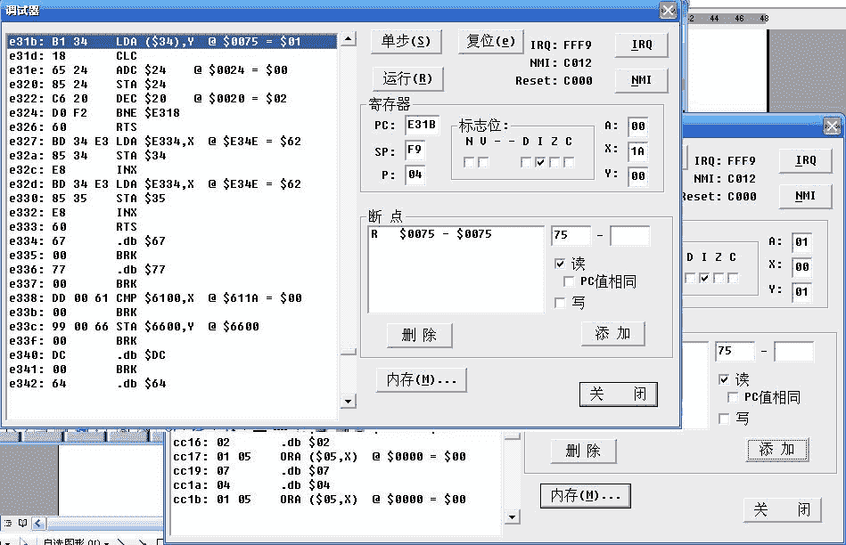  
\-------------------------------------------------------------------------------------------------  
当主角死了但是还没有出现续关码的屏幕前，切换到调试窗口，点击单步，先让游戏暂停下来，在 0x75 设内存读取断点，然后点击运行  
  
  
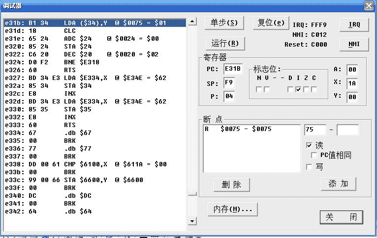  
\-------------------------------------------------------------------------------------------------  
可以看到，程序中断在 e31b  
切换到 ida ，看看 e31b 在干什么？  
  
  
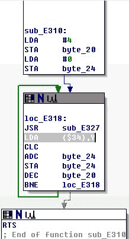  
\-------------------------------------------------------------------------------------------------  
E31b 处的指令是   LDA     ($34),Y  
查询 6502 指令集   
  
  
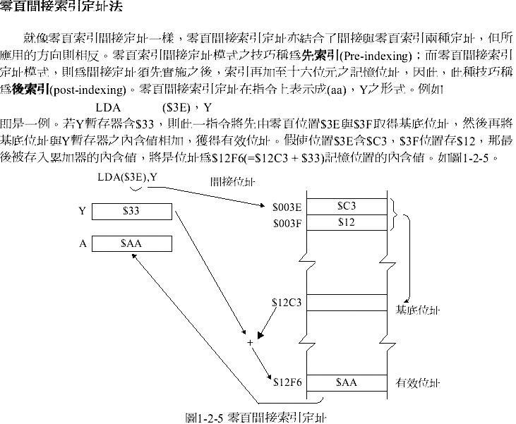  
\-------------------------------------------------------------------------------------------------  
 得知，这种寻址方式属于零页间接索引地址，内存 34 和 35 处放置着一个 16 位地址，把这个地址再加上 Y 寄存器的值作为有效地址，再把有效地址指向的数据送到 A 寄存器中  
我们看前面那条指令  
JSR     sub\_E327  
Jsr 是 6502 的 call 指令，我第一眼以为是像 jmp 一样不回来了呢  
让我们到 子函数 sub\_E327 里面看看吧  
  
  
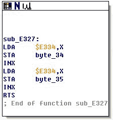  
\-------------------------------------------------------------------------------------------------  
原来地址在这里面，双击 E334，来到这里  
  
  
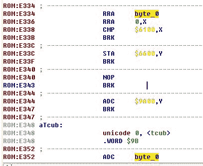  
\-------------------------------------------------------------------------------------------------  
不好…ida 把这里认作了代码….  
只好手动 undefine ，一共 20 个 16 位地址  
  
  
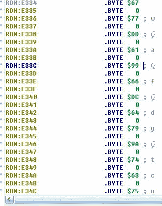  
\-------------------------------------------------------------------------------------------------  
代码:

```
BYTE offset\[20\]={       0x67,0x77,0xDD,0x61,0x99,0x66,0xDC,0x64,0x79,0x9A,
                        0x74,0x63,0x75,0x62,0x9B,0x65,0x94,0xDE,0x76,0x95
                };

```

经过无数的模拟器调试，我们知道了各个内存对应的属性  
  
代码:

```
typedef struct
{
        BYTE score\_1;           //分数右 1 位
        BYTE Remote\_bomber;         //遥控
        BYTE stage\_low;         //关卡低 4 位
        BYTE score\_7;           //分数右 7 位     
       BYTE byte\_99;        //未知
        
         BYTE score\_2;           //分数右 2 位
        BYTE power;             //威力 由 mem\_73 右移 4 位获得
        BYTE score\_4;           //分数右 4 位
        BYTE mianyi;            //炸弹免疫        
         BYTE byte\_9a;        //未知

        BYTE bomber\_num;          //炸弹数
        BYTE score\_5;           //分数右 5 位
        BYTE speed;             //速度
        BYTE score\_6;           //分数右 6 位        
     BYTE byte\_9b;        //未知

        BYTE score\_3;           //分数右 3 位
        BYTE show\_obj;          //显示物品
        BYTE stage\_high;        //关卡高 4 位
        BYTE chuanqiang;        //穿墙
        BYTE byte\_95;          //未知
}Address;

```

让我们再回到 sub\_E310:  
  
  
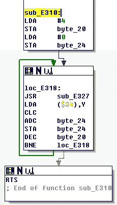  
\-------------------------------------------------------------------------------------------------  
一看就知道，这是一个 for 循环,以 byte\_20 为循环变量,目的是计算连续 4 个地址的校验和,放到 byte\_24 中，我们要到上层函数里面看看 byte\_24 放哪里去了  
来到函数 sub\_E291: 其实这个就是 encode 函数  
  
  
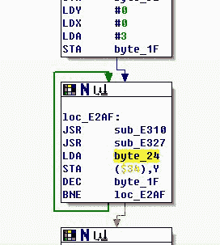  
\-------------------------------------------------------------------------------------------------  
我们可以看到 byte\_24 被放到刚才的地址列表中去了，原来  
0x99;  
0x9A  
0x9B  
分别放的是 前面 4 位数据的校验和   
  
下面我们对 encode 函数从头到尾分析一遍  
  
  
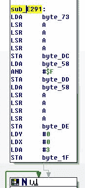  
\-------------------------------------------------------------------------------------------------  
通过调试，我们知道，byte\_73 里面放到是威力大小，但是是低 4 位和高 4 位反着放的，所以，最多能有 15 格的威力  
Encode 函数把 byte\_73 的数据左移 4 位,得到威力数据,放到 byte\_dc 中  
下一步是 把 byte\_58（关卡数）中的数据分成高 4 位和低 4 位两部分  
低 4 位放到 byte\_dd 高 4 位放到 byte\_de  
再往下就是初始化循环变量了  
  
  
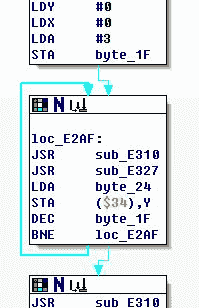  
\-------------------------------------------------------------------------------------------------  
前面我们分析过，这是个 do while 循环 一共 3 次，把前 3 组的校验和算出来，分别放到 0x99  0x9A  0x9B  
然后下面还有一次，是计算最后一组校验和的，不过最后一组的校验和没有直接放到 0x95，而是加上前面 3 个校验和的左移一位之后的和，  
  
下面还是个 do while 循环  
  
  
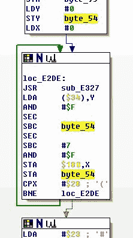  
\-------------------------------------------------------------------------------------------------  
一共循环了 0x28/2 = 20 次  
  
程序设置了一个临时变量 byte\_54  
把内存列表对应的数据取出来，然后取数据的低 4 位，再减去 byte\_54 ，减去 7，再取低 4 位，把结果放到 182(因为 sub\_e327 中 x 加了 2 次)开始的内存地址。  
用 c 语言表示  
代码:

```
do
        {
                cache= (p\[x\]&0x0F)-Temp;
                Temp = ( cache-7 )&0x0F;
                psw\[x++\] = Temp;
        }while(x<20);

```

这时的内存 ....  
  
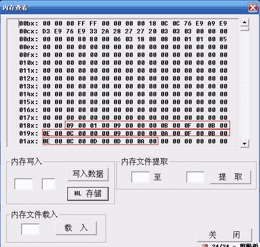  
  
到了这里，只差最后一步了，  
  
  
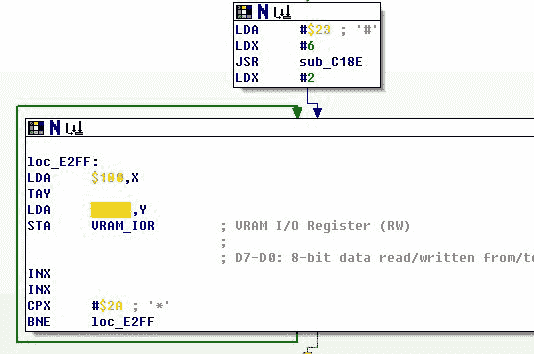  
\-------------------------------------------------------------------------------------------------  
程序循环 （0x2a -2） /2 次，把 0x182 开始的数据查表后输出  
转换表在 e35c  
  
  
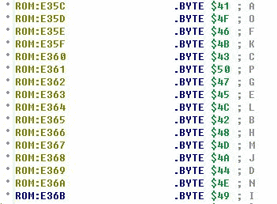  
\-------------------------------------------------------------------------------------------------  
共 16 位   
  
BYTE convert\[\]="AOFKCPGELBHMJDNI";      //转换表  
转换之后就大功告成了……  
  
**炸弹人续关码编码和解码工具:**  
Project1.rar