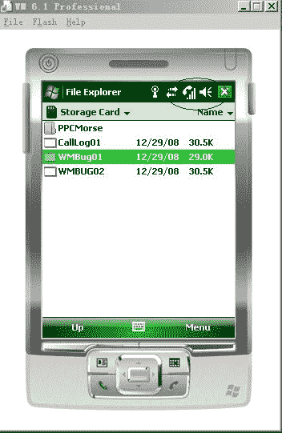
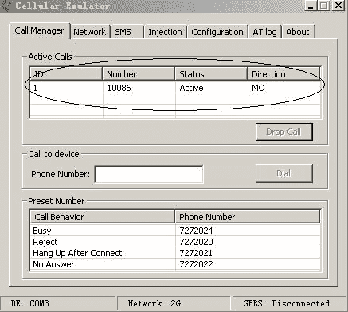

# \[WM 系统开发\]一种手机窃听功能的实现方法

> 原文：[`www.pediy.com/kssd/pediy10/79744.html`](https://www.pediy.com/kssd/pediy10/79744.html)

随着硬件水平的不断提升智能设备如智能手机、PDA、导航仪、车载系统等正在飞速的普及；越来越多的关键业务在向智能设备上转移，比如手机支付系统、手机银行、电子商务等等。同时智能设备平台也逐渐成为了黑客感兴趣的领域，各种手机病毒、木马、流氓软件层出不穷。可以肯定手机平台恶意代码将会在未来得到迅猛的发展。为了加强防范知己知彼，我们很有必要了解一些手机病毒的可能实现方法。所以我把一些研究手机病毒的成果发布在这里希望和大家一起交流共同提高！  
  
  
郑重声明：  
本人坚决反对用病毒技术做违反法律的攻击！如有人使用我们讨论的技术做违法的攻击，一切后果由攻击者承担！  
  
  
说到“窃听”无非就是被攻击者说话的内容我们也可以听到罢了。我们可以分成两种情况一种是窃听用户日常谈话内容；一种是窃听用户用手机通话时的内容。  
这次介绍的技术主要目的是窃听用户日常谈话内容。  
  
实现方法：用病毒控制用户手机给黑客手机秘密拨打电话，黑客接通电话就可以听到用户的谈话内容。  
  
到此为止，问题就转换成：如何用程序控制用户手机拨打指定号码电话？  
  
  
Windows Mobile 中有多种 API 可以实现拨打电话的功能，这里介绍两个：  
  
PhoneMakeCall()这个函数在 MSDN 和我的 API 手册中都有介绍使用一个 PHONEMAKECALLINFO 结构体指针做参数。结构体中可以设置电话号码的字符串。  
  
tapiRequestMakeCallW()这个函数在 MSDN 和我的 API 手册中也有介绍。这个函数有 4 个参数。可以只填写第一个为欲拨号码的字符串指针。但这个函数在 VS2005 中没有  
头文件和 LIB，需要用户加载 cellcore.dll 库并查找函数获得函数地址再调用。用 Xarm 编写比较简单。如果用 C/C++则需要声明函数指针。  
  
  
这两个函数可以控制用户手机拨打指定号码，在实战中可以配合其他触发功能一起使用。  
方案一：定时功能当病毒检测到当前时间为指定时间时可以对外拨号。  
方案二：通过 GPS 功能当用户手机进入指定范围时，比如一些敏感地区时开始拨号等。  
  
当然用这项技术可以做其他一些攻击：  
攻击一：通过病毒让用户拨打指定的付费号码，从而增加用户花费。  
攻击二：通过病毒让大量用户拨打一个单位的一个或一组号码，阻塞其信道。  
  
  
后面提供了两个用 C 写的 Demo 程序，点击之后会拨打 10086 电话。  
  
  

上传的附件
|  || WMBug.rar  
 |