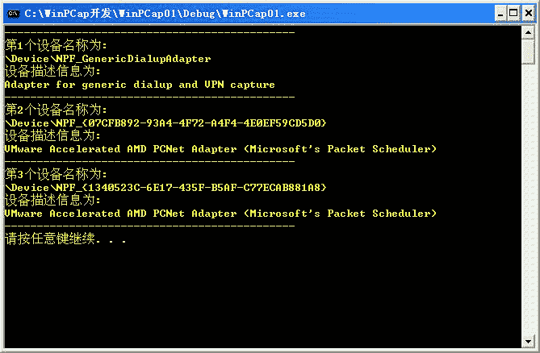

# 基于 WinPCap 的网络协议开发 - 基础介绍和枚举网络设备（01）

> 原文：[`www.pediy.com/kssd/pediy10/86912.html`](https://www.pediy.com/kssd/pediy10/86912.html)

【文章标题】: 基于 WinPCap 的网络协议开发 - 基础介绍和枚举网络设备（01）  
【文章作者】: 加百力  
【软件名称】: WinPCap  
【下载地址】: http://www.winpcap.org/  
【内部编号】: MASSADA 0026  
【编写语言】: C++  
【使用工具】: VC++ 6.0  
【操作平台】: Windows XP SP2  
\--------------------------------------------------------------------------------  
【详细过程】  
  
基础介绍：  
  
WinPCap(windows packet capture)是 Windows 平台下一个免费，公共的网络访问系统。开发 WinPCap 这个项目的目的在于为 win32 应用程序提供访问网络底层的能力。它提供了以下的各项功能：  
  
　　1> 捕获原始数据包，包括在共享网络上各主机发送/接收的以及相互之间交换的数据包。  
  
　　2> 在数据包发往应用程序之前，按照自定义的规则将某些特殊的数据包过滤掉。  
  
　　3> 在网络上发送原始的数据包。  
  
　　4> 收集网络通信过程中的统计信息。  
  
WinPCap 的主要功能在于独立于主机协议（如 TCP-IP)而发送和接收原始数据包。也就是说，WinPCap 不能阻塞，过滤或控制其他应用程序数据包的发收，它仅仅只是监听共享网络上传送的数据包。因此，它不能用于 QoS 调度程序或个人防火墙。目前，WinPCap 开发的主要对象是 windows NT/2000/XP。一些著名的网络协议分析软件如 WireShark 等都是基于 WinPCap 的。  
  
  
WinPCap 开发环境配置：  
  
01、下载 WinPCap 的驱动和 DLL。  
     到 http://www.winpcap.org/install/下载 4.0.2 版本的驱动和 DLL 文件，直接安装。  
     该版本为最新的稳定版，可以支持从 NT4 到 Vista，从 x86 到 x64 的 Windows 平台。  
  
02、下载 WinPCap 开发包。  
     到 http://www.winpcap.org/devel.htm 可以下载 4.0.2 版本的开发包。主要是\*.h 头文件和\*.lib 库文件。  
  
03、安装好驱动和 DLL 之后，简单的方法是将头文件和 Lib 库文件直接拷贝到 VC6++的对应目录下。  
  
04、在编写的程序中需要加入#include "pcap.h"包含头文件。  
  
05、在项目属性中设置连接信息，加入 wpcap.lib 这个库。  
  
  
开发第一个 WinPCap 程序 - 获取当前网络适配器信息：  
  
使用过 WireShark 的朋友都知道在进行网络抓包之前的第一个工作必须是设置要抓取的适配器。所以第一个工作是  
得到当前系统中所有适配器信息。  
  
pcap\_findalldevs()函数可以枚举当前系统的网络设备，并生成一个链表。  
  
pcap\_freealldevs()函数的功能是释放设备链表。  
  
具体代码请看，附件中的 VC++工程。  
  
  
  
\--------------------------------------------------------------------------------  
【版权声明】: 本文原创于看雪技术论坛, 转载请注明作者并保持文章的完整, 谢谢!  
  
                                                       2009 年 04 月 22 日 12:30:00

上传的附件
|  || WinPCap01.rar  
 |