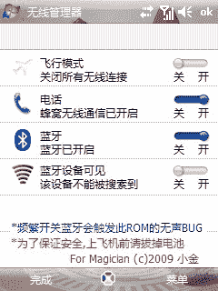

# 发个 WM 手机开关 GSM 模块的代码（即飞行模式开关）

> 原文：[`www.pediy.com/kssd/pediy10/87504.html`](https://www.pediy.com/kssd/pediy10/87504.html)

哎，真不知道怎么一个两个都把它藏着掖着，查了半天资料以及 IDA 逆了来电精灵和一个一键飞行工具才明白了其中的内幕。  
  
成品界面看附件图。  
  
不多说了，用法是：  
SetPhoneState(LINEEQUIPSTATE\_MINIMUM); //开飞机  
SetPhoneState(LINEEQUIPSTATE\_FULL);   //安全着陆  
  
\------------------------------------------------------------------------------------  
  
DWORD GetTSPLineDeviceID(const HLINEAPP hLineApp, const DWORD dwNumberDevices, const DWORD dwAPIVersionLow, const DWORD dwAPIVersionHigh, const TCHAR\* const psTSPLineName)  
{  
DWORD dwReturn = 0xffffffff;  
for(DWORD dwCurrentDevID = 0 ; dwCurrentDevID < dwNumberDevices ; dwCurrentDevID++)  
{  
   DWORD dwAPIVersion;  
   LINEEXTENSIONID LineExtensionID;  
   if(0 == lineNegotiateAPIVersion(hLineApp, dwCurrentDevID,   
    dwAPIVersionLow, dwAPIVersionHigh,   
    &dwAPIVersion, &LineExtensionID))   
   {  
    LINEDEVCAPS LineDevCaps;  
    LineDevCaps.dwTotalSize = sizeof(LineDevCaps);  
    if(0 == lineGetDevCaps(hLineApp, dwCurrentDevID,   
     dwAPIVersion, 0, &LineDevCaps))   
    {  
     BYTE\* pLineDevCapsBytes = new BYTE\[LineDevCaps.dwNeededSize\];  
     if(0 != pLineDevCapsBytes)   
     {  
      LINEDEVCAPS\* pLineDevCaps = (LINEDEVCAPS\*)pLineDevCapsBytes;  
      pLineDevCaps->dwTotalSize = LineDevCaps.dwNeededSize;  
      if(0 == lineGetDevCaps(hLineApp, dwCurrentDevID,   
       dwAPIVersion, 0, pLineDevCaps))   
      {  
       if(0 == \_tcscmp((TCHAR\*)((BYTE\*)pLineDevCaps+pLineDevCaps->dwLineNameOffset),   
        psTSPLineName))   
       {  
        dwReturn = dwCurrentDevID;  
       }  
      }  
      delete\[\] pLineDevCapsBytes;  
     }  
    }  
   }  
}  
return dwReturn;  
}  
  
DWORD SetPhoneState(DWORD state)  
{  
HLINEAPP m\_hLineApp = 0;  
DWORD m\_dwAPIVersion = TAPI\_API\_HIGH\_VERSION;  
DWORD dwNumDevs;  
LINEINITIALIZEEXPARAMS liep;  
liep.dwTotalSize = sizeof(liep);  
liep.dwOptions = LINEINITIALIZEEXOPTION\_USEEVENT;  
HLINE hLine = 0;  
LONG lRC = 0;  
DWORD dwState, dwRadioSupport;  
TCHAR gszFriendlyAppName\[160\];  
  
if(lineInitializeEx(&m\_hLineApp, 0, 0, gszFriendlyAppName, &dwNumDevs, &m\_dwAPIVersion, &liep)) {  
   return PHONEDEVICE\_ERROR;  
}  
  
if(NULL == m\_hLineApp)  
{  
   return -1;  
}  
  
DWORD dwDeviceID = GetTSPLineDeviceID(m\_hLineApp, dwNumDevs, TAPI\_API\_LOW\_VERSION, TAPI\_API\_HIGH\_VERSION, CELLTSP\_LINENAME\_STRING);  
  
lRC = lineOpen( m\_hLineApp, dwDeviceID, &hLine, m\_dwAPIVersion, 0,   
   NULL, LINECALLPRIVILEGE\_OWNER, LINEMEDIAMODE\_DATAMODEM,  
   NULL);  
  
if(lRC < 0)  
{  
   if(hLine != NULL)  
   {  
    lineClose(hLine);  
    hLine = NULL;  
   }  
  
   return lRC;  
}  
  
//lRC = lineGetEquipmentState(hLine, &dwState, &dwRadioSupport);  
  
//if(lRC < 0)  
//{  
// lineClose(hLine);  
// return lRC;  
//}  
  
//if((LINEEQUIPSTATE\_MINIMUM == state) ||  
// (LINEEQUIPSTATE\_NOTXRX == state))  
//{  
// lRC = lineUnregister(hLine);  
  
// if(lRC < 0)  
// {  
//   lineClose(hLine);  
//   return lRC;  
// }  
//}  
  
//if(dwState != state)  
//{  
   lRC = lineSetEquipmentState(hLine, state);  
//}  
  
if(lRC < 0)  
{  
   lineClose(hLine);  
   return lRC;  
}  
  
if((LINEEQUIPSTATE\_FULL == state) ||  
   (LINEEQUIPSTATE\_RXONLY == state) ||  
   (LINEEQUIPSTATE\_TXONLY == state))  
{  
   lRC = lineRegister(hLine, LINEREGMODE\_AUTOMATIC, NULL, LINEOPFORMAT\_NONE);  
  
   if(lRC < 0)  
   {  
    lineClose(hLine);  
    return lRC;  
   }  
}  
  
lRC = lineClose(hLine);  
  
return lRC;  
}  
  
