# 如何破解 BlackBerry 9530 CDMA MEID/ESN 保护

> 原文：[`www.pediy.com/kssd/pediy11/109179.html`](https://www.pediy.com/kssd/pediy11/109179.html)

## 作者的话

本文首发于我的好友 kaka 的博客“籽籽在发芽”<http://honeyhan.cn/>，虽然在大学时期就得闻看雪论坛盛名，但真正注册却是昨天的事。本文自发布后连续修订过 3 次共发布了 4 个版本，这是第 4 次修订即第 5 个版本，一直忙着没有发布，既然刚在看雪注册，就发在看雪吧，作为新人的一点知识分享。

从技术上来说，本文没有什么高深的地方；只是看到看雪自 09 年开辟了与手机有关系的板块，所以觉得此文也许还有点抛砖的价值；另外，本文假设的是读者对 BlackBerry 和 CDMA 甚至相关软件操作都不熟悉，因此描述得相对来说比较详细和仔细（因为很多手机用户需要用到该知识，希望任何一个普通用户都能按文操作达到目标），这也许是本文能够作为一个通俗教材的另一点小小的价值吧。

最后，关于本文任何的批评、建议，请朋友们随时联系我。

本文最早于 2009 年 6 月初发布，目前是 v1.4 版。

BlackBerry 9530 CDMA 烧号过程分享（手工写入 ESN/MEID）v1.4

Coolfrog <coolfrog#gmail.com>

KaKa <kaka.maillist#gmail.com>

因为本文的形成与 kaka 同志的贡献密不可分，因此，我们选择把文章首先发表在 kaka 的博客上，大家转载请注明出处，也请大家支持 kaka 的博客“籽籽在发芽”<http://honeyhan.cn/>，谢谢！

## 修订

V1.4 2009/12/12 改进 meid 在重启后会自动恢复的处理方法，绝对稳定，可靠，可操作

V1.3 2009/6/23 做一些小的调整（错别字、措辞等）

V1.2 2009/6/18 制作发布版 PDF

v1.1 2009/6/18 对方法进行改进，改进后的方法更加稳定，避免了原方法中的一些偶然因素，重点修改在第十三章。其他修改：

第七章，软件版本的说明；

第十章，增加准备工作中的网络设置；

第十一章，增加对软件版本的说明；

第十二章，对 IMSI 增加补充说明；

备注也进行了修改；

对内存地址也进行了标准化，都加上了 0x 标记。

## 一、 致谢

感谢 kaka 同志提供 BB 9530 供我随意折腾，10 年来的 hacking 工作给了我们不断学习不断提高的机会；

感谢 1007 对于 9530 内存扫描问题的解答（ROM 版本问题），并感谢 1007 对于我解决该问题思路的启发；

感谢 Jacky 和我的面对面沟通，让我更清晰地了解了很多技术问题。

在此本人把最近研究 BlackBerry Storm 9530 烧号的进展汇报一下，主要是手工写入 ESN/MEID 部分的技术攻关。

希望朋友们能够在此方法的基础上进行测试（注意不要弄坏你的 BB，注意安全操作，宁愿多问，不要冒险），如果将来证明方法确实如我所认为的那样稳定可行，加之如果时间宽裕的话，也许会写个烧号程序供大家使用，因为这个过程还是有些繁琐的。

## 二、 背景

08 年底，我开始使用 189；不久后，kaka 和另外一个兄弟各买了一台 BlackBerry Storm 9530，于是他们决定也支持一下电信，考虑对 9530 进行 CDMA 烧号。

经过 kaka 在网上的大量查阅资料，并进行筛选，给了我工作的基础，依靠这些资料，我基本了解了 CDMA 烧号到底是啥意思。

随后的烧号尝试不断碰壁，首先是找人帮忙，可能由于该机器刚刚面市，国内外又没有多少人研究，所以在电信工作的朋友们尝试了很多种方法，都失败了（注：只考虑在手机上烧号，不考虑去电信后台更改配置）。

Kaka 怒了，就去买了一个正版 CDMA Workshop 3.3.5 软件，结果发现这个软件也搞不定。

困难在哪里呢？就是 ESN 的问题无法将手机号对应的 UIM 卡 ESN 写入手机设备。

在网上查阅了无数的国内外资料，没有找到搞定 9530 的 ESN 的方法。其间，kaka 经常会打电话给我，说在某论坛又看到某人搞定了 9530 写号问题，经过总结，我告诉 kaka，理论上这些人都没搞定 ESN，肯定都是在电信开后门把机身 ESN 写到电信设备上了，因为在全球范围内还真没找到这个问题的解决方法……于是，在经历了数轮打击之后，kaka 同志很郁闷，并愤而在博客上发了一篇文章《作风一定要严谨》（[`honeyhan.cn/200903/05_767.html`](http://honeyhan.cn/200903/05_767.html)），当然他说的“作风”其实是指对待技术的态度，通过此文表达了对于那些研究技术、阐述问题不严谨的朋友们的强烈不忿。

后来大家工作也忙，就休息了相当长一段时间（2 月下旬至 5 月底），没有继续研究这个东西。

2 台 9530 在睡觉，其间 kaka 还丢了一台 8300，不爽啊。

5 月底，kaka 的战斗热情再次燃起。某日与 kaka 夫妇、swan 博士吃完陕北菜后，kaka 把 9530 又翻出来了，再次交给我，让我继续研究。

其实我偷懒了好几天，直到大约 6.1 之后才开始折腾，这中间 kaka 打电话问进展，我就说没进展（本来就没进展嘛）……

## 三、 如何阅读本文

在写这篇文章的过程中，很多朋友在问相关的问题，如果要一一解答确实很累。其实要写一篇对大家真的有所帮助的文章还真难，因为不同的朋友技术基础不同，所需要的内容也不尽相同。有的朋友只需要操作步骤和截图，有的朋友会在过程中碰到问题，需要一些分析和解释说明，还有些朋友只关心关键几个节点的原理、手段或测试思路等，甚至有朋友会关心一些扩展或更深入的话题。

为了适应不同朋友对本文的不同要求，我把文章内容的不同针对性部分进行了标示：

操作步骤表示这一部分是对操作步骤的记录和指导；

原理知识表示这一部分是对技术原理的说明，属于知识方面的内容；

分析说明表示这一部分是对问题的分析、推导、测试碰壁的记录，以及思路的梳理等内容；

重要数据表示这一部分列出了重要的数据信息；

特别注意表示容易出错、容易忽视、需要特别注意的问题。

请大家在阅读时各取所需，跳过自己不需要的部分。

注意：请大家先通读本文，具备整体印象，并了解我的实际操作和总结方法之间的差异，同时对所有可能碰到的问题有一个概念，然后再实际去操作。

另外，我是在大量的尝试中最终烧号成功的，过程中可能有些运气的成分，本文是我事后的整理，虽然我尽力将我的理解、我的操作描述得更加详细，但本文可能仍然不够准确或难免有所遗漏，实际情况也未必跟你的机器完全一样，通常你还会碰到一些问题，需要独立思考或与大家探讨来解决，特别是对于计算机基本知识和 BB 手机本身不太熟悉的朋友，你碰到的问题一定会很多，记得要坚持！

同时，也希望大家将碰到的问题或总结的经验都记录下来，以便我们不断完善这个方法。

## 四、 工作基础

[分析说明]

年初虽然没有搞定烧号问题，但至少知道已经尝试过的方法是不行的。经过实验并确认无法完成写号的方法和相关重要结论如下：

1、 IMSI、A-Key 的写入，在 9530 上不是问题，不需要专门研究，网上有很多兄弟都给出了方法，建议用工具软件写入 A-Key，工具软件或手编输入 IMSI，在本文就不浪费篇幅做具体详细描述（当然大家如果有疑问也可以提出）；

2、 用 `CDMA Workshop 3.3.5` 无法直接对 9530 进行 ESN 修改操作（该软件的各种方式均不适合 9530）；

3、 用 `UniCDMA2005`、`CDMA Universal` 无法直接对 9530 进行 ESN 修改操作；

4、 用扫描内存（找出可读内存段）、导出内存镜像文件（`.bin`）、搜索 ESN 位置并改写的方法，在机器重启后，ESN 会自动复原。

## 五、 知识准备（CDMA 烧号的基本概念）

根据网上查阅的资料和帖子，以及向各位热心朋友的请教解答，我们可以简单整理一下烧号所需要的知识点。

这里只列出本文所需的知识点，更多详细的知识请查看网上的其他整理帖，例如 lingxw 兄弟的转帖《关于智能机中 CDMA 手机写号问题的汇总》（转载于 www.anranpda.com ），该帖 URL 请参见 http://bbs.maxpda.com/thread-240701-1-1.html，或请大家去翻阅原文。

[原理知识]

假设：

我现在用的是中国电信 189 号码，三星 CDMA 手机（型号 S259+）+UIM 卡

现在希望用 BB 9530 的 CDMA 模式，9530 是双模单待手机，是支持 CDMA2000 的 3G 手机，该机型 GSM 模式是机卡分离（需要插入 SIM 卡），CDMA 模式是机卡一体（需要把号码写入到手机中）；

所谓“烧号”，就是把号码写入到手机中，那么我们到底需要把哪些东西写到手机中呢？

其实，一共需要三个信息：

a) `IMSI`：国际移动用户识别码（唯一标识），`IMSI` = `MCC` + `MNC` + `MSIN`，其中 `MCC` 是指移动台国家代码（3 位，中国 460），`MNC` 是指移动网代码（2 位，中国电信 03），`MSIN` 是指移动用户识别号码(10 位)，例如上海电信的 189 号段常见 MSIN 是 6010******、6181******等。

b) `ESN`（`MEID`）：`ESN` 是“电子序列号 Electronic Serial Number”的缩写，是移动手机的身份识别符。`ESN` 为 32 位，即 8 个十六进制数字标识，例如 `F5XXXXXX`。

而 Mobile Equipment IDentifier (`MEID`) 是全球唯一的 56bit 移动终端标识号。由于 ESN 号段是有限的资源，基本上耗尽，所以制定了 56 位的 MEID 号段，用来取代 32 位的 ESN 号段。MEID 主要分配给 CDMA 制式的手机。

MEID 的格式：

MEID 由 14 个十六进制数字标识，第 15 位为校验位，不参与空中传输。

RR：范围 A0-FF，由官方分配

XXXXXX：范围 000000-FFFFFF,由官方分配

ZZZZZZ：范围 000000-FFFFFF,厂商分配给每台终端的流水号

C/CD：0-F,校验码

例如我们手上的 9530 MEID 可能是：`0xA000000D******`

c) `A-Key`：`Akey` 也叫鉴权码，16 位 16 进制的一组数字，是存储在 MS（标准名称叫做移动站，简单点理解就当它是整部手机好了）中进行鉴权和加密的密钥，是分配给 MS 的 64bit 数据，并且仅对 MS 和相关的归属位置寄存器/鉴权中心（HLR/AC）是可知的。

每个手机出厂时都有一个 ESN 号，MIN 号是运营商分配的，用以区别用户，一个手机能够正常服务，在交换上写号时必须输入 ESN。这个 ESN 号和 MIN 号是一一对应的，在鉴权时使用，对于机卡一体手机，需要写号时只需提供手机中的 ESN 号给交换人员，他们会分配一个 MIN 号给你，在手机中写入即可。在用户鉴权时会用到手机中固有的 ESN 号，所以对于不同的机卡一体手机，由于 ESN 号不同，把获得的 MIN 值写入其它手机，手机可以识别网络，但无法通过鉴权，故无法通话（准确地说是在国内只能拨打 10000 号）；对于机卡分离的手机，手机出厂时也有 ESN 号，但在写号时在 UIM 卡中另外写入一个 ESN 号，所以手机鉴权时不用手机中固有的 ESN 号，而是用 UIM 卡中人为写入的 ESN 号，这样 UIM 卡就可以做到放入任何一个 C 网手机中都可以打电话。

一个机卡合一的手机进入 CDMA 网工作，最初只需要三个数据：一是 ESN 码；二是 IMSI 码（机卡合一写在手机里面，机卡分离的 ESN IMSI 在卡里面）；三是鉴权码，存储的位置和 IMSI 一样。

## 六、 整体流程

为了大家对整个烧号过程有更好的全局观，知道自己每一步需要做什么，特对整个过程大的步骤进行说明如下（注意本文讨论的是自己动手将 UIM 卡中的 ESN 写入手机的方式，如果您是通过其他途径将手机中的 ESN 写到电信设备上，则本文对您并无帮助）：

1、 获得自己需要写入的号码的 IMSI（MIN）、ESN/MEID、A-Key（若通过其他途径关闭 A-Key 则不需要）；

2、 通过手编方式，将自己 UIM 卡的 IMSI（MIN）、HOME SID（所属地标示，上海电信是 13840）等基本信息写入手机，确保可以拨打中国电信 10000 号客服热线；

3、 通过软件，将 A-Key 写入手机；

4、 通过本文描述方法，将自己 UIM 卡的 ESN 写入手机并验证；

5、 测试通话并修改手机通话的相关设置，例如国家码（+86）等等；

6、 再次测试并验证，如未成功则返回一一检查，排除故障。

## 七、 准备工具软件和所需物品

`BlackBerry Desktop Manager`（即大家常说的 DM，我用的是 4.70 B059 多国语言版，我们需要的其实是其中的设备管理器，即 Device Managment）该软件用于把手机连接到电脑（驱动、端口）

`CDMA Universal Unpacked`（或 `UniCDMA 2005`）读手机信息、扫描内存等；

`QPST 2.7 build 323`、`QXDM 3.11.36` `QUALCOMM` 提供的强大工具，后面详细介绍

我还有 `CDMA Workshop 3.4.1` 正式版（kaka 赞助的，多谢 kaka），这个工具比较贵，不必强求，事实上，在本文的基础上，你只要用好 `QXDM` 即可，呵呵。当然，如果你能准备一下 3.4.1demo 版也很好，或者 2.7 破解版。

此外还需要 Windows 的计算器、`UltraEdit`（或其他的 16 进制编辑器）。

当然，还需要一根 USB 线（BB 能用的就行，我用的是 Nokia 6500c 自带的 USB 线）。

最后，强烈建议，准备 3 张 A4 大小的白纸，准备好两支不用颜色的笔，在你操作的过程中，一定要尽量记录关键的内存地址、修改前后数值、你的疑问等等重要的内容！这一点真的很重要。

特别注意：如果你用的是 Vista 或 Windows Server 2008，或者你安装了 IE 的最新版本，又使用的是 `QXDM 3.9.19` 版本，可能会碰到 QXDM 无法安装的问题（因为安装程序不能识别 IE 最新版本，所以会提示“需要 IE 5 以后的版本”，这个问题有解决方案，但受篇幅所限，不在本文中阐述，有困难的朋友可以联系我，等我有空也会另外写文章或工具提供给大家参考。）

## 八、 准备工作 1：获得 UIM 卡三码

首先，`A-Key` 这个东西只能通过电信内部的人拿到，或者还有个办法，就是找人帮你关闭鉴权，这样就不需要 A-Key 了（不推荐）；

其次，我们可以通过 UIM 卡获得 IMSI（如前所述，其实我们需要的只是 MSIN 而已）和 ESN；方法很多：

[操作步骤]

i） 把 UIM 卡插在我的三星 CDMA 手机（S259+）中，依次按“菜单、4、*”键，出现一个输入密码的界面“系统程序”[图 1]：输入 `000000`；这时会出现“Service Mode”，第一页显示的就是 ESN（请看最后一行的 8 个 16 进制数）[图 2]；按“确定”可以看到第二个页面，就是 MSIN[图 3]；继续按“确定”，直到手机重新启动[图 4]；你用其他手机也可以，只不过操作方式略有差异，请大家查阅网上资料；

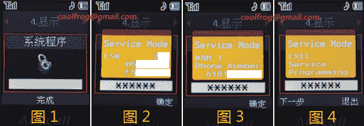

ii） 还是用三星手机，插入 UIM 卡，开机，输入`*759#813580`，就可以进入测试模式，手机屏幕显示一个 TEST NONE 的界面[图 5]，这时候就可以输入测试指令了，例如“024”，就可以看到界面出现“Send ESN”字样[图 6]，这个时候慢慢按“*”键，就可以看到 ESN 了[图 7]；按 4 次*号键之后，你会发现 024 后面出现了一个“.”号[图 7]，表示这个指令结束了；如果你需要自己结束一条指令，开始下一条指令，也可以直接按“#”键；另外一个指令是“022”，按完之后也是用*翻页，就能看到 MSIN 了[图 8]。

特别注意：这个手机通过此种方法看到的 MSIN 好像有点问题，大致是这样：

6181XX-XXX6181XX-XXX2A

说它有问题，一方面是它位数不符合我们所了解的知识，它一共有 6+9+4 个数字，再加一个字母，而我们需要的是 10 位数字；

另一方面，它的数字是有重复的，也就是我们可以猜测，它就是以 6181 开头的，不过第一次出现只有 9 位数字，第二次出现有 10 位数字，可惜的是第二次出现的 10 位，最后一位数字和前面一种方法看到的 MSIN 不一样，一个是 0，一个是 2，呵呵，不知道怎么回事。（我采用的是第一种方法看到的 MSIN）

最后一条指令，002，手机会重启的。[图 9]

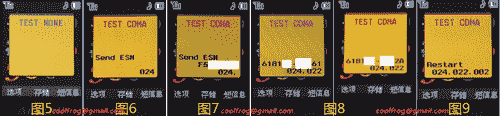

（特别注意：三星有的 CDMA 机型指令是 2 位，不是 3 位，例如 024，可能是 24。）

iii）你还可以把 UIM 卡插在手机、CDMA 上网卡等设备上，然后连接到电脑上，通过电脑上的工具软件去读取 UIM 卡信息（工具可以见后文）；

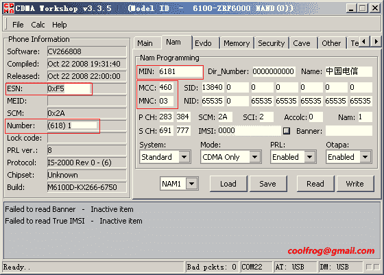

特别注意：这个阶段，需要注意，ESN 应该获取 UIM 卡的信息，不要搞错了，别拿到手机机身的 ESN 信息当作 UIM 卡信息。

## 九、 准备工作 2：获得 9530 手机设备 ESN/MEID


此外，在开始干活之前，还得记录下 9530 手机设备（机身）当前的 `ESN`、`MEID`，因为你在工作中需要查找这些东西，并且修改它们，还要确认是否修改成功。先说一下方法：

### [操作步骤]

1、拨号界面按`##000000`，拨号，就可以得到 `ESN`，例如 `80YYYYYY`

2、菜单，进 `Options`，选 `Status`，就能看到 `MEID`，例如 `A000000DYYYYYY`

当然，你也可以通过软件读取，并记录。

## 十、 准备工作梳理和信息确认：

我们了解了简单的基本知识

1) 准备好了 `UIM` 卡对应的三码：

a) `ESN`：`F5AABBCC`

b) `IMSI`：`6181XXXXXX`（`MIN`）

c) `A-Key`：`XXXXXXXXXXXXXXXX`

2) 准备好了 `9530` 设备对应的 `ESN` 和 `MEID`：

a) `ESN`：`80YYYYYY`

b) `MEID`：`A000000DYYYYYY`

3) 准备好了 `9530`、`USB` 线和自己的电脑，以及必备的工具软件；

4) 建议在手机中不要插入 `GSM` 网络的 `SIM` 卡，并且在开始时先将网络设置为 `1XEV`。

## 十一、 工具的安装和基本使用方法（扫盲）

有些朋友可能对这些软件工具还不会用，其实只要大家勤快点上网去搜索搜索就可以学会了，为了让大家更方便，这里也简单列一下每一种软件的最基本用法：

注意，以下部分图片所示的软件版本可能不是最新的，请根据你的具体情况参考，例如 `QPST`，是 `2.7` 的老版本，不是 `build 323` 版本；例如 `QXDM`，是 `3.9.19`，不是 `3.11.36`；`CDMA Workshop` 是 `3.3.5`，不是 `3.4.1`，你最好使用尽量新的版本。（我现在就用的是最新版本，新改进的方法也是用的新版本反复验证的，当然，就本文描述的内容而言，这些不会影响结果，用新的版本，会在其他工作中带来帮助。）

特别说明：`CDMA Workshop` 是收费软件，但并不是必须的，对于本文而言，不用这个软件也一样可以实现预期结果。

### 1、将 9530 连接至电脑

首先，我们需要把 `9530` 手机连接到电脑，这样就需要安装 `DM`，然后用 `USB` 线将手机连接到电脑，然后打开 `DM` 的设备管理器：

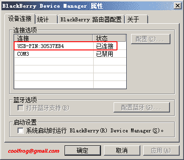

可以看到，我们的 `9530` 已经连接成功了。

接下来要确认这个连接用的是哪个端口，“我的电脑”-右键-“属性”-“设备管理器”-“端口”，能看到两个 `RIM Virtual Serial Port v2`：

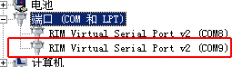

在我机器上分别是 `COM8`、`COM9`，通常我们要用的就是第二个（在我这里就是 `COM9`），请把这个端口号记下来。

### 2、使用 CDMA Workshop

如果你使用 `CDMA Workshop` 的话，可以在上述连接完成的基础上，打开这个软件：

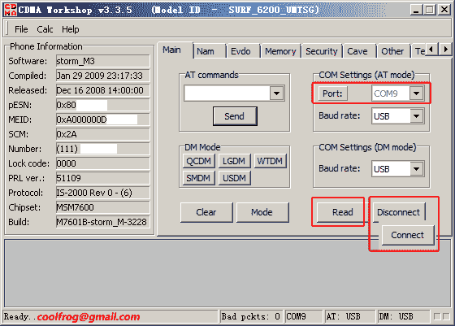

如上图，你需要先选择 `Port`（就是端口号，我这里是 `COM9`）；然后点击下面的“Connect”，如果连接成功，这个按钮会变成 `Disconnect`。

为了测试是否连接成功，请点击旁边的“Read”，如果一切正常，你就可以看到左边的这些 `Phone Information`（手机信息）了。

`CDMA Workshop` 的 `Demo` 版有使用时间和功能的限制，但基本功能也够用了。

### 3、使用 CDMA Universal

如果你没有 `CDMA Workshop` 正式版，又不喜欢 `Demo` 版，你也可以使用 `CDMA Universal` 或 `UniCDMA`（其实一样的，不过 `UniCDMA 2005` 好像不支持 `COM8` 以上的端口，你需要手工修改 `COM` 端口号，这个我就不多说了）。

具体使用方法：

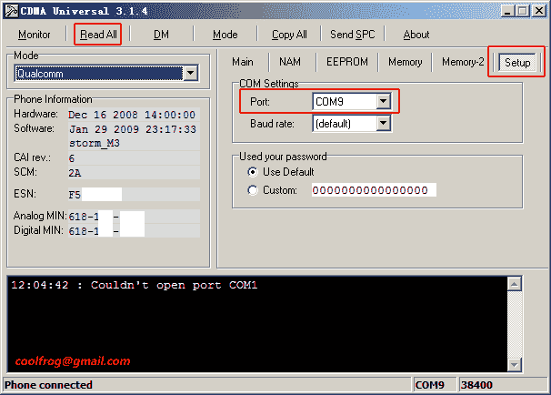

### 5、使用计算器

别不耐烦，你很可能还得用到计算器进行 `10` 进制、`16` 进制的计算和转换。

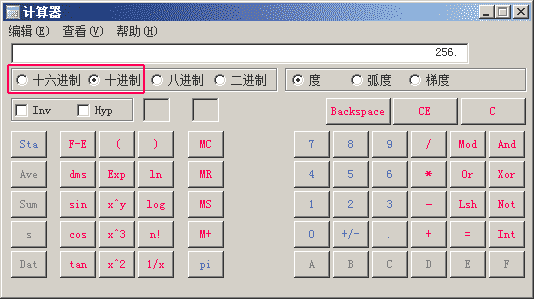

### 6、使用 QPST 和 QXDM

上述软件只要复制就可以使用，这两个软件都需要安装。

安装好了之后需要先打开 `QPST Configration`：

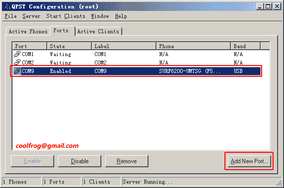

点击“Add New Port”，添加你所要试用的 `COM` 端口。

然后打开 `PXDM`，并从菜单“View”中选择“New”-“Common”，再选择“Command Output”和“Memory Viewer”两个窗口视图：

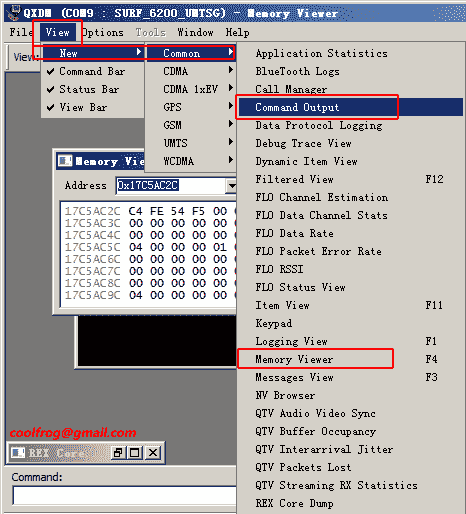

接着就可以看到如下界面：

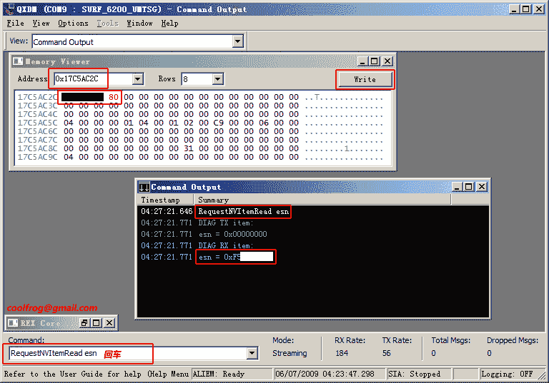

本文中描述的方法只用到上述这两个视图：

在 `Memory Viewer` 中的“Address”输入框输入内存地址，下面的窗口中就会显示内存数据，如果你对内存进行了修改，需要点击旁边的“Write”按钮，使写入生效。

在主窗口下方的“Command”输入框中输入命令并回车，在 `Command Output` 窗口就能看到命令执行结果。

## 十二、 将 IMSI 和 A-Key 写入手机（简述）

先简单说一下 `IMSI` 如何写进 `BB 9530`，其实很简单。

在拨号界面，输入`##000000`，然后拨号，就出来手编界面，直接在 `IMSI_S` 那里写就行了（写 `10` 位阿拉伯数字的 `MIN`：`6181XXXXXX`）。

当然你也可以用工具软件来写：

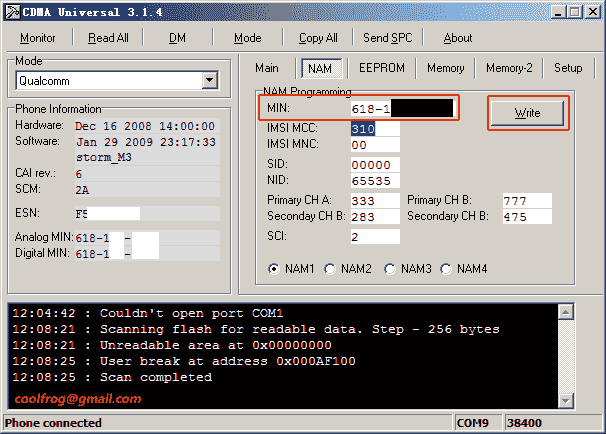

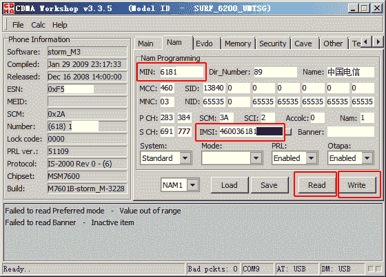

注意，你要填写 `MCC`、`MNC`、`MIN`，这样才是完整的 `IMSI`。

写好 `IMSI` 之后，在手编界面填写 `HOME SID`（上海电信是 `13840`）应该就可以拨打 `10000` 号了，试试看！如果拨打其他电话，会提示没有开通此功能之类的。

如果你现在希望将 `A-Key` 写入手机，建议用软件实现，这里也就不描述了，网上关于 `IMSI` 和 `A-Key` 的文章非常多：

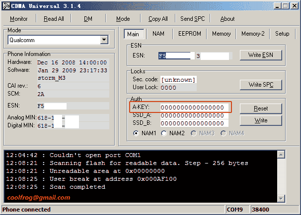

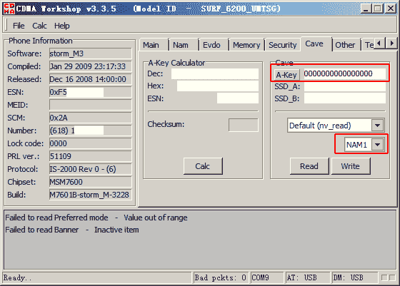

## 十三、 将 ESN 写入手机

接下去就是搞定 `ESN` 了，这个过程很痛苦，我 `2` 月份研究过，以完美的失败告终。最近几天是重新研究，尝试过很多方法，有些没意义的，就不写了，有些有意义的，我会记录下来，供大家参考。

### [分析说明]

`2` 月份研究过的方法包括：

1、通过 `CDMA Workshop 3.3.5` 直接写（有很多写的方式），全部失败；

2、经典的内存扫描+`QXDM` 手写方式（此处只是分析，该方法的操作步骤见后文）：

a) 通过 `CDMA Workshop`（或 `CDMA Universal`、或 `UniCDMA`）扫描 `9530` 的可读内存；

b) 把可读内存段导出，存为`.bin` 文件；

c) 用 `16` 进制编辑器在导出的`.bin` 文件中搜索 `9530` 的 `ESN`（按“字节反序”，即，如果你手上的 `9530` 的 `ESN` 是 `1A-2B-3C-4D` 的话，你要在文件中搜索 `4D-3C-2B-1A`），找到之后把地址全部记下来，并且换算成真实地址（该方法的操作步骤后面详述）；

d) 用 `QXDM`，打开 `Memory Viewer`，找到所有的上述 `ESN` 所在地址，把这些 `ESN` 全部清为 `00000000`，或者改成自己 `UIM` 卡的 `ESN F5XXXXXX`；

可是面临的问题是，一旦重启，`ESN` 又会恢复成 `9530` 自己原先的 `ESN`。

所以最近几天主要在研究这个 `ESN` 的问题。经过对年初写号失败的反思，我有如下思路：

### [分析说明]

1) 年初写 `ESN` 失败，可能是存在一些未知问题；例如：我找到的可读内存地址段不准确，导致从内存中搜索到的 `ESN` 数量不够全面，有遗漏，所以即使把我找到的 `ESN` 全部改写了也无效？

2) `ESN` 是否存在硬件上或不可读取的系统文件内，`9530` 的系统程序会从硬件上或系统文件中读取，所以我们无论如何修改内存都无效？

3) 我们修改内存，到底起到的是怎样的效果，拔掉电池之后我们写入的信息不会丢失吗？`9530` 怎么才能将自己管理的 `ESN` 交给我们来修改呢？……

带着这些问题，最近几天，在 `google` 进行了一些关键字搜索，到国内外的网站上看了看帖子，了解到的新知识梳理如下：

### [原理知识]

1、`9530` 除了 `ESN` 之外，还有个 `MEID` 的东西（见上文的介绍），并且看起来好像 `9530` 是 `MEID` 控制硬件识别的（不好意思，之前一直不知道这么回事情，所以总是盯着 `ESN`）；

2、`MEID` 和 `ESN` 有一定的对应关系（知道 `MEID` 可以推算出 `ESN`，但反之不行）；

3、`9530` 中有一个 `SCM`（可以翻译成状态类别码/状态类别标识、标记）：

`SCM (Station Class Mask)`

`If the Value is 0x2A then Phone is ESN Based`

`If the Value is 0x3A then Phone is MEID Based`

这个大家都能看懂吧，不解释了。

### [分析说明]

此时，再加上其他一些杂七杂八的信息，我在脑中仔细思考了一下摆在面前的困难，决定，坚决放弃原先只盯着 `ESN` 的思路，现在开始盯着 `ESN/MEID/SCM`，我决定对这 `3` 个东西同时下手。

### [A]ESN 攻坚战预备阶段：

在 `ESN` 修改过程中，我们要做的第一阶段工作，就是扫描 `9530` 的可读内存段，并将这些可读内存导出来保存为`.bin` 文件，然后在这些文件中找到 `MEID`、`ESN` 位置。

### [操作步骤]

#### [A-1]扫描可读内存

`2` 月份用 `CDMA Universal` 扫描内存、导出内存都很正常，最近却碰到了一些问题，不知道是不是因为我换了操作系统的缘故（当时是 `2003`，现在是 `2008`）；所以我改用 `CDMA Workshop` 扫描内存（试用版也可以），大家可以根据各自情况选择 `CDMA Workshop`、`UniCDMA`、`CDMA Universal` 工具中的一个。

将 `9530` 连接到电脑，打开 `DM`，再打看 `CDMA Workshop`，选择 `COM` 端口（例如 `COM9`），点“Connect”，如果连接成功，可以点击一下“Read”，看看读取 `9530` 信息是否正常，如果正常，则将 `CDMA Workshop` 切换到 `Memory` 一页进行内存扫描：

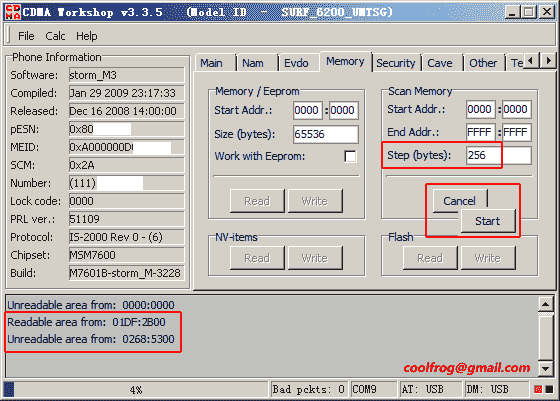

选择开始地址、结束地址以及步长，我选择的扫描步长是 `256` 字节，所以扫描速度很慢（一般用 `1024-4096`），第一次扫描，从 `0000:0000` 开始，扫到 `3E24:1900` 时被我手工停掉了（没时间），扫描结果如下：

```
Scanning memory for readable areas:
Unreadable area from:  0000:0000
Readable area from:  01DF:2B00
Unreadable area from:  0268:5300
Readable area from:  17AE:B100
Unreadable area from:  17B2:6700
Readable area from:  17B2:8A00
Unreadable area from:  17FC:CB00
Process is stopped at:  3E24:1900
```

#### [特别注意]

上述扫描结果，我们需要从中挑出成对的“Readable”、“Unreadable”，例如第一对是：

`Readable area from:  01DF:2B00`

`Unreadable area from:  0268:5300`

表明从 `01DF:2B00` 到 `0268:5300` 这一段内存地址可读。

这是一个不严谨的说法，但是不影响我们的操作。如果要严谨地来说，应该是：

a) 从 `01DF:2B00` 开始的内存可读；

b) 也有可能在 `01DF:2B00` 之前某个地址的内存就已经可读，但不会提前到超过 `01DF:2A00`（因为 `0x01DF2B00-0x100=0x01DF2A00`，步长 `256` 就是 `0x100`）；

c) 我们所选择的这一段内存，也有可能中间会出现不可读的部分，因为我们是按照步长 `256` 字节进行跳跃式搜索的，不是一个字节一个字节地搜索的，可能不可读的部分被我们刚好跳过了，当然这种可能性很小，因为 `256` 字节在内存分配中是很小的数值了；

d) 直到 `0268:5300` 这个地址，内存开始不可读；

e) 也有可能在 `0268:5300` 这个地址之前，内存就已经不可读了，但不会提前到超过 `0268:5200`（因为 `0x02685300-0x100=0x02685200`，步长 `256` 就是 `0x100`）。

f) ……


是不是很罗嗦？呵呵，技术工作就是这么个东西，不能不严谨，有可能不严谨会侥幸没出问题，但是如果你的技术工作是关系到重要系统或重要事件，等你出问题了就太晚了，要养成严谨的习惯。

后来我有空的时候，又从 `3E24:1900` 开始扫描，到 `6724:F900` 结束，这一段没有扫到可读内存。再后来我就没继续扫下去了。

经过上述过程，我通过扫描得到的可读内存区间段如下：

### [重要数据]

共三段（没有扫完，只扫了 `0000:0000` 到 `6724:F900` 的部分，因为我觉得后面的内存肯定没啥用）

第一段可读内存：

起始地址：`01DF2B00`

结束地址：`02685300`

总字节数：`8988672 bytes(10 进制)`

第二段可读内存：

起始地址：`17AEB100`

结束地址：`17B26700`

总字节数：`243200 bytes(10 进制)`

实际导出时在 `17B266E0` 处结束

实际字节数：`243168 bytes(10 进制)`

第三段可读内存：

起始地址：`17B28A00`

结束地址：`17FCCB00`

总字节数：`4866304 bytes(10 进制)`

（这一段我忘记是否全部导出了，反正不会相差太多，因为我的扫描步长是 `256` 字节，已经足够精确了。）

特别注意：关于扫描内存，我走过弯路，感谢 `maxpda` 论坛的 `1007` 给我解答，请大家务必注意新版本的 `ROM` 限制了内存扫描操作，请使用老版本 `ROM`，否则你会发现无法进行。（我用的是 `9530AllLang_PBr4.7.0_rel140_PL4.0.0.125_A4.7.0.99`）

#### [A-1]导出可读内存，存为.bin 文件

大家可以根据各自情况选择 `CDMA Workshop`、`UniCDMA`、`CDMA Universal` 工具中的一个，将上述可读内存全部导出；我用的是 `CDMA Workshop 3.3.5`。

### [操作步骤]

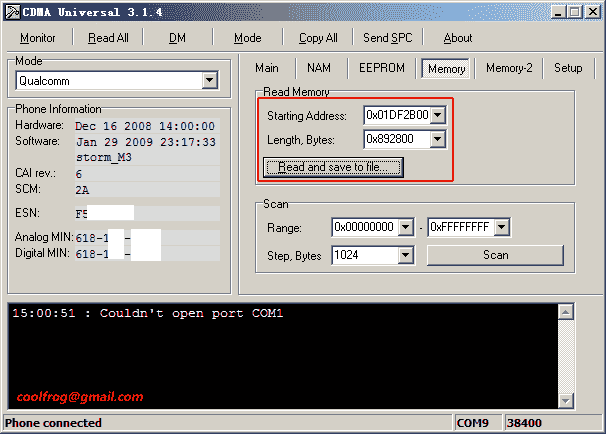

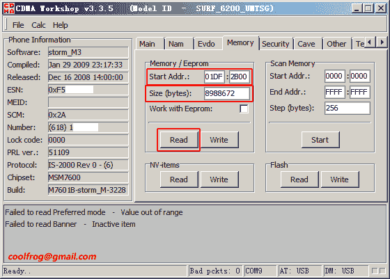

#### [A-2]在内存镜像文件中搜索 ESN、MEID

有了这 `3` 个`.bin` 文件，我们就可以找 `ESN` 和 `MEID` 了；

### [操作步骤]

打开 `UltraEdit`，并依次用 `16` 进制编辑方式打开`.bin` 文件，并在该文件中搜索 `16` 进制的内容（`9530` 手机自身的 `MEID` 和 `ESN`），注意，搜索的内容需要“按字节反序”，例如：

`MEID` 是 `A0 00 00 0D F1 E2 D3`

`ESN` 是 `80 1A 2B 3C`

则我们需要搜索的实际上分别是：

`D3 E2 F1 0D 00 00 A0`

`3C 2B 1A 80`

友情提醒：其实你可以搜索两、三个字节，即可。

如下图所示，我们在第一个`.bin` 文件中，在 `0086ebdf-0086ebe6` 这个位置搜索到了第一个 `MEID`：

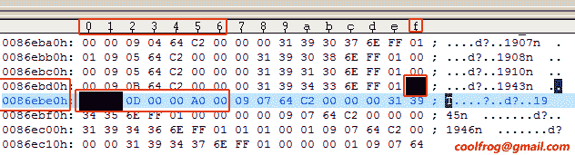

由于第一个`.bin` 文件实际上是从 `01DF2B00` 开始的，因此，我们找到的这个 `MEID` 实际上在内存中的位置是：`0x01DF2B00 + 0x0086ebdf = 0x026616DF`。

以此类推，你需要从所有的文件中找出所有的 `MEID` 和 `ESN`。

下面是我找到的所有地址记录（我的 `9530` 用的是`.99` 的 `ROM`，你的可能跟我的不太一样）：

### [重要数据]

先说 `MEID`，共 `3` 处（看绝对地址就行）：

起始地址：`0x01DF2B00`

偏移地址：`0x0086ebdf`

绝对地址：`0x026616DF`

起始地址：`0x17B28A00`

偏移地址：`0x0011dbb8`

绝对地址：`0x17C465B8`

起始地址：`0x17B28A00`

偏移地址：`0x0029fe10`

绝对地址：`0x17DC8810`

还有两个地址，有时候会用来存放 `MEID`：

`0x17DC88E0`

`0x17DD1960`

我觉得它们只是缓存，临时用的内存地址，不需要关注。


此外还有个特殊地址 `0x17FCB20D`，请见 ESN 内存部分的描述。

接着说 ESN，ESN 比较不确定，我找到 10 余处，有些地址会永远都是 ESN 码，有些地址却有时候会变化。不多说，列在这里：

**[重要数据]**

`0x02663F1C`

`0x02663F33`（以上这两个地址非常重要，我们可以称它们为第一组 ESN 地址）

注：第一组 ESN 地址会发生变化，根据我最近操作过的所有记录来看，我一共发现过三组这样的 ESN 地址，其规律就是都在 `0x0266:0000` 至 `0x0266:FFFF` 这一段内存空间中。另外两组分别是 `0x02664042` 和 `0x02664059`，以及 `0x0266405A` 和 `0x02664071`。你也会有一组这样的 ESN 地址。

`0x17AEB8A4`

`0x17B0FCDC`

`0x17B1C244`

`0x17B9F0B8`

`0x17C4613C`

以上 5 个 ESN 地址也很重要，我们可以称它们为第二组 ESN 地址，目前我实验过 N 次，这些地址没有发生过变化。

下面还有几个地址，有时候会存放 ESN，大部分时候是 0，可以适当关注：

`0x17C46214`

`0x17C4C8A0`

`0x17C5AC2C`

还有一个特殊的地址：

`0x17FCB20D`

第一次研究的时候，发现该地址有时候是 ESN，有时候是 `00000000`；在本文刚写成的时候，在我修改 esn 成功的那一次，它还变成过 MEID；在本文 v1.1 版本修订过程中，可以确定该地址为 QXDM 的 `command` 缓存地址，事实上可以不用关注。

这样，我们一共找到 11 处 ESN，有些是会变的，大家记住这一点就行了，反正我们在操作过程中对这些地址进行多次检查，注意不要遗漏即可。

## [B]正式开战

本部分包括如下操作：

1、用 QXDM `Memory Viewer` 改内存中的 MEID，共 3 处，全部改为 0；

2、用 QXDM `Memory Viewer` 改内存中的 ESN，共 7-10 处左右（不一定每个都是必须，但为了保险，我全部改了）；全部改为 0；

### [关键节点检查]

这个时候 ESN 和 MEID 在内存中均为 0，此时应该出现一个现象，即，你可以使用命令修改 ESN 或 MEID 中的任意一个（我在这里列出关键节点，是为了让你方便检查错误，如果上述两个步骤没有成功，这个检查就会有重要帮助了；你不需要手工检查，直接做下面的第 3 步，如果出错，再回头检查上面的内容）：

可以用命令修改 ESN 为任意值，包括 0；

可以用命令修改 MEID 为一个非 0 值了（只有 `0x00000000000000` 不可以，其他都可以，如果你输入位数不足 14 位，它会自动在前面补 0，如果你输入位数超过 14 位，系统会报错）这个仅仅是我自己感兴趣的测试，大家不需要测试，该动作不是必须的，而且，如果用命令修改了 MEID，请注意 ESN 一定会随之发生变化；

3、接下来应该通过 QXDM 的命令把 ESN 修改为自己 UIM 卡的 ESN，同时确保 MEID 为全 0；

4、将网络设置为 GSM，并尝试打开网络；

5、拔下 USB 线，然后冷启动（拔电池，再装上电池）；

6、机器启动之后，检查 GSM 网络和信号标示状态，应该是 SOS；

7、此时内存中的第一个 MEID 地址（`0x026616DF`）处应该已经恢复位 MEID，用 QXDM 的 `Memory Viewer` 将其改为 0；然后将网络改为 1XEV，然后拨打 10000 号、拨打自己的其他手机，看是否正常；

8、如果正常就再次冷启动，就大功告成了。

下文详述：

### [B-1]第一步，把 9530 内存中所有的 MEID 和 ESN 清 0

得到上述重要数据（地址）之后，开始忙活，祭出法宝 QXDM：

（要打开 DM，并确认自己的 9530 连接电脑的端口是 COM 几，我的是 COM9，然后用 QPST `Configuration` 配置一下端口，确认连接正常）

1、打开 QXDM 之后，先到 `Options-Communications` 里面设置连接的端口，然后打开两个窗口，一个 `Memory Viewer`（F4），一个 `Command Output`，并确认已经连接成功；

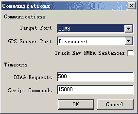


2、在 QXDM 主窗口的左下角，有个 `Command` 输入框，在这里输入命令，依次输入：

`RequestNVItemRead meid`（敲回车）

`RequestNVItemRead esn`（敲回车）

`RequestNVItemRead scm`（敲回车）

这样在 `Command Output` 窗口就可以看到返回的执行结果，如下：

```
RequestNVItemRead esn
DIAG TX item:
esn = 0x00000000
DIAG RX item:
esn = 0x80YYYYYY
```

```
RequestNVItemRead meid
DIAG TX item:
meid = 0x0000000000000000
DIAG RX item:
meid = 0x00A000000DYYYYYY
```

```
RequestNVItemRead scm
DIAG TX item:
scm = 0x00
DIAG RX item:
scm = 0x3A
```

不错，工作正常。

3、然后你可以试试看用 `RequestNVItemWrite` 命令改 `meid` 和 `esn`，会很顺利地失败的：）

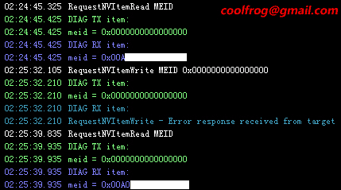

4、因为我在直接折腾 ESN 的时候，遭受过太多挫折，所以现在决定先灭掉 MEID，具体方式如下：

在 QXDM 的 `Memory Viewer` 中，找到如下 3 个地址

绝对地址：`0x026616DF`

绝对地址：`0x17C465B8`

绝对地址：`0x17DC8810`

把它们统统改成 `00000000000000` 并点击“Write”；

然后再通过 `Command` 去 `Read` 一下，确认是否修改完成。

5、接着也别耽误了，用同样的方法找到所有的 ESN，全部改为 `00000000`

6、用 `Command` 确认一下：

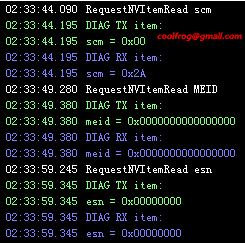

嗯，很完美。

到目前，我们做了 3 件事情：

SCM 被改成了 `0x2A`

MEID 被清为了 0

ESN 被清为了 0

### [B-2]第二步，把 9530 内存中的 ESN 改为我们 UIM 卡上的 ESN

7、现在试试看用 `Command` 去写 ESN，写自己 UIM 卡上的 ESN，发现没有报错：

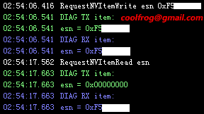

8、继续通过 `Read` 的方式确认一下：

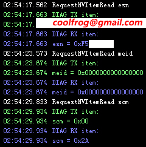

不错，经过反复确认，发现没什么问题（修正：不必关注上图中的 `scm` 值，按照改进后的方法，此时 `scm` 应该是 `0x3A`）。

9、在手机上进入 `Manage Connections` 菜单，选择 `Mobile Network Options`，然后将 `Network Technology` 设置为 `GSM/UMTS`；然后再退到 `Manage Connections` 里面，勾上 `Mobile Network` 前面的勾，这时候手机屏幕右上角的信号标示应该是个叉号，或者是个 SOS；

10、我们需要把机器重新启动一下。经过 kaka 推荐，我用的是冷启动，就是直接拔电池，然后启动。

11、等手机启动好了之后，先检查一下手机屏幕右上角的信号标示，应该是个 SOS；

12、在 QXDM 中通过命令读一下 `scm`、`meid`、`esn` 的值，应该分别是 `0x2A`、老的 `meid`、自己 UIM 卡的 `esn`；

13、如果你不放心，可以再次冷启动手机，并再次确认手机屏幕右上角的信号标示、`scm`、`meid`、`esn`；应该与 11、12 条一样；

14、在 QXDM 中输入命令 `RequestNVItemWrite meid_cd 1`，并敲回车；然后通过 QXDM 的 `Memory Viewer`，将 `meid` 修改为 0，正常的话，应该只有 `0x026616DF` 这一个地址需要修改，另外两个 `meid` 地址处都是 0，无需修改了；

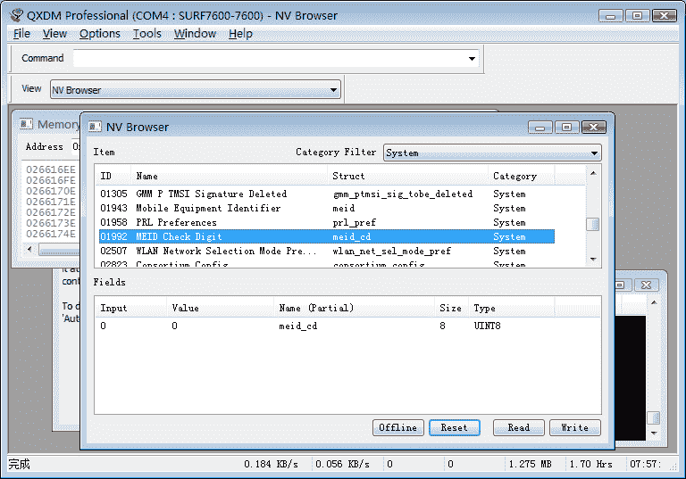

15、在 QXDM 中输入命令 `RequestNVItemWrite meid_cd 0`，并敲回车；在 QXDM 中通过命令读一下 `scm`、`meid`、`esn` 的值，应该分别是 `0x2A`、`0`、自己 UIM 卡的 `esn`；

16、在手机上进入 `Manage Connections` 菜单，选择 `Mobile Network Options`，然后将 `Network Technology` 设置为 `1XEV`；然后再退到 `Manage Connections` 里面，勾上 `Mobile Network` 前面的勾，这时候手机屏幕右上角的信号标示应该显示出网络信号正常；

17、请拨打 10000 号，如果正常，再拨打其他手机号码试试看，如果正常就重新冷启动手机；

18、如果一切顺利，现在你的手机已经可以正常使用电话功能了。

此外，你还可以进入手机菜单的 `Options-Status`，确认一下状态：

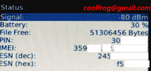

你会看到两个重要变化：

原先这个界面的最下面是 MEID，现在变成 pESN 了！

更重要的是，这里的 ESN 已经被改写成我们自己 UIM 的 ESN 啦！

但同时还会发现另外一个问题：

##000000 进入手编界面，你看到的 pESN 是 0

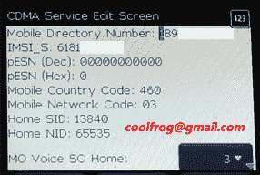

而 `Status` 里面看到的 ESN 是我们 UIM 卡上的 ESN（上文图），这两个不一致（目前使用中没有影响）。

一切正常，恭喜你终于可以使用自己烧号的 9530 了！

不论上述测试过程对大家是否有所帮助，都希望大家多提意见，集思广益，互相帮助，谢谢！

备注：

1、 第一次发布的方法，大家在实际操作中最容易出现的一个问题，就是 `meid` 会自动还原，不能保持 0 的状态；

2、 因此，我仔细研究了这个问题，发现如下值得留意的信息：

A） 在 MEID 和 ESN 都是 0 的情况下，可以用命令修改 MEID 或 ESN 中的一个，不同的是如果修改 MEID，ESN 会自动随之变换成对应的值，如果修改 ESN，MEID 当时是 0，而重启之后，MEID 会变成上一个有效值；

我推测，9530 会自动保存上一个有效值，那么它到底如何判断“有效”呢？

A） 要么是必须修改文件中的值；

B） 要么是必须用 `Write` 命令写成功；

C） 要么是它会根据上一次成功连接网络的情况自动保存一下 MEID，下次启动时恢复；

D） ……

所以我想，可能得先让 9530“忘记”它的 `meid`，因此，我通过设置 GSM-1XEV 网络来回切换的方式，最终修改了 MEID，并让它记住了 0 这个值。最后的修改版本，更彻底，直接用修改 `meid_cd` 标记的方式使机器不再校验 `meid`，从而达到我们的目的。

以上为推测，不知道 RIM 是如何设计它的保护措施的，因此，仅供参考。
