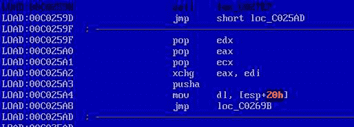
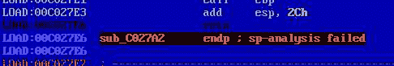
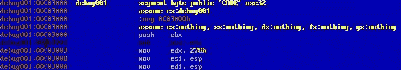
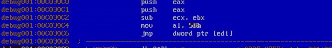
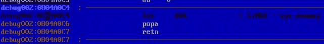

# linux 下 upx 脱壳笔记

> 原文：[`www.pediy.com/kssd/pediy10/79061.html`](https://www.pediy.com/kssd/pediy10/79061.html)

linux 很少有需要 crack 的软件，所以最近总是自娱自乐。自己写的软件自己破着玩但是由于都是知道自己的手段，没有什么意思。真的希望有高手们写些 crackme for linux 。  
最近看了看 windows 的脱壳大致的理解了脱壳的原理，之前没有怎么接触脱壳，通常只是选择没有壳的软件看看。在 linux 下的壳没有找到几个。只找到了一个 upx 的壳，在 windows 下是个弱壳。实际上在 linux 下面也是弱壳，完全可以使用"upx -d"的命令解决问题。但我总是喜欢自己手动的。呵呵....纯属于自娱自乐。  
ok,开始我们的 linux 的 upx 的脱壳之旅.........  
我在选择工具的时候花了很多时间，忽然发现 GDB 在 upx 面前是那么的苍白无力...也终于知道为什么有人说 GDB 不适合做逆向了...虽然软件在调试器里可以正常于运行，正常下断。但是根本无法查看反汇编的代码.......。  
无奈无奈....使用传说中最好的工具 IDA 为此我特地简单的学习了一下 IDC 脚本的使用方法...  
没有什么资料可以参考，是一件很不愉快的事情，因为不知道能不能成功。不管了，一步一步来吧...  
我用“upx －d“ 脱出了原来的文件，发现文件是全的，没有任何部分丢失，所以我相信这些文件会出现在进程空间的某个时间的某个角落，这个很大的坚定了我手动脱壳的信心（但是实际上到这篇文章的结尾我也没有能够在找到完整的程序文件，但我相信理论上内存空间中应该会出现完整的文件的...）。  
  
我的加壳软件是我上次文章中用到做外挂的 mines（扫雷游戏）。先找到了 upx-3.03-i386\_linux 软件 附件中我会给出的免的度这篇文章的人去寻找了。  
对我们目标软件加壳，命令如下，的确是个好用的压缩壳软件，直接有 54％的压缩律。  

代码:

```
\[jun@beijihuCom dumpupx\]$ ./upx mines
                       Ultimate Packer for eXecutables
                          Copyright (C) 1996 - 2008
UPX 3.03        Markus Oberhumer, Laszlo Molnar & John Reiser   Apr 27th 2008

        File size         Ratio      Format      Name
   --------------------   ------   -----------   -----------
     13960 ->      7556   54.13%  linux/elf386   mines                         

Packed 1 file.
\[jun@beijihuCom dumpupx\]$ 

```

好了，我们开始调试他了，加了壳以后，一般的调试软件已经对他无能为力了...  
实验一下 GDB 和 DDD 的效果...以及 objdump  
readelf 还可以正常使用，（仅限于一部分功能.呵呵，不详谈了...）  
代码:

```
\[jun@beijihuCom dumpupx\]$ readelf -e ./mines
ELF Header:
  Magic:   7f 45 4c 46 01 01 01 03 00 00 00 00 00 00 00 00 
  Class:                             ELF32
  Data:                              2's complement, little endian
  Version:                           1 (current)
  OS/ABI:                            UNIX - Linux
  ABI Version:                       0
  Type:                              EXEC (Executable file)
  Machine:                           Intel 80386
  Version:                           0x1
  Entry point address:               0xc02598
  Start of program headers:          52 (bytes into file)
  Start of section headers:          0 (bytes into file)
  Flags:                             0x0
  Size of this header:               52 (bytes)
  Size of program headers:           32 (bytes)
  Number of program headers:         2
  Size of section headers:           40 (bytes)
  Number of section headers:         0
  Section header string table index: 0

There are no sections in this file.

Program Headers:
  Type           Offset   VirtAddr   PhysAddr   FileSiz MemSiz  \*\*\* Align
  LOAD           0x000000 0x00c01000 0x00c01000 0x01d60 0x01d60 R E 0x1000
  LOAD           0x0002fc 0x0804b2fc 0x0804b2fc 0x00000 0x00000 RW  0x1000

```

上面的输出，我们可以发现他的入口点是 0xc02598 这个入口点已经和 GCC 编译出来的程序大不一样了。实际上重“upx －d“脱出来的效果来看，原来的入口点基本上是不会改变的，也就是说我们的手动脱壳的时候软件的入口点，加载方式都是和未加壳的软件是一样的...这一点又为我们的脱壳成功，增加了砝码..  
继续....gdb 调试一下  
代码:

```
(gdb) b \*0xc02598
Breakpoint 1 at 0xc02598
(gdb) r
Starting program: /home/jun/Crack/dumpupx/mines 
warning: shared library handler failed to enable breakpoint
(no debugging symbols found)

Breakpoint 1, 0x00c02598 in ?? ()
(gdb) disassemble
No function contains program counter for selected frame.
(gdb) 

```

gdb 看不反汇编代码，晕了都不知道下一步的操作是什么....看来是没有什么用了  
祭起传说中的逆向利器 IDA.学西习了一下，简单操作，我开始了调试之旅.  
代码:

```
\[jun@beijihuCom dumpupx\]$ idal ./mines

```

等到加载完成，会停在入口处，呵呵在光标在 call 上直接按 F4，程序运行，停到了入口出  
  
单步运行...实际上我没有什么办法，不知道有什么下好的方法下断点，可以使这个简单方法调试...  
这边我是这么想的，upx 是压缩壳，当他把执行权交给原目标程序的时候，必定会有一个大的跳转，好多新手在 windows 脱壳，都是以这个为 oep 的标准的。linux 应该也不会例外的...  
F8 单步到 0xc025c8 跳到 oxc025d1 在 0xc025d3 又会跳回来。显然是个循环。不在循环里浪费时间了。我们向下找找，下面有个 retn 返回。光标移到上面 F4。实际上没有什么把握。只是蒙的，结果很好，没有飞走.F8 单步到了这里  
  
继续单步，retn 到一个地方  
  
不详细分析了往下看。翻阿翻，不会这么巧吧.看见了 jmp dword ptr \[edi\]跳转，这不会是传说中的大跳吧。  
  
不管直接 F4 到这里...哈哈很成功。  
单步一下，跳到了这里。  
  
不懂代码的具体含义，但是明显不是程序的入口...为什么?单步....继续  
  
看到这里我忽然顿悟，这里是在做 ld 连接，不能让他运行了，很可能是为了我们目标程序的运行进行共享库的连接..会修改我们内存中的映像文件。这样我们 dump 出来的就不是原来的干净程序，因为我们没有修复工具，比起 windows 里面的 PE 修复要麻烦多了.....所以赶紧 dump 出来...  
用来 dump 映像的 idc 脚本  
代码:

```
#include <idc.idc>
#define PT\_LOAD              1

#define PT\_DYNAMIC           2
static main(void)
{
  auto ImageBase,StartImg,EndImg;//基址 08048000
  auto e\_phoff;
  auto e\_phnum,p\_offset;//paddr 0xc 地址，pmemsz ox14 大小,p\_offset 0x4
  auto i,dumpfile;
    ImageBase=0x08048000;
  StartImg=0x08048000;
  EndImg=0x0;  
  Message("%8x\\n",Dword(ImageBase));
  if (Dword(ImageBase)==0x7f454c46 || Dword(ImageBase)==0x464c457f )
  {
    if(dumpfile=fopen("./dumpfile","w+"))
    {
      e\_phoff=ImageBase+Word(ImageBase+0x1c);
      e\_phnum=Word(ImageBase+0x2c);
      for(i=0;i<e\_phnum;i++)
      {
         if (Dword(e\_phoff)==PT\_LOAD || Dword(e\_phoff)==PT\_DYNAMIC)
          
          {  p\_offset=Dword(e\_phoff+0x4);        
            StartImg=Dword(e\_phoff+0xc);
            EndImg=Dword(e\_phoff+0xc)+Dword(e\_phoff+0x14);
              
                dump(dumpfile,StartImg,EndImg,p\_offset);
                Message("dump LOAD%d ok.\\n",i);
          }    
          
        e\_phoff=e\_phoff+0x20;
      }
      fseek(dumpfile,0x30,0);
      fputc(0x00,dumpfile);    
      fputc(0x00,dumpfile);    
      fputc(0x00,dumpfile);    
      fputc(0x00,dumpfile);
      fclose(dumpfile);
    }else Message("dump err.");
  }

}
static dump(dumpfile,startimg,endimg,offset) 
{
  auto i;
  auto size;
  size=endimg-startimg;
  fseek(dumpfile,offset,0);
    for ( i=0; i < size; i=i+1 ) 
    {
      fputc(Byte(startimg+i),dumpfile);
    }
}

```

改变文件的属性，让他可以运行。  
代码:

```
\[jun@beijihuCom dumpupx\]$ su
口令：
\[root@beijihuCom dumpupx\]# chmod 755 ./dumpfile
\[root@beijihuCom dumpupx\]# ./dumpfile

```

程序运行的很好..  
  
总结：第一次在 linux 下手动脱壳，看上去文章中写的很轻松，实际上在之前做了很多工作。包括 ELF 的加载等等。还有我发现如果程序的节表头程序也能很好的运行，什么的..  
另外，我之调试的时候，实际经过很多挫折...没有足够的经验嘛...不过些文章，截图的时候都很顺利..呵呵.共勉........

上传的附件
|  || dumpupx.zip  
 |