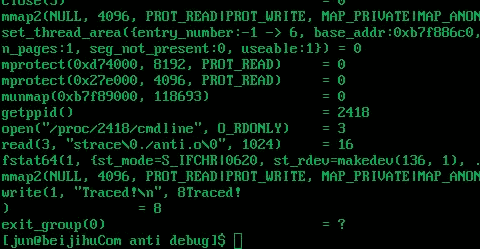
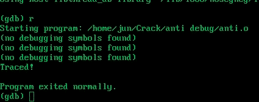
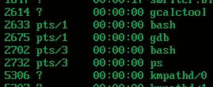
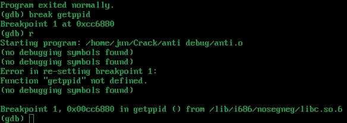
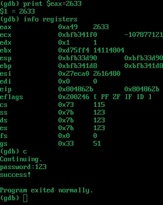

# linu 下反反跟踪的一点学习笔记

> 原文：[`www.pediy.com/kssd/pediy10/77461.html`](https://www.pediy.com/kssd/pediy10/77461.html)

每天一小步，循序渐进学 linux 的 crack.  
  
嘻嘻，网上搜了搜 linux 下反调试的方法。果然还是有一些的，一位叫 Geek 大人的 blog 里就列举的几种。  
好像他也是摘录的，具体原文是什么样子。我也不不知道，他的方法我大致的看了看。有反调试，就有反反调试。然后还有反反反调试。呵呵，实际上我现在想做的是就是挑出来一个然后实现他的反调试，然后在想办法绕过他的反调试。实际上这些若是在 windows 下面。早已经被过了八百次了，呵呵。现在我们要在 linux 下绕过它，该怎么做呢？嘿嘿。  
实验启动....  
  
挑一个  
源代码如下。  

代码:

```
#include <stdio.h>
#include <stdlib.h>
#include <string.h>
#include <unistd.h>
#include <sys/types.h>
#include <sys/stat.h>
#include <fcntl.h>
  
int get\_name\_by\_pid(pid\_t pid, char\* name)
 {
     int fd;
     char buf\[1024\] = {0};
     snprintf(buf, 1024, "/proc/%d/cmdline", pid);
     if ((fd = open(buf, O\_RDONLY)) == -1)
         return -1;
     read(fd, buf, 1024);
     strncpy(name, buf, 1023);
     return 0;
 }
  
 int main(void)
 {
     char \*password="123",user\[5\]="";
     char name\[1024\];
     pid\_t ppid = getppid();
     //printf("getppid: %d\\n", ppid);
         if (get\_name\_by\_pid(ppid, name))
         return -1;
        if (strcmp(name,"bash")==0||strcmp(name,"init")==0)
            {printf("password:");                   
              scanf("%s",user);
                       if(!strcmp(password,user)) printf("success!\\n");        
                       else printf("Error!\\n");
                 }
     else if (strcmp(name,"gdb")==0 || strcmp(name,"strace")==0 || strcmp(name,"ltrace") == 0)
         printf("Traced!\\n");
     else
         printf("Unknown! Maybe traced!\\n");
  
     return 0;
 }

```

它利用 getppid 来进行探测。得到自己程序的父进程。检查他的父进程是不是 bash 或者是 init，这里为什么是父进程是 bash，或者是 init 呢？bash 就不解释了，因为 linux 的程序基本都是在 bash 下运行的。init 是 linux 启动的第一进程，init 进程是所有进程的发起者和控制者。呵呵....不多说了。  
在 Linux 上要跟踪一个程序，必须是它的父进程才能做到，因此，如果一个程序的父进程不是意料之中的而是 gdb，strace 之类的，那就说明它被跟踪了，被调试了。  
编译并测试。  
代码:

```
\[jun@beijihuCom anti debug\]$ gcc -o anti.o  anti.c
\[jun@beijihuCom anti debug\]$ ./anti.o
password:123
success!
\[jun@beijihuCom anti debug\]$  

```

编译后 使用 strace 跟踪。  
截图如下。没有运行到密码判断的之路下。  
  
下面我们再看看 gdb 能不能调试它。  
  
我没有下断点之接运行了。看到他检查出来父进程不是 bash 就打印出 Traced 退出了。  
  
下面我们应该考虑怎么过这个了.......，我的想法就是在他调用 getppid 的时候把他的返回值改为 bash 的 pid 值。这样它就会被我们欺骗转向正确的支路线。  
ok 启动 gdb  
代码:

```
\[jun@beijihuCom anti debug\]$ gdb ./anti.o

```

这个时候你要是直接用  
break getppid 是没办法成功下断的....原因正在研究中。不管我们现运行一下。它会报告我们，被跟踪了.......  
代码:

```
(gdb) r
Starting program: /home/jun/Crack/anti debug/anti.o 
(no debugging symbols found)
(no debugging symbols found)
(no debugging symbols found)
Traced!

Program exited normally.
(gdb) 

```

会有如上输出......  
这个时候下断点应该是可以了...  
代码:

```
(gdb) break getppid
Breakpoint 1 at 0xcc6880
(gdb) 

```

如上输出，你的机器可能和这个地址不一样。  
另外启动一个 bash 输入以下命令  
代码:

```
\[jun@beijihuCom ~\]$ ps -A

```

  
你会找到如上的一些输出....bash 的 pid 是 2633 待用。  
我们还会发现  
代码:

```
16100 ?        00:00:02 gnome-screensav
21836 ?        00:00:00 notification-da
22352 pts/2    00:00:00 bash

```

这样一个 bash 的 pid ，这个比起你的上面的 pid 可大很多。我们不用它。  
在 gdb 的控制台上输入 r  
代码:

```
(gdb) r

```

我们会得到于以下输出。  
  
步过，不是单步 相当于 od F8 gdb 用 next （单步用 step）  
不截图了，直接复制代码上来了  
代码:

```
(gdb) next                                        ;步过
Single stepping until exit from function getppid, 
which has no line number information.
0x0804862b in main ()
(gdb) info registers                              ;查看 cpu 的寄存器值
eax            0xa73    2675                      ;这个就是得到 ppid，父进程的 id 看看上面图片哈哈，就是 gdb 的
ecx            0xbfb341f0       -1078771216
edx            0x1      1
ebx            0xd75ff4 14114804
esp            0xbfb33d90       0xbfb33d90
ebp            0xbfb341d8       0xbfb341d8
esi            0x27eca0 2616480
edi            0x0      0
eip            0x804862b        0x804862b <main+51>
eflags         0x200246 \[ PF ZF IF ID \]
cs             0x73     115
ss             0x7b     123
ds             0x7b     123
es             0x7b     123
fs             0x0      0
gs             0x33     51

```

下面我们要修改 eax 的值了，简单的一个命令就可以了  
代码:

```
(gdb) print $eax=2633                                 ;修改 eax 寄存器为 bash 的 pid
$1 = 2633
(gdb) info registers                                  ;查看寄存器
eax            0xa49    2633
ecx            0xbfb341f0       -1078771216
edx            0x1      1
ebx            0xd75ff4 14114804
esp            0xbfb33d90       0xbfb33d90
ebp            0xbfb341d8       0xbfb341d8
esi            0x27eca0 2616480
edi            0x0      0
eip            0x804862b        0x804862b <main+51>
eflags         0x200246 \[ PF ZF IF ID \]
cs             0x73     115
ss             0x7b     123
ds             0x7b     123
es             0x7b     123
fs             0x0      0
gs             0x33     51
(gdb) 

```

继续运行了。  
代码:

```
(gdb) c
Continuing.
password:123
success!

Program exited normally.
(gdb) 

```

呵呵，成功。如果是需要干其他事情的就干其他事情了。比如你最拿手的 crack 了  
最后附图  
