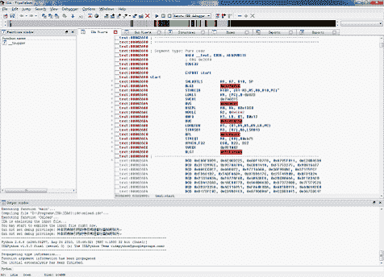
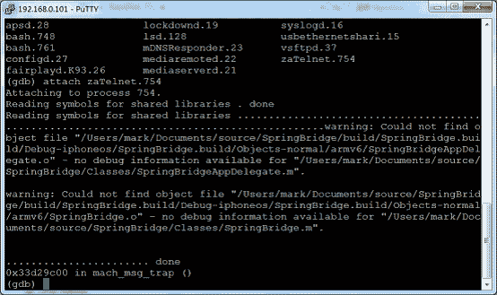
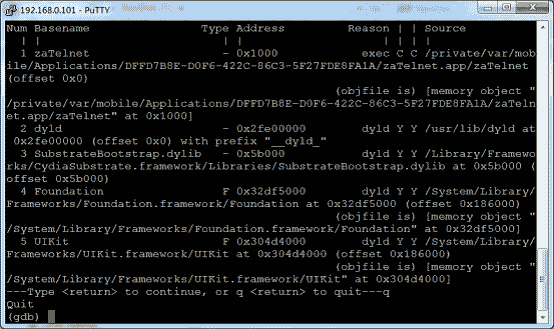
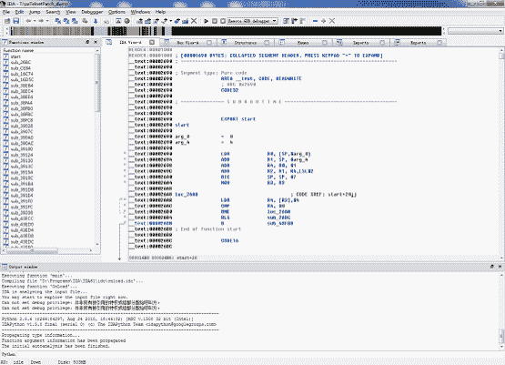
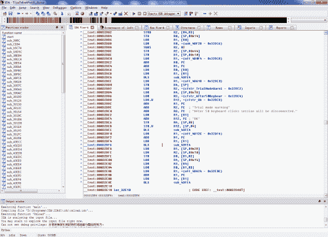
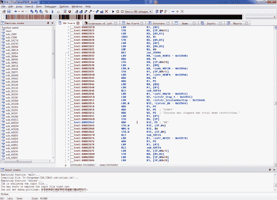
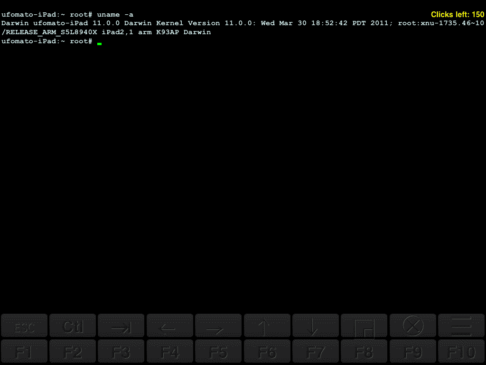

# IPAD 破文一篇

> 原文：[`www.pediy.com/kssd/pediy12/138743.html`](https://www.pediy.com/kssd/pediy12/138743.html)

**前言：**  
  一个偶然的机会，得到一台 IPAD2，若只当个娱乐玩具，还是挺很不错的。在苹果封闭的体系保护中，不去苹果那儿注册，安装自己开发软件是相当的困难，尤其在没有 MAC 笔记本的情况下，安装 IPAD 的开发环境相当艰苦，我到现在还没安装成功过（要是你成功安装过，欢迎教我一下），呵呵。前不久，jailbreakme 利用 PDF 漏洞实现了越狱，可以安装各种软件和开发工具了，哈哈，可以在没有 XCode 开发环境下，从另一个方面深入地了解一下其内部系统了。  
  言归正传，在 APP 中找了款免费的 SSH 软件，体验了一下，整体感觉还是不错的，只是使用时会有 150 次按键的限制，有点不爽，这便激发我来解决这一点。特别说明，本文仅以学习研究为目的。  
  
  
**准备：**  
一台越狱后的 IPAD2，GCC 编译工具，GDB 调试工具，Open SSH 服务，当然还有我们的目标软件 zaTelnet。  
一台电脑，装有 Putty 系列工具，IDA6.1 工具。  
保证电脑和 IPAD 的网络畅通。  
  
  
**分析：**  
以 zaTelnet3.0.6 为例  
  
通过 SSH 连接在 IPAD 找到 zaTelnet 所在目录  
/private/var/mobile/Applications/DFFD7B8E-D0F6-422C-86C3-5F27FDE8FA1A  
将主程序 zaTelnet 拉下来看看  
  
  
一地鸡毛，像加了壳似的。静态分析是没法做了，只能通过动态调试的来看看。  
  
上 GDB 工具，使用 ATTACH 命令，进入 ZaTelnet 进程的领空。  
  
再使用 info sharedlibrary 命令，查看加载的模块信息  
  
发现进程占用的空间 为 0x1000 ~ 0x5b000  
再使用 dump zaTelnetPatch\_dump 0x1000 0x5b000 命令，将内存 DUMP 到 zaTelnetPatch\_dump 文件中。  
再上 IDA 来分析下 zaTelnetPatch\_dump 文件。  
  
  
貌似是解过密的原始代码了。  
通过提示特征信息，快速定位。  
  
  
  
  
相关的处理  
\_\_text:00032CB8                 PUSH            {R4-R7,LR}  
\_\_text:00032CBA                 ADD             R7, SP, #0xC  
\_\_text:00032CBC                 PUSH.W          {R8,R10,R11}  
\_\_text:00032CC0                 VPUSH           {D8-D15}  
\_\_text:00032CC4                 SUB             SP, SP, #0x74  
\_\_text:00032CC6                 LDR.W           R3, =(off\_44154 - 0x32CD2)  
\_\_text:00032CCA                 STR             R0, \[SP,#0x28\]  
\_\_text:00032CCC                 ADD             R0, SP, #0x40  
\_\_text:00032CCE                 ADD             R3, PC  
\_\_text:00032CD0                 STR             R2, \[SP,#0x24\]  
\_\_text:00032CD2                 LDR             R3, \[R3\]  
\_\_text:00032CD4                 STR             R7, \[SP,#0x60\]  
\_\_text:00032CD6                 STR.W           SP, \[SP,#0x68\]  
\_\_text:00032CDA                 STR             R3, \[SP,#0x58\]  
\_\_text:00032CDC                 LDR.W           R3, =(unk\_42C94 - 0x32CE4)  
\_\_text:00032CE0                 ADD             R3, PC  
\_\_text:00032CE2                 STR             R3, \[SP,#0x5C\]  
\_\_text:00032CE4                 LDR.W           R3, =(loc\_32F02 - 0x32CEC)  
\_\_text:00032CE8                 ADD             R3, PC  
\_\_text:00032CEA                 ORR.W           R3, R3, #1  
\_\_text:00032CEE                 STR             R3, \[SP,#0x64\]  
\_\_text:00032CF0                 BLX             sub\_43F80  
\_\_text:00032CF4                 LDR.W           R0, =(unk\_4DE58 - 0x32D04)  
\_\_text:00032CF8                 LDR.W           R1, =(off\_4DDF0 - 0x32D06)  
\_\_text:00032CFC                 MOV.W           R2, #0xFFFFFFFF  
\_\_text:00032D00                 ADD             R0, PC  
\_\_text:00032D02                 ADD             R1, PC  
\_\_text:00032D04                 LDR             R0, \[R0\]  
\_\_text:00032D06                 LDR             R1, \[R1\]  
\_\_text:00032D08                 STR             R2, \[SP,#0x44\]  
\_\_text:00032D0A                 BLX             sub\_43FE4  
\_\_text:00032D0E                 TST.W           R0, #0xFF  
\_\_text:00032D12                 BEQ.W           loc\_32E7E  
\_\_text:00032D16                 LDR.W           R2, =(unk\_4CB98 - 0x32D22)  
\_\_text:00032D1A                 LDR             R3, \[SP,#0x28\]  
\_\_text:00032D1C                 LDR             R4, \[SP,#0x28\]  
\_\_text:00032D1E                 ADD             R2, PC  
\_\_text:00032D20                 LDR             R1, \[R2\]  
\_\_text:00032D22                 STR             R3, \[SP,#0x2C\]  
\_\_text:00032D24                 LDR             R3, \[R3,R1\]  
\_\_text:00032D26                 SUBS            R3, #1       按一次计数器减 1   
\_\_text:00032D28                 STR             R3, \[R4,R1\]  
\_\_text:00032D2A                 LDR             R3, \[R2\]  
\_\_text:00032D2C                 LDR             R3, \[R4,R3\]  
\_\_text:00032D2E                 CMP             R3, #0  
在 GDB 中，使用 00032D26 命令，内存修改代码  
(gdb) set {unsigned char} 0x00032D26 = 0x00  
(gdb) x/i 0x00032D26  
0x32d26:        subs    r3, #0  
(gdb)  
继续运行程序  
(gdb) c  
Continuing.  
见证奇迹的时刻到了。你就会发现，按任何一个按键之后，右上角的计数不再减少了。至此完成的破解。当然实际使用时，总不能架一个 GDB 吧，总需要自动 Patch 吧。  
  
  
**补丁：**  
    进程执行时会检查 /Library/MobileSubstrate/DynamicLibraries/ 目录中 扩展名 plist 的文件中的描述来决定是否动态同名的扩展名为 dylib 的文件。用这个方法就可以实现在 zaTelnet 执行自动加载我们的 Patch 动态库。  
附上 Patch 内存的核心代码，大部分都是从网上抄来的，呵呵。  
  
static void patch\_mem(void \*p, unsigned char data)  
{  
    int page = getpagesize();  
    uintptr\_t address = (uintptr\_t)(p);  
    uintptr\_t base = address / page \* page;  
    mach\_port\_t self = mach\_task\_self();  
    kern\_return\_t error;  
  
    if ((page - (uintptr\_t)(p) - base) < 12)  
        page \*= 2;  
          
    if (error = vm\_protect(self, base, page, FALSE, VM\_PROT\_READ | VM\_PROT\_WRITE | VM\_PROT\_COPY))   
    {  
        // fprintf(stderr, "vm\_protect():%d\\n", error);  
        return;  
    }  
    \*(unsigned char\*) p = data;  
    // \_\_clear\_cache((char \*)(p), (char \*)(p + 1));  
   
    if (error = vm\_protect(self, base, page, FALSE, VM\_PROT\_READ | VM\_PROT\_EXECUTE))  
    {  
        // fprintf(stderr, "vm\_protect():%d\\n", error);  
        return;  
    }  
}  
  
static mach\_msg\_type\_number\_t read\_mem(void \*p, char \*data, mach\_msg\_type\_number\_t size)  
{  
    int page = getpagesize();  
    vm\_address\_t address = (vm\_address\_t)(p);  
    mach\_port\_t self = mach\_task\_self();  
    pointer\_t buf;  
    kern\_return\_t error;  
  
    if (error = vm\_read(self, address, size, &buf, &size))  
    {     
        //fprintf(stderr, "vm\_read():%d\\n", error);  
        return 0;  
    }  
    memcpy(data, (void\*)buf, (int)size);  
    return size;  
}  
  
int \_X\_HIDDEN patcher\_(unsigned char\* pFun, unsigned char\* pIns)  
{  
    unsigned char \*p;  
    char buf\[16\];  
    p = pFun;  
    if (read\_mem(p, buf, sizeof(buf)) == sizeof(buf))  
    {  
        if (0 == memcmp(buf, "\\xF0\\xB5\\x03\\xAF\\x2D\\xE9\\x00\\x0D\\x2D\\xED\\x10\\x8B", 12))  
        {  
            p = pIns;  
            if (p\[0\] == '\\x01' && p\[1\] == '\\x3b')  
            {  
                // 修改内存属性  
                // p\[0\] = '\\0';    
                patch\_mem(p, '\\0'); // 停止减少按键计数  
                return 1;  
            }  
        }  
    }  
    return 0;  
}  
  
  
  
  
**最后：**  
    就不贴执行文件了，重点是分析过程，初次接触苹果系统，水平有限，不足之处，欢迎各位指教。  
  
最后来一张效果图  
  

上传的附件
|  || IPAD 破文一篇.pdf  
 |