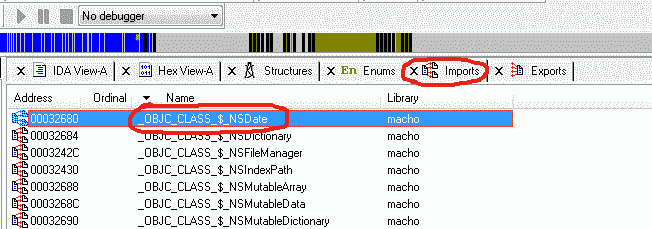
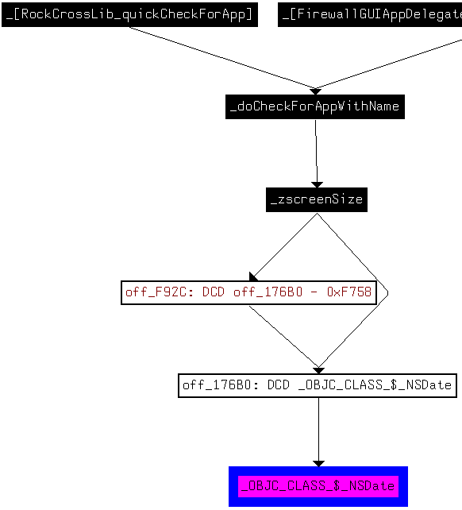
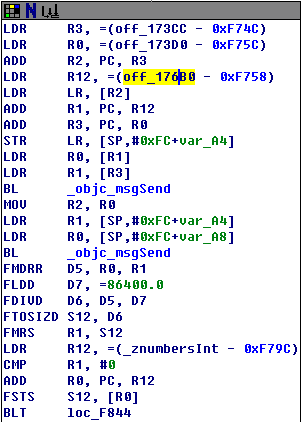
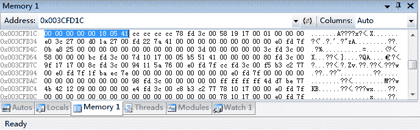

# IPhone 平台下破解:Crack Firewall ip

> 原文：[`www.pediy.com/kssd/pediy11/109834.html`](https://www.pediy.com/kssd/pediy11/109834.html)

PS:仙果代朋友而发  
目录:  
0x1.题记  
0x2.调试环境及工具  
0x3.破解过程  
0x4.结语  
  
作者相关  
afdsft@gmail.com  
http://hi.baidu.com/afdsft  
  
0x1.题记  
手上拿到一台港台行货的 IPhone,随即开始摆弄，进过一系列的越狱等工作，终于可以把玩。  
由于大意电话没有通过 wifi 上网而是通过 GPRS,又没有 GPRS 流量,所以  
白白浪费了一些话费.于是萌生了安装防火墙的念头.  
来到 Rock App 的主页,很快就发现了 Firewall ip 这款软件,评价还不错,  
于是就装到了电话上.迅速浏览下程序的设置页面,发现”block if not on  
wifi”这项功能正是我需要的,呵呵.  
由于这是 Rock App 上面的一个付费软件,只能试用 10 天,程序启动时也会显示  
“Trial expires x day”. 恩,这个嘛.........抄家伙:  
  
0x2.调试环境及工具  
1.Firewall ip 1.3.9  
2.IDA pro 5.5  
3.010 Editor  
4.vc 2008  
5.windows 7\_En  
  
0x3.破解过程  
一.推测验证：程序如何计算试用期剩于天数?  
当然,我们的电话还没有先进到自己去测某个分子的原子周期来计算距离  
1900 年已经过去多久,那么一般办法有两种:通过网络到指定服务器或是本地取  
得当前日期，取得日期后与保存在“某个地方”的安装日期做比较。验证一下，  
在“设置->通用->日期”与时间菜单里，将日期调后一天，重新运行软件，发  
现原来显示还有 10 天试用期，现在已经变成了还有 11 天。那么证明程序是通  
过本地来取得日期的。那么这样就可以简单达到延长试用期的目的了，如果我  
告诉你文章这里就结束了，你会鄙视我的，呵呵，继续。  
  
二. 程序通过调用什么函数取得当前日期？  
对 iphone SDK 我的前置知识为零，我更不清楚系统层级别的一些函数。那么又只  
有猜测了，通过 iphone SDK 某个函数取得当前日期，那么函数名字里面得有个关键  
字“date”吧，(啥，这也猜不到，-\_-#),用 ida 将主程序 FirewallGUI 载入（此处  
省去将程序拷到 windows 主机 N 个步骤），在 ida 导入函数表里面找到了这个函数，  
如图:  
  
  
然后查看了下这个函数的引用情况，如图：  
  
  
还好调用的情况不是很复杂，查看下反汇编代码：如图：  
  
  
黄色高亮的那一行就是引用 NSDate 的地方，继续往下看，看到什么问题没有？  
86400.0 这个数字比较可疑，这是一个程序中使用的常量，什么常量呢？(作者身高  
的浮点数，薪水......), 3600 X 24 = 86400,就是一天有 24 个小时有 86400 秒钟。  

代码:

```
FLDD D7,=86400.0
FDIVD D6，D5，D7

```

结合这两条指令来看，第一条指令是将 86400.0 赋给 D7,下一条指令是用 D5 的值除  
以 D7 然后将结果保存到 D6 中，小学生现在都清楚了，它是在计算有多少天。那么修  
改这里就可以达到我们的目的了，我们虽然尚不清楚被除数 D5 怎么得来的，但是我  
可以修改 86400 这个常量，如果我把 86400 修改为　86400 X 2 = 172800 的话，那  
么在程序看来，要过 172800 秒才算是过一天，86400 X 365,86400 X 365 X 20(二十  
年又是一好汉)，86400 X 2012 (-\_-#)....  
  
三.修改测试。  
　　86400.0 因该是浮点数，结合指令来看好像是双精度浮点数，ida 里面搜索到  
86400.0 是这样保存的  
代码:

```
00 00 00 00 00 18 F5 40

```

　　我想把它修改为　86400 X 2 = 172800 ，但是怎么修改呢？不知道怎么转换的。  
只有用 vc 2008 来转换了，用到了下面的几行代码  
  
代码:

```
#include "stdafx.h"
int \_tmain(int argc, \_TCHAR\* argv\[\])
{
double i= 172800; //将 172800 赋给双精度变量 i
\_asm
{
　
lea eax,i //将变量 i 在内存中地址赋给 eax
int 3 //中断断点，程序断下来后，在内存中查看浮点数保存形式
}
return 0;
}

```

如图  
  
  
　蓝色部就是 172800 双精度浮点在内存中的“样子”了。然后用 010 Editor  
搜索 00 00 00 00 00 18 F5 40　然后将其替换为 00 00 00 00 00 18 05 41。  
  
　修改完成后，将程序传回电话，然后运行程序，各位看官因该还记得开始的时候，  
我将日期调后了一天，显示还有 11 天过期，运行程序后提示变回了还有 10 天过期，  
再往后调一天，也就是总共把日期往后调整了两天，现在程序就显示还有 11 天过期  
了，看来前面的推测是正确的了。现在就可以将这个数字改大一点然后一直试用了，  
需要注意的是程序传回去的时候需要执行　chmod +x 　命令。  
  
0x4 结语  
Question for U :)  
a.程序将安装日期放在那里的？  
b.如果将 86400 改为零的话....  
本文没有技术含量权当抛砖引玉，高手一笑而过。  
crack\_firewall\_ip.pdf