# Mac OS X 下一软件 Voila 注册算法分析

> 原文：[`www.pediy.com/kssd/pediy11/104728.html`](https://www.pediy.com/kssd/pediy11/104728.html)

Voila keygen  
  
工具: IDA v5.2, gdb  
IDA 可以用 Wine 在 mac os x 上跑起来，或者有两台电脑，一台 windows，跑 IDA，另一台 Mac。  
  
在 windows 平台中打开 ida，加载 Voila(Mac OS X binary)   
找到的关键地方为：  
000A9B8F                         \_\_VLRegister\_registerContinue\_\_  
  
   
  
 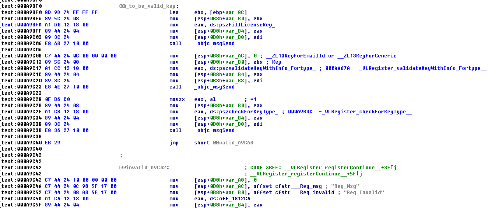  
  
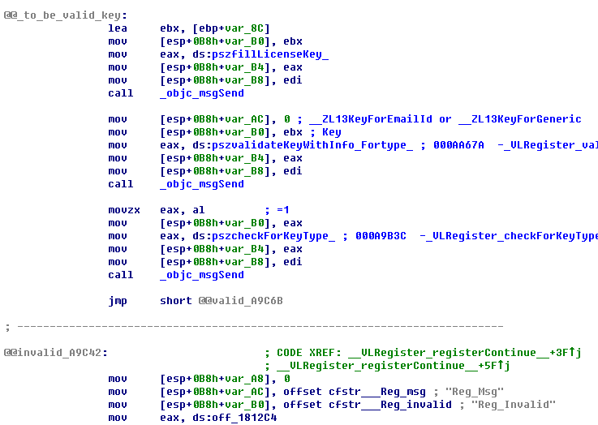  
  
下面再跟进下面的函数:  
  
000AA67A                         \_\_VLRegister\_validateKeyWithInfo\_Fortype\_\_  
  
在 000AA681 执行后,查看 ecx:  
 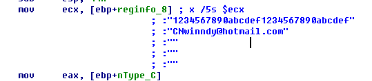  
  
下面,判断使用什么 key  
  
 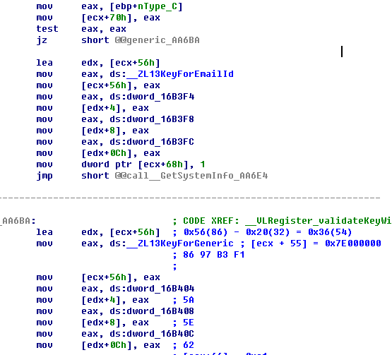  
  
参数 nType\_C 是从下面传进来的.  
\_\_text:000A9C0B C7 44 24 0C 00 00 00 00                 mov     \[esp+0B8h+var\_AC\], 0  
  
看看 key:  
  
 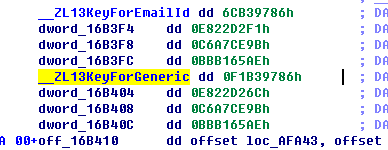  
  
继续:  
 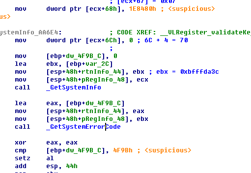  
  
注意到上图最上面两行, 两个常数, 为方便起见,就当作是一个 int64 整数.  
  
跟进\_GetSystemInfo  
  
实例化一个 SystemState 类  
   
  
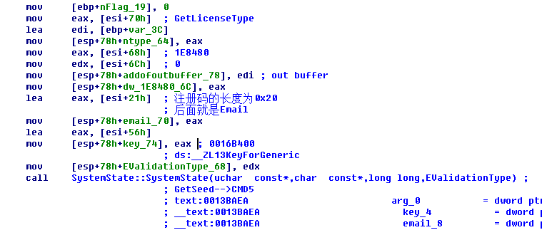  
  
进入构造函数 SystemState::SystemState(unsigned char  const\*, char  const\*, long long, EValidationType):  
  
 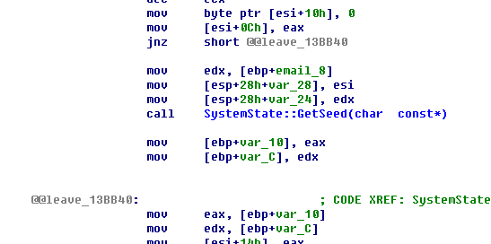  
  
如果没有传入上面提到的 int64 常数,则调用 GetSeed 函数来生成一个 int64.  
  
继续:  
  
 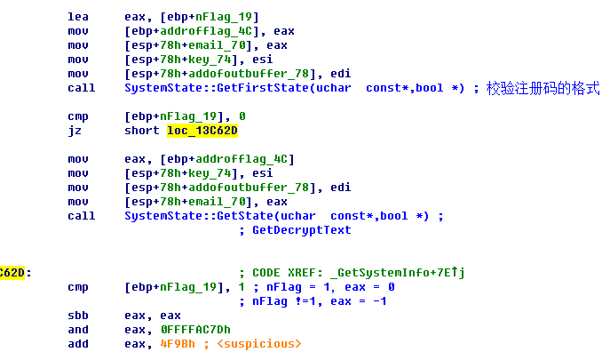  
  
SystemState::GetFirstState 用来校验注册码的长度(0x20)和注册码的字符(数字和字母).  
  
再跟进 SystemState::GetState  
  
 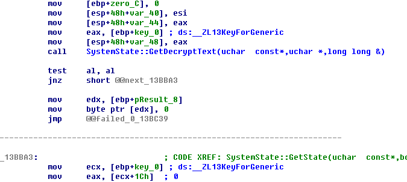  
  
首先调用 SystemState::GetDecryptText,然后对解出来的信息进行校验.  
  
跟进 SystemState::GetDecryptText:  
  
 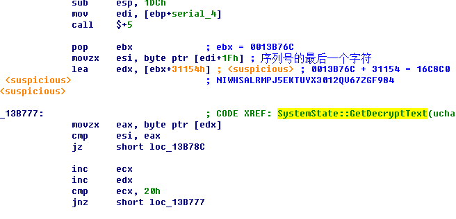  
取出序列号的最后一个字符,然后找到这个字符在” NIWHSALRMPJ5EKTUYX3012QV67ZGF984”中的位置（第一个字符位置为 0），设为 LastCharIndex。  
  
下面再从注册码中的 LastCharIndex 开始，取 5 个字符，设为 Part\_5,将剩余的 26 个字符，合并为 Part\_26  
  
 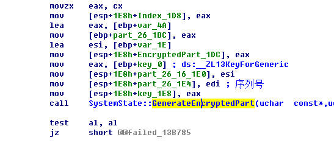  
  
再来看看 SystemState::GenerateEncryptedPart  
这个函数先将注册码分割为两部分，再将注册码用其在两个字符串中的位置所代替。  
偶数字符从 SystemState::m\_acSet2 db 'BCDORSJAMP5LEKTUYX3012QV67ZGF984',0 中取  
奇数字符从 SystemState::m\_acSet1 db 'NIWHSALRMPJ5EKTUYX3012QV67ZGF984',0 中取  
注册码的第一个字符为 0，偶数字符  
  
再往下看  
  
 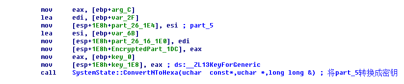  
  
函数 SystemState::ConvertNToHexa，将 part\_5 转换为密钥（aes128），当成一个 int64 来看。  
  
来看看函数 SystemState::ConvertNToHexa 的关键代码：  
 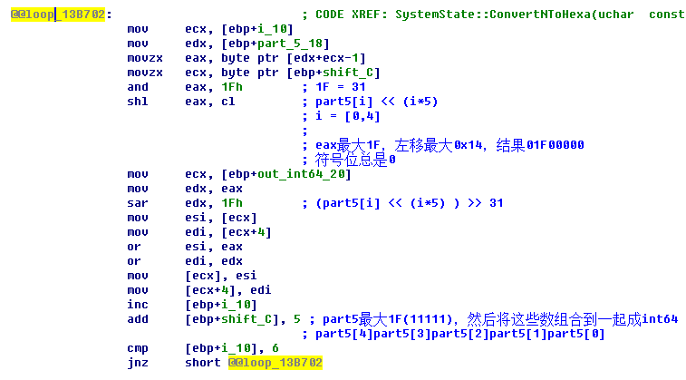  
  
将 part\_5 紧凑起来。因为两个字符级是 32，index 最大 31，占 5 个 bit，因此将这些 5bit 合并，使得每个字节的每个 bit 都利用。  
同时将这个 int64 变成一个字符串。  
  jmp     SystemState::GenerateNinHexa(uchar \*,ulong long) ; 将 int64 变成字符串  
  
再看看 part\_26 的转换：  
  
 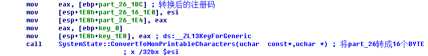  
  
将 26 个 index，也紧凑起来。  
  
继续  
调用 CAESDecryptor::DecryptText，将 part\_26 用 part\_5 作密钥来解密  
   
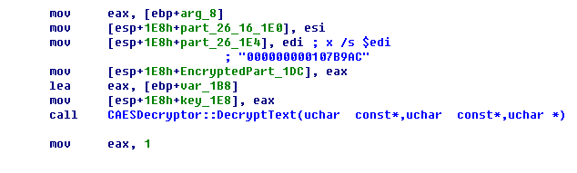  
解密之后，回到函数 SystemState::GetState  
校验解出来的 16 个字节，以及 part\_5  
  
解密出来的 16 个字节必须是 ds:\_\_ZL13KeyForGeneric  
   
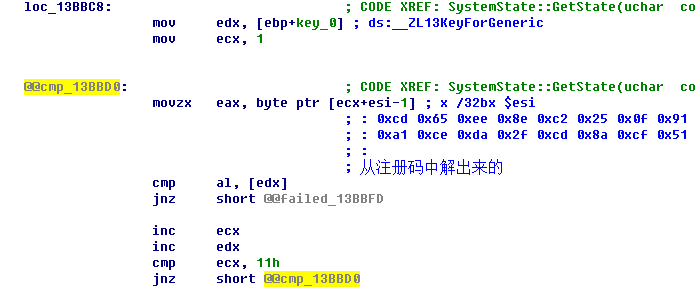  
  
part\_5 得到的 int64，必须比上面提到的 int64 0x00000000 001e8480 要小  
  
Over。  
剩下的活，就是写注册机。  
该公司的另一款产品 web2delight，算法一样。  
关键代码为：  

代码:

```
\- (NSString\*) doKeygen:(int)indexofproduct atusername:(NSString\*)username atEmail:(NSString\*)email
{
  NSString \*szkey;
  unsigned char indata\_web2delight\[17\] = {0x75,0x18,0x10,0x25,0x86,0x37,0x8B,0xDE,
                      0x19,0xA7,0x21,0x90,0xD3,0x12,0xB4,0x86,0x00};
  unsigned char indata\[17\] = {0x86,0x97,0xB3,0xF1,0x6C,0xD2,0x22,0xE8,
                0x9B,0xCE,0xA7,0xC6,0xAE,0x65,0xB1,0xBB,0x00};
  unsigned char outdata\[17\] = {0};
  unsigned char aeskeydata\[17\] = {0};
  
  const char\* set1 = "NIWHSALRMPJ5EKTUYX3012QV67ZGF984";
  const char\* set2 = "BCDORSJAMP5LEKTUYX3012QV67ZGF984";
  
  const unsigned long long ullKeyLowLimit = 0x0;
  const unsigned long long ullKeyHighLimit = 0x001E8480;//1,1D,1,4,0
  const unsigned long long ullKeyLowLimitWeb2 = 0x0;
  const unsigned long long ullKeyHighLimitWeb2 = 0x00004E20;//
  unsigned long long ullKeyRandom = 0;
  unsigned char key5\[5\] = {0};
  unsigned char otherkey26\[26\] = {0};
  unsigned char c = 0;
  char szckey\[33\] = {0};
  int i = 0;
  unsigned char halfbyte = 0;
  int j = 0;
  
  
  
  srand(time(NULL));
  
  if(indexofproduct == 0)
  {
    ullKeyRandom = rand() % (ullKeyHighLimit - ullKeyLowLimit) + ullKeyLowLimit;
  }
  else if(indexofproduct == 1)
  {
    ullKeyRandom = rand() % (ullKeyHighLimitWeb2 - ullKeyLowLimitWeb2) + ullKeyLowLimitWeb2;
  }
  else
  {
    return nil;
  }
    
  for(i = 0; i < 5;i++)
  {
    c = ullKeyRandom >> (i) \* 5;
    key5\[i\] = c & 0x1F;
  }
  
  
  c = rand() % (31 - 5); //the last char of registration code
  
  for(i = 0; i < 16;i++)
  {
    halfbyte = Gethalfbytefromint64(ullKeyRandom,i);
    aeskeydata\[15 - i\] = halfbyte2hexchar(halfbyte);
  }
  
  
  
  if(indexofproduct == 0)
  {
    aes\_encrypt(indata,
        outdata,
        aeskeydata);
  }
  else if(indexofproduct == 1)
  {
    aes\_encrypt(indata\_web2delight,
          outdata,
          aeskeydata);
  }
  else
  {
    return nil;
  }
  
  
  //5 \* 8 = 40, 40 / 5 = 8
  otherkey26\[0\] = outdata\[0\] & 0x1F;
  otherkey26\[1\] = ((outdata\[1\] & 0x3) << 3) | (outdata\[0\] >> 5);
  otherkey26\[2\] = (outdata\[1\] >> 0x2) & 0x1F;
  otherkey26\[3\] = ((outdata\[2\] & 0xF) << 1) | (outdata\[1\] >> 7);
  otherkey26\[4\] = ((outdata\[3\] & 0x1) << 4) | (outdata\[2\] >> 4);
  otherkey26\[5\] = (outdata\[3\] >> 1) & 0x1F;
  otherkey26\[6\] = ((outdata\[4\] & 0x7) << 2) | (outdata\[3\] >> 6);
  otherkey26\[7\] = (outdata\[4\] >> 3) & 0x1F;
  
  otherkey26\[8\] = (outdata\[5\]) & 0x1F;
  otherkey26\[9\] = ((outdata\[6\] & 0x3) << 3) | (outdata\[5\] >> 5);
  otherkey26\[10\] = (outdata\[6\] >> 2) & 0x1F;
  otherkey26\[11\] = ((outdata\[7\] & 0xF) << 1) | (outdata\[6\] >> 7);
  otherkey26\[12\] = ((outdata\[8\] & 0x1) << 4) | (outdata\[7\] >> 4);
  otherkey26\[13\] = (outdata\[8\] >> 1) & 0x1F;
  otherkey26\[14\] = ((outdata\[9\] & 0x7) << 2) | (outdata\[8\] >> 6);
  otherkey26\[15\] = (outdata\[9\] >> 3) & 0x1F;
  
  otherkey26\[16\] = (outdata\[10\]) & 0x1F;
  otherkey26\[17\] = ((outdata\[11\] & 0x3) << 3) | (outdata\[10\] >> 5);
  otherkey26\[18\] = (outdata\[11\] >> 2) & 0x1F;
  otherkey26\[19\] = ((outdata\[12\] & 0xF) << 1) | (outdata\[11\] >> 7);
  otherkey26\[20\] = ((outdata\[13\] & 0x1) << 4) | (outdata\[12\] >> 4);
  otherkey26\[21\] = (outdata\[13\] >> 1) & 0x1F;
  otherkey26\[22\] = ((outdata\[14\] & 0x7) << 2) | (outdata\[13\] >> 6);
  otherkey26\[23\] = (outdata\[14\] >> 3) & 0x1F;
  
  otherkey26\[24\] = (outdata\[15\]) & 0x1F;
  otherkey26\[25\] = ((outdata\[16\] & 0x3) << 3) | (outdata\[15\] >> 5);  
  
  for(i = 0; i < c;i++)
  {
    szckey\[i\] = otherkey26\[i\];
    
    j = szckey\[i\];
    if((i % 2) == 0)
    {
      szckey\[i\] = set2\[j\];
    }
    else
    {
      szckey\[i\] = set1\[j\];
    }
  }
  
  for(i = c; i < c + 5;i++)
  {
    szckey\[i\] = key5\[i - c\];
    
    j = szckey\[i\];
    if(((i - c) % 2) == 0)
    {
      szckey\[i\] = set2\[j\];
    }
    else
    {
      szckey\[i\] = set1\[j\];
    }
  }
  
  for(i = c + 5; i < 31;i++)
  {
    szckey\[i\] = otherkey26\[i - 5\];
    
    j = szckey\[i\];
    if(((i - 5) % 2) == 0)
    {
      szckey\[i\] = set2\[j\];
    }
    else
    {
      szckey\[i\] = set1\[j\];
    }
  }
  
  szckey\[31\] = set1\[c\];
  
  NSLog(@" key is %s",szckey);
  
  szkey = \[\[NSString stringWithCString:(const char\*)szckey\] retain\];
  
  return szkey;
}

```

附：  
ObjC 使用 msgSend 来调用函数。  
比如：调用-\_VLRegister\_validateKeyWithInfo\_Fortype\_\_ 的地方  
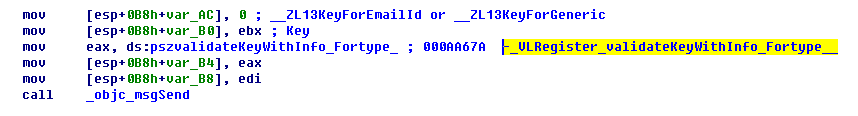  
  
Function\_name\_ptr 保存在\[esp+4\]中  
  
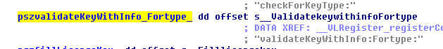  
  
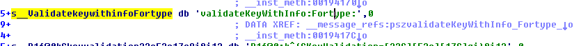  
  
查看交叉参考，\_\_inst\_meth:0019417Co，来到：  
  
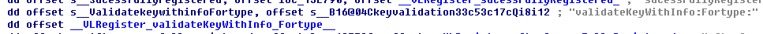  
  
然后才看到函数地址  
  
我写了个 Python 脚本，用 IDAPython 来跑，可以添加注释，显示出函数名，并添加交叉参考。速度比较慢。跑完 Voila，要用 18 分钟。脚本运行后，鼠标最好就不动了。否则 IDA 会假死。  
  
Python 脚本为：  
  
代码:

```
#
# Mac OS Objective-c msgSend function Helper
#
# winndy CNwinndy@hotmail.com
#
# 
#
from idaapi import \*
from idautils import \*
from idc import \*

def GetSegmentof\_\_imp\_\_objc\_msgSend():
  print "get address of \_\_imp\_\_objc\_msgSend !"
  segm\_num = get\_segm\_qty()
  segm\_name = ''
  segm\_class = ''
  for segmindex in range(segm\_num): 
    segm = getnseg(segmindex)
    seg\_name     = get\_segm\_name(segm.startEA)
    seg\_truename = get\_true\_segm\_name(segm)
    seg\_class    = get\_segm\_class(segm)
    seg\_type     = segtype(segm.startEA)
    print ' \[-\] segmentation %d Name: %s / Type: %d / True Name: %s / class %s' % (segmindex, seg\_name, seg\_type, seg\_truename, seg\_class)
    if SEG\_XTRN == seg\_type:
      print 'found segment %d' %(segmindex)
      return segm

def Getaddressof\_objc\_msgSend():
        func\_num = get\_func\_qty()
        for funcindex in range(func\_num):
                func = getn\_func(funcindex)
                func\_name = get\_func\_name(func.startEA)
                print "function %d : %s" %(funcindex, func\_name)
                if '\_objc\_msgSend' == func\_name:
                        return func

#\_\_text:000A9CBA A1 CC 00 18 00                          mov     eax, ds:off\_1800CC
# mov eax, dword ptr\[1800CC\]
def is\_mov\_mem(inst,reg):   
  return ((inst.itype == idaapi.NN\_mov) and 
          (idaapi.get\_instruction\_operand(inst,0).type == idaapi.o\_reg) and
                (idaapi.get\_instruction\_operand(inst,0).reg == reg) and
          (idaapi.get\_instruction\_operand(inst,1).type == idaapi.o\_mem))

#\_\_text:000A9CBF 89 44 24 04                             mov     \[esp+18h+var\_14\], eax
def is\_mov\_esp\_4(inst):
  return ((inst.itype == idaapi.NN\_mov) and 
          (idaapi.get\_instruction\_operand(inst,0).type == idaapi.o\_displ) and
                (idaapi.get\_instruction\_operand(inst,0).reg == 4) and
                (idaapi.get\_instruction\_operand(inst,0).addr == 4) and
          (idaapi.get\_instruction\_operand(inst,1).type == idaapi.o\_reg))

#\_\_text:000A9CE8 89 45 0C                                mov     \[ebp+arg\_4\], eax
def is\_mov\_ebp\_C(inst):
  return ((inst.itype == idaapi.NN\_mov) and 
          (idaapi.get\_instruction\_operand(inst,0).type == idaapi.o\_displ) and
                (idaapi.get\_instruction\_operand(inst,0).reg == 5) and
                (idaapi.get\_instruction\_operand(inst,0).addr == 0x0C) and
          (idaapi.get\_instruction\_operand(inst,1).type == idaapi.o\_reg))

#  8B1C24  mov ebx, \[esp+0\]; retn
def is\_mov(inst):
  return ((inst.itype == idaapi.NN\_mov) and 
          (idaapi.get\_instruction\_operand(inst,0).type == idaapi.o\_reg) and
          (idaapi.get\_instruction\_operand(inst,1).type == idaapi.o\_displ))

def is\_pop(inst):
  return ((inst.itype == idaapi.NN\_pop) and 
          (idaapi.get\_instruction\_operand(inst,0).type == idaapi.o\_reg) and 
          (idaapi.get\_instruction\_operand(inst,1).type == idaapi.o\_void))

#\_\_text:001397EA 8B 83 36 92 04 00                       mov     eax, \[ebx+49236h\]
def is\_mov2(inst, reg):
        print 'is\_mov2',(inst.itype == idaapi.NN\_mov),(idaapi.get\_instruction\_operand(inst,0).type == idaapi.o\_reg), \\
              (idaapi.get\_instruction\_operand(inst,1).reg == reg), (idaapi.get\_instruction\_operand(inst,1).type == idaapi.o\_displ)
  return ((inst.itype == idaapi.NN\_mov) and 
          (idaapi.get\_instruction\_operand(inst,0).type == idaapi.o\_reg) and
                (idaapi.get\_instruction\_operand(inst,1).reg == reg) and
          (idaapi.get\_instruction\_operand(inst,1).type == idaapi.o\_displ))

def is\_lea(inst, reg):
  return ((inst.itype == idaapi.NN\_lea) and 
          (idaapi.get\_instruction\_operand(inst,1).reg == reg) and
          (idaapi.get\_instruction\_operand(inst,1).type == idaapi.o\_displ))

"""
#from ihood.py,by Cameron Hotchkies, 
def find\_anchor(address):
    func\_start = GetFunctionAttr(address, FUNCATTR\_START)
    func\_end = GetFunctionAttr(address, FUNCATTR\_END)

    cursor = func\_start

    while cursor < func\_end:
        # call $+5; pop ebx
        if (Byte(cursor) == 0xE8 and Dword(cursor+1) == 0x00000000 and Byte(cursor+5)==0x5B):
            return cursor+5
        elif GetMnem(cursor) == "call":
            subfunc = Rfirst0(cursor)
            #   mov ebx, \[esp+0\]; retn
            if (Byte(subfunc) == 0x8B and Byte(subfunc+1) == 0x1C and Byte(subfunc+2) == 0x24 and Byte(subfunc+3) == 0xC3):
                return NextNotTail(cursor)
            else:
                cursor = NextNotTail(cursor)
        else:
            cursor = NextNotTail(cursor)
    return BADADDR
"""

def find\_anchor2(ea):

        # call $+5; pop ebx
        pattern = 'E8 00 00 00 00'
        print '%08lx find\_anchor2' %(ea)
        func = get\_func(ea)
        if (func is None):
                print 'cannot get func from address %08lx' %(ea)
                return -1,BADADDR,-1;

        ea1 = find\_binary(func.startEA, func.endEA,pattern,16,SEARCH\_DOWN)
        print 'found %08lx between %08lx and %08lx' %(ea1,func.startEA, func.endEA)
        if (ea1 != BADADDR) and (ea1 > func.startEA) and (ea1 < func.endEA):
                ea2 = ea1 + 5
                #get reg
                idaapi.ua\_ana0(ea2)
                inst = idaapi.get\_current\_instruction()
                if(not is\_pop(inst)):
                        return -1,BADADDR,-1;
                reg = idaapi.get\_instruction\_operand(inst,0).reg;
                return 0,ea2,reg

        cursor = func.startEA
        while cursor < func.endEA:
                if GetMnem(cursor) == "call":
                        subfunc = Rfirst0(cursor)
                        #  8B0424  mov     eax, dword ptr \[esp\]
                        #  8B0C24  mov     ecx, dword ptr \[esp\]
                        #  8B1424  mov     edx, dword ptr \[esp\]
                        #  8B1C24  mov ebx, \[esp+0\]; retn

                        #if(not is\_mov(inst)):
                        #if (Byte(subfunc) == 0x8B and """Byte(subfunc+1) == 0x1C and""" Byte(subfunc+2) == 0x24 and Byte(subfunc+3) == 0xC3):
                        if (Byte(subfunc) == 0x8B and Byte(subfunc+2) == 0x24 and Byte(subfunc+3) == 0xC3):
                                 #get reg
                                idaapi.ua\_ana0(subfunc)
                                inst = idaapi.get\_current\_instruction()                               
                                reg = idaapi.get\_instruction\_operand(inst,0).reg;
                                return 1,NextNotTail(cursor),reg
                        else:
                                cursor = NextNotTail(cursor)
                else:
                        cursor = NextNotTail(cursor)

        #no anchor,mov eax,offset funcname\_ptr
        return 2,BADADDR,-1

def HandleOneRefCall(ea):
        
        #\_\_text:000A9CBA A1 CC 00 18 00                          mov     eax, ds:off\_1800CC
        #\_\_text:000A9CBF 89 44 24 04                             mov     \[esp+18h+var\_14\], eax
        #\_\_text:000A9CC3 89 34 24                                mov     \[esp+18h+var\_18\], esi
        #\_\_text:000A9CC6 E8 AB 26 10 00                          call    \_objc\_msgSend

        #\_\_text:000A9CE8 89 45 0C                                mov     \[ebp+arg\_4\], eax
        #\_\_text:000A9CEB 89 55 08                                mov     \[ebp+arg\_0\], edx
        #\_\_text:000A9CEE 83 C4 10                                add     esp, 10h
        #\_\_text:000A9CF1 5B                                      pop     ebx
        #\_\_text:000A9CF2 5E                                      pop     esi
        #\_\_text:000A9CF3 C9                                      leave
        #\_\_text:000A9CF4 E9 7D 26 10 00                          jmp     \_objc\_msgSend

        #(inst.itype == idaapi.NN\_call)
        #print 'in HandleOneRefCall'
        #ea1 = prevaddr(ea)
        ea1 = prev\_not\_tail(ea)
        func = get\_func(ea)
        while ea1 >= func.startEA:
                #get reg
                idaapi.ua\_ana0(ea1)
                inst = idaapi.get\_current\_instruction()
                if(is\_mov\_esp\_4(inst)):
                        reg = idaapi.get\_instruction\_operand(inst,1).reg;
                        ea2 = prev\_not\_tail(ea1) 

                        while ea2 >= func.startEA:
                                #get reg
                                idaapi.ua\_ana0(ea2)
                                inst = idaapi.get\_current\_instruction()
                                if(is\_mov\_mem(inst,reg)):
                                        #find it
                                        Addcmtxref(ea2,get\_instruction\_operand(inst,1).addr)
                                        return 1
                                else:
                                        ea2 = prev\_not\_tail(ea2)
                        break
                else:
                        ea1 = prev\_not\_tail(ea1)
        print '%08lx not done' %(ea)
        return 0

def HandleOneRefJmp(ea):
        
        #\_\_text:000A9CBA A1 CC 00 18 00                          mov     eax, ds:off\_1800CC
        #\_\_text:000A9CBF 89 44 24 04                             mov     \[esp+18h+var\_14\], eax
        #\_\_text:000A9CC3 89 34 24                                mov     \[esp+18h+var\_18\], esi
        #\_\_text:000A9CC6 E8 AB 26 10 00                          call    \_objc\_msgSend

        #\_\_text:000A9CE3 A1 78 12 18 00                          mov     eax, ds:runModalForWindow\_\_PTR
        #\_\_text:000A9CE8 89 45 0C                                mov     \[ebp+arg\_4\], eax
        #\_\_text:000A9CEB 89 55 08                                mov     \[ebp+arg\_0\], edx
        #\_\_text:000A9CEE 83 C4 10                                add     esp, 10h
        #\_\_text:000A9CF1 5B                                      pop     ebx
        #\_\_text:000A9CF2 5E                                      pop     esi
        #\_\_text:000A9CF3 C9                                      leave
        #\_\_text:000A9CF4 E9 7D 26 10 00                          jmp     \_objc\_msgSend

        #(inst.itype == idaapi.NN\_jmp)
        #print 'in HandleOneRefJmp'
        #ea1 = prevaddr(ea)
        ea1 = prev\_not\_tail(ea)
        func = get\_func(ea)
        while ea1 >= func.startEA:
                #get reg
                idaapi.ua\_ana0(ea1)
                inst = idaapi.get\_current\_instruction()
                if(is\_mov\_ebp\_C(inst)):
                        reg = idaapi.get\_instruction\_operand(inst,1).reg;
                        ea2 = prev\_not\_tail(ea1) 

                        while ea2 >= func.startEA:
                                #get reg
                                idaapi.ua\_ana0(ea2)
                                inst = idaapi.get\_current\_instruction()
                                if(is\_mov\_mem(inst,reg)):
                                        #find it
                                        Addcmtxref(ea2,get\_instruction\_operand(inst,1).addr)
                                        return 1
                                else:
                                        ea2 = prev\_not\_tail(ea2)
                        break
                else:
                        ea1 = prev\_not\_tail(ea1)
        print '%08lx not done' %(ea)
        return 0

def HandleOneRef(ea):
        
        #\_\_text:000A9CBA A1 CC 00 18 00                          mov     eax, ds:off\_1800CC
        #\_\_text:000A9CBF 89 44 24 04                             mov     \[esp+18h+var\_14\], eax
        #\_\_text:000A9CC3 89 34 24                                mov     \[esp+18h+var\_18\], esi
        #\_\_text:000A9CC6 E8 AB 26 10 00                          call    \_objc\_msgSend

        #\_\_text:000A9CE8 89 45 0C                                mov     \[ebp+arg\_4\], eax
        #\_\_text:000A9CEB 89 55 08                                mov     \[ebp+arg\_0\], edx
        #\_\_text:000A9CEE 83 C4 10                                add     esp, 10h
        #\_\_text:000A9CF1 5B                                      pop     ebx
        #\_\_text:000A9CF2 5E                                      pop     esi
        #\_\_text:000A9CF3 C9                                      leave
        #\_\_text:000A9CF4 E9 7D 26 10 00                          jmp     \_objc\_msgSend

        print '%08lx in HandleOneRef' %(ea)

        idaapi.ua\_ana0(ea)
        inst = idaapi.get\_current\_instruction()

        if(inst.itype == idaapi.NN\_call):
                ret = HandleOneRefCall(ea)
        elif(inst.itype == idaapi.NN\_jmp):
                ret = HandleOneRefJmp(ea)
        else:
                print 'error'
                
def isValidAddress(ea):
        if(idaapi.cvar.inf.minEA <= ea and ea < idaapi.cvar.inf.maxEA):
                return True
        else:
                return False;

def GetFunctionAddressFromNameoff(nameoffset):
        print "in GetFunctionAddressFromNameoff()"
        refListOfname = DataRefsTo(nameoffset)
        ref\_count = len(refListOfname)
        print "total ref count of nameoffset %08lx is %08X(%d)" %(nameoffset,ref\_count, ref\_count)

        funcaddresslist = \[\]
        for i in range(ref\_count):
                segmname = get\_segm\_name(refListOfname\[i\])
                if '\_\_inst\_meth' != segmname:
                        continue
                else:
                        a = (refListOfname\[i\] + 8)
                        funcaddress = get\_long(a)
                        funcaddresslist.append(funcaddress)
                        

        return funcaddresslist

def GetLenOfAscii(ea):
        length = 0
        b = get\_byte(ea)
        while b != 0 :
                length = length + 1
                ea = ea + 1
                b = get\_byte(ea)
                if(length > 255):
                        break

        return length + 1
        
def Addcmtxref(ea\_to\_addcmt,ea\_name\_ptr):
        comment = '%08lx' % (ea\_name\_ptr)
        set\_cmt(ea\_to\_addcmt, comment, False)
        OffsetToFunctionName = get\_long(ea\_name\_ptr)
        if(isValidAddress(OffsetToFunctionName)):
                # Convert that to string
                flags = get\_flags\_novalue(OffsetToFunctionName)
                if(not isHead(flags)):
                        print 'ea\_to\_addcmt = %08lx,ea\_name\_ptr = %08lx,failed' %(ea\_to\_addcmt,ea\_name\_ptr)
                        return

                length = GetLenOfAscii(OffsetToFunctionName)
                do\_unknown\_range(OffsetToFunctionName,length,DOUNK\_EXPAND or DOUNK\_DELNAMES)
                #MakeStr(OffsetToFunctionName,BADADDR) #failed to make ascii string
                make\_ascii\_string(OffsetToFunctionName,length,ASCSTR\_C)
                flags = get\_flags\_novalue(ea\_name\_ptr)
                if(not has\_name(flags)):
                        name1 = get\_ascii\_contents(OffsetToFunctionName,get\_max\_ascii\_length(OffsetToFunctionName,ASCSTR\_C),ASCSTR\_C)
                        if(name1 is None):
                                name1 = get\_name(BADADDR,ea\_name\_ptr)
                        name1 = name1 + '\_PTR'
                        if(MakeName(ea\_name\_ptr,name1) == 0):
                                # We cannot create the string, create alternate string
                                make\_name\_auto(ea\_name\_ptr)
                        #make\_name\_public(ea\_name\_ptr)
                        comment += ' %s' %(name1)

                        set\_cmt(ea\_to\_addcmt, comment, False)
                        print '%08lx : %s' %(ea\_to\_addcmt, comment)

                else :
                        #print "isASCII return true"
                        name1 = get\_name(BADADDR,ea\_name\_ptr)
                        comment += ' %s' %(name1)
                        set\_cmt(ea\_to\_addcmt, comment, False)
                        print '%08lx : %s' %(ea\_to\_addcmt, comment)

                func2list = GetFunctionAddressFromNameoff(OffsetToFunctionName)
                if 0 != len(func2list):
                        for func2 in func2list:
                                comment += '\\n%08lx %s' %(func2, get\_func\_name(func2))
                                add\_cref(ea\_to\_addcmt,func2,fl\_CN | XREF\_USER)

                set\_cmt(ea\_to\_addcmt, comment, False)
                print '%08lx : %s' %(ea\_to\_addcmt, comment)
                                         
        else:
                flags = get\_flags\_novalue(ea\_name\_ptr)
                if(not isHead(flags) or not isData(flags)):
                        comment += ' %08lx' %(ea\_name\_ptr)
                        set\_cmt(ea\_to\_addcmt, comment, False)
                        print '%08lx : %s' %(ea\_to\_addcmt, comment)
                        return
                length = GetLenOfAscii(ea\_name\_ptr)
                do\_unknown\_range(ea\_name\_ptr,length,DOUNK\_EXPAND or DOUNK\_DELNAMES)
                make\_ascii\_string(ea\_name\_ptr,length,ASCSTR\_C)
                name1 = get\_ascii\_contents(ea\_name\_ptr,get\_max\_ascii\_length(ea\_name\_ptr,ASCSTR\_C),ASCSTR\_C)
                comment += ' \\"%s\\"' %(name1)
                set\_cmt(ea\_to\_addcmt, comment, False)
                print '%08lx : %s' %(ea\_to\_addcmt, comment)
        
def HandleOneRefFunction(ea):
        
        #\_\_text:00002CF5 E8 00 00 00 00                          call    $+5
        #\_\_text:00002CFA 5B                                      pop     ebx
        pattern = 'E8 00 00 00 00'
        pattern\_lea = ''
        mask = r'\\0\\0\\0\\0\\0'
        func = get\_func(ea)
        #ea1 = bin\_search(func.startEA, func.endEA,pattern,None,len(pattern),BIN\_SEARCH\_FORWARD,BIN\_SEARCH\_NOCASE)
        #print '%08lx : address of call $+5' %(ea1)
        ea1 = find\_binary(func.startEA, func.endEA,pattern,16,SEARCH\_DOWN)
        print '%08lx : address of call $+5' %(ea1)
        ea2 = ea1 + 5

        #get reg
        idaapi.ua\_ana0(ea2)
  inst = idaapi.get\_current\_instruction()
  if(not is\_pop(inst)):
                return;

        reg = idaapi.get\_instruction\_operand(inst,0).reg;

        #8D 10^^^\*\*\* ? ? 00 00
        #^^^:reg1
        #\*\*\*:reg2
        #pattern\_lea = '8D 8%1d ? ? 00 00' %(reg)
        pattern\_lea = '8D ? ? ? ? 00'
        #print pattern\_lea

        #\_\_text:00002B49 8D 83 EB 24 00 00                       lea     eax, \[ebx+24EBh\]
        ea3 = find\_binary(ea2, func.endEA,pattern\_lea,16,SEARCH\_DOWN)

        #\_\_text:0013AE9B 8B 83 0C 81 04 00                       mov     eax, \[ebx+4810Ch\]
        

        while (BADADDR != ea3) and (ea3 < func.endEA) and(ea3 > func.startEA):
                flags = getFlags(ea3)
                if(not isHead(flags)):
                        ea3 = find\_binary(ea3 + 1, func.endEA,pattern\_lea,16,SEARCH\_DOWN)
                        continue
                idaapi.ua\_ana0(ea3)
                inst = idaapi.get\_current\_instruction()
                if(not is\_lea(inst, reg)):
                        ea3 = find\_binary(ea3 + 6, func.endEA,pattern\_lea,16,SEARCH\_DOWN)
                        continue
                
                #print '%08lx : address of lea     eax, \[ebx+????????h\]' %(ea3)
                delta = get\_long(ea3 + 2)

                Addcmtxref(ea3,ea2 + delta)

                instsize = get\_item\_size(ea3)
                #print instsize
                ea3 = ea3 + instsize
                ea3 = find\_binary(ea3, func.endEA,pattern\_lea,16,SEARCH\_DOWN or SEARCH\_NEXT)
                #print ea3

        pattern\_mov = '8B ? ? ? ? 00'

        #\_\_text:0013AE9B 8B 83 0C 81 04 00                       mov     eax, \[ebx+4810Ch\]
        ea3 = find\_binary(ea2, func.endEA,pattern\_mov,16,SEARCH\_DOWN)

#\_\_text:000D6091 8B 35 DC F0 17 00                       mov     esi, ds:off\_17F0DC
#\_\_text:000D6097 89 74 24 04                             mov     \[esp+38h+var\_34\], esi
#\_\_text:000D609B 89 04 24                                mov     \[esp+38h+var\_38\], eax
#\_\_text:000D609E E8 D8 62 0D 00                          call    \_objc\_msgSendSupe

        while (BADADDR != ea3) and (ea3 < func.endEA) and(ea3 > func.startEA):
                flags = getFlags(ea3)
                if(not isHead(flags)):
                        ea3 = find\_binary(ea3 + 1, func.endEA,pattern\_mov,16,SEARCH\_DOWN or SEARCH\_NEXT)
                        continue
                idaapi.ua\_ana0(ea3)
                inst = idaapi.get\_current\_instruction()
                print '%08lx : address of mov     eax, \[ebx+????????h\]' %(ea3)
                if(not is\_mov2(inst, reg)):
                        ea3 = ea3 + 6
                        ea4 = ea3
                        print '%08lx : next address1' %(ea3)
                        ea3 = find\_binary(ea4, func.endEA,pattern\_mov,16,SEARCH\_DOWN or SEARCH\_NEXT)
                        if(ea3 <= ea4):
                                
                                print 'error.%08lx is found within %08lx and %08lx' %(ea3, ea4,fuc.endEA)
                                raw\_input('111')
                                return
                        print '%08lx : next address2' %(ea3)
                        continue
                
                #print '%08lx : address of mov     eax, \[ebx+????????h\]' %(ea3)
                delta = get\_long(ea3 + 2)

                Addcmtxref(ea3,ea2 + delta)      
                instsize = get\_item\_size(ea3)
                ea3 = ea3 + instsize
                ea3 = find\_binary(ea3, func.endEA,pattern\_mov,16,SEARCH\_DOWN or SEARCH\_NEXT)


def BelongToFunction(start,end,EA):
        return EA >= start and \\
                EA < end


def start():
       
        GetSegmentof\_\_imp\_\_objc\_msgSend()  
        segm = GetSegmentof\_\_imp\_\_objc\_msgSend()
        nextEA = nextaddr(segm.startEA);
        print get\_item\_size(segm.startEA)

        print ItemSize(segm.startEA)

        ea = segm.startEA;

        while segm.endEA > ea :
                print '%s' %(LineA(ea,1))
                if (ua\_ana0(ea) > 0):
                        instsize =  idaapi.cvar.cmd.size 
                        print '%08x : %s \\nInstruction size: %d bytes' %(ea, GetDisasm(ea),instsize)
                else:
                    print 'Not at an instruction.'

                if has\_name(ea):
                        print '%s' %(get\_name(BADADDR,ea))
                
                if('\_\_imp\_\_objc\_msgSend' == get\_name(BADADDR,ea)):
                        refList1 = CodeRefsTo(ea, 1)    
                        ref\_count1 = len(refList1)
                        print "total ref count of \_\_imp\_\_objc\_msgSend is %08X(%d)" %(ref\_count1, ref\_count1)
                        refList1.sort()
                        for i in range(ref\_count1):
                                print '%08x : ref %08x(%d)' %(refList1\[i\],i,i)
                                
                                func\_objc\_msgSend = get\_func(refList1\[i\])
                                refList = CodeRefsTo(func\_objc\_msgSend.startEA, 1)
                                refList.sort()
                                ref\_count = len(refList)
                                print "total ref count of \_objc\_msgSend is %08X(%d)" %(ref\_count, ref\_count)

                                func\_contain\_call\_msgSend\_list2 = \[\]
                                for refaddress in refList:
                                        
                                        func = get\_func(refaddress) 
         
                                        if(func is None):
                                                print "failed to process ref %08lx" %(refaddress)
                                                continue
                                        print '\\nfrom %08lx found function %08lx %08lx' %(refaddress,func.startEA,func.endEA)
                                        retcode,ebx,reg = find\_anchor2(refaddress)
                                        print '%08lx return %d %08lx %d' %(refaddress,retcode,ebx,reg)
                                        
                                        #break 
                                        if (retcode == -1):
                                                print 'internal error while handle %08lx' %(refaddress)
                                        elif (retcode in \[0,1\]):
                                        #else if((retcode == 0) or (retcode == 1)):
                                                # hanle one function by one
                                                #for all functions that contain call msgSend
                                                belong = False
                                                for (start,end) in func\_contain\_call\_msgSend\_list2:
                                                        if(BelongToFunction(start,end,refaddress)):
                                                                belong = True
                                                                break;
                                                if(belong):
                                                        print '%08lx is already been hadled in HandleOneRefFunction()' %(refaddress)
                                                        continue;
                                                func\_contain\_call\_msgSend = get\_func(refaddress)
                                                HandleOneRefFunction(func\_contain\_call\_msgSend.startEA)
                                                if(not ((func\_contain\_call\_msgSend.startEA,func\_contain\_call\_msgSend.endEA) in func\_contain\_call\_msgSend\_list2)):
                                                        func\_contain\_call\_msgSend\_list2.append((func\_contain\_call\_msgSend.startEA, \\
                                                                                                func\_contain\_call\_msgSend.endEA))
                                        elif(retcode == 2):
                                                # hanle one reference by one 
                                                HandleOneRef(refaddress)
                                        else:
                                                print 'error'

                ea = ea + 4        

  

start()

```