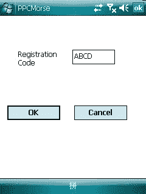
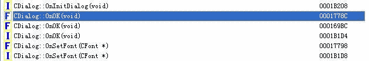
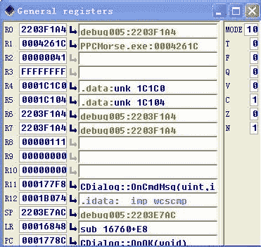
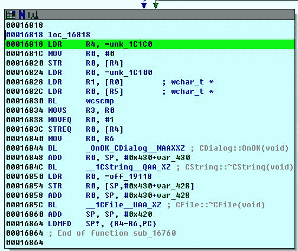
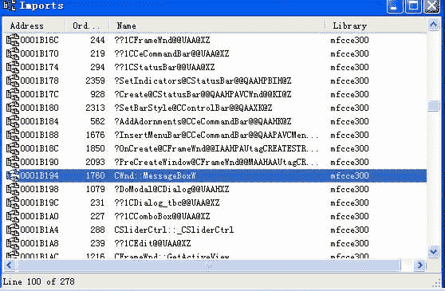
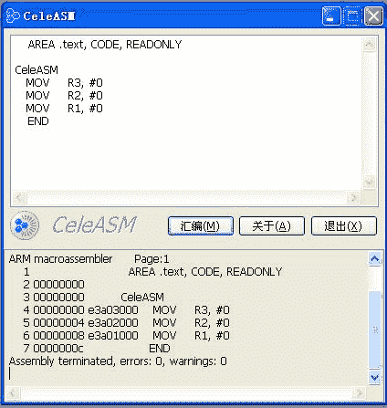
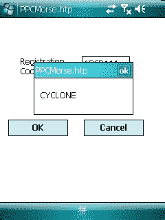

# 第一次写 PPC 程序破解教程--PPCMorse 自己弹出注册码,高手略过。

> 原文：[`www.pediy.com/kssd/pediy10/65131.html`](https://www.pediy.com/kssd/pediy10/65131.html)

【目标程序】：  PPCMorse V 1.1  
【破解目的】：  让程序自己弹出注册码  
【应用平台】：  PocketPC  
【作者声明】：　只是感兴趣，没有其他目的，看到论坛有兄弟需要，才献丑了。失误之处敬请诸位大侠赐教。  
               
【调试环境】：WinXP、IDA pro 5.2 、Windows Mobile 6.0　模拟器包 for Pocket PC、lordpe   
             还有 Yonsm 大侠的 CeleASM，用于查找对应机器码。  
【联系方式】：emb2001@163.com   QQ:50540415        欢迎来信交流  
—————————————————————————————————   
【分析过程】：  
1、现在我们该开始了。如果你已经有过破解 Windows 软件的经验，再和 PPC 操作系统打交道就比较容易了。先熟悉一下软件，点 Settings 下 Registration 菜单，出现注册界面。输入任意注册后，没有提示就退出了。  
  
  
  
2、运行前面提到的 IDA 工具。当 IDA 问你处理器的种类（processor type）时，请选择 ARM Processor: ARM 就可以了。   
  
3、用 IDA 分析完毕后，回到 IDA 用 shift+F4 打开 the names window 搜索“OK”，这个字符串来自软件注册的 OK 按钮。   
  
  
  
CDialog::OnOK(void)                               0001778C     
  
应该差不多就是与注册算法相关的信息了。  
往上溯  
  
t:0001778C  
.text:0001778C             ; =============== S U B R O U T I N E =======================================  
.text:0001778C  
.text:0001778C             ; Attributes: thunk  
.text:0001778C  
.text:0001778C             ; protected: virtual void \_\_cdecl CDialog::OnOK(void)  
.text:0001778C             \_OnOK\_CDialog\_\_MAAXXZ    ; CODE XREF: .text:00015F2C\_p  
.text:0001778C                                      ; sub\_16760+E4\_p ...  
.text:0001778C 00 C0 9F E5 LDR     R12, =\_\_imp\_\_OnOK\_CDialog\_\_MAAXXZ  
.text:00017790 00 F0 9C E5 LDR     PC, \[R12\]  
.text:00017790             ; End of function CDialog::OnOK(void)  
  
4、在.text:0001778C 00 C0 9F E5 LDR     R12, =\_\_imp\_\_OnOK\_CDialog\_\_MAAXXZ　按 F2 下断点，按 F9 运行。  
  
模拟器中软件已运行，点 Settings 下 Registration 菜单，出现注册界面。输入任意注册码后，点 OK 后断下。  
  
观察 LR 的值，往上溯。  
  
  
  
  
  
5、清除原有断点，在.text:00016818 loc\_16818 下，按 F9 运行。重新输入任意注册码后，点 OK 后断下。按 F8 步进。  
  
.text:00016818 loc\_16818  
.text:00016818 LDR     R4, =unk\_1C1C0  
.text:0001681C MOV     R0, #0  
.text:00016820 STR     R0, \[R4\]  
.text:00016824 LDR     R0, =unk\_1C100  
.text:00016828 LDR     R1, \[R0\]        ; wchar\_t \*　　准确注册码的 unicode  
.text:0001682C LDR     R0, \[R5\]        ; wchar\_t \*　　输入假码的 unicode  
.text:00016830 BL      wcscmp　　　　　　　　　　　　　比较  
.text:00016834 MOVS    R3, R0  
.text:00016838 MOVEQ   R0, #1  
.text:0001683C STREQ   R0, \[R4\]  
.text:00016840 MOV     R0, R6  
.text:00016844 BL      \_OnOK\_CDialog\_\_MAAXXZ ; CDialog::OnOK(void)  
.text:00016848 ADD     R0, SP, #0x430+var\_430  
.text:0001684C BL      \_\_1CString\_\_QAA\_XZ ; CString::~CString(void)  
.text:00016850 LDR     R0, =off\_19118  
.text:00016854 STR     R0, \[SP,#0x430+var\_428\]  
.text:00016858 ADD     R0, SP, #0x430+var\_428  
.text:0001685C BL      \_\_1CFile\_\_UAA\_XZ ; CFile::~CFile(void)  
.text:00016860 ADD     SP, SP, #0x420  
.text:00016864 LDMFD   SP!, {R4-R6,PC}  
.text:00016864 ; End of function sub\_167  
  
/////////////////////////////////////////////////////////////////////////////////////  
//到此我们已经找到了注册码休息一下  
////////////////////////////////////////////////////////////////////////////////////  
  
6、pediy 一下，让他弹出注册码，修改思路如下，可参照 API 资料。  
  
  
.text:0001681C                 MOV     R3, #0  
.text:00016820                 MOV     R2, #0  
.text:00016824                 LDR     R0, =unk\_1C100  
.text:00016828                 LDR     R1, \[R0\]　　　　　准确注册码的  
.text:0001682C                 MOV     R0, #0  
.text:00016830                 BL      CWnd\_\_MessageBoxW  
　  
打开 IDA　Imports window,搜索“MessageBoxW”。  
  
  
  
往上溯。  
.text:000176CC             ; =============== S U B R O U T I N E =======================================  
.text:000176CC  
.text:000176CC             ; Attributes: thunk  
.text:000176CC  
.text:000176CC             CWnd\_\_MessageBoxW                       ; CODE XREF: .text:00012D3C\_j  
.text:000176CC                                                     ; sub\_16760+D0\_p  
.text:000176CC 00 C0 9F E5                 LDR     R12, =\_\_imp\_CWnd\_\_MessageBoxW  
.text:000176D0 00 F0 9C E5                 LDR     PC, \[R12\]  
.text:000176D0             ; End of function CWnd\_\_MessageBoxW  
.text:000176D0  
  
找到 MessageBoxW 入口地址为 000176CC  
  
到现在可根据以下公式计算 BL 的偏移。  
  
相对跳转，current 为当前指令地址，des 为目的地址，offset 为偏移  
    if(current < dest + 8)  
    {  
        offset = (dest - current- 8)/4;  
    }else  
    {  
        offset = 0x1000000 - (current - dest +8 )/4;  
    }  
  
因 00016830 处调用                BL      CWnd\_\_MessageBoxW  
计算 offset = (176CC - 16830- 8)/4＝3A5  
BL 的偏移得到了，就可以用 Yonsm 大侠的 CeleASM 查其它指令机器码了。  
  
  
  
7、万事俱备，总结一下。  
  
.text:0001681C 00 30 A0 E3                 MOV     R3, #0　　　　　　; uType　　　　  
.text:00016820 00 20 A0 E3                 MOV     R2, #0　　　　　　; lpCaption  
.text:00016824 40 00 9F E5                 LDR     R0, =unk\_1C100　　　　　　　　原指令　　　　　　  
.text:00016828 00 10 90 E5                 LDR     R1, \[R0\]　　　　　; lpText　　原指令　　　　　　  
.text:0001682C 00 00 A0 E3                 MOV     R0, #0　　　　　　; hWnd  
.text:00016830 A5 03 00 EB                 BL      CWnd\_\_MessageBoxW  
  
修改方法如下  
先用 lodepe 的 flc 转化一下要修改的地址，再编辑后保存。  
  
  
8、你现在运行这个软件看看，是不是成功了？   
  
  
  
/////////////////////////////////////////////////////////////////////////////////////  
//第一次写教程，一个字“累”，比较破解软件本身累多了。终于可以休息了。  
////////////////////////////////////////////////////////////////////////////////////