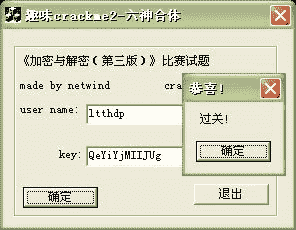

# <<加密与解密三>>比赛试题分析报告

> 原文：[`www.pediy.com/kssd/pediy10/68294.html`](https://www.pediy.com/kssd/pediy10/68294.html)

<<加密与解密三>>比赛试题分析报告  
论坛上有不少人一看到用户名,就会大概判定出其是否使用暴破,其实很简单,只要有简单地判定下面的三个条件是否都符合,只有一个不符合,就是暴破出结果的.  
1 用户名的长度为 6 个字符  
2 用户名的每一个字符都在\[‘b’-‘z’\]区间中  
3 用户名最后一个字符是否为’p’  
  
  
  
  
  
一 使用工具  
二 保护概要  
三 保护部分的分析  
四 算法整体的分析  
五 注册机  
  
  
  
  
  
一 使用工具  
IDA5.2+F5 键(Hex-Rays.Decompiler.v1.0.for.DataRescue.IDA.Pro.Advanced.v5.2-YAG)  
  
  
  
二 保护概要  
1 花指令  
2 异常处理  
3 通过改变函数的返回地址来改变执行流程  
4 MessageBox 首参数的判定  
5 用户名和序列号通过变换验证  
  
  
  
三 保护部分的分析  
1 花指令  
直接看花指令代码吧,没有太多好说的,只有一种  
代码:

```
.text:00401A30 598 EB 05                                   jmp     short loc\_401A37
.text:00401A32                             ; ---------------------------------------------------------------------------
.text:00401A32
.text:00401A32                             loc\_401A32:                             ; CODE XREF: sub\_4019F0:loc\_401A37 p
.text:00401A32 000 F9                                      stc ;表示借位
.text:00401A33 000 73 01                                   jnb     short near ptr byte\_401A36 ;不会跳转
.text:00401A35 000 C3                                      retn
.text:00401A35                             ; ---------------------------------------------------------------------------
.text:00401A36 000 FF                      byte\_401A36     db 0FFh                 ; CODE XREF: sub\_4019F0+43 j
.text:00401A37                             ; ---------------------------------------------------------------------------
.text:00401A37
.text:00401A37                             loc\_401A37:                             ; CODE XREF: sub\_4019F0+40 j
.text:00401A37 598 E8 F6 FF FF FF                          call    loc\_401A32

通过查看机器码,即可得到
eb 05 f9 73 01 c3 ff e8 f6 ff ff ff 
\==>
90 90 90 90 90 90 90 90 90 90 90 90

```

修正之后再用 IDA 分析, 附有 IDA 除花指令的 IDC “去花指令.idc”,   
  
  
2 异常处理  
在 0x401BB0()函数中, 通过向 \[29Ch\] 内存中写入 6, 始终会触发一个 C++异常, 然后去执行 sub\_4019F0(),以保证程序是通过父进程名称为 explorer.exe,防止动态加载调试  
  
  
3 通过改变函数的返回地址来改变执行流程  
在 0x401BB0()函数中  
代码:

```
.text:00401BD2 070                 mov     eax, \[ebp+arg\_0\]
.text:00401BD5 070                 sub     eax, 10h
.text:00401BD8 070                 mov     \[ebp+var\_14\], eax
.text:00401BDB 070                 mov     ecx, \[ebp+var\_14\]
.text:00401BDE 070                 mov     dword ptr \[ecx\], offset sub\_4017F0

其函数中有两处验证,一处直接出错退出,另一处就是修改返回地址为出错函数处理的地址
.text:00401C54 070                 mov     ecx, \[ebp+var\_14\]
.text:00401C57 070                 mov     dword ptr \[ecx\], offset sub\_4017B0

.text:00401C29 070                 call    sub\_4017B0

```

4 MessageBox 首参数的判定  
在 sub\_4017F0 函数中,经过一系列处理之后始通过会执行到这一块,这也是困惑我最久的地方  
\[/CODE\]  
.text:004018BB     loc\_4018BB:                             ; CODE XREF: sub\_4017F0+33 j  
.text:004018BB 090                 push    0               ; uType  
.text:004018BD 094                 push    offset aA       ; "错了!"  
.text:004018C2 098                 push    offset aMJ      ; "继续努力!"  
.text:004018C7 09C                 movsx   ecx, g\_code+0Ah  
.text:004018CE 09C                 sub     ecx, 55h  
.text:004018D1 09C                 neg     ecx  
.text:004018D3 09C                 sbb     ecx, ecx  
.text:004018D5 09C                 inc     ecx  
.text:004018D6 09C                 push    ecx             ; hWnd  
.text:004018D7 0A0                 call    ds:MessageBoxA  
.text:004018DD 090                 mov     \[ebp+var\_28\], eax  
.text:004018E4 090                 jz      short loc\_4018FB  
.text:004018E6 090                 call    ds:GetCurrentProcess  
.text:004018EC 090                 mov     \[ebp+hProcess\], eax  
.text:004018EF 090                 push    0               ; uExitCode  
.text:004018F1 094                 mov     edx, \[ebp+hProcess\]  
.text:004018F4 094                 push    edx             ; hProcess  
.text:004018F5 098                 call    ds:TerminateProcess  
.text:004018FB  
.text:004018FB     loc\_4018FB:                             ; CODE XREF: sub\_4017F0+F4 j  
  
F5 反编译之后对应的语句  
  v2 = MessageBoxA((HWND)(g\_code\[10\] == 85), "继续努力!", "错了!", 0);  
  v7 = v2;  
  if ( v2 )  
  {  
    v3 = GetCurrentProcess();  
    hProcess = v3;  
    TerminateProcess(v3, 0);  
  }  
\[/CODE\]  
当注册机数组的第 10 个元素为 85 时其句柄值为 1,此时 MessageBoxA 无法正确提示出错,并返回 0,从而通过验证机制.根据用户名的字符与注册码的关系 1(见下面),其用户名的第 5 个字符(即最后一个字符)为 85+27=112 即字符’p’  
  
5 用户名和序列号通过变换验证  
我就简单描述一下,详细的算法的整体分析和注册机代码  
a. subOnOK ()函数(0x00401CC0)中,对用户名进行检查, 用户名长度必须为 6 个字符且用户名字符一定在\['b'-'y'\]区间内  
b. sub\_401BB0()函数的检查  
( \*(\_BYTE \*)(v11 + name) != \*(\_BYTE \*)(v12 + code) + 27 ) //用户名的字符与注册码的关系 1  
( \*(\_BYTE \*)(v11 + name) > \*(\_BYTE \*)(v12 + code + 1) + 32 ) //用户名的字符与注册码的关系 2  
c. sub\_4017F0()函数中的用户名转换为第三个数组  
代码:

```
  v5 = "ABCDEFGHIJKLMNOPQRSTUVWXY";
  v6 = "ABCDEFGHIJKLMNOPQRSTUVWXY"; // 转换字符串
  v7 = 0;
  while ( v7 != 24 )
  {
    if ( g\_name == \*v5 + 32 || byte\_40416B\[strlen(&g\_name)\] == \*v5 + 32 )
      ++v5;
    v8\[v7++\] = \*v5; // 用户名转换后的数组,后面与注册码进行验证
    v5 += 2;
    if ( !\*v5 )
    {
      if ( v7 < 24 )
        v5 = v6 + 1;
    }
  }

```

d. sub\_4017F0()函数中的通过第三个数组对注册码进行验证  
代码:

```
  v7 = 0;
  v10 = 5;
  v11 = 0;
  while ( v7 != 12 ) // 注册码进行验证
  {
    v12 = 4 \* v10 - 4;
    do
    {
      v0 = g\_code\[v7\];
      v4 = v8\[v12++\]; // 用户名转换后的数组
      if ( v0 == v4 )
        break;
      ++v11;
    }
    while ( v11 <= 4 ); // 用户名转换后的有五次碰撞机会. 我生成注册码时也就通过这个来完成的,对这个转换方法不太了解
    if ( v11 == 5 )
    {
      v13 = "ABCDEFGHIJKLMN"; // 迷惑人的 
      v14 = "OPQRSTUVWXYZ";
      v11 = v0;
      if ( v0 > 0 )
        sub\_4017B0();
      sub\_4017B0(); // 出错提示后退出
    }
    v7 += 2;
    --v10;
    if ( !v10 )
      v10 = 6;
    v11 = 0;
  }

```

  
四 算法整体的分析  
IDA 中选择相应的函数后直接按 F5 键即可得到类 C 的代码,可直接看出其函数执行的流程,在写注册机时也可以直接 Ctrl+C, Ctrl+V 了.  
  
OnOk() //确定之后的处理函数  
sub\_401BB0() //用户名与注册码对应关系的检查  
sub\_4017F0() // 核心验证  
sub\_401770() // 过关提示  
sub\_4017B0() // 出错提示  
sub\_4019F0() // sub\_401BB0()中的异常处理时 防动态调试的保护  
  
反编译的函数  
代码:

```
//.text:00401CC0
int \_\_fastcall subOnOK(int a1)
{
  int result; // eax@2
  int v2; // ST08\_4@1
  int v3; // eax@1
  int v4; // eax@1
  int v5; // eax@1
  int v6; // eax@1
  int v7; // eax@1
  int v8; // \[sp+5Ch\] \[bp-4h\]@1
  char \*code; // \[sp+58h\] \[bp-8h\]@1
  char \*name; // \[sp+54h\] \[bp-Ch\]@1
  signed int v11; // \[sp+50h\] \[bp-10h\]@5
  int v12; // \[sp+0h\] \[bp-60h\]@12
  int \*v13; // \[sp+4Ch\] \[bp-14h\]@12

  v8 = a1;
  v2 = a1 + 96;
  v3 = CWnd\_\_GetDlgItem(1001);
  CWnd\_\_GetWindowTextA(v3, v2);
  v4 = sub\_401E20();
  code = (char \*)CString\_\_GetBuffer(v8 + 96, v4);
  v5 = CWnd\_\_GetDlgItem(1002);
  CWnd\_\_GetWindowTextA(v5, v8 + 100);
  v6 = sub\_401E20();
  v7 = CString\_\_GetBuffer(v8 + 100, v6);
  name = (char \*)v7;
  if ( strlen((const char \*)v7) )
  {
    if ( strlen(code) )
    {
      v11 = 0;
      while ( name\[v11\] && name\[v11\] > 'a' && name\[v11\] < 'z' ) //用户名字符一定在\['b'-'y'\]区间内
        ++v11;
      if ( v11 == 6 ) //用户名长度必须为 6 个字符
      {
        strcpy(&g\_name, name);
        strcpy(g\_code, code);
        v13 = &v12;
        result = sub\_401BB0(&v12, name, code);
      }
      else
      {
        result = CWnd\_\_MessageBoxA(v8, "非法用户!", 0, 0);
      }
    }
    else
    {
      result = CWnd\_\_MessageBoxA(v8, "请输入注册码!", 0, 0);
    }
  }
  else
  {
    result = CWnd\_\_MessageBoxA(v8, "请输入用户名!", 0, 0);
  }
  return result;
}

int \_\_usercall sub\_401BB0<eax>(int a1<eax>, int a2, int name, int code) // 注意通过第一个参数可以修改函数的返回地址
{
  int result; // eax@1
  signed int v5; // \[sp+68h\] \[bp-4h\]@1
  int (\*v6)(); // \[sp+64h\] \[bp-8h\]@1
  int v7; // \[sp+60h\] \[bp-Ch\]@1
  int v8; // \[sp+0h\] \[bp-6Ch\]@1
  int \*v9; // \[sp+5Ch\] \[bp-10h\]@1
  int v10; // \[sp+58h\] \[bp-14h\]@1
  signed int v11; // \[sp+54h\] \[bp-18h\]@1
  int v12; // \[sp+50h\] \[bp-1Ch\]@1

  v5 = -1;
  v6 = SEH\_401BB0;
  v7 = a1;
  v9 = &v8;
  result = a2 - 16;
  v10 = a2 - 16;
  \*(\_DWORD \*)(a2 - 16) = sub\_4017F0; // 函数返回地址 正确通过
  v11 = 0;
  v12 = 0;
  while ( v11 < 6 )
  {
    if ( \*(\_BYTE \*)(v11 + name) != \*(\_BYTE \*)(v12 + code) + 27 ) // 用户名的字符与注册码的关系 1
      sub\_4017B0(); // 直接错误提示退出
    if ( \*(\_BYTE \*)(v11 + name) > \*(\_BYTE \*)(v12 + code + 1) + 32 ) // 用户名的字符与注册码的关系 2
      \*(\_DWORD \*)v10 = sub\_4017B0; // 函数返回地址 错误提示退出
    v12 += 2;
    result = v11++ + 1;
  }
  v29c = 6; // 觖发异常 执行 sub\_4019F0()函数
  return result;
}

int \_\_cdecl sub\_4017F0() // 核心验证
{
  signed int v0; // eax@15
  int v2; // eax@10
  HANDLE v3; // eax@11
  signed int v4; // edx@15
  char \*v5; // \[sp+88h\] \[bp-4h\]@1
  char \*v6; // \[sp+84h\] \[bp-8h\]@1
  signed int v7; // \[sp+64h\] \[bp-28h\]@1
  \_BYTE v8\[28\]; // \[sp+68h\] \[bp-24h\]@6
  HANDLE hProcess; // \[sp+60h\] \[bp-2Ch\]@11
  signed int v10; // \[sp+5Ch\] \[bp-30h\]@12
  signed int v11; // \[sp+58h\] \[bp-34h\]@12
  int v12; // \[sp+54h\] \[bp-38h\]@14
  char \*v13; // \[sp+50h\] \[bp-3Ch\]@20
  char \*v14; // \[sp+4Ch\] \[bp-40h\]@20

  v5 = "ABCDEFGHIJKLMNOPQRSTUVWXY";
  v6 = "ABCDEFGHIJKLMNOPQRSTUVWXY"; // 转换字符串
  v7 = 0;
  while ( v7 != 24 )
  {
    if ( g\_name == \*v5 + 32 || byte\_40416B\[strlen(&g\_name)\] == \*v5 + 32 )
      ++v5;
    v8\[v7++\] = \*v5; // 用户名转换后的数组,后面与注册码进行验证
    v5 += 2;
    if ( !\*v5 )
    {
      if ( v7 < 24 )
        v5 = v6 + 1;
    }
  }
  v2 = MessageBoxA((HWND)(g\_code\[10\] == 85), "继续努力!", "错了!", 0); // 容易困惑的地方 注意注册码的第 11 个元素
  v7 = v2;
  if ( v2 )
  {
    v3 = GetCurrentProcess();
    hProcess = v3;
    TerminateProcess(v3, 0);
  }
  v7 = 0;
  v10 = 5;
  v11 = 0;
  while ( v7 != 12 ) // 注册码进行验证
  {
    v12 = 4 \* v10 - 4;
    do
    {
      v0 = g\_code\[v7\];
      v4 = v8\[v12++\]; // 用户名转换后的数组
      if ( v0 == v4 )
        break;
      ++v11;
    }
    while ( v11 <= 4 ); // 用户名转换后的有五次碰撞机会. 我生成注册码时也就通过这个来完成的,对这个转换方法不太了解
    if ( v11 == 5 )
    {
      v13 = "ABCDEFGHIJKLMN"; // 迷惑人的 
      v14 = "OPQRSTUVWXYZ";
      v11 = v0;
      if ( v0 > 0 )
        sub\_4017B0();
      sub\_4017B0(); // 出错提示后退出
    }
    v7 += 2;
    --v10;
    if ( !v10 )
      v10 = 6;
    v11 = 0;
  }
  return sub\_401770();
}

BOOL \_\_cdecl sub\_401770()
{
  HANDLE v1; // eax@1

  MessageBoxA(0, "过关!", "恭喜!", 0);
  v1 = GetCurrentProcess();
  return TerminateProcess(v1, 0);
}

BOOL \_\_cdecl sub\_4017B0()
{
  HANDLE v1; // eax@1

  MessageBoxA(0, "继续努力!", "错了!", 0);
  v1 = GetCurrentProcess();
  return TerminateProcess(v1, 0);
}

BOOL \_\_cdecl sub\_4019F0() // sub\_401BB0()中的异常处理时 防动态调试的保护
{
  BOOL result; // eax@15
  HANDLE v1; // eax@1
  BOOL v2; // eax@1
  HANDLE v3; // eax@2
  BOOL v4; // eax@11
  HANDLE v5; // eax@13
  HANDLE v6; // \[sp+468h\] \[bp-12Ch\]@1
  DWORD v7; // \[sp+45Ch\] \[bp-138h\]@1
  DWORD v8; // \[sp+460h\] \[bp-134h\]@1
  char Dst; // \[sp+58h\] \[bp-53Ch\]@1
  HANDLE hSnapshot; // \[sp+464h\] \[bp-130h\]@1
  PROCESSENTRY32 pe; // \[sp+46Ch\] \[bp-128h\]@1
  BOOL v12; // \[sp+458h\] \[bp-13Ch\]@1
  HANDLE hProcess; // \[sp+54h\] \[bp-540h\]@2
  int v14; // \[sp+50h\] \[bp-544h\]@3
  HANDLE v15; // \[sp+4Ch\] \[bp-548h\]@13

  v6 = 0;
  v7 = 0;
  v8 = 0;
  memset(&Dst, 0, 0x400u);
  v1 = CreateToolhelp32Snapshot(0xFu, 0);
  hSnapshot = v1;
  pe.dwSize = 296;
  v2 = Process32First(v1, &pe);
  v12 = v2;
  if ( !v2 )
  {
    v3 = GetCurrentProcess();
    hProcess = v3;
    TerminateProcess(v3, 0);
  }
  v14 = 0;
  while ( v12 && !v7 && !v8 )
  {
    if ( pe.th32ProcessID == GetCurrentProcessId() )
    {
      v8 = pe.th32ParentProcessID; // 当前的父进程 ID
      v6 = OpenProcess(0x1F0FFFu, 1, pe.th32ParentProcessID);
    }
    else
    {
      if ( !strcmp(pe.szExeFile, "explorer.exe") )
        v7 = pe.th32ProcessID;  // Explorer 的 ID
    }
    v4 = Process32Next(hSnapshot, &pe);
    v12 = v4;
    if ( !v4 )
    {
      if ( !v14 )
      {
        v5 = GetCurrentProcess();
        v15 = v5;
        TerminateProcess(v5, 0);
      }
    }
    ++v14;
  }
  result = v8;
  if ( v8 != v7 ) // 当前的父进程不为 Explorer,直接挂了
    result = TerminateProcess(v6, 0);
  return result;
}

```

由于 Word 对代码的排序不太好,代码也可查看”分析.txt”  
  
  
  
五 注册机  
不多说了,直接看代码吧. 偷懒了,有些代码直接从 IDA 中复制过来,连变量名都不改.  
附有源文件和编译后的执行程序  
  
代码:

```
/\*
Dev-cpp 4.9.9.2 下编译通过

\*/
#include <windows.h>
#include <stdio.h>
#include <string.h>
#include <time.h>

/\*
生成随机用户名
\*/
void GenUserName(char\*username)
{
    srand(time(NULL));
    for(int i=0; i<5; i++)
    {
        username\[i\]='b'+rand()%('z'-'b');
    }
    username\[5\]='p';
}

void GenCheck(char \*username, char \*v8, char \*v6)
{
  char\*v5=v6;
  int v7 = 0;
  while ( v7 != 24 )
  {
    if ( username\[0\] == \*v5 + 32 || username\[strlen(username)-1\] == \*v5 + 32 )
      ++v5;
    v8\[v7++\] = \*v5;
    v5 += 2;
    if ( !\*v5 )
    {
      if ( v7 < 24 )
        v5 = v6 + 1;
    }
  }
}

void GenKey(char \*username, char \*key)
{
    for(int i=0; i<6; i++)
    {
        key\[i\*2\]=username\[i\]-27;
        key\[i\*2+1\]=username\[i\]-(rand()%32);
    }
}

int CheckKey(char \*username, char \*key, char \*v8)
{
  int v7 = 0;
  int v10 = 5;
  int v11 = 0;
  while ( v7 != 12 )
  {
    int v12 = 4 \* v10 - 4;
    do
    {
      BYTE v0 = key\[v7\];
      BYTE v4 = v8\[v12++\];
      if ( v0 == v4 )
        break;
      ++v11;
    }
    while ( v11 <= 4 );
    if ( v11 == 5 )
    {
        username\[v7>>1\]=v8\[v12-1-rand()%5\]+27;
        if(!(username\[v7>>1\]>'a' && username\[v7>>1\]<'z'))
            for(int i=0; i<5; i++)
            {
                username\[v7>>1\]=v8\[v12-1-i\]+27;
                if((username\[v7>>1\]>'a' && username\[v7>>1\]<'z'))
                    break;
            }
        return v7;
    }
    v7 += 2;
    --v10;
    if ( !v10 )
      v10 = 6;
    v11 = 0;
  }
  return -1;
}

int main(void)
{
    char username\[256\]="";
    char key\[512\]="";
    bool b=true;
GenUserName(username);
char v8\[28\]={0};
  char\*v6 = "ABCDEFGHIJKLMNOPQRSTUVWXY\\0";

do {
    GenCheck(username, v8, v6);
    GenKey(username, key);

} while(CheckKey(username, key, v8)>=0);

printf("UserName: %s\\n", username);
printf("Key: %s\\n", key);

system("pause");

}

```

  
  
最后运行来幅截图  
  
  
  
  
由于本人水平有限,不足之处还请指教.  
谢谢!  
  
pcasa   
2008-7-12

上传的附件
|  || 分析.rar  
 |