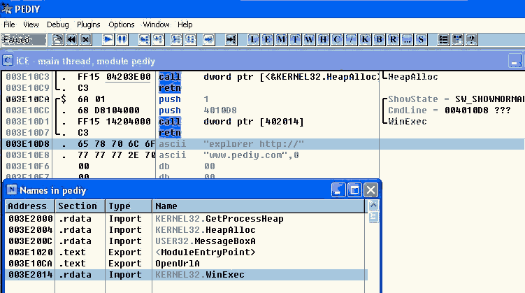
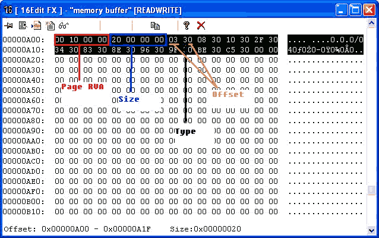
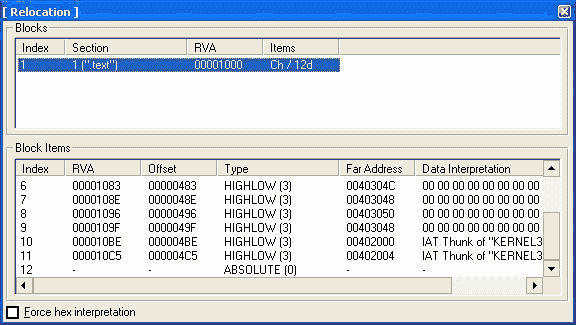
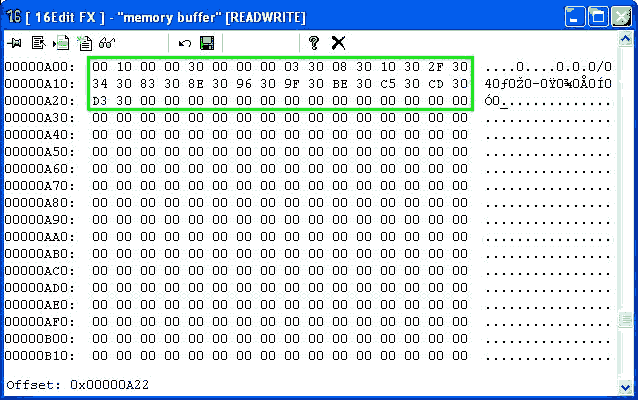
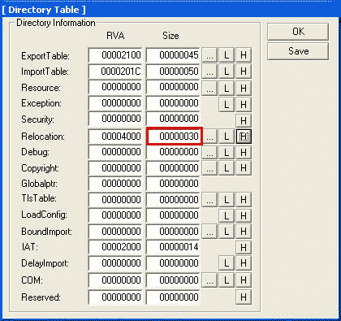
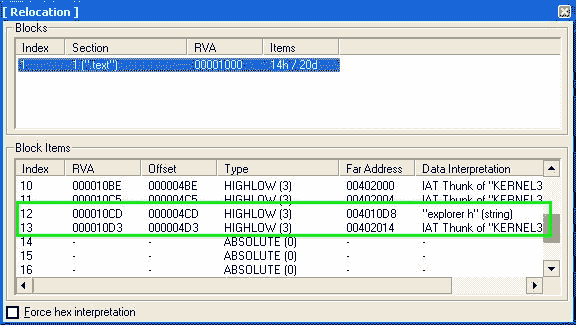
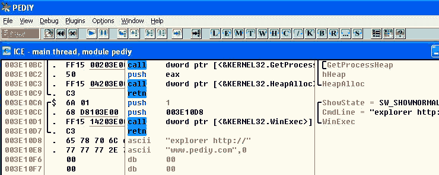

# 我的题目一做法

> 原文：[`www.pediy.com/kssd/pediy10/73927.html`](https://www.pediy.com/kssd/pediy10/73927.html)

已经过了保密时间，现在公开下我的做题答案，祥见附件。答案缺点是兼容性差，直接使用了 `LoadLibrary`,`GetProcAddress`,`FreeLibrary` 等函数地址。

优点当然是修改的地方少了。

恐怕函数占用字节数我是最多的了。呵呵，重在参与。这些不重要了。抛砖引玉吧。

1. 数据目录中添加导出表结构 20b0(6B0)

在 `pediy.dll` 文件 `148h` 处添加字节：`b0 20 00 00 45 00 00 00`

2. 添加导出表

在 `pediy.dll` 文件 `6b0` 处添加如下字节:用作导出表

```
00 00 00 00 34 cf e5 48 00 00 00 00 e2 20 00 00
01 00 00 00 01 00 00 00 01 00 00 00 d8 20 00 00
dc 20 00 00 e0 20 00 00 20 11 00 00 ec 20 00 00
00 00 70 65 64 69 79 2e 64 6c 6c 00 4f 70 65 6e
55 72 6c 41 00
```

3. 添加导出函数

在 `pediy.dll` 文件 `520h` 处添加机器码：

```
53 57 56 E8 00 00 00 00 5B 81 EB 28 11 40 00
8D B3 00 11 40 00 56 BF 77 1D 80 7C FF D7 50
5F 8D B3 10 11 40 00 56 57 B8 28 AC 80 7C FF
D0 6A 01 6A 00 6A 00 8D B3 e0 10 40 00 56 8D
B3 d0 10 40 00 56 6A 00 FF D0 57 B8 66 AA 80
7C FF D0 5E 5F 5B C3
```

在 `.text` 中添加常量字符串。

1） 在 `pediy.dll` 文件 `4e0h` 处添加： `68 74 74 70 3A 2F 2F 26 62 73 2E 70 65 64 69 79 2E 63 6F 6D 00`

2） 在 `pediy.dll` 文件 `4d0h` 处添加： `6F 70 65 6E 00`

3) 在 `pediy.dll` 文件 `500h` 处添加： `73 68 65 6C 6C 33 32 2E 64 6C 6C 00`

4) 在 `pediy.dll` 文件 `510h` 处添加： `53 68 65 6C 6C 45 78 65 63 75 74 65 41 00`

到这里题目就完成了。

测试代码：

```
HMODULE hd = LoadLibrary("pediy.dll");
GetProcAddress(hd,"OpenUrlA");
_asm call eax
FreeLibrary(hd);
```

上传的附件

|  || TEST.rar |

本来我这样做。第一次提交

加了 `SHELLEXECUTEA`

3X 字节

```
003F10CA . 60 pushad
003F10CB . E8 00000000 call 3.003F10D0 代码自身重定位
003F10D0 /$ 58 pop eax
003F10D1 |. 6A 00 push 0
003F10D3 |. 6A 00 push 0
003F10D5 |. 8BC8 mov ecx, eax
003F10D7 |. 83C1 1C add ecx, 1C
003F10DA |. 51 push ecx
003F10DB |. 83C1 06 add ecx, 6
003F10DE |. 51 push ecx
003F10DF |. 6A 00 push 0
003F10E1 |. 6A 01 push 1
003F10E3 |. 05 4C3F0000 add eax, 3F4C
003F10E8 |. FF10 call dword ptr [eax] SHELLEXECUTEA
003F10EA |. 61 popad
003F10EB \. C3 retn
```

后来

我加了 2 重定位 还是用 `SHELLEXECUTEA`

19 字节

```
003F10CA . 33C0 xor eax, eax
003F10CC . 50 push eax ; /IsShown => 0
003F10CD . 50 push eax ; |DefDir => NULL
003F10CE . 50 push eax ; |Parameters => NULL
003F10CF . 68 F2103F00 push 复件\_(3).003F10F2 ; |FileName = "http://bbs.pediy.com" 重定位
003F10D4 . 50 push eax ; |Operation => NULL
003F10D5 . 50 push eax ; |hWnd => NULL
003F10D6 . FF15 AA203F00 call dword ptr <&SHELL32.ShellExecut>; \\ShellExecuteA 重定位
003F10DC . C3 retn
```

后来 改了 `WINEXEC` ![ 汗 第 2 次提交

14 字节

```
003F10CA . 6A 01 push 1 ; /ShowState = SW_SHOWNORMAL
003F10CC . 68 F2103F00 push 复件\_2.003F10F2 重定位 ; |CmdLine = "explorer.exe http://bbs.pediy.com"
003F10D1 . FF15 08203F00 call dword ptr [<&KERNEL32.WinExec>] 重定位 ; \\WinExec
003F10D7 . C3 retn
```


```
003F10CA . 6A 01 push 1 ; /ShowState = SW_SHOWNORMAL
```

`push eax` 就行，省 1 字节。显示状态随便为什么了，最后显示出来的是 ieexplorer.exe.

将输入表向下移位 `0x50`。。在输入表前加入 `winexec` 参数 1,就能压缩到 12byte;

```
0600h: 65 78 70 6C 6F 72 65 72 2E 65 78 65 20 68 74 74 explorer.exe htt
0610h: 70 3A 2F 2F 62 62 73 2E 70 65 64 69 79 2E 63 6F p://bbs.pediy.co
0620h: 6D 00 00 00 00 00 00 00 00 00 00 00 00 00 00 00 m...............
0630h: 00 00 00 00 00 00 00 00 00 00 00 00 00 00 00 00 ................
0640h: 00 00 00 00 00 00 00 00 00 00 00 00 00 00 00 00 ................
0650h: E2 20 00 00 D6 20 00 00 F3 20 00 00 00 00 00 00 . ... ... ......
0660h: BC 20 00 00 00 00 00 00 B4 20 00 00 00 00 00 00 . ....... ......
0670h: 00 00 00 00 CA 20 00 00 60 20 00 00 A4 20 00 00 ..... ..\` ... ..
0680h: 00 00 00 00 00 00 00 00 FE 20 00 00 50 20 00 00 ........ ..P ..
0690h: 00 00 00 00 00 00 00 00 00 00 00 00 00 00 00 00 ................
06A0h: 00 00 00 00 E2 20 00 00 D6 20 00 00 F3 20 00 00 ..... ... ... ..
06B0h: 00 00 00 00 BC 20 00 00 00 00 00 00 BE 01 4D 65 ..... ........Me
06C0h: 73 73 61 67 65 42 6F 78 41 00 55 53 45 52 33 32 ssageBoxA.USER32
06D0h: 2E 64 6C 6C 00 00 99 01 48 65 61 70 41 6C 6C 6F .dll....HeapAllo
06E0h: 63 00 40 01 47 65 74 50 72 6F 63 65 73 73 48 65 c.@.GetProcessHe
06F0h: 61 70 00 00 00 57 69 6E 45 78 65 63 00 00 4B 45 ap...WinExec..KE
0700h: 52 4E 45 4C 33 32 2E 64 6C 6C 00 00 00 00 00 00 RNEL32.dll......
```

`OpenUrlA` 12 byte 代码部分：

```
003C10CA > B8 00203C00 mov eax, 003C2000 ; ASCII "explorer.exe http://bbs.pediy.com"或 cmd start 命令也可
003C10CF 6A 05 push 5
003C10D1 50 push eax
003C10D2 FF50 58 call dword ptr [eax+58]
003C10D5 C3 retn
```

未添加节，没修改文件大小,可通用。

如果根据那测试程序的话，，可以压缩到更小。。但通用性不高，9byte 也可以实现，但如果 DLL 进行初始化处理，就不能了。。

引用: *最初由 **pathletboy**发布*  `003F10CA . 6A 01 push 1 ; /ShowState = SW_SHOWNORMAL`

`push eax` 在我机器上无法通过。。通用性不高~

用 `lordpe` 添加了一个导入函数 `WinExec`

然后用 `WinExec("Explorer http://bbs.pediy.com", SW_SHOW);`来打开网页

然后修改两处从定位表

感觉 14 个字节挺标准的，呵呵

```
6A 05 push 5 ; /ShowState = SW_SHOW
68 47304000 push 0042201C ; |CmdLine = "Explorer http://bbs.pediy.com"
FF15 17504000 call dword ptr [<&KERNEL32.WinExec>] ; \\WinExec
C3 retn
```

本来想手动添加导入函数，但是没有经验，参考了书上的做法（用 `lordpe`）,

结果多了一个节，失败，呵呵。但在提交时才发现不添加节加分,哎，懒得再改了。

12 字节，将 `ShellExecuteEx` 的参数预先放在数据区，直接调用即可。数据区的布局用数组表示为如下：

```
//sizeof(SHELLEXECUTEINFO)=0x3c,15 个 DWORD
DWORD ShellEx[] = {
 0x0000003C, //1,cbSize
 0x00000000, //2
 0x00000000, //3
 0x00000000, //4
 0x00424a30, //5, lpFile，指向"http://bbs.pediy.com"，地址需要重定位;
 0x00000000, //6
 0x00000000, //7
 0x00000000, //8
 0x00000000, //9
 0x00000000, //10
 0x00000000, //11
 0x00000000, //12
 0x00000000, //13
 0x00000000, //14
 0x00000000 //15
};
```

在 `OpenUrlA` 函数填充的代码表示如下，实际可能略有不同，还需要重定位：

```
.text:00401000 68 58 60 40 00 push offset ExecInfo ; lpExecInfo
.text:00401005 FF 15 9C 50 40 00 call ds:ShellExecuteExA
.text:0040100B C3 retn
```

这种方法要添加输入表，输出表，重定位信息。但是没添加节，也没修改文件大小。

我想 `Aker` 大大说的 12 字节就是这样子吧，要压缩在个位数内并且通用，不知怎么弄了?

引用: *最初由 **edisonH**发布*  思路太死了。。。

添加个输入函数不是更好？

代码中再搞个重定位

兼容性肯定没问题

我差不多就是这么想的，只是没想到把字符串和导入函数连在一起，想楼上几位一样用偏移 call。。。

我的 14 字节

```
003C10CA >/$ 6A 01 push 1 ; /ShowState = SW_SHOWNORMAL
003C10CC |. 68 D8103C00 push 003C10D8 ; |CmdLine = "explorer http://www.pediy.com"
003C10D1 |. FF15 14203C00 call dword ptr [<&KERNEL32.WinExec>] ; \\WinExec
003C10D7 \. C3 retn
003C10D8 . 65 78 70 6C 6F 7>ascii "explorer http://"
003C10E8 . 77 77 77 2E 70 6>ascii "www.pediy.com",0
```

添加了一个引入函数 `WinExec`，添加了 2 个重定位地址

函数的大小关键在--使用哪个 api

13 楼的 Api 这样使用

```
0100739D > B8 56341200 mov eax, 123456
010073A2 50 push eax
010073A3 FF50 70 call dword ptr [eax+70]
```


`010073A6`      `C3`            `retn`

这样会省一个字节

10 字节。

我是用错了 `api` 的

引用: *最初由 **vxasm** 发布*  12 字节，将 `ShellExecuteEx` 的参数预先放在数据区，直接调用即可。数据区的布局用数组表示为如下：

//sizeof(SHELLEXECUTEINFO)=0x3c,15 个 DWORD

`DWORD` `ShellEx`[] = {

    `0x0000003C`, //1,cbSize 

 ...
}
`.text:00401000` `68` `58` `60` `40` `00`            `push`    `offset` `ExecInfo`         ; `lpExecInfo`
`.text:00401005` `FF` `15` `9C` `50` `40` `00`         `call`    `ds:ShellExecuteExA`
`.text:0040100B` `C3`                        `retn`

可以再压缩下，弄到 10bytes

```
mov eax,lpExecInfo
push eax
call [eax+xx]
retn
```

引用: *最初由 **somuch** 发布*  函数的大小关键在--使用哪个 `api`

13 楼的 `Api` 这样使用

```
0100739D >    B8 56341200   mov     eax, 123456
010073A2      50            push    eax
010073A3      FF50 70       ...
```

15 楼说的没错，这样可以少 2 字节，当时没想到这样使用。

引用: *最初由 **lunglungyu** 发布*  没权限是看不了的    

贴一下

代码:

```
1，构造数据
004020C0  WinExec 函数地址（4 字节），WinExec 导入表的 FirstThunk 指向这个双字
004020C4  0
004020C8  explorer.exe http://bbs.pediy.com/
004020EA

2，构造指令序列（12 字节）
004010D0   .  6A 01         push    1
004010D2   .  B8 C8204000   mov     eax, pediy.004020C8   ;  ASCII "explorer.exe http://bbs.pediy.com/"
004010D7   .  50            push    eax
004010D8   .  FF50 F8       call    dword ptr [eax-8]    ;  kernel32.WinExec
004010DB   .  C3            retn

3，添加 WinExec 的导入项
略

4，添加重定位项
如步骤 2，004010D3 处需要重定位

5，添加导出函数
导出函数为 OpenUrlA

说明：未添加新节，未增大文件大小
```

上传的附件

|  || pediy.rar |

1。`ShellExecuteExA`

2。`WinExec`

3。`ShellExecuteA`

 原来是把参数给移出去了，实在没想到...

我开始也是搜索 `LoadLibraryA` 来着，不过通过 `PEB` 搜 `Kernel32` 基址，代码比 `LZ` 的还要长...不过这个确实稳定。

长见识了，`ShellExecuteExA()` 这个 `API`，只用压一次参数，比 `WinExec` 还省...

可怜我 `CreateProcessA` 写了 40 多字节 ：

```
003F10CA   .  60            PUSHAD
003F10CB   .  6A 44         PUSH 44                                  ;  _STARTUPINFO.cb = 44
003F10CD   .  B9 10000000   MOV ECX,10                               ;  压入 40 字节的 0 作为缓冲区
003F10D2   >  6A 00         PUSH 0
003F10D4   .^ E2 FC         LOOPD SHORT pediy.003F10D2
003F10D6   .  54            PUSH ESP                                 ;/pProcessInfo
003F10D7   .  54            PUSH ESP                                 ;|pStartupInfo
003F10D8   .  6A 00         PUSH 0                                   ;|CurrentDir = NULL
003F10DA   .  6A 00         PUSH 0                                   ;|pEnvironment = NULL
003F10DC   .  6A 00         PUSH 0                                   ;|CreationFlags = 0
003F10DE   .  6A 00         PUSH 0                                   ;|InheritHandles = FALSE
003F10E0   .  6A 00         PUSH 0                                   ;|pThreadSecurity = NULL
003F10E2   .  6A 00         PUSH 0                                   ;|pProcessSecurity = NULL
003F10E4   .  68 80303F00   PUSH 003F3080                            ;|CommandLine = "-e bbs.pediy.com"
003F10E9   .  68 50303F00   PUSH 003F3050                            ;|ModuleFileName = "C:\\Program Files\\Internet Explorer\\iexplore.exe"
003F10EE   .  FF15 5D503F00 CALL DWORD PTR DS:\<&KERNEL32.CreateProc>; \\CreateProcessA
003F10F4   .  83C4 44       ADD ESP,44                               ;  修正之前压入的 44 字节
003F10F7   .  61            POPAD
003F10F8   .  C3            RETN
```

20 多个字节才实现的，当时没想到 `WinExec`，字节全都用在传递参数上了。

引用: *最初由 **可见光** 发布*  “添加了 2 个重定位地址”这个是怎么找啊？我的思路和你的基本一样，就是不会弄那个重定位。麻烦给解释下吧

我也是用 `OD` 写的。

先补好引入表和导出表（大家的步骤都差不多,就略过了），然后开始写代码



图 1 开始写代码

```
003E10CA >/$  6A 01         push    1                                ;/ShowState = SW_SHOWNORMAL
003E10CC  |.  68 D8104000   push    4010D8                           ;|CmdLine = 004010D8 ???
003E10D1  |.  FF15 14204000 call    dword ptr [402014]               ;\\WinExec
003E10D7  \\.  C3            retn
003E10D8   .  65 78 70 6C 6>ascii   "explorer http://"
003E10E8   .  77 77 77 2E 7>ascii   "www.pediy.com",0
```

现在 `OD` 里面 `PEDIY.DLL` 基址是 `003E0000`

如果用 `LordPE` 察看 `PEDIY.DLL`,镜像基址是 `00400000`

写代码的时候要按照 `00400000` 写，所以第二个 `push` 和 `call` 里面的地址是 `004010D8` 和 `00402014`,因为

字符串地址=003E10D8(从 `OD` 里面看）-003E0000（`OD` 里面 `DLL` 基址）+00400000(`LordPE` 里面镜像基址）= 004010D8

同理 `WinExec` 的导入表地址=003E2014-003E0000+00400000=00402014

然后看一下需要重定位的地址（在 `OD` 里面）是 `003E10CD` 和 `003E10D3`,换算成 `LordPE` 里面要用到的地址

003E10CD-003E0000+00400000=004010CD

003E10D3-003E0000+00400000=004010D3

关了 `OD`,打开 `LordPE>Directory>Relocation>HexEdit`



图 2 编辑前



图 3 编辑前 2

Offset 的计算

004010CD-00401000=0CD

004010D3-00401000=0D3

Type 都是 3 （`IMAGE_REL_BASED_HIGHLOW`）

我也是第一次改重定位项，看 `PE` 文档上说每一个重定位块都开始于 32 的倍数，虽然不知道大小怎么办，干脆就用 `0x30` 当大小了，反正后面都是 0，无所谓。外面在 `Directories` 里面也要改大小。



图 4 编辑后



图 5 编辑后 2



图 6 编辑后 3

重新用 `OD` 载入，完工了。



图 7 完成
