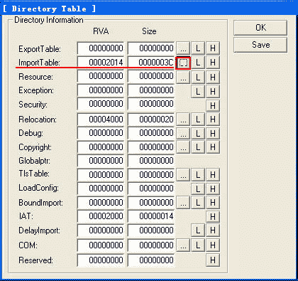
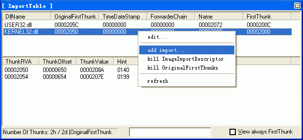
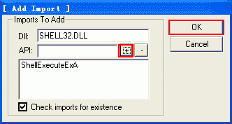
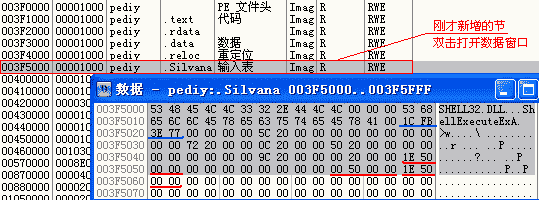
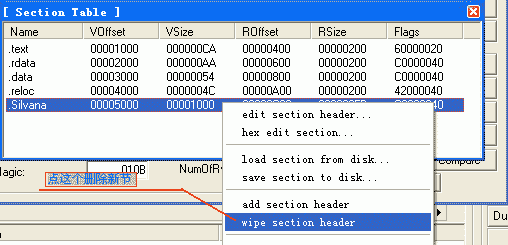
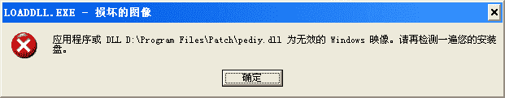
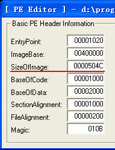

# 给 pediy.dll 手动增加引入函数（附图）

> 原文：[`www.pediy.com/kssd/pediy10/73963.html`](https://www.pediy.com/kssd/pediy10/73963.html)

高手就不用看了，仅以此献给和我一样第一次接触在引入表中新增函数的各位   
   
起因是改造第一题的 pediy.dll。  
最初没有引入 API，用 PEB 搜索 Kernell32 基址->搜 GetProcAddress->LoadLibraryA->ShellExecuteA 的 ShellCode 模式，写了个长达 115＋字节的 OpenUrlA ，于是决定寻找其他解法。  
按书上所说，LoadPE 可以自动增加函数，但会在 DLL 末尾增加一个节。看了 [【原创】看雪论坛.腾讯公司 2008 软件安全技术竞赛第一题分析过程](http://bbs.pediy.com/showthread.php?t=73935) 一文的相关部分，原来可以通过移动新节的内容来完成引入表的添加，我果然小白了   
自己试着做了一下，把整个过程详细记录了下来，有什么问题欢迎指正。  
   

引用: 关于 10 字节以内搞定 OpenUrlA 的做法，shoooo 的帖子总结了一下：  
[【娱乐】某些牛人们的方法](http://bbs.pediy.com/showthread.php?t=73938) （好吧，这题目确实不引人注目）  
  
广告一下，我在该贴 6 楼把这些代码简要注释了一下，14 楼有对**方法 3**(7 字节)的详细说明。  
话说 7 字节的方法果然精妙啊 ！原来参数这样可以输入来着。 

  
\-------------------------------------------------------------------------------------------  
拿出原始 DLL，用 LoadPE 载入。点击"Directories"（目录）按钮弹出如下对话框：  
  
  
找到引入表，点击其后的"..."按钮。在弹出窗口的上方 DLL 信息框中点反键，选择"add import..."（新增引入）：  
  
  
输入要添加新函数和 DLL 名称，例如：  
SHELL32.DLL  
ShellExecuteExA  
点击"+"，然后"OK"。  
  
  
  
确定保存修改的 DLL，接着用 WinHex 打开查看。找到刚才添加的新节内容：  

引用: Offset 0 1 2 3 4 5 6 7 8 9 A B C D E F  
00000C00 53 48 45 4C 4C 33 32 2E 44 4C 4C 00 00 00 53 68 SHELL32.DLL...Sh  
00000C10 65 6C 6C 45 78 65 63 75 74 65 45 78 41 00 0C 50 ellExecuteExA..P  
00000C20 00 00 00 00 00 00 5C 20 00 00 00 00 00 00 00 00 ......\\ ........  
00000C30 00 00 72 20 00 00 0C 20 00 00 50 20 00 00 00 00 ..r ... ..P ....  
00000C40 00 00 00 00 00 00 9C 20 00 00 00 20 00 00 1E 50 ......?... ...P  
00000C50 00 00 00 00 00 00 00 00 00 00 00 50 00 00 1E 50 ...........P...P 

  
复制这个部分到.rdata 节的空白处，例如这里选取的 000006B0 处。修改代码中的 RAV 地址（红色标出的部分）：  

引用: Offset 0 1 2 3 4 5 6 7 8 9 A B C D E F  
000006B0 53 48 45 4C 4C 33 32 2E 44 4C 4C 00 00 00 53 68 SHELL32.DLL...Sh  
000006C0 65 6C 6C 45 78 65 63 75 74 65 45 78 41 00 BC 20 ellExecuteExA..P  
000006D0 00 00 00 00 00 00 5C 20 00 00 00 00 00 00 00 00 ......\\ ........  
000006E0 00 00 72 20 00 00 0C 20 00 00 50 20 00 00 00 00 ..r ... ..P ....  
000006F0 00 00 00 00 00 00 9C 20 00 00 00 20 00 00 CE 20 ......?... ..?  
00000700 00 00 00 00 00 00 00 00 00 00 B0 20 00 00 CE 20 ..........?..? 

其实不清楚引入表的构造也没有关系，只要把指向原来位置的几个偏移改到你移动的位置就行了。一图胜千言，用 OD 加载 DLL，按 Alt+M 打开内存映射窗口，找到 pediy.dll 的最后一个节：  
  
  
蓝色的 4 个字节暂时不管，先看红色部分。  
003F504E 1E 50 00 00  对应文件中的  00000C4E1E 50 00 00  
查 [**引入表结构**](http://www.pediy.com/tutorial/chap8/Chap8-1-6.htm) 可知，这是用于存放 API 实际地址的位置（从上图也可以看出，其值再被加载时自动修正了）。它正好在'ShellExecuteExA',0 后面，所以对应的，移动后 000006FE 的值也要指向在'ShellExecuteExA',0 的后面，即 000020CE 处。  
  
这里过了就完成了大半，稍微调整引入表的偏移地址：  
00000150   26 50 00 00                                        &P..  
\->  
00000150   D6 20 00 00                                        ?..  
  
  
至此已经完成了大半，DLL 的功能已经没有问题。（二楼待续） 

继续修改 DLL，让他变得更完美吧。  
  
保存后拿 LoadPE 载入，看看引入表是否正常（例如点击引入表后面的"L"按钮）：  

引用: ->Import Table  
   1. ImageImportDescriptor:  
    OriginalFirstThunk:  0x0000205C  
    TimeDateStamp:       0x00000000  (GMT: Thu Jan 01 00:00:00 1970)  
    ForwarderChain:      0x00000000  
    Name:                0x00002072  ("USER32.dll")  
    FirstThunk:          0x0000200C  
  
    Ordinal/Hint API name  
    ------------ ---------------------------------------  
    0x01BE       "MessageBoxA"  
  
   2. ImageImportDescriptor:  
    OriginalFirstThunk:  0x00002050  
    TimeDateStamp:       0x00000000  (GMT: Thu Jan 01 00:00:00 1970)  
    ForwarderChain:      0x00000000  
    Name:                0x0000209C  ("KERNEL32.dll")  
    FirstThunk:          0x00002000  
  
    Ordinal/Hint API name  
    ------------ ---------------------------------------  
    0x0140       "GetProcessHeap"  
    0x0199       "HeapAlloc"  
  
   3. ImageImportDescriptor:  
    OriginalFirstThunk:  0x000020CE  
    TimeDateStamp:       0x00000000  (GMT: Thu Jan 01 00:00:00 1970)  
    ForwarderChain:      0x00000000  
    Name:                0x000020B0  ("SHELL32.DLL")  
    FirstThunk:          0x000020CE  
  
    Ordinal/Hint API name  
    ------------ ---------------------------------------  
    0x0000       "ShellExecuteExA" 

好了，ShellExecuteExA 成功引入，其调用偏移为 0x20CE。  
  
现在来去掉新增的节，还原 DLL 的大小。  
打开区段对话框，找到最后一个由 LoadPE 新增的节(我这里是.Silvana) ，反键选择"wipe section header"（清除区段）。  
  
  
用 WinHex 清除文件末尾从 00000C00 开始的节内容，保存退出。  
  
  
之后用 OD 载入，Oh..NO! 怎么提示“应用程序或 DLL pediy.dll 为无效的 Windows 映像。请再检测一遍您的安装盘。”！  
  
  
LoadPE 已经能认识新的引入表了啊？仔细回想刚才的步骤，终于发现问题所在：刚才直接删除了新节，没有去调整镜像大小到原始值。LoadPE 打开 DLL，找到镜像大小：0000504C，改回 0000404C 保存。  
  
  
好了，用 OD 载入 DLL，这次顺利载入了。测试一下吧，向上找到  
003F100E  |.  FF15 0C203F00 CALL DWORD PTR DS:\[<&USER32.MessageBoxA>>; \\MessageBoxA  
双击反汇编，提示的内容是：CALL DWORD PTR DS:\[3F200C\]  
由于 ShellExecuteExA 偏移为 0x20CE，改成 CALL DWORD PTR DS:\[3F20CE\]  
003F100E      FF15 CE203F00 CALL DWORD PTR DS:\<&SHELL32.ShellExecut>;  SHELL32.ShellExecuteExA  
  
看来改造成功了！之后想怎么发挥就怎么发挥了，例如 7 字节完成 OpenUrlA || pediy\_ 原始 DLL.zip  
 |
|  || pediy\_ 引入 ShellExecuteExA.rar  
 |
|  || pediy\_115+字节的改造过程.zip  
 |