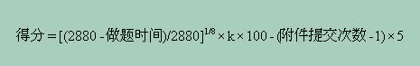

# \[结束\]\[第一阶段◇第二题\]看雪论坛.腾讯公司 2008 软件安全技术竞赛

> 原文：[`www.pediy.com/kssd/pediy10/74006.html`](https://www.pediy.com/kssd/pediy10/74006.html)

【进行中】\[第一阶段◇第二题\]看雪论坛.腾讯公司 2008 软件安全技术竞赛  
本次比赛规则及奖品请参看此帖：[`bbs.pediy.com/showthread.php?t=73422`](http://bbs.pediy.com/showthread.php?t=73422)  
  

第一阶段比赛说明   
本阶段共四道题目，每题计分每题的计分方法，将在题目放出时公布。（各题的分数将算入最后的总数，在决定最终名次时，每一题都很重要）。四道题不是同时给出，在第一题结束后，再放出第二题，以此类推。但无论答题正确与否，都有资格参与下一题的回答。若题目答错或未答，该题均计 0 分。  
  
  
**第一阶段第二题**  
  
CrackMe.exe 是一个简单的注册程序，见附件，请找出序列号或写一个注册机。  
  
答题要求   
1. 注册机是 KeyGen，不是内存注册机或文件 Patch  
2. 注册机可以使用 ASM,VC,BC,VB，Delphi 等语言书写，其他谢绝使用。  
3. 注册机必须可以运行在 Windows 系统上。  
4. 将编译好的注册机和源代码一起上传，同时描述一下分析过程及注册流程。  
5. 上传方式：将注册机工程源代码和编译好的注册机打包后,一起上传到“**[看雪论坛.腾讯公司 2008 软件安全竞赛答案提交区](http://bbs.pediy.com/forumdisplay.php?f=120)**”。  
  
其他注意事项  
1.比赛答题期间，不得在论坛或群等公开场所讨论。  
2.不得泄露 CrackMe 任何有效的姓名/序列号。  
3.违反第 1,2 条，取消相关人员比赛资格  
  
  
**提交机会**：此题每个选手有多次提交附件的机会．但从第二次提交附件起，每提交一次分数减 5 分做为惩罚，详见计分公式．以最后一次提交结果为最终计分结果,之前的提交不进行计分.  
  
**计分公式**：  
  
参数说明：  
做题时间：是指从 2008-10-5 12:00 开始到该次附件提交的时间的总共分钟数。  
K:  
  如果提交的答案是有效注册机，k 的值取 1  
  如果提交的答案是用户名/序列号，k 的值取 0.5  
  
**答题时间**：2008-10-5 12:00 至 2008-10-7 12:00 止.  
  
**通过标准**：  
分两种情况，满足下面两条中任一条视为通过。  
1.提交的答案是用户名/序列号：必须是两组不同用户名/序列号，两组用户名/序列号均能注册成功。  
2.提交的答案是注册机：在注册机中任意输入用户名，均能得到正确的注册码，使得注册成功。**(2008-10-05 16:15 aker 注：用户名为自动生成符合规则的用户名或者任意输入符合规则的用户名) **  
  
**赛事预告**：休赛一天后，2008-10-8 中午 12 点正式开始第一阶段第三题比赛。

上传的附件
|  || cm.zip  
 |