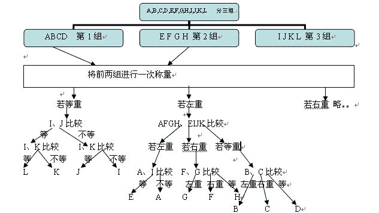

# 第一阶段第二题 crackme 设计说明

> 原文：[`www.pediy.com/kssd/pediy10/74151.html`](https://www.pediy.com/kssd/pediy10/74151.html)

根据规则,现公布该 cm 设计的详细过程,由于本人水平有限,以下内容难免存在疏漏甚至错误的地方,如有不合理之处望批评指点,希望起到学习交流的目的.  
Crackme 设计说明  
  
**一、算法部分:**  
算法模型:有 12 个钢球,形状颜色完全相同,但其中一个球质量与其他球质量不同,现给一天平,请使用最少的次数把这个质量不同的球分辨出来.  
方法:设有 12 个球 A,B,C,D,E,F,G,H,I,J,K,L  
将球平均分为三组分别为 ABCD   EFGH    IJKL  
按下图所示方法可得结果：  
   
说明：当第一次称等重时，异常球则在第 3 组，取第 3 组其中两球 I、J 比较，若等重，异常球在 L、K 里，且 I 为标准球，再将 I、K 比较就得到结果；如果 I、J 不等那么异常球在 I、J 里，K 为标准球 再拿 I 与标准球 k 比较就得到结果。  
      当第一次称量左边重时，异常球再第一组和第二组里，第三组为标准球。把第一组后三球拿走，把第 2 组后三个放第一组，把第三组前三个放入第 2 组。然后第一、二组进行比较，如果仍然左边重我们可以判定异常球在 A、E 中间，因为 IJK 是标准球，如果异常在 FGH 间那么天平应该不会继续左边重，因为 FGH 位置变化了，所以 FGH 也是标准球。这时拿 A 与标准球比较一次就得到结果了；如果第 2 次称量右边重，那么同理异常球就在 FGH 中了，并且我们可以推断异常球比其他球质量轻，那么从 FGH 取两球一比较就得到结果了；  
如果第 2 次称量等重说明异常球在 BCD 中间了，并且可以知道异常球为重球，那么同理从 BCD 里取两球一比较就得到结果了。  
     当第一次称量右边重时的情况跟左边重时的情况类似，故省略。  
  
**二、Cm 设计部分：**  
（1）注册码的生成：  
本 cm 注册码第一个字符表示要分的组数，且只能分三组才合适，故注册码第一字符必须是 3，第 2 个和第三个分别表示参与比较的两组的组编号，Cm 程序中组号分别为 0，1，2，上面描述的就是把第 0 组与第 1 组进行第一次比较。后面部分的注册码就是上图从根节点到叶节点，从左到右把参与比较的字母的编号（坐标）组合在一起得到的一串数字。  
比如这里有一串正确注册码：  
30120212022111212313120221322001101020102010200200102  
3 表示要分三组，0 和 1 表示取第 0 组和第 1 组进行第一次比较；2，0 ，2，1 表示第 2 组第 0 个字母与第 2 组第 1 个字母比较 即 I、J 比较；2，0，2，2 表示 I、K 比较，后面类推。  
当进行到 AFGH、EIJK 比较时对应注册码填的分别是 FGH IJK 的坐标。后面的仍然是参与比较的字符的坐标。当图中所有情况遍历完时成功得到注册码（实际上注册码就是一组指令告诉程序如何进行称量以找出异常球）。  
    （2）对注册码的验证：  
记录用户名大小顺序比如 ABCDEF 大小顺序为 012345，BACDEF 大小顺序为 102345，然后带入上面的称量过程中，比如如果对应大小顺序是 102345，首先将第 1 号球置为异常球，程序运行后会找到第 1 号球，然后再把 0 号球置异常球，运行后得到 0 号球，这样依次继续。这样得到所有球后代表球的字母的大小顺序应该与用户名大小顺序一致 否则注册失败。另外我们将异常球质量置一轻质量进行一次得到一个结果，再置重质量进行一次得到一个结果，这两结果的大小顺序应该与用户名大小顺序相同，否则注册失败。  
这里提供一组正确的用户名和注册码：  
User:abcdefghijkl  
Key:30120212022111212313120221322001101020102010200200102  
    （3）反调试：  
Cm 中字符串和 API 函数进行了简单的变形，隐藏信息，避开 MessageBox,用 DialogBoxIndirect。  
在程序关键代码处进行断点检测以及补丁检测，两者结合防止 cracker 在跟踪过程中下断点或者修改程序执行流程，一但检测出程序正被调试就立即结束掉程序。  
（4）消息提示：  
当用户名、注册码出错会收到三种提示：username?、key?、wrong!。  
当成功注册会得到提示：ok!。  
  
**关于“h”的说明：**  
如果把算法看成一个黑盒子那么我们的程序 所做的事情如下：  
1、将有 12 个不同字母组成的字符串按字母大小顺序编号  
比如 abcdefghijkl 对应的编号是 0 1 2 3 4 5……….  
bacdefghijkl 对应的编号是 1 0 2 3 4 5……….依次类推。  
2、如果注册码正确，从用户名从左向右依次取字符放入黑盒子按上面描述的算法进行一系列逻辑运算，然后得到一串由 abcdefghijkl 够成的 24 个字符长度的字符串。该字符串的前一半与后一半完全相同。对前一半串进行编号所得编号将与用户名的编号完全相同（实际上黑盒子处理完后记录的完全是用户名的编号，用字母来表示了）。  
3、我们的程序有如下代码：  
if(xbox\[key\[41\]\]\[key\[42\]\].m<xbox\[key\[43\]\]\[key\[44\]\].m)  
          {  
            s\[c1++\]='g';    
              
          }  
          if(xbox\[key\[41\]\]\[key\[42\]\].m<xbox\[key\[43\]\]\[key\[44\]\].m)  
          {  
            s\[c1++\]='h';    
          }  
  
  
从编程的角度看上去的确是一个明显的逻辑错误，但正是这个逻辑错误为整个算法程序蒙上了一层乌黑的面纱。它对用户名进行了进一步非常苛刻的限制。这个限制就是用户名里编号为 6 和 7 的字符必须紧挨在一起，并且编号为 6 的字符必须在编号为 7 的字符的左边，如此才能通过，并且这时候第二个 if 中的判断条件小于号与等于号等价。  
  
详细过程如下：  
     设我们以编号为 0,1,2,3,4….的用户名 abcdefghijkl 为例，我们只关注黑盒子输出的前一半串。我们先把编号为 0 的字符 a 丢 进去  将会从 abcdefghijkl 中选出编号为 0 的字符 a 输出，我们用 s\[c++\]来保存输出的结果。同样 b 丢进去输出 b，依次继续。。。。。  
当我们把 g 丢进去后 s\[6\]=g 得到 g 同时 c++ ，执行第二个 if 得到 s\[7\]=h，同时 c++,  c=8。接着我们把 h 丢进去，只有第二个 if 语句条件为等于时才满足输出 h 的条件，这时没有满足 h 的条件，那么 c 依然为 8，接下来把 i 丢进去 s\[8\]=i，然后继续，最后得到数组 s 的内容为 abcdefghijkl ,这个结果实际上 等同于第二个 if 语句判断为等于号时的结果。  
但当我们把 g 和 h 分开 或者交换他们的位置，就不会得到结果。  
因为我们当对 g 操作的时候 先得到 g ，同时把 h 放了 g 的后面，这样输出结果里 g 和 h 就放到一起了，那么得到的编号肯定也是错误的，如果 g 和 h 位置互换了，象这样 hg,那么执行完后输出就是 gh，编号也不对了。  
另外用户名不限于 abcdefghijkl 这几个字符，abcdefswijkl 也可以（这里编号为 6 和 7 的 i 和 j，就要成一个组合了，不能分开，彼此不能换位）。用户名和注册码没有一一对应关系，任何一个正确的用户名可以对应任何一个正确的注册码。  
将上面树状图中只判断等于不等的结点的两个字符位置互换一下，就可以得到一组新的注册码。  
  
301 20 21 2022111212313120221322001101020102010200200102   
看这个注册码，把 20 和 21 换个位置就又组新的了  
301 21 20 2022111212313120221322001101020102010200200102