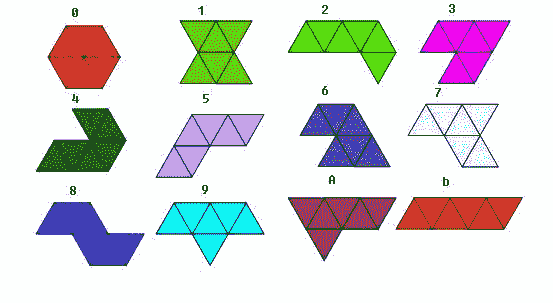

# \[第二阶段◇第一题答案\]看雪论坛.腾讯公司 2008 软件安全竞赛

> 原文：[`www.pediy.com/kssd/pediy10/74757.html`](https://www.pediy.com/kssd/pediy10/74757.html)

先上传个附件  
  
start time: 04:47"36  
end time: 04:50"12  
number of solution found: 3402  
  
用/silent 参数可以关闭屏幕输出，不用的话会慢一些  
计算结果里面包含了对称的，因此应该是 3402/2 = 1701

上传的附件
|  || pediy21.rar  
 |

首先构造两个数组，一个是容器，一个是各个板块  
每个板块又包含了 1-12 种变化（6 种旋转及翻转），为了优化代码，板块信息全部都用静态数组  
  
这个板块数组的定义如下  

引用: typedef struct \_PEDIY\_BLOCK {  
    BYTE    used;  
    BYTE    number\_of\_variant;  
    BYTE    index;  
    BYTE    data\[12\]\[4\]\[6\];  
}PEDIY\_BLOCK; 

第一个参数 used 用于循环中避免重复取用  
第二个参数 number\_of\_variant 表示该板块有几种变化  
第三个参数 index 原来是考虑用来保存第一种变化被应用到，但在实际实现中这个值没用上  
第四个参数 data 数组保存了该板块的所有变化信息  
  
如果某个字节最高位为 1，表示该位置为空，没有数据  
如果最高位不为 0，最低位为 0 时表示向上的三角形，为 1 时表示向下的三角形  
另外第 4 和第 5 位用于表示行数  
例如：  
    // AVA  
    // VAV  
    0x00, 0x01, 0x00, 0x80, 0x80, 0x80,  
    0x11, 0x10, 0x11, 0x80, 0x80, 0x80,  
    0x80, 0x80, 0x80, 0x80, 0x80, 0x80,  
    0x80, 0x80, 0x80, 0x80, 0x80, 0x80,  
注释中 A 表示向上的三角形，V 表示向下的三角形  
  
另外，采用 4\*6 的数组是因为最大高度和宽度分别为 4 和 6，虽然内存使用上有不少浪费但考虑到速度还是将就一下了  
  
容器数组采用宽 18 高 11，这是因为该钻石容器的实际长宽分别为 13 和 8，考虑到后面计算方便并且避免溢出，所以采用容量 13+6-1 和 8+4-1  
  
该数组也预先初始化好，0xFF 表示无效空间，0x00 表示向上的三角形，0x01 表示向下的三角形  
  
好了，准备工作到这里就可以了  
  
接下来的算法很简单，我们从容器的上方开始遍历空着的有效区域，从上到下，从左到右  
  
一旦发现空格子，从板块数组中任意取一块出来测试，先根据容器中该格子需要的三角形过滤到不合格的板块  
这里主要是判断该板块所对应在容器中的位置是否全部有效或是是否已经被占用，如果合格则填入容器，并递归查找下去。  
如果 12 块板块都用成功填入，则输出一个结果，并且继续当前的计算。  
当容器中所有和该取出的板块相对应的位置  
  
我用 IBM T60P 2GB 内存 2.16GHz 的 CPU 计算时如果不开屏幕输出大约需要不到 3 分钟，开屏幕输出会略慢一些 

输出的时候是按照下图编码的，当然使用到的任意块都有可能是旋转或是翻转后的  
  

这一题实在太无语了，为什么文档中的图片顺序不一致。。。  
  
只好重新提交一次，希望不要因此扣分  
  

引用: start time: 10:24"36  
end time: 10:26"20  
number of solution found: 3402 

上传的附件
|  || pediy21.rar  
 |