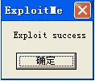

# \[第一阶段 第一题\]『深圳腾讯 2010 安全技术竞赛』

> 原文：[`www.pediy.com/kssd/pediy11/122497.html`](https://www.pediy.com/kssd/pediy11/122497.html)

\===========第一阶段比赛===========  
   

第一阶段比赛说明   
1.本阶段共四道题目，每题的计分方法会在题目放出时公布。  
   
2.四道题不是同时给出，在第一题结束后放出第二题，以此类推。  
   
3.无论本题答题正确与否，都有资格参与本轮下一题的解答。  
   
4.若题目答错或未答，该题均计 0 分。  
   
5.四道题全部答完之后，计算第一阶段总分，据此分数排序，最多取排名靠前的 50%选手进入下一轮。  
  
  
第一阶段第一题  
  
题目  
1.执行附件中的 ExploitMe.exe，将弹出“Fail”窗口。  
   
2.要求修改 exploit.dat 中的内容使得弹出的窗口如下图所示。  
  
   
3.程序运行环境为 Windows XP sp3，不得修改 ExploitMe.exe 程序本身。  
   
4.完成之后，将 exploit.dat 文件提交到 [**腾讯 2010 安全技术竞赛--答案提交区 **](http://bbs.pediy.com/forumdisplay.php?f=155)\[临时用户 的 ID 有权限提交\]  
   
5.第一题答题时间：2010-10-18 12:00 至 2010-10-20 12:00 止.  
  
  
评分标准  
   
ExploitMe 评分标准：  
   
1.本题满分 100 分；  
   
2.成功弹出窗口可得 50 分；  
   
3.Exploit.dat 文件构造部分占 50 分。  
   
此部分计分公式如下：  
   
分数 = 50 \* (min\_size / size)  
   
min 是所有选手提交的，能够弹出 exploit success 框的 exploit.dat 文件中，非零字节个数的最小值  
   
size 是选手提交的能够弹出 exploit success 框的 exploit.dat 文件中，非零字节的个数  
   
例如：00 90 90 00 为 2 个非零字节（即 90 90）  

上传的附件
|  || ExploitMe.rar  
 |