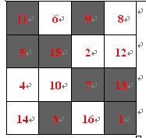
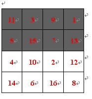
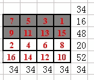
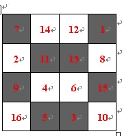
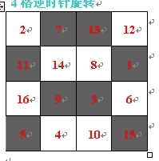
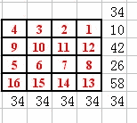
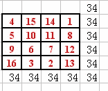

# 研究 4 阶幻方找到的部分规律

> 原文：[`www.pediy.com/kssd/pediy11/123177.html`](https://www.pediy.com/kssd/pediy11/123177.html)

先说明下,本人是数学小白,所以有错误的地方请见谅!看到这道题时,我还不知道幻方是何物,所以百度上查了一下,发现原来[洛书](http://baike.baidu.com/view/4170.htm)就是一个 3 阶幻方,易经的后天八卦这是按照这个顺序排的,神奇的东西!然后找了一些 4 阶幻方的例子,开始找规律,一晚上下来,总算有点头绪了!现在分享给大家,本人愚钝,还没有完全参透  
   
随便拿几个例子:  
  
   
奇数(阴)背景加了颜色,你可能会惊奇的发现,这个图案,对折刚好是可以重合的,下面我们重合下:  
  
重合后看不出他有什么规律,但是我们可以发现,他是一半奇数,一半偶数,然后在瓜分一半到另一边去,我们试着手动写一个:  
   
   
这个很简单, 很有规律性,竖和斜都是 34,除了横排,现在我们要把 4 个奇数放到偶数那边,因为竖和斜都是 34,所以,4 个角和中间 4 个不能动,动了斜面的和就要变了,所以只能动 5,3,9,15 和 2,14,12,8,把他们对应交换后,得到:  
   
   
一个简单的幻方就完成了,这时候把他们从分成 4 块, 7,14,2,11 为一块,12,1,13,8 为一块,9,4,16,5 和 6,15,3,10,然后顺时针旋转一格:  
   
还是一个幻方,这样可以旋转 4 次!  
   
下面来试试用另一种方法:  
  
   
第一行从右到左,依次写 1,2,3,4,然后第 3 行左往写 5,6,7,8  
   
第 2 行从左往右写 9,10,11,12,第 4 行从右到左,13,14,15,16,这里你会发现一个规律,第一行和第 3 行相对,和都为 9,第 2 行和第 4 行相对,和都为 25,所以竖排和都会一样!  
   
用上面的方法,4 边和中间不动,得到:  
   
   
   
概念还是很模糊,希望对大家有一点帮助