# lichsword 的《加密解密》学习笔记...更新中

> 原文：[`www.pediy.com/kssd/pediy11/104782.html`](https://www.pediy.com/kssd/pediy11/104782.html)

从 2010\\1\\8 开始，在这此帖整理自己的学习笔记：  
1>2009\\2\\7 就买到了《加密与解密》第三版，可到现在只会对无壳的软件暴破（太懒了！），自己都无颜了，再这样下去，怕是走不进逆向的世界了。  
   
2>在此帖中得到无形的监督  
   
3>相信也有雪友在学习中，希望能相互交流，共同进步。  
   
故，开始《加》的学习。  
\----------------------------------------------开始-------------------------------------------------------------  

第一章 基础知识常见的 intel 体系芯片用 Little-Endian 类(逆序)  
某些 RISC 架构的 CPU，eg:IBM 的 POWER-PC 等为 Big-Endian 类(正序)  
Big-Endian:高字节存入低地址，低字节存入高地址。(少见的情况)  
Little-Endian:低字节存入低地址，高字节存入高地址。(这种是我们的机子的顺序)  
所以当我们 PEDIY 时，就是用逆序存放的。  
  
  
1.2 什么是 UNICODE？  
额，区别于 ASCII，大二学 C 时，总说“啊斯克码”，全称 美国信息交换标准码  
American Standard Code for Information Interchange  
Unicode 是 ASCII 的扩展，eg:  
70h 65h 64h 69h 79h(ASCII 的“pediy”) 7 位编码  
0070h 0065h 0064h 0069h 0079h(Unicode 的“pediy”) 16 位编码  
  
1.3 什么是 API？  
额，我用了不少 API 了，应用程序编程接口(Application Programming Interface)  
windows 提供的丰富的 API 给程序员使用，这些 API 封装到 DLL 中。  
系统最常用的 DLL：  
Kernel:16bit KRNL386.EXE + 32bit KERNEL32.DLL，包括进程与线程控制、内存管理、文件访问等核心功能服务  
听名字就知道 kernel--1.谷粒;仁,核 2.要点,中心,核心  
难怪，我们用 OD 时，经常一个 CALL 跑到系统领空，那就是到这些 DLL 中去了。  
User:16bit USER.EXE + 32bit USER32.DLL,处理 键盘鼠标输入、窗口和菜单管理等用户接口。  
  
GDI:16bit GDI.EXE + 32bit GDI32.DLL,这个也很常用，如我们用画直线画点等 API。作用是 允许用户在屏幕和打印机上显示文本和图形。  
英文是 Graphics Device Interface 图形设备接口。  
以上三个几乎是用汇编写程序必用的 DLL：  
代码:

```
 
;--------include files--------
include gdi32.inc
includelib gdi32.lib
include user32.inc
includelib user32.lib
include kernel32.inc
includelib kernel32.lib
...

```

之外还有一些 DLL，如下所示，先混个脸熟:  
COMDLG32.DLL:通用对话框 DLL。这个也相当常用了，  
使用 

> 打开文件对话框  
> 保存文件对话框  
> 字体选择对话框  
> 颜色选择对话框  
> 查找和替换文本对话框  
> 页面设置对话框  
> 浏览目录对话框 等相关 API，就要用到 comdlg32.dll  

Comctl32.dll:标题栏、进度条、状态栏、滚动条、工具栏、提示文本、树型视图、列表视图等控件的相关 API，都要用到这个库。  
wsock32.dll:网络编程接口库。对网络数据包的操作用到。  
  
1.4 常用 API 函数  
参考：MSDN 或百度 google 或..  
由于字符分 ASCII 和 Unicode 编码，所以一些与字符相关的 API，就分成 2 类。  
以 A 结尾(单字节方式)以 W 结尾(宽字节方式)  
eg:  
GetWindowText:获取窗口文本 GetWindowTextA/GetWindowTextW  
GetDlgItemText:获取对话框文本 GetDlgItemTextA/GetDlgItemTextW  
MessageBox:创建和显示信息框 MessageBoxA/MessageBoxW  
  
我们写程序时，只用调用 MessageBox 就可以,编译器会根据设置来采用 A/W。  
\[思考\]但如果用 OD 对 API 下断点时，我们是对以 A 结尾的 API 下断 还是 对以 W 结尾的 API 下断呢？  
我的想法是，先用 Ctrl+N 打开导入库，查看是什么样的 API，再下断，就可以了。  
当然，也可以先下 A 型的，不行，再下 W 型的。一次次试。  
  
1.5 什么是句柄  
句柄就是一个标识符，本质是一个整数。由于表示的东东的类型不同，分为：  
  
窗口句柄  
资源句柄(细分为 字符串句柄、声音 wav 资源句柄、图片句柄等等)  
  
总之就是 一个用于保存每个东东的索引的 DWORD 型整数。比如：

> 代码:
> 
> ```
>  
> ;----------------------------------------------
> ;EQU define
> ;----------------------------------------------
> DLG\_MAIN EQU 1000 对话框
> ICO\_MAIN EQU 100 程序图标
> ;... ...s
> RED\_TXT EQU 1001 Richedit 控件
> IDM\_OPENFILE EQU 10002 以下都是菜单项的句柄
> IDM\_EXIT EQU 10003
> IDM\_BASICINFO EQU 10004
> IDM\_IMPORT EQU 10005
> IDM\_EXPORT EQU 10006
> IDM\_RESOURCE EQU 10007
> IDM\_RELOCATION EQU 10008
> IDM\_VERSION EQU 10009
> 
> ```

1.6 windows 各操作系统与 Unicode 的处理  
ASCIId 码只有 7 位，保存的信息少，而 Unicode 为 16 位，可以保存更多的信息，如我们的汉字就是 2 个 UNICODE 大小。  
一、9x 系统，即 win95-win98(不是很严谨)的处理如下：  
将 UNICODE 字符参数先转换成 ASCII 类型--->再调用 ASCII 型的 API  
eg:  
代码:

```
 
windows98 里 MessageBoxW 函数的内部定义
int MessageBoxW(MessageBoxExW{ // 调用 MessageBoxExW()函数

> WideCharToMultiByte(); // 取得要显示文本的长度
> GlobalAlloc(); // 按字符串长度分配内存
> WideCharToMultiByte(); // 将 UNICODE 文本转换成 ANSI 字符串
> WideCharToMultiByte(); // 取得消息框标题文本的长度
> GlobalAlloc(); // 按字符串长度分配内存
> WideCharToMultiByte(); // 将 UNICODE 文本转换成 ANSI 字符串
> MessageBoxExA(); // 最终还是调用 ANSI 版的 MessageBoxExA();函数显示窗口
> GlobalFree(); // 释放内存
> GlobalFree(); // 释放内存

}
);

```

  
二、NT/2000/XP 系统如何处理 Unicode  
NT 及以上系统好像完全反过来了。  
将 ASNI 字符串先转换成 UNICODE，再调用 W 型 API，因为 NT 及以上系统是的系统核心完全是用 Unicode 函数工作的。  
代码:

```
 
eg: int MessageBoxA(
MessageBoxA{ // 调用 MessageBoxExA()函数 
MBToWCSEx(); // 将消息框主体文字转换成 Unicode 字符串
MBToWCSEx(); // 将消息框标题文字转换成 Unicode 字符串
MessageBoxExW() // 调用 MessageBoxExW()函数
HeapFree() // 释放内存
}
);

```

  
1.7 windows 消息机制  
［笑话一则］学到这里，我想起最近发生的事。是在 QQ 上和朋友聊天，朋友是学软件工程的，他居然不知道 C 可以写窗口程序，他理解为 C 只能写 console 这种黑框框的控制台程序。  
并和他同学一致讨论，认为，C++才能写窗口程序！  
  
我的理解是：只要在理解 windows 消息机制的基础上，调用相关 API，就可以写出窗口程序。**C 当然可以写窗口，因为 C 可以调用相关 API，我也写过不少了。再说，好多网络游戏，单机游戏就是用 C 写的，有名的拉莫斯的游戏引擎就是用 C 写的，额，说远了，打住，说回来。**  
这里总结 C 语言 和汇编语言 的 window 消息机制  
  
先写汇编的框架:>>>>>>>>>>>>>>>>>>>>>>>>>>>>>>>>>>>>>>>>>>>>>>>>>>>>>>>>>>>>>>>>>>>>>>  
代码:

```
 
;--------------------------------------------------------
;time:2009-11-3 13:46
;author:lichsword
;function:
;
;--------------------------------------------------------
.386
.model flat,stdcall
option casemap:none
;----------------------------------------------
;include file define
;----------------------------------------------
include windows.inc
include gdi32.inc
includelib gdi32.lib
include user32.inc
includelib user32.lib
include kernel32.inc
includelib kernel32.lib
;----------------------------------------------
;EQU define
;----------------------------------------------
ICO\_MAIN EQU 100
;... ...
 
;----------------------------------------------
;.data segment
;----------------------------------------------
.data?
 
hInstance dd ?
hWinMain dd ?
hIconMain dd ?
.data
;... ...
.const
szClassName db 'MyClassName',0
szCaptionName db 'My Window Caption',0
szText db '这是一个窗口的框架。',0
;---------------------------------------------
;.code segment
;---------------------------------------------
.code
;---------------------------------------------
;Main Window's process
;---------------------------------------------
\_ProcWinMain proc uses ebx edi esi hWnd,uMsg,wParam,lParam
 
LOCAL @stPs:PAINTSTRUCT
LOCAL @stRect:RECT
LOCAL @hDc
 
mov eax,uMsg
;-------------------------------------------
.if eax==WM\_PAINT
invoke BeginPaint,hWnd,addr @stPs
mov @hDc,eax
 
invoke GetClientRect,hWnd,addr @stRect
invoke DrawText,@hDc,addr szText,-1,addr @stRect,DT\_SINGLELINE or DT\_CENTER or DT\_VCENTER
invoke EndPaint,hWnd,addr @stPs
;--------------------------------
;add your code here...
;--------------------------------
.elseif eax==WM\_COMMAND
;--------------------------------
.elseif eax==WM\_CREATE
invoke SendMessage,hWnd,WM\_SETICON,ICON\_BIG,hIconMain
 
 
 
.elseif eax==WM\_CLOSE
invoke DestroyWindow,hWinMain
invoke PostQuitMessage,NULL
.else
invoke DefWindowProc,hWnd,uMsg,wParam,lParam
ret
.endif
 
xor eax,eax
ret
 
\_ProcWinMain endp
;---------------------------------------------
;Main Window
;---------------------------------------------
\_WinMain proc 
 
LOCAL @stWndClass:WNDCLASSEX
LOCAL @stMsg:MSG
 
invoke GetModuleHandle,NULL
mov hInstance,eax
 
invoke RtlZeroMemory,addr @stWndClass,sizeof @stWndClass
 
;---------------------------------
;注册窗口类
;---------------------------------
invoke LoadCursor,0,IDC\_ARROW
mov @stWndClass.hCursor,eax
 
invoke LoadIcon,hInstance,ICO\_MAIN
mov hIconMain,eax
 
push hInstance
pop @stWndClass.hInstance
 
mov @stWndClass.cbSize,sizeof WNDCLASSEX
mov @stWndClass.style,CS\_HREDRAW or CS\_VREDRAW
mov @stWndClass.lpfnWndProc,offset \_ProcWinMain
mov @stWndClass.hbrBackground,COLOR\_WINDOW+1
mov @stWndClass.lpszClassName,offset szClassName
 
invoke RegisterClassEx,addr @stWndClass
;---------------------------------
;Create and show window
;---------------------------------
invoke CreateWindowEx,WS\_EX\_CLIENTEDGE,\\
offset szClassName,offset szCaptionName,\\
WS\_OVERLAPPEDWINDOW,\\
100,100,600,400,\\
NULL,NULL,hInstance,NULL
mov hWinMain,eax;save handle of window
 
invoke ShowWindow,hWinMain,SW\_SHOWNORMAL;show window
invoke UpdateWindow,hWinMain ;update window
;---------------------------------
;message circle 消息循环
;---------------------------------
.while TRUE
invoke GetMessage,addr @stMsg,NULL,0,0
.break .if eax==0;when @stMsg = WM\_QUIT , eax=0
 
invoke TranslateMessage,addr @stMsg
invoke DispatchMessage,addr @stMsg
 
.endw
ret
\_WinMain endp
;-------------------------------------------------
start:
call \_WinMain
invoke ExitProcess,NULL
end start 

```

下面是 C 的框架：>>>>>>>>>>>>>>>>>>>>>>>>>>>>>>>>>>>>>>>>>>>>>>>>>>>>>>>>>>>>>>>>>>>>>>  
代码:

```
 
/\*-------------------- include files define ----------------------------\*/
#include<windows.h>
#include<windowsx.h>
#include<winuser.h>
#include<stdio.h>
/\*-------------------- defines files ----------------------------------\*/
#define WIN32\_LEAN\_AND\_MEAN // 不使用 MFC
#define WINDOW\_CLASS\_NAME "WINCLASS"
 
/\*------------------- struct define ----------------------------\*/
 
 
/\* ------------------- funciton indentifier -----------------------------\*/
 
/\* ------------------- funcitons -----------------------------\*/
 
LRESULT CALLBACK WindowProc(HWND hWnd, UINT stMsg, WPARAM wParam, LPARAM lParam)
{
/\* 窗口进程回调函数
完成 windows 消息分支处理
\*/
 
PAINTSTRUCT stPs;
HDC hDc;
 
switch(stMsg)
{
case WM\_CREATE:
{
/\* 窗口初始化 \*/
return(0);
}break;
case WM\_PAINT:
{
/\* 客户区绘制 \*/
hDc=BeginPaint(hWnd,&stPs);
 
EndPaint(hWnd,&stPs);
 
}break;
case WM\_DESTROY:
{
/\* 窗口摧毁 \*/
PostQuitMessage(0);
return(0);
 
}break;
default:
break;
} // end switch
 
// 处理其它系统默认消息
return (DefWindowProc(hWnd,stMsg,wParam,lParam));
 
} // end WindowPric
 
int WINAPI WinMain(HINSTANCE hInstance, HINSTANCE hPrevInstance, LPSTR lpCmdline,int nCmdShow)
{
WNDCLASSEX stWndClass; // 保存建立的窗口类
HWND hWnd; // 保存窗口句柄
MSG stMsg; // 保存消息结构
 
/\* 清空结构 \*/
RtlZeroMemory(&stWndClass,sizeof stWndClass);
/\* 填充窗口类 \*/
stWndClass.cbSize =sizeof(WNDCLASSEX); // 类大小
stWndClass.style =CS\_DBLCLKS | CS\_HREDRAW | CS\_VREDRAW; // 窗口属性
stWndClass.lpfnWndProc =WindowProc; // 窗口进程函数
stWndClass.hInstance =hInstance; // 窗口句柄
stWndClass.hIcon =LoadIcon(NULL,IDI\_APPLICATION); // 窗口主图标
stWndClass.hCursor =LoadCursor(NULL,IDC\_ARROW); // 光标
stWndClass.hbrBackground =(HBRUSH)GetStockObject(BLACK\_BRUSH); // 客户区背景
stWndClass.lpszMenuName =NULL; // 菜单
stWndClass.lpszClassName =WINDOW\_CLASS\_NAME; // 窗口类名
 
/\* 注册窗口类 \*/
if(! RegisterClassEx(&stWndClass))
return 0;
 
/\* 创建窗口 \*/
if(!(hWnd=CreateWindowEx(
WS\_EX\_CLIENTEDGE,
WINDOW\_CLASS\_NAME,
"DataStruct Demo",
WS\_OVERLAPPEDWINDOW | WS\_VISIBLE, 
100,100,
600,400,
NULL,NULL,
hInstance,
NULL)))
{ return 0; }
ShowWindow(hWnd,SW\_SHOWNORMAL);
UpdateWindow(hWnd);
/\* 进入事件循环 \*/
while(TRUE)
{
GetMessage(&stMsg,NULL,0,0);
if(stMsg.message==WM\_QUIT)
break;
// 处理快捷键
TranslateMessage(&stMsg);
 
// 消息转发给窗口回调函数
DispatchMessage(&stMsg);
} // end while
 
// 返回操作系统
return (stMsg.wParam);
} // end WinMain

```

  
流程看框架就明白了，相关 API 只有几个。更具体的，可以参考 罗云彬的《win32 汇编语言程序设计》第四章第二部分 或《windows 程序设计》一书 或者 就在我们论坛上找，一定会有相关帖子的。  
  
1.8 保护模式  
学到这里，我想起我为啥这么喜欢汇编语言的原因了。因为它是我觉得唯一称得上“能调戏程序的语言”，注意，不是“调试”是“调戏”。  
本节核心：

> > 1.  应用程序是不会直接访问物理地址的；
> > 2.  虚拟内存管理器通过虚拟地址的访问请求，控制所有的物理内存访问；
> > 3.  每个应用程序都有相互独立的 4GB 寻址空间，不同应用程序的地址空间是隔离的；
> > 4.  DLL 程序没有自己的“私有”空间，它们总是被映射到其它应用程序的地址空间中，作为其它应用程序的一部分运行。因为如果 DLL 不和其他程序同属一个空间，应用程序就无法调用它。

离开电脑，活动一下。  
  
第二章 动态分析技术 2.1 OllyDbg  
从这章开始，就有事做了，开始准备学习使用我们的武器装备了。  
第一个是 OllyDbg，简称 OD;Ring3 级程序调试器  
学习教程，推荐先看论坛的 CCDbuger 的 OD 系列精华教程：\[INDENT\]

> > > 传送门：  

> > > [【原创】OllyDBG 入门系列（一）－认识 OllyDBG ](http://bbs.pediy.com/showthread.php?t=21284)  
> > > [【原创】OllyDBG 入门系列（二）－字串参考](http://bbs.pediy.com/showthread.php?t=21308)  
> > > [【原创】OllyDBG 入门系列（三）－函数参考](http://bbs.pediy.com/showthread.php?t=21330)  
> > > [【原创】OllyDBG 入门系列（四）－内存断点](http://bbs.pediy.com/showthread.php?t=21378)  
> > > [【原创】OllyDBG 入门系列（五）－消息断点及 RUN 跟踪 ](http://bbs.pediy.com/showthread.php?t=21532)  
> > > [【原创】关于《OllyDBG 入门系列（五）－消息断点及 RUN 跟踪》的补充 ](http://bbs.pediy.com/showthread.php?t=46520)  
> > > [【原创】OllyDBG 入门系列（七）－汇编功能 ](http://bbs.pediy.com/showthread.php?t=23873)  

请问 代码的对齐与 缩进，大家是如何编辑的，好像看到好多人是用 一个框框把代码都框起来，就很漂亮，很整齐，如何做到的？  
  
找到一种方法，用 luo cong 的代码着色器。http://www.luocong.com/myworks.htm 这里是下载地址  
  
版主可以告诉，那种 整齐的加边框 如何实现  
  
感谢 youstar 相告，方法是：

代码:

```
选择“进入高级模式”--->有一个新的工具像＃号一样的---->把 你的代码选中，点这个＃号工具，OK。--->和谐了！

```

第三章

静态分析技术  
3.1 文件类型分析  
相关工具：PEiD/pe-scan/FileInfo  
3.2 静态反汇编  
相关工具：W32Dasm/C32asm/IDA  
IDA 的使用部分---先挂起。  
\--------------------- mark ------------------------  
3.3 可执行文件的修改  
相关工具：Hiew  
书中是以 Hiew 为工具，以 ReverseMe 为破解对象来说明。  
  
目标：为程序的窗口增加“水平滚动条和垂直滚动条”  
原理：通过 win32 编程知识，我们知道“水平滚动条和垂直滚动条”是窗口样式属性之一，即 dwStyle，并且这个属性会作为 CreateWindowExA 的参数来被调用，因此，只要静态修改这个值，就可以实现我们的目标。  
过程：  
在知道原理的基础上，我们的首要任务就是找到 CreateWindowExA 这个 API 在本程序中的调用地址。如果用 OD，我们可以用 Ctrl+N 来查看导入表中的函数，来定位调用 CreateWindowExA 的地址，但出于本节是静态分析的学习，就使用 IDA 来查找导入表（方法简单，打开 IDA--->导入程序反汇编--->在输入表窗口查找 CreateWindowExA--->双击，就不再细说了）。在找到这个地址后，我们记下来 dwStyle 属性的地址 0040109E,那么 IDA 的任务就完成了（我们只用 IDA 来定位地址）。  
下面我们要定位参数 dwStyle 的地址，并要能修改它的值，然后保存文件。那么就换 Hiew 出场，其它的工具，如 W32Dasm 也是可以实现这个功能的。Hiew 的用法真的是易学（界面中都有用法的帮助信息），当我们把位于 0040109E 的数据由原来的 push 000CF0000 改为 000FF0000,再按 F9 键存盘，得，就算是完成了。  
总结：IDA 来用直观的图形化界面查看程序结构，可以更迅速了解程序流程。  
Hiew 可以方便的修改文件，不过我觉得只能修改无壳的软件，要是加了壳，静态反汇编后修改也是徒劳无功。再就是类似暴破的关键点修改。当然这里只是学习使用和了解啥是静态分析，所以书中的目的已经实现了。  
  
3.4.1 静态分析技术应用实例  
本例是软件暴破的实例，呵呵，难怪那么人喜欢暴破，不过这个 CrackMe 太小了，很容易找到暴破点，而且还是明码比较。  
目标：CrackMe.exe  
方式：暴破  
过程：  
首先，软件没加壳，运行后，混乱输入一个序列号后，程序很和谐的返回一个“序列号不对，重新再试一次”的消息框。这里就不谈复杂了，有信息就用吧，这次不用 IDA，换用 W32Dasm，对它静态反汇编后，我们在串式数据参考中找到这个提示的信息字符串，双击后就跳到了相关代码处，这个程序是如此简单，所以我们的重点就是去找关键点，即 com+je/jz/jne/jnz 之类的组合指令，这是常见的判断语句（当然还有 test+jz 等等，这就要考查我们的汇编基础知识了）。住前找，一下就找到关键点  
004010C9 751D jne 004010E8；这里的跳转一实现的话，就玩蛋。即输入序列号不对。  
所以我们不能让它跳。  
  
改法有 2 种：我们可以把“jne”改为“je”，就成了错误的序列号会成功注册，而正确的序列号（虽然实际情况我们很难乱输入一个正确的序列号）却会注册失败。  
所以我们还有另一种改法----干脆无论序列号正确还是错误，都不跳。即这个跳转无效，我们通常用 NOP 来代替，又因为 jne 004010E8 是一个双字节指令，所以我们得连续 2 个 NOP，否则就引起后面的代码位置错位（让我想起花指令）。  
其实，还可以改为这个跳转为 jne 004010CB，呵呵，因为 004010CB 就是这个跳转的下一条指令。额，小程序就不再深究了，因为我们的目的不是破解这个程序，而是理解静态反汇编工具的使用以及破解（这里是暴破）的原理。  
  
总结：这个例子用了 W32Dasm 工具，属于静态反汇编，缺点是只能对无壳软件修改，如果加了壳，就不能静态反汇编来改了，因为看到的都是错误的代码。  
再就是关键点的找法，以本例说明：运行---->随意输入序列号--->查看程序给出的提示信息--->载入 W32Dasm 静态反汇编--->查找提示信息的字符串--->通过观察代码流程，向前找到判断跳转语句（即关键点）--->动点手脚--->完毕！  
  
3.4.2 逆向工程初步  
目标：Reverse01  
任务：  
1>移去“Okay,for now,mission failed”对话框  
2>显示一个 MessageBox 对话框，上面有读者输入字符  
3>再次显示一个对话框，以告知输入序列号是正确还是错误；"Good/Bad serial"  
4>将按钮标题由“Not Reversed”改为“-Reversed-”;  
5>使序列号为“pediy”.  
  
按着书中来，很容易完成。  
但我得整理下我的心得：  
首先，不得不说，我开始一看到这个任务，我当时就喜欢得不得了，哎呀妈呀，这么就开始进行“传说中的逆向工程”了，虽然是“初步”，但真是太兴奋了。下面我们看看这些任务的实用性：  
1>这种任务很实用，因为如果我们在使用一个软件时，它时不时地弹出提示框，如“楼主你不厚道啊，怎么买我的注册码呀，试用期快到了哟！”。这时，我们就可以用类似思路找到调用这个消息框的调用代码，并向前找到关键点，对它动点“手脚”。  
2>这个任务，一开始把我给唬住了，我起初一想，程序没有显示 MessageBox 对话框的功能，我如何能凭空做出一个来呢？ 等我按书中做完，才醒悟，“哦！原来程序内部已经有这个功能，只是没有被调用，而我逆向的目的就是激活这个功能”，想到什么了吗？对！当我们在试用一个软件时，如果这个软件因为没有注册而禁止了一此功能，但我们知道这个功能仍在软件中...嗯，明白了！---所以这个任务也是有实际应用的。  
3>这个就是改字符，与之前的 Hiew 应用也差不多，只要找到字符串所在地址，后面的处理就好办。  
4>这一步任务，初看一下好像与第 3 步雷同，不都是改字符串吗，其实还是有点差别的，你想想，我们有时破解完一个程序 不都喜欢加上“到此一游”的话吗（当然，我一般写“Crack by lichsword”）？当然是写在标题栏啦，这里改的是窗口类名，这属于窗口创建的知识，不细说了。  
5>这一步是考查我们的汇编算法，其实如果要深究，还得全局地分析一下代码。虽然不多，不过以书中一句“一个较好的地方是在 401270h 处”未免让我们心存疑问----为啥说这个地方 好捏？  
如果让我不看书写，我会这样做：首先我会写一段 以 pediy 为注册码的校验代码---这个有些汇编基础不难写出，但问题是我们在哪里写呢？  
其实，光用静态分析是看不明白程序的流程的，我分析是程序在按钮被按下进，就进行读文本，判断是否是正确注册码，所以我们要在 “按钮被按下”这一条件发生后，加上注册码的校验代码，然后跟据校验结果跳到相应地址，显示是否注册成功的消息框。  
不过这不是仅仅用静态分析就能完成的，我打算如果有必要，以后再完善这段分析。。。  
好，我觉得第三章就到这里。

第四章 逆向分析技术  
记住：逆向工程 Reverse Engineering  
  
4.1 启动函数  
这部分的资料还没有找全，占位编辑。  
  
4.2 函数  
  
函数的识别：  
函数的调用是 CALL 指令，CALL 与跳转指令的区别在于，CALL 是先将之后的地址压入栈，再跳转到函数的程序地址，而 JMP 之类的跳转指令仅仅是跳转。  
函数的用完后会返回，否则如何继续下条指令呢？   
所以相应的有一个 RET 指令（由于调用约定的不同，RET 的位置会不同，这是后话）。  
因此，我们通过 CALL 指令来识别调用了一个函数。  
eg:  
  
代码:

```
00401000 push 6
00401002 push 5
00401004 call 00401010 \---这里就是函数的调用，先把下条指令的地址即 00401009 入栈，再跳转到 00401010 地址执行。
00401009 add esp,8
0040100C xor eax,eax
...
00401010 mov eax,dword ptr \[esp+8\]
00401014 mov ecx,dword ptr \[esp+4\]
00401018 add eax,ecx
0040101A retn ---这里就是函数返回，先是从堆栈中取出返回地址，然后跳转到该返回址，不过就是有一点不同的，即为 retn，为段内返回。

```

函数的参数：  
关于函数的参数的话题是：如何传递参数  
有三种方式：堆栈、寄存器、全局变量  
a>先说说堆栈方式：  
调用约定与编译器相关，我觉得不必死记，用多就熟悉了，再则不会时可以再查资料。  
比如说\_\_stdcall 就是从右向左调用参数，由子程序来平衡堆栈。为啥呢？因为我写过很多，所以记得了。  
有些地方要注意：  
非优化的编译器，会用 ebp 来对参数寻址，而优化好的编译器将直接用 esp 来寻址。  
eg：（一个非优化的编译器）  
代码:

```
 
push ebp ---这是保护 ebp
mov ebp,esp ---设新 ebp 指向栈顶
mov eax,dword ptr \[ebp+0C\] ---调用参数 2
mov ebx,dword ptr \[ebp+8\] ---调用参数 1
sub esp,8 ---开辟 8Byte 栈空间，来存放局量变量。
...
add esp,8 ---函数结束前，要先收回局部变量的栈空间
mov esp,ebp ---还原 esp 到栈顶
pop ebp ---还原 ebp
ret 8 ---回收参数占用的栈空间（即平衡堆栈），弹出函数调用的入栈地址，并返回。

```

多说一句，ret 8，这个 8 是表示“在 ret 指令执行后，再把 esp+8”，其目的也就是平衡堆栈，不过这是为了 平衡“函数参数”的堆栈。  
有一组不常用的指令：其中“\*\*\*\*”号表示数值，即局部变量占据大小。  
代码:

```
 
enter \*\*\*\*等价于
push ebp
mov ebp,esp
sub esp,\*\*\*\*
另一个 leave \*\*\*\*
等价于
add esp,\*\*\*\*
mov esp,ebp
pop ebp

```

  
下面说说 用 寄存器传递参数  
即用 eax ebx ecx edx 等寄存器来传递参数，但不同的编译器，对寄存器的选择是不同的，不仅仅是个数的不同，种类也不同。  
比如有的只用 edx,eax，不用别的寄存器，这个是归于各编译器的设定吧，就不深究。  
最后说说，用全局变量传递参数，这个也是相当常见了。  
我们写汇编程序时，不是常在.data/.const/.data?这几个段定义变量和常量吗？ 对，这些变量和常量就是以全局变量的方式来传递参数。  
代码:

```
1:    #include<stdio.h>
2:    int a=2010;
3:    void main()
4:    {
0040D690   mov         eax,\[\_a (00414a30)\]
0040D695   push        eax
0040D696   push        offset string "%c" (00414a38)
0040D69B   call        printf (00401040)
0040D6A0   add         esp,8
5:        printf("%d",a);
6:    }
0040D6A3   ret

```

反汇编后，可以看到全局变量 a 的调用方式为 mov eax,0042adbc  
  
  
  
现在去地址 0042adbc 查看数据：  
  
  
变量 a 是 int 型，占 4 个字节，由于低地址存放高位数据，高地址存放低位数据，所以为 000007DA = 十进制的 2010，即说明就是直接取固定地址的。  
关于参数调用约定的最后一点：参数名称的修饰约定  
这里不细说了，只要记得不同的编译器的参数名的修饰约定是不同的，就行了。用时再来查资料。mark，以后加个 传送门。  
函数的参数说完了，下面说说函数的返回值：  
  
返回值的返回方式有 2 种：  
用 return 返回，和通过参数按传引用方式返回值  
其实简单地说：  
return 返回：是将结果保存在 eax 中，然后返回 eax。说白了，就是用 eax 寄存器来返回值。  
引用方式返回值：引用的本质就是把参数的实参地址作为了函数的参数，而在函数内部是对这个实参地址直接读写，所以当然就可以返回函数的结果罗！  
4.3 数据结构  
高级语言，如 C/C++都有基本的数据结构（变量、数组、结构体、共用体、枚举类等），也有更高级的结构，如：栈、队列、树、图（不过，这些高级结构不是我们要谈的，这些高级结构与算法联系密切，这里不谈）。  
在汇编里，结构都被打散到“微粒”，我们最多可以一眼看如数组，但不可能一下子看出一个树型结构。  
下面说说常见的数据结构的细节：  
a>局部变量：（或者说“如何识别局部变量”）  
如果一个变量保存在寄存器中，或 堆栈中，我们可以判定这个多半是局部变量，因为栈的空间会释放的，寄存器也是会时不时的被存入的新数据给覆盖，所以多半是用于局部变量。  
  
  
b>全局变量：（或者说“如何识别全局变量”）  
当我们看到一个变量是直接以固定地址来引用的，那一定是全局的，而且这个地址一定位于可读可写的.data 段中。  
eg：mov eax dword ptr \[4084C0h\] ---4084C0h 这个地址存放的就是一个全局变量。  
  
例子说明，参见 用全局变量传递参数  
  
c>数组：（或者说“如何识别数组”）  
数组的特点是，数据以连续的地址存放。并且数据大小相同，类型相同，eg：同为 int 型 ，大小为 4 字节（占一个 DWORD 空间）。所以，当我们看到一个 “基址加变址寻址”时，10 有 89 就是一个数组了，而且我们可以进一步推断，那个基址就是数组的首地址，那个变址就是数组的索引值  
eg：mov edi, dword ptr \[eax+00407030\]  
00407030 就是数据的基址 a［］，而 eax 就是索引值 i 。  
以上就是 把 a \[ i \] 中的数值，送给 edi。  
代码:

```
1:    #include<stdio.h>
2:    void main()
3:    {
0040D690   sub         esp,8
0040D693   push        esi
4:        int i;
5:        char a\[5\]={'p','e','d','i','y'};
0040D694   mov         byte ptr \[esp+4\],70h    \---'p'
0040D699   mov         byte ptr \[esp+5\],65h    \---'e'
0040D69E   mov         byte ptr \[esp+6\],64h    \---'d'
0040D6A3   mov         byte ptr \[esp+7\],69h    \---'i'
0040D6A8   mov         byte ptr \[esp+8\],79h    \---'y'
6:        for(i=0;i<5;i++)
0040D6AD   xor         esi,esi
7:            printf("%c",a\[i\]);
0040D6AF   movsx       eax,byte ptr \[esp+esi+4\]   \---这里就是“基址+变址”寻址的方式，基址是 esp+4，esi 是变址。
0040D6B4   push        eax
0040D6B5   push        offset string "%c" (00414a38)
0040D6BA   call        printf (00401040)
0040D6BF   add         esp,8
0040D6C2   inc         esi    \---变址加 1
0040D6C3   cmp         esi,5
0040D6C6   jl          main+1Fh (0040d6af)
0040D6C8   pop         esi
8:    }
0040D6C9   add         esp,8
0040D6CC   ret

```

  
  
以上就是通过一行代码，看出是什么类型的数据结构，那么更高级的呢？如结构体，共用体，枚举类型 呢？  
我觉得这些结构就不是一行语句能识别，我们得上下文多行识别才行，而且多数还有分支语句。  
  
最后一个常见的：虚函数（或者说“如何识别虚函数”）  
说实话，如果真是把汇编逆向后写出了虚函数这类高级特征的语句后，我觉得这丫的已经算是半个高手了。  
书中的分析已经说明了，就是 2 级（层）间接寻址。  
我对 C++很不熟悉，这个虚函数先挂起。  
(好晚了，先睡了，明天继续！)

4.5    控制语句  
if--else 型编译非优化，优化后的才没这么清晰。  

代码:

```
1:    #include<stdio.h>
2:    void main()
3:    {
0040F960   push        ebp
0040F961   mov         ebp,esp
0040F963   push        ecx
4:        int a=2010;
0040F964   mov         dword ptr \[a\],7DAh
5:        if(a==2012)
0040F96B   cmp         dword ptr \[a\],7DCh    \---比较
0040F972   jne         main+23h (0040f983)   \---不相等就跳
6:            printf("Judgement Year!");
0040F974   push        offset \_\_\_decimal\_point\_length+16Ch (00417328)
        \---00417328 是字符串"Judgement Year!"的首地址。
0040F979   call        printf (00401030)
0040F97E   add         esp,4
7:        else
0040F981   jmp         main+30h (0040f990)
8:            printf("Happy Year!");
0040F983   push        offset \_\_\_decimal\_point\_length+17Ch (00417338)
        \---00417338 是字符串"Happy Year!"的首地址。
0040F988   call        printf (00401030)
0040F98D   add         esp,4
9:    }
0040F990   mov         esp,ebp
0040F992   pop         ebp
0040F993   ret

```

switch--case 型 编译器优化为代码体积最小。  
代码:

```
1:    #include<stdio.h>
2:    void main()
3:    {
0040F94A   push        ebp
0040F94B   mov         ebp,esp
0040F94D   push        ecx
4:        int a;
5:        scanf("%d",&a);
0040F94E   lea         eax,\[a\]
0040F951   push        eax
0040F952   push        offset string "%d" (00417a50)
0040F957   call        scanf (00401130)
6:        switch(a){
0040F95C   mov         eax,dword ptr \[a\]   \---取变量 a 的值，送到 eax
0040F95F   pop         ecx
0040F960   sub         eax,0     \---与 0 相减
0040F963   pop         ecx
0040F964   je          0040f984     \---若相等，则 a=0，跳到 case 0
0040F966   dec         eax            
0040F967   je          0040f97d     ---若相等，则 a=1，跳到 case 1
0040F969   dec         eax
0040F96A   je          0040f976     \---若相等，则 a=2，跳到 case 2
0040F96C   dec         eax
0040F96D   jne         0040f98f     ---若相等，则 a=3，执行 case 3，若不相等，则玩蛋。
10:       case 3:printf("pediy3");break;
0040F96F   push        00417a48        \---"pediy3"
0040F974   jmp         0040f989
9:        case 2:printf("pediy2");break;
0040F976   push        00417a40        \---"pediy2"
0040F97B   jmp         0040f989
8:        case 1:printf("pediy1");break;
0040F97D   push        00417a38        \---"pediy1"
0040F982   jmp         0040f989
7:        case 0:printf("pediy0");break;
0040F984   push        00417a30        \---"pediy0"
0040F989   call        printf (004010b0)
0040F98E   pop         ecx
11:       default:break;
12:       }
13:   }
0040F98F   leave   \---leave 指令=mov esp,ebp  /  pop ebp 可以节省代码大小。
0040F990   ret

```

4.5.3  转移指令机器码计算  
用时查书。  
4.5.4 条件设置指令  
用时查书。  
4.5.4 纯算法实现逻辑判断  
要求扎实的汇编基础。  
  
4.6 循环语句 ecx 和 LOOP 组成循环  
cmp/test/add sub  和 跳转指令组成循环  
  
loop 写时很常见，但反汇编中少见，我只见过几次。  
loop 循环的个缺点，就是 loop 要先把 ecx 减 1，再判断是否为 0，不为 0 就循环；为 0 就结束  
特殊之处在于，如果此时 ecx 为 0，那么 ecx-1 后成了 FFFF FFFF，就出错了。  
所以我见过的 loop 循环都作了处理，好像是先全加 1.就避免了 ecx 为 0 的情况。  
好像还有一种是，mov ecx FFFFFFFFh，这也是循环开始的标志吧。  
  
4.7 数学运算符  
  
加：  
add 是常的，优化的代码中，还有 lea 也很常见  
add eax,edx  
add eax,ecx  
add eax,78  
用 lea 一句搞定:lea eax,\[edx+ecx+78\]，而且 lea 只用一个时钟。  
  
减：  
注意优化成补码的情况  
sub eax,3 即 add eax,FFFFFFFD  
  
乘：  
注意算法中用移位和加法来优化乘法  
mov eax,dword ptr \[esp\]  
mov ecx,0B  
imul ecx  
优化成了  

代码:

```
1:    #include<stdio.h>
2:    void main()
3:    {
0040F980   push        ecx
4:        int a;
5:        scanf("%d",&a);
0040F981   lea         eax,\[esp\]
0040F985   push        eax
0040F986   push        offset string "pediy0" (00417a30)
0040F98B   call        scanf (00401130)
6:        a=a\*11;
0040F990   mov         eax,dword ptr \[esp+8\]
0040F994   lea         ecx,\[eax+eax\*4\]      \---ecx=5\*eax
0040F997   lea         eax,\[eax+ecx\*2\]      \---eax=eax+2\*ecx=eax+10\*eax=11\*eax
7:        printf("%d",a);
0040F99A   push        eax
0040F99B   push        offset string "pediy0" (00417a30)
0040F9A0   mov         dword ptr \[esp+10h\],eax
0040F9A4   call        printf (004010b0)
8:    }
0040F9A9   add         esp,14h
0040F9AC   ret

```

除：优化成了乘法，虽然代码大小增大不少，但速度为非优化的 3 倍。  
代码:

```
1:    #include<stdio.h>
2:    void main()
3:    {
0040F980   push        ecx
4:        int a;
5:        scanf("%d",&a);
0040F981   lea         eax,\[esp\]
0040F985   push        eax
0040F986   push        offset string "pediy0" (00417a30)
0040F98B   call        scanf (00401130)
6:        a=a/11;
0040F990   mov         ecx,dword ptr \[esp+8\]
0040F994   mov         eax,2E8BA2E9h      \---编译器对代码优化后，产生的常数。
0040F999   imul        ecx       \---以后看到这种情况，表怕，这是一个除法！
0040F99B   sar         edx,1
0040F99D   mov         ecx,edx
0040F99F   shr         ecx,1Fh    \---以下 2 条也是优化代码，用逻辑算法优化。
0040F9A2   add         edx,ecx
7:        printf("%d",a);
0040F9A4   push        edx
0040F9A5   push        offset string "pediy0" (00417a30)
0040F9AA   mov         dword ptr \[esp+10h\],edx
0040F9AE   call        printf (004010b0)
8:    }
0040F9B3   add         esp,14h
0040F9B6   ret

```

4.8 文本字符串  
4.8.1 字符串存储格式  
不同编程语言，字符存储格式是不同的。  
C 和 DOS 归为一类，它们都是以特殊字符来标识字符串结尾，即终止字符。  
C 是以'\\0'   
DOS 是以'$' eg：This program cannot be run in DOS mode.....$ 这是我们常常看到的。  
   
Pascal 和 Depphi 归为一类，它们都把字符串长度放在头部，后面是字符串内容  
不同的是 Pascal 只用 1 个字节即 8 位来表示长度，那么字符串最长为 255  
   
而 Delphi 增强了这一属性，用 2 个字节，即 16 位来表示长度，那么最长为 65536  
   
Delphi 还支持一种更长的，用 4 个字节来表示长度，最长字符串可以 2 的 32 次方，即 4GB。  
所以

> "PEDIY"

C 语言  

> 'P','E','D','I','Y','\\0'

Delphi 语言  

> 5,0,'P','E','D','I','Y'

如果对 Delphi 程序改字符串时，要记得要同时修改头部的字符串长度数值。   
  
4.8.2 字符寻址指令  
相关指令：mov lea  
  
直接寻址：mov eax,\[401000h\]字符常量  
寄存器间接寻址：mov eax,\[ecx\]字符指针  
  
代码:

```
在计算索引与常量的和时，编译器一般将指针放在第一个位置，而不管它们在程序中的顺序。
eg:
mov dword ptr \[eax+8\],67453201
mov dword ptr \[eax+C\],EFCDAB89
\---书中的这段话，让我很是费解呀！！！

```

  
4.8.3 字母大小写转换  
方法一：大写-20h=小写  
方法二：小写 AND 11011111b=大写  
  
4.8.4 计算字符串长度代码:

```
1:    #include<stdio.h>
2:    void main()
3:    {
00401010   sub         esp,0Ch
4:        int l;
5:        char a\[\]="lichsword";
00401013   mov         eax,\[string "lichsword" (00414a34)\]  ---eax 中存放"lich"
00401018   mov         ecx,dword ptr \[string "lichsword"+4 (00414a38)\]   ---ecx 中存放"swor"
0040101E   mov         dx,word ptr \[string "lichsword"+8 (00414a3c)\]   ---dx 中存放"d"
00401025   push        edi    ---本以为会优化成书中的例子，结果编译器看我的字符串不是很长，就切了。倒！
00401026   mov         dword ptr \[esp+4\],eax
0040102A   mov         dword ptr \[esp+8\],ecx   ---字符串送入栈中
6:        l=strlen(a);
0040102E   lea         edi,\[esp+4\]  
00401032   or          ecx,0FFh     ---这个标志出现，表示很可能要获得字符串长度了。
00401035   xor         eax,eax      
00401037   mov         word ptr \[esp+0Ch\],dx
0040103C   repne scas  byte ptr \[edi\]   ---这里的优化与书中不同
0040103E   not         ecx
00401040   dec         ecx       ---额，用逻辑算法优化了。
7:        printf("%d",l);
00401041   push        ecx
00401042   push        offset string "%d" (00414a30)
00401047   call        printf (00401080)
0040104C   add         esp,8
0040104F   pop         edi
8:    }
00401050   add         esp,0Ch
00401053   ret

```

  
4.9 指令修改技巧  
功能：  
1、替换字节，执行无意义活动。eg：nop/ inc eax + dec eax  
这类指令既可以占用一定的空节，又不会破坏代码(我是指无意中的破坏，当然可以有意义的破坏啦！)。  
  
2、寄存器清零。eg：mov eax,00000000h/push 0 + pop eax  
这类指令可以改变寄存器状态，可能会影响后面的程序流程。  
  
3、与清零相配的就是 寄存器置为 0FFFFFFFFh。eg:mov eax,0FFFFFFFFh / Stc + sbb eax,eax 影响力同 2  
  
4、测试寄存器是否为零。eg:cmp eax,0 + je \_label\_  
  
5、转移指令。jmp \_label\_ 和 push \_label +ret   
这个就相当有影响力了，可以用于很邪恶的事情。  
更多具体细节，还是参考汇编基础知识，或 要用时再来查书吧。

> 第四章，就学到这里。  

第五章 常见的演示版保护技术  
5.1 序列号保护方式  
5.1.1 序列号保护的机制  
1>以用户名为自变量，通过函数 F 变换之后得到序列号  
序列号=F(用户名)  
这种方法的缺点是，比较过程中会出现明文，很容易写出内存注册机呀！实为下下之策。  
  
2>通过注册码还验证用户名的正确性  
    序列号=F(用户名)  
并且     用户名=F-1(序列号)，可见这种保护机制限定了 F 是一个可逆的运算。  
这种方法比前一种有所进步，因为没有明文比较，不会一下子查看内存区得注册码或写出内存注册机。  
但缺点是 F 必须为可逆的，这种情况，加密算法会有点受限制，如不能使用 MD5 单向散列算法加密等。  
  
3>通过对等函数检查注册码  
即 F1(用户名)=F2(注册码)  
这种保护机制更加进步，首先，内存中没有出现明文。短期不会出现内存注册机。  
但逆向者不必对 F1、F2 同时逆向，只要知道其一就可以写出注册机了。  
所以软件者得同时操两分心，既不能让 F1 轻易被逆向，又不能让 F2 被轻易逆向。  
哎，这年头都不容易啊。  
  
4>同时采用用户名和序列号作为自变量，即二元函数  
    F(用户名，序列号)=特定值。  
这种方法保护强度是更高，但是对软件作者来说可不容易设计。  
你想啊：你自己要能写出注册机，而用户名和序列号又要相互制约，因为二者共同产生一个特定值。  
所以这个关系有点不好维护。好像谢逊的“七伤拳”一样，在伤人的同时也伤了已。  
  
5.1.2 序列号的保护方法  
1>数据约束性秘诀  
本秘诀仅适用于对付有明文比较的加密算法。  
原理，生成的明文会在内存中出现，而且出现的位置在用户输入序列号的内存地址的+/-90h 的地方。  
所以我们只要下好断点，断在输入序列号处，再向前或向后查看 字符串即可。  
书中的 TraceMe.exe 就不再多说了。  
  
2>万能断点。  
在 9\*平台可以使用，现在的 XP、NT、2000 平台中，使用新的内核，所以不再受用了。  
  
3>利用消息断点  
这个就是 OD 的消息断点使用，我们打开 Ctrl+W,查看窗口，找到按钮之类的控件，给它们下消息断点  
如：WM\_LBUTTONDOWN、WM\_LBUTTONUP 等窗口消息，即可断下。  
  
4>利用消息提示  
这种软件的作者很自大，总以为自己的软件很好，大家一定会花钱来买，于是花心思做些提示消息框  
说：“丫想用我的软件，呵呵，给你打个 8 折吧！”，于是我们可以查找程序的字符串，找到相应的消息提示  
然后找到关键，要爆还是逆，都是后话了。  
  
5.1.3 字符串比较形式  
略，这个在实战中是天天见啊。  
  
5.1.4 注册机的制作  
1>如果是明文比较，我们可以写出内存注册机。  
小白可以先多用用 keymaker.exe 这个第三方工具来制作注册机，等牛 B 了，就可以自己写注册机了。  
注意，要理解 keymaker.exe 的注册机制作原理，是下了 INT3 断点。  
  
2>如果不是明文比较，那么我们就得逆向了。  
下面以 Serial.exe 来逆向分析一下。我已经在 OD 中分析完毕，下面上分析代码。  
  
上代码前，先运行看看，我喜欢输入:  
用户名：lichsword  
序列号：132456  
点 OK 按钮，出现提示信息"Incorrect!,Try Again"  
于是线索来了，我们就从这个 "Incorrect!,Try Again" 字符串找起。  
在反汇编窗口-->右击--->查找--->所有参考文件字串  
在新弹出的字串窗口中，我们可以看到 2 个"Incorrect!,Try Again" 字串，我们随便点一个，我点了前面一个。  
（后面一个"Incorrect!,Try Again"我也试点过，2 个字串相隔不远。）  
 我们逆向找到跳转关键点：  
00401241   .  3BC3          cmp     eax, ebx                         ;  比较  
00401243   . /74 07         je      short serial.0040124C            ;  相等就跳到成功  
eax、ebx 的数据又是从哪里来的呢？再向前找。。。  
代码:

```
00401228   .  68 8E214000   push    serial.0040218E                  ;  ASCII "lichsword"
0040122D   .  E8 4C010000   call    serial.0040137E                  ;  这是处理用户名函数
00401232   .  50            push    eax
00401233   .  68 7E214000   push    serial.0040217E                  ;  ASCII "123456"
00401238   .  E8 9B010000   call    serial.004013D8                  ;  这是处理注册码函数
0040123D   .  83C4 04       add     esp, 4
00401240   .  58            pop     eax
00401241   .  3BC3          cmp     eax, ebx                         ;  比较
00401243   .  74 07         je      short serial.0040124C            ;  相等就跳到成功
00401245   .  E8 18010000   call    serial.00401362                  ;  跳了就完蛋
0040124A   .^ EB 9A         jmp     short serial.004011E6
0040124C   >  E8 FC000000   call    serial.0040134D                  ;  跳了就成功
00401251   .^ EB 93         jmp     short serial.004011E6

```

也许，你会问，你怎么知道  
0040122D   .  E8 4C010000   call    serial.0040137E                  ;  这是处理用户名函数  
和  
00401238   .  E8 9B010000   call    serial.004013D8                  ;  这是处理注册码函数  
呢？  
因为输入的是  
用户名：lichsword  
序列号：132456  
而 00401228   的 push    serial.0040218E 就是“lichsword”入栈  
00401233   的 push    serial.0040217E 就是“123456”入栈  
所以我才如此断定。  
现在我们在 00401228   下 F2 断点，重新载入 Serial.exe  
F7 跟进 0040122D   call    serial.0040137E，来到下面的代码：  
代码:

```
0040137E  /$  8B7424 04     mov     esi, dword ptr \[esp+4\]
00401382  |.  56            push    esi                              ;  ESI="lichsword"
00401383  |>  8A06          /mov     al, byte ptr \[esi\]              ;  取一个字符到 a\[i\]
00401385  |.  84C0          |test    al, al                          ;  判断 a\[i\]是否为 0，即字符串是否处理完
00401387  |.  74 13         |je      short serial.0040139C           ;  相等，即处理完毕，就跳到函数结束
00401389  |.  3C 41         |cmp     al, 41
0040138B  |.  72 1F         |jb      short serial.004013AC           ;  如果 a\[i\]<'A'成立就跳，一跳就完蛋，说明必须是字母，不能为数字或其它字符
0040138D  |.  3C 5A         |cmp     al, 5A
0040138F  |.  73 03         |jnb     short serial.00401394           ;  如果 a\[i\]>'Z'成立就跳到执行 00401383 函数
00401391  |.  46            |inc     esi
00401392  |.^ EB EF         |jmp     short serial.00401383
00401394  |>  E8 39000000   |call    serial.004013D2                 ;  小写字母转成大写字母
00401399  |.  46            |inc     esi                             ;  指向下一个字符
0040139A  |.^ EB E7         \\jmp     short serial.00401383           ;  下一循环
0040139C  |>  5E            pop     esi                              ;  EDI="LICHSWORD"
0040139D  |.  E8 20000000   call    serial.004013C2                  ;  功能：字符串各字符累加和送 EDI
004013A2  |.  81F7 78560000 xor     edi, 5678                        ;  用户名各字符累加和再与常数 5678 异或
004013A8  |.  8BC7          mov     eax, edi                         ;  结果送 EAX
004013AA  |.  EB 15         jmp     short serial.004013C1            ;  跳转到函数返回
004013AC  |>  5E            pop     esi
004013AD  |.  6A 30         push    30                               ; /Style = MB\_OK|MB\_ICONEXCLAMATION|MB\_APPLMODAL
004013AF  |.  68 60214000   push    serial.00402160                  ; |Title = "Error!  "
004013B4  |.  68 69214000   push    serial.00402169                  ; |Text = "Incorrect!,Try Again"
004013B9  |.  FF75 08       push    dword ptr \[ebp+8\]                ; |hOwner
004013BC  |.  E8 79000000   call    <jmp.&USER32.MessageBoxA>        ; \\MessageBoxA
004013C1  \\>  C3            ret

```

其中 00401394  |>  E8 39000000   |call    serial.004013D2                 ;  小写字母转成大写字母          ----内部实现代码如下：  
代码:

```
004013D2  /$  2C 20         sub     al, 20                           ;  a\[i\]-20h,即小写字母-20h=大写字母
004013D4  |.  8806          mov     byte ptr \[esi\], al               ;  覆盖原字符
004013D6  \\.  C3            ret

```

代码:

```
int F1(用户名){
    char name\[\]="lichsword";
    int i,n=0;
    for(i=0;a\[i\]!='\\0';i++)
    {
        if(a\[i\]>'Z')
            a\[i\]-=0x20;
        n+=a\[i\]
    }
    n=n⁰x5678;
    return n;
}

```

用户名的处理已经分析完了，下面开始分析序列号的算法  
代码:

```
004013D8  /$  33C0          xor     eax, eax
004013DA  |.  33FF          xor     edi, edi
004013DC  |.  33DB          xor     ebx, ebx
004013DE  |.  8B7424 04     mov     esi, dword ptr \[esp+4\]           ;  ESI="123456"
004013E2  |>  B0 0A         /mov     al, 0A                          ;  j=10
004013E4  |.  8A1E          |mov     bl, byte ptr \[esi\]              ;  取一个字符送到 a\[i\]
004013E6  |.  84DB          |test    bl, bl
004013E8  |.  74 0B         |je      short serial.004013F5           ;  如果 a\[i\]=='\\0'，即到了字串尾，就结束循环
004013EA  |.  80EB 30       |sub     bl, 30                          ;  a\[i\]-30h，有点像字符转换成数字
004013ED  |.  0FAFF8        |imul    edi, eax                        ;  n=n\*10
004013F0  |.  03FB          |add     edi, ebx                        ;  n=n+a\[i\]
004013F2  |.  46            |inc     esi                             ;  指向下一个字符
004013F3  |.^ EB ED         \\jmp     short serial.004013E2           ;  下一循环
004013F5  |>  81F7 34120000 xor     edi, 1234                        ;  n 与 1234h 异或
004013FB  |.  8BDF          mov     ebx, edi                         ;  把结果 n 送 EBX，返回
004013FD  \\.  C3            ret

```

还原成 C 就是；  
代码:

```
int F2(序列号){
    char sn\[\]="123456";
    int i,n=0;
    for(i=0;a\[i\]!='\\0';i++)
    {
        a\[i\]-=0x30;
        n=n\*10+a\[i\];
    }
    n=n⁰x1234;
    return n;
}

```

注册机就不写了，这个例子是归类于 对等函数保护机制，有点意思。分析完毕！晚安。 

小结一下，逆向的关键之处为：  
第一要点：找到关键代码。如果连关键代码都找不到，那从哪下断点，从哪开始分析算法呢，逆向更是空谈。  
第二要点：读懂汇编代码，理清程序算法流程。这个时候已经可以在心中有个高级语言的算法雏形了。  
第三要点：做些合适的处理。如，爆破、SMC、DIY、等等。  
  
5.2 警告(Nag)窗口  
   
首先，我思索着，去掉这个窗口的方法：  
1、把这段代码从程序中“去掉”，即，用 NOP 指令覆盖全部与警告窗口相关的代码。  
2、不调用显示警告窗口的子程序。相关于 JMP OVER 跳过。  
   
第一种方法，不是很好，不知道为啥，好像高手们都没这么做，也许代码之间相关性很强，牵一发而动全身，因此目  
  
前我先用第二种方法。  
   
第二种方法，要点在于，跳转，要跳得合适，既完成了去警告窗口的目的又不改变其它流程。  
   
好，看完书后，我也自己手动分析一番。  
首先当然是运行一下程序。运行之前，我先用 PEID 查一下壳：  
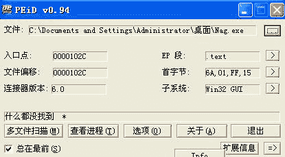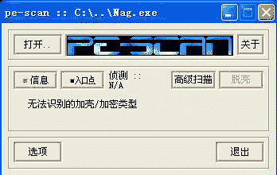  
晕，如图所示，未知壳类型。再用 pe-scan 一查，也是无法识别类型。  
   
汗，好吧，先运行看看。  
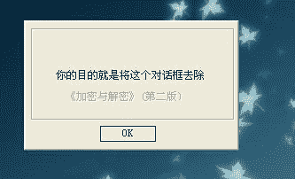  
首先就出现了警告窗口，然后我们点 OK，主窗口显示。  
  
说明警告窗口是在主窗口之前显示的，那么我们的任务就是在  
   
警告窗口显示的代码中下断。  
好，问题变成了，如何定位警告窗口的显示代码。  
显示窗口的 API 有  
MessageBoxA(W)---显示消息框  
DialogBoxParamA(W)---显示对话框  
ShowWindow---显示窗口  
CreateWindowExA(W)---创建窗口  
我们刚看到的警告窗口中，明显有 Static 静态文本、按钮等控件，这说明它不是消息框，而是资源定义的  
  
对话框。  
好了，我先试下 DialogBoxParamA(W)下断点。  
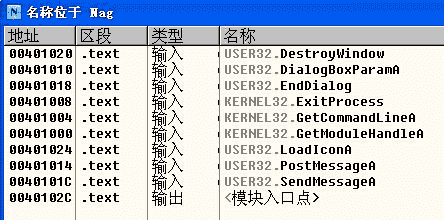  
Ctrl+N,看到了 DialogBoxParamA(W)导入函数，选择“在每个参考上设置断点”中断。  
   
这种情况会在 DialogBoxParamA  
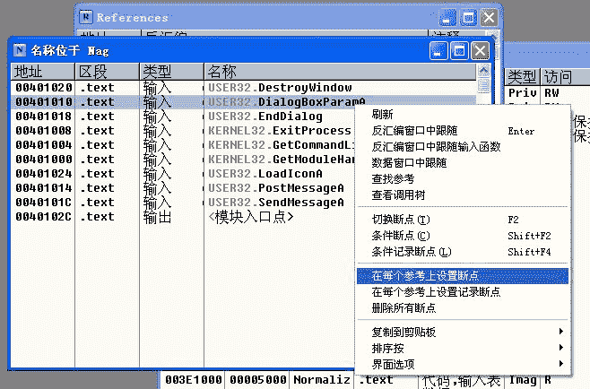  
(W)调用前断下，不会进入内部。  
或者用 Ctrl+G 输入跟随的表达式 DialogBoxParamA(W),不过这种方法不好，因为只有 DialogBoxParamA(W)函数已经被调  
  
用后，我们才能引发中断，而这时是在系统进程中。有点走偏了的意味。  
   
因为我们的目的是要到警告框显示之前。  
   

代码:

```
0040104D  /$  8B4424 04     mov     eax, dword ptr \[esp+4\]
00401051      6A 00         push    0
00401053      68 C4104000   push    Nag.004010C4                     ;  NEG 对话框处理函数指针
00401058  |.  6A 00         push    0                                ; |hOwner = NULL
0040105A      6A 79         push    79                               ;  79 资源 ID，即 NEG
0040105C  |.  50            push    eax                              ; |hInst
0040105D  |.  A3 9C114000   mov     dword ptr \[40119C\], eax          ; |
00401062  |.  FF15 10104000 call    dword ptr \<&USER32.DialogBoxPar>; \\DialogBoxParamA  断在此处
00401068  |.  33C0          xor     eax, eax
0040106A  \\.  C2 1000       ret     10

```

好了，现在断是断下了，但是我们怎么知道这个对话框是我们的警告框呢？  
  
这时应该想到每个对话框都有自己的资源 ID，所以查看 ID 是否匹配就可以知道啦！  
那么这个警告框的 ID 是什么呢？  
用 eXeScope.exe 来查看 ID，如下图可知是 79H=121  
![  
下面再看 OD 中我们断下来的 ID，不错哟，push 79 不就是这个吗，呵呵！  
  
好了，现在的问题就是如何改跳转了，首先 DialogBoxParamA 的参数不能入栈，否则不就堆栈不平衡了？所以从第一个 push 0 改为跳转，  
那么这个跳转跳到哪里去呢？  
如果只是跳到最近的 ret。好，先试试，我改为如下：  
\[CODE\]00401051 /EB 17 jmp short Nag\_done.0040106A  
00401053 |. |68 C4104000 push Nag\_done.004010C4 ; |DlgProc = Nag\_done.004010C4  
00401058 |. |6A 00 push 0 ; |hOwner = NULL  
0040105A |. |6A 79 push 79 ; |pTemplate = 79  
0040105C |. |50 push eax ; |hInst  
0040105D |. |A3 9C114000 mov dword ptr \[40119C\], eax ; |  
00401062 |. |FF15 10104000 call dword ptr \[<&USER32.DialogBoxPar>; \\DialogBoxParamA  
00401068 |. |33C0 xor eax, eax  
0040106A \\. \\C2 1000 ret 10 ; |跳到此处。\[/CODE\]  
  
保存后，运行，结果对话框一个都没出来。  
现在分析一下原因：  
好，地址 004010C4 是警告框的处理函数起始地址。  
我们查看一下这里的相关代码，在 OD 输入 at 004010C4 指令：  
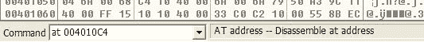 就会跳到 004010C4 处，查看代码。  
查看代码如下：  
代码:

```
004010C4    8B4424 08         mov     eax, dword ptr \[esp+8\]
004010C8    2D 10010000       sub     eax, 110                          ; Switch (cases 110..111)
004010CD    74 34             je      short Nag\_down.00401103
004010CF    48                dec     eax
004010D0    75 2D             jnz     short Nag\_down.004010FF
004010D2    8B4424 0C         mov     eax, dword ptr \[esp+C\]            ; Case 111 of switch 004010C8
004010D6    48                dec     eax
004010D7    75 26             jnz     short Nag\_down.004010FF
004010D9    6A 00             push    0
004010DB    FF7424 08         push    dword ptr \[esp+8\]
004010DF    FF15 18104000     call    dword ptr \[<&USER32.EndDialog>\]   ; USER32.EndDialog
004010E5    6A 00             push    0
004010E7    68 09114000       push    Nag\_down.00401109
004010EC    6A 00             push    0
004010EE    6A 65             push    65
004010F0    6A 00             push    0
004010F2    FF15 00104000     call    dword ptr \[<&KERNEL32.GetModuleHa>; kernel32.GetModuleHandleA
004010F8    50                push    eax
004010F9    FF15 10104000     call    dword ptr \[<&USER32.DialogBoxPara>; USER32.DialogBoxParamA
004010FF    33C0              xor     eax, eax                          ; Default case of switch 
004010C8
00401101    EB 03             jmp     short Nag.00401106
00401103    6A 01             push    1                                 ; Case 110 of switch 004010C8
00401105    58                pop     eax
00401106    C2 1000           ret     10

```

以上是警告框的处理程序，我们发现主对话框的显示调用是在警告框的 OK 按钮按下之后 调用的。  
也即是说，主对话框是在警告框的处理函数中调用的，我之前把这个警告框的处理函数全部跳过，当然也就不会调用主对话框显示程序了 。  
所以是我们的跳转跳得过度了。  
所以我们要跳到警告框结束之后，并且在主对话框显示之前的代码处，那就是  
004010E5 . 6A 00 push 0 ; /lParam = NULL  
  
把 00401051 |. 6A 00 push 0 ; /lParam = NULL  
双击(或在 00401051 代码行右键-->汇编)00401051 ，在弹出的对话框中 输入“jmp 004010E5”  
这时，我们的代码变成红色，提醒我已经完成了改写  
同样，再次 右键-->复制到可执行文件-->保存文件，命名为 Neg\_nop.exe  
运行 Neg\_nop.exe 没有警告框，直接显示了主对话框。  
以上是方法一  
\------------------------------------------------------------  
方法二，这个思路我是看到书中的方法  
其实也不难想到  
因为警告框和主对话框都是调用 DialogBoxParamA 函数，只是参数不同，所以就出现了不同的对  
  
话框，那么把警告框的参数改为主对话框的参数，不就是间接地跳过了警告框吗？  
下面是警告框的参数：  
代码:

```
00401051      6A 00         push    0
00401053      68 C4109090   push    909010C4                         ;  NEG 对话框处理函数
00401058  |.  6A 00         push    0                                ; |hOwner = NULL
0040105A  |.  6A 79         push    79                               ; |79 资源 ID，即 NEG
0040105C  |.  50            push    eax                              ; |hInst
0040105D  |.  A3 9C114000   mov     dword ptr \[40119C\], eax          ; |
00401062  |.  FF15 10104000 call    dword ptr \[<&USER32.DialogBoxPar>; \\DialogBoxParamA

```

下面是主对话框参数：  
代码:

```
004010E5   .  6A 00         push    0                                ; /lParam = NULL
004010E7   .  68 09114000   push    Nag.00401109                     ; |DlgProc = Nag.00401109
004010EC   .  6A 00         push    0                                ; |hOwner = NULL 主对话框处理函数
004010EE   .  6A 65         push    65                               ; |pTemplate = 65  主对话框资源 ID
004010F0   .  6A 00         push    0                                ; |/pModule = NULL
004010F2   .  FF15 00104000 call    dword ptr \[<&KERNEL32.GetModuleH>; |\\GetModuleHandleA
004010F8   .  50            push    eax                              ; |hInst
004010F9   .  FF15 10104000 call    dword ptr \[<&USER32.DialogBoxPar>; \\DialogBoxParamA

```

  
不同的地方有 3 处：资源 ID 号、处理函数、父窗口句柄  
资源 ID 号:由 79H 改为 65H  
处理函数：由 push 004010C4 改为 push 00401109  
父窗口句柄:这个参数就用默认的实例句柄，我不作修改。  
好，改变参数后，再同样右键--->复制到可执行文件--->选择--->右键--->备份--->保存数据到文件  
代码:

```
0040104D  /$  8B4424 04     mov     eax, dword ptr \[esp+4\]
00401051  |.  6A 00         push    0                                ; /lParam = NULL
00401053  |.  68 09114000   push    Nag\_ok03.00401109                ; |DlgProc = Nag\_ok03.00401109
00401058  |.  6A 00         push    0                                ; |hOwner = NULL
0040105A  |.  6A 65         push    65                               ; |pTemplate = 65
0040105C  |.  50            push    eax                              ; |hInst
0040105D  |.  A3 9C114000   mov     dword ptr \[40119C\], eax          ; |
00401062  |.  FF15 10104000 call    dword ptr \<&USER32.DialogBoxPar>; \\DialogBoxParamA
00401068  |.  33C0          xor     eax, eax
0040106A  \\.  C2 1000       ret     10

```

如下图所示，运行后程序运行成功，没有出现 Nag  
![  (我最爱的仙剑四)......Nag 警告框的去除就学到这里。 5.3 时间限制  《加》书中谈了许多类的时间限制技术，但只给了一个 用 SetTimer 来定时的 CM。  这里先按书中来，以后有相关的其它时间限制的保护，再来补充  \---------------------------------------------------------------------------------------  首先，运行 Timer.exe  看到每过 1 秒，右下方的时间计数框中时间加 1（现在是 6 秒），到 20 时就关闭了程序。  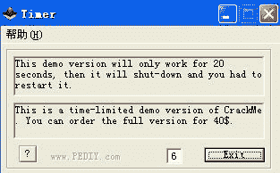  
查下壳，不知道是什么语言写的，类型未知。  
   
从哪里下手呢？  
这时得从大脑的信息库中得到与时间相关的资料：  
SetTimer---设定一个定时器。  
WM\_TIMER---定时消息，定义为常量 0x113  
KillTimer---释放定时器（因为系统的定时器资源是有限的）  
GetTickCount---获得从系统启动以来的运行时间。  
GetSystemTime  
GetLocalTime---上面这 2 个也是经常用了  
GetFileTime  
FileTimetoSystemTime  
   
\--------------------------------  
现在真刀实战开始。  
OD 载入  
如何看到用了什么 API 呢？  
老方法---Ctrl+N,查看导入函数如下图：  
 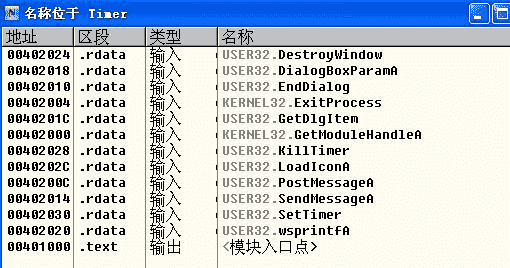  
与时间直接相关的有：  
KillTimer  
SetTimer  
OK，从 SetTimer 下手“在每个参考上设置断点”  
 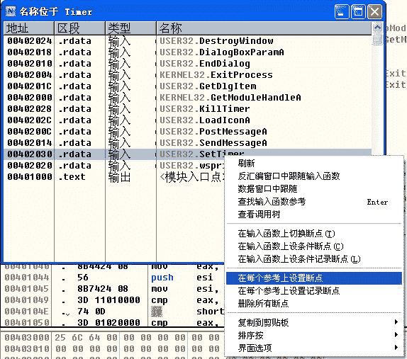  
F9，运行，断下  

代码:

```
 
004010C2 . 8B7424 08 mov esi, dword ptr \[esp+8\] ; Case 110 (WM\_INITDIALOG) of switch 004010A5
004010C6 . 6A 00 push 0 ; /Timerproc = NULL
004010C8 . 68 E8030000 push 3E8 ; |Timeout = 1000. ms
004010CD . 6A 01 push 1 ; |TimerID = 1
004010CF . 56 push esi ; |hWnd
004010D0 . FF15 30204000 call dword ptr \[<&USER32.SetTimer>\] ; \\SetTimer 断在这里

```

  
问题来了，怎么确定这个 SetTimer 就是关键的那个呢？  
会不会有其它的 SetTimer 呢？  
好，我觉得可以确定是这个，为什么呢？  
我们看看参数，  
004010C8 . 68 E8030000 push 3E8 ; |Timeout = 1000. ms  
说明定时为 1000 毫秒即 1 秒。  
如果还不能确定，我们可以往下走，看看在 WM\_INITDIALOG 消息中还加载了什么定时器。  
代码:

```
 
004010C2 . 8B7424 08 mov esi, dword ptr \[esp+8\] ; Case 110(WM\_INITDIALOG) of switch 004010A5
004010C6 . 6A 00 push 0 ; /Timerproc = NULL
004010C8 . 68 E8030000 push 3E8 ; |Timeout = 1000. ms
004010CD . 6A 01 push 1 ; |TimerID = 1
004010CF . 56 push esi ; |hWnd
004010D0 . FF15 30204000 call dword ptr \[<&USER32.SetTimer>\] ; \\SetTimer 断在这里
004010D6 . A1 04304000 mov eax, dword ptr \[403004\]
004010DB . 6A 70 push 70 ; /RsrcName = 112.
004010DD . 50 push eax ; |hInst => 00400000
004010DE . FF15 2C204000 call dword ptr \[<&USER32.LoadIconA>\] ; \\LoadIconA
004010E4 . 50 push eax ; /lParam
004010E5 . 6A 01 push 1 ; |wParam = 1
004010E7 . 68 80000000 push 80 ; |Message = WM\_SETICON
004010EC . 56 push esi ; |hWnd
004010ED . FF15 14204000 call dword ptr \[<&USER32.SendMessageA>; \\SendMessageA
004010F3 . B8 01000000 mov eax, 1
004010F8 . 5E pop esi
004010F9 . C2 1000 ret 10

```

可以看到，在 RET 之前，只有 SetTimer+LoadIconA+SendMessageA,就是说，只有自定义的一个定时器加载和程序图标的加载操作。  
所以说，这个 SetTimer 就是我们的解决目标，好，搞死搞残......  
怎么搞呢？  
我觉得：  
1、把这个 SetTimer 给跳过，就没有定时器，也不会处理定时消息了，虽然源代码中会有 WM\_TIMER 分支，但那已经成了空架子，不会被调用的。  
2、为了不让它定时到 20 就自动结束程序，可以在 计数变量加+1 处理，改为不加 1，不就 OK 了。  
再就是可以在判断时，如 if(i==20),我们改变代码，让 i==20 永远不会为真，不就 OK 了。  
还可以做其它小动作，不过本质都是改变程序流程，让它不发送 WM\_CLOSE 消息，就不会调用 KillTimer,DestroyWindow 函数了，不就 OK 了。  
这个程序，让我有全逆向的冲动，虽然不是什么大程序，但很清晰了...后话。  
  
先跳过 SetTimer 来实现去时间限制  
004010C6 6A 00 push 0  
改为  
004010C6 /EB 0E jmp short Timer.004010D6  
  
代码:

```
004010C6 /EB 0E jmp short Timer.004010D6
004010C8 . |68 E8030000 push 3E8 ; |Timeout = 1000. ms
004010CD . |6A 01 push 1 ; |TimerID = 1
004010CF . |56 push esi ; |hWnd
004010D0 . |FF15 30204000 call dword ptr \[<&USER32.SetTimer>\] ; \\SetTimer 断在这里
004010D6 . \\A1 04304000 mov eax, dword ptr \[403004\] ; 跳过 SetTimer 到这里，继续运行
004010DB . 6A 70 push 70 ; /RsrcName = 112.
004010DD . 50 push eax ; |hInst => 00400000
004010DE . FF15 2C204000 call dword ptr \[<&USER32.LoadIconA>\] ; \\LoadIconA
004010E4 . 50 push eax ; /lParam
004010E5 . 6A 01 push 1 ; |wParam = 1
004010E7 . 68 80000000 push 80 ; |Message = WM\_SETICON
004010EC . 56 push esi ; |hWnd
004010ED . FF15 14204000 call dword ptr \[<&USER32.SendMessageA>\] ; \\SendMessageA
004010F3 . B8 01000000 mov eax, 1
004010F8 . 5E pop esi
004010F9 . C2 1000 ret 10

```

右键--->复制到可执行文件--->选择--->保存文件--->名为 SetTimer\_ok01.exe  
运行，如下图所示，可以看到，计时框啥都没有，为什么什么都没什么呢？具体就继续看下文罗。  
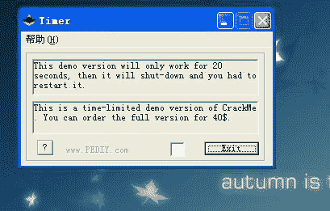  
  
目的已经达到了。  
下面再改个方法，我们让它创建定时器，再对 WM\_TIMER 的处理搞些小动作，下面先看看 WM\_TIMER 的内容是什么。  
现在问题是怎么找 WM\_TIMER 的处理代码呢？  
之前说过了，WM\_TIMER 消息的定义常为 113h，《加》书中是用 W32Dasm 静态反汇编查 113h 字串，但我不习惯 W32Dasm 分析得不全面。  
现在说说在 OD 中如何查。  
首先，我们知道 windows 消息处理机制，类似代码如下：  
代码:

```
 
mov eax,uMsg
;-------------------------------------------
.if eax==WM\_PAINT
invoke BeginPaint,hWnd,addr @stPs
mov @hDc,eax
 
invoke GetClientRect,hWnd,addr @stRect
invoke DrawText,@hDc,addr szText,-1,addr @stRect,DT\_SINGLELINE or DT\_CENTER or DT\_VCENTER
invoke EndPaint,hWnd,addr @stPs
;--------------------------------
;add your code here...
;--------------------------------
.elseif eax==WM\_COMMAND
;--------------------------------
.elseif eax==WM\_CREATE
invoke SendMessage,hWnd,WM\_SETICON,ICON\_BIG,hIconMain
 
.elseif eax==WM\_CLOSE
invoke DestroyWindow,hWinMain
invoke PostQuitMessage,NULL
.else
invoke DefWindowProc,hWnd,uMsg,wParam,lParam
ret
.endif

```

我们都是在分支中判断是什么消息，WM\_INITDIALOG 和 WM\_TIMER 都是系统的分支程序，所以是同一级别的。  
就好像 swich case 中的 不同 case 分支一样。  
所以我的意思就是说，有 WM\_INITDIALOG 的地方，WM\_TIMER 也不远了(当然，前提是程序中的 WM\_TIMER,本例中当然有啦)  
那分支在呢？  
这就又说回来了，WM\_TIMER 的值是 113，所以判断 113 就是一个分支的入口跳转了。  
好，立即去看看。  
代码:

```
 
004010A0 . 8B4424 08 mov eax, dword ptr \[esp+8\]
004010A4 . 56 push esi
004010A5 . 3D 11010000 cmp eax, 111 ; WM\_COMMAND; Switch (cases 10..113)
004010AA . 0F87 C5000000 ja Timer.00401175 ; WM\_TIMER=113>111,跳之
004010B0 . 74 67 je short Timer.00401119
004010B2 . 83F8 10 cmp eax, 10 ; WM\_CLOSE
004010B5 . 74 45 je short Timer.004010FC
004010B7 . 3D 10010000 cmp eax, 110 ; WM\_INITDIALOG
004010BC . 0F85 86000000 jnz Timer.00401148
004010C2 . 8B7424 08 mov esi, dword ptr \[esp+8\] ; Case 110 (WM\_INITDIALOG) of switch 004010A5

```

  
WM\_TIMER=113>111 所以  
004010A5 . 3D 11010000 cmp eax, 111 ; WM\_COMMAND; Switch (cases 10..113)  
004010AA . 0F87 C5000000 ja Timer.00401175 ; WM\_TIMER=113>111,跳之  
会跳到 00401175 处，好，跟下去，看看 00401175 是什么东东：  
我们可以在命令行输入 at 00401175 或在 ja Timer.00401175 行，点右键--->跟随  
代码如下：  
代码:

```
 
00401175 > \\3D 13010000 cmp eax, 113 ; 是否为 WM\_TIMER 消息
0040117A .^ 75 CC jnz short Timer.00401148
0040117C . A1 08304000 mov eax, dword ptr \[403008\] ; 保存计数次数; Case 113 (WM\_TIMER) of switch 004010A5
00401181 . 83F8 13 cmp eax, 13 ; 计数是否达 19
00401184 .^ 7F B1 jg short Timer.00401137 ; 大于 19 就跳到摧毁窗口，然后就完蛋
00401186 . 40 inc eax ; 计数+1
00401187 . 8D4C24 0C lea ecx, dword ptr \[esp+C\] ; /---以下是送文本编辑框显示---\\
0040118B . 50 push eax ; /<%ld>
0040118C . 68 00304000 push Timer.00403000 ; |Format = "%ld"
00401191 . 51 push ecx ; |s
00401192 . A3 08304000 mov dword ptr \[403008\], eax ; |把当前计数保存于全局变量 00403008 处
00401197 . FF15 20204000 call dword ptr \[<&USER32.wsprintfA>\] ; \\wsprintfA
0040119D . 8B4424 14 mov eax, dword ptr \[esp+14\]
004011A1 . 83C4 0C add esp, 0C
004011A4 . 8D5424 0C lea edx, dword ptr \[esp+C\]
004011A8 . 52 push edx ; /lParam
004011A9 . 6A 00 push 0 ; |wParam = 0
004011AB . 6A 0C push 0C ; |Message = WM\_SETTEXT
004011AD . 68 FC030000 push 3FC ; |/ControlID = 3FC (1020.)
004011B2 . 50 push eax ; ||hWnd
004011B3 . FF15 1C204000 call dword ptr \[<&USER32.GetDlgItem>\] ; |\\GetDlgItem
004011B9 . 50 push eax ; |hWnd
004011BA . FF15 14204000 call dword ptr \[<&USER32.SendMessageA>\] ; \\SendMessageA
004011C0 . 33C0 xor eax, eax
004011C2 . 5E pop esi
004011C3 . C2 1000 ret 10 ; \\----------------------/

```

实在是太和谐了，这么和谐的代码，真是让我有逆向的冲动，你们说从哪里开始调戏程序呢？  
好，改 00401181 . 83F8 13 cmp eax, 13 ; 计数是否达 19  
为 cmp eax, 7F  
代码:

```
 
0040117C . A1 08304000 mov eax, dword ptr \[403008\] ; 保存计数次数; Case 113 (WM\_TIMER) of switch 004010A5
00401181 83F8 7F cmp eax, 7F ; 计数是否达 7F
00401184 ^ 7F B1 jg short Timer.00401137 ; 大于 7F 就跳到摧毁窗口，然后就完蛋

```

保存后，运行，理论上应该是到 7F 秒，即 128 秒后，就结束程序。  
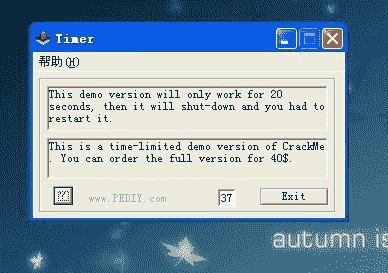  
果然，到了 20 都没事，不过这还是没有实现去时间限制。  
重新载入源程序，把  
00401186 40 inc eax ; 计数+1  
的 inc eax，改为 nop  
保存后，运行，结果为下图  
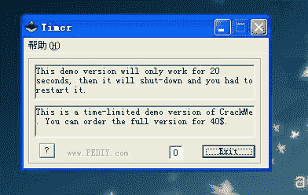  
可以知道，定时器一直在运行，但没有增加计数，所以一直是初始计数值 0 哟。  
还可以改  
00401184 .^ 7F B1 jg short Timer.00401137 ; 大于 19 就跳到摧毁窗口，然后就完蛋  
把 jg short Timer.00401137 改为 NOP NOP 就行。  
如下图：  
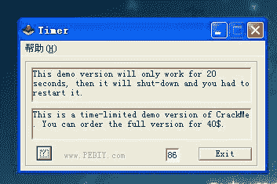  
计数仍在计，总不到头，呵呵。这个例子就分析到这里，书中说到了另一具工具---变速齿轮，这个软件的作者太牛 B 了，写出这么强大的软件。  
《变速齿轮》用于软件的加速，可以把几个小时的运行，缩短到几分钟。  
mark... ...  
以后有更好的时间限制 DEMO，再补充。 

5.4 菜单功能限制  
如《加》书中所示，一般是 DEMO 版，菜单灰色，无法使用。  
第一种是正式版与试用版完全分开的版本，试用版一些菜单灰化且没有功能实现的代码。  
第二种情况是，正式版与试用版都是同一个程序，只是没有注册激活功能而已。从作者的角度来说，最好是用第一种方案来保护，不然你就太低估破解者的实力了。  
第二种情况就是下面聊的，也是我们关心的。  
以书中的 EnableMenu.exe 学习吧。  
首先查壳  
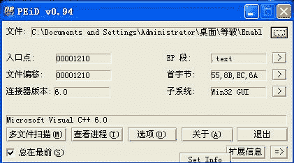  
很好，没壳(当然没壳呀，这只是教程参数程序。)  
Microsoft Visual C++ 6.0  
好，运行看看  
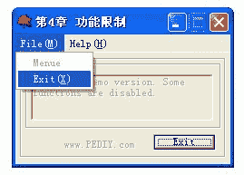  
File 菜单下，有一个 Menu 的子菜单灰化了，我们的目的就是要激活它。  
下面调用相关知识：  
EnableMenuItem  
  
BOOL EnableMenuItem(HWND hMenu,UINT uIDEnableItem,UINT uEnable)  
参数含义如下：  
\-----------------------------------------------------  
hMenu:菜单句柄  
uIDEnable:欲允许或禁止的一个菜单条目的标识符  
uEnable:控制标志。有：  
MF\_ENABLED(允许，0h)  
MF\_GRAYED(灰化，1h)MF\_DISABLED(禁止，2h)  
MF\_BYCOMMAND(指定菜单项的命令 ID 号，此为缺省值)  
MF\_BYPOSITION(指定菜单项的位置)  
返回值是菜单以前的状态，如果菜单项不存在，则返回 FFFFFFFFh  
  
\>>>>>>>>>>>>>>>>>>>>>>>>>>>>>>>>>>>>>>>>>>>>>>>>>>>>>>>>  
还可以用 EnableWindow  
允许或禁止指定的窗口  
BOOL EnableWindow(HWND hWnd,BOOL bEnable)  
参数含义如下：  
\-----------------------------------------------------  
hWnd:窗口句柄  
bEnable:TRUE 允许、FALSE 禁止  
返回值 0 表示失败，非 0 表示成功  
\-----------------------------------------------------  
  
好，开始动手，OD 载入  
Ctrl+N 查看导入函数，如下：  
名称位于 EnableMe  

代码:

```
地址       区段       类型    (  名称                                    注释
004040A0   .rdata     输入    (    USER32.DestroyWindow
004040B4   .rdata     输入    (    USER32.DialogBoxParamA
0040409C   .rdata     输入    (    USER32.EnableMenuItem
004040B0   .rdata     输入    (    USER32.EndDialog
00404034   .rdata     输入    (    KERNEL32.ExitProcess
00404048   .rdata     输入    (    KERNEL32.FreeEnvironmentStringsA
0040404C   .rdata     输入    (    KERNEL32.FreeEnvironmentStringsW
00404080   .rdata     输入    (    KERNEL32.GetACP
0040402C   .rdata     输入    (    KERNEL32.GetCommandLineA
0040407C   .rdata     输入    (    KERNEL32.GetCPInfo
0040403C   .rdata     输入    (    KERNEL32.GetCurrentProcess
004040A4   .rdata     输入    (    USER32.GetDlgItem
00404054   .rdata     输入    (    KERNEL32.GetEnvironmentStrings
00404004   .rdata     输入    (    KERNEL32.GetEnvironmentStringsW
00404060   .rdata     输入    (    KERNEL32.GetFileType
00404098   .rdata     输入    (    USER32.GetMenu
00404044   .rdata     输入    (    KERNEL32.GetModuleFileNameA
00404024   .rdata     输入    (    KERNEL32.GetModuleHandleA
00404084   .rdata     输入    (    KERNEL32.GetOEMCP
00404020   .rdata     输入    (    KERNEL32.GetProcAddress
00404028   .rdata     输入    (    KERNEL32.GetStartupInfoA
0040405C   .rdata     输入    (    KERNEL32.GetStdHandle
0040400C   .rdata     输入    (    KERNEL32.GetStringTypeA
00404008   .rdata     输入    (    KERNEL32.GetStringTypeW
00404030   .rdata     输入         KERNEL32.GetVersion
00404088   .rdata     输入    (    KERNEL32.HeapAlloc
00404068   .rdata     输入    (    KERNEL32.HeapCreate
00404064   .rdata     输入    (    KERNEL32.HeapDestroy
00404070   .rdata     输入    (    KERNEL32.HeapFree
00404058   .rdata     输入    (    KERNEL32.HeapReAlloc
00404014   .rdata     输入    (    KERNEL32.LCMapStringA
00404010   .rdata     输入    (    KERNEL32.LCMapStringW
00404094   .rdata     输入    (    USER32.LoadIconA
0040401C   .rdata     输入    (    KERNEL32.LoadLibraryA
00404018   .rdata     输入    (    KERNEL32.MultiByteToWideChar
004040A8   .rdata     输入    (    USER32.PostMessageA
00404074   .rdata     输入    (    KERNEL32.RtlUnwind
004040AC   .rdata     输入    (    USER32.SendMessageA
00404000   .rdata     输入    (    KERNEL32.SetHandleCount
00404038   .rdata     输入    (    KERNEL32.TerminateProcess
00404040   .rdata     输入    (    KERNEL32.UnhandledExceptionFilter
0040408C   .rdata     输入    (    KERNEL32.VirtualAlloc
0040406C   .rdata     输入    (    KERNEL32.VirtualFree
00404050   .rdata     输入    (    KERNEL32.WideCharToMultiByte
00404078   .rdata     输入    (    KERNEL32.WriteFile
00401210   .text      输出         <模块入口点>

```

选择 USER32.EnableMenuItem,右键--->在每个参考上下断点。  
重新载入 OD  
F9 运行，断下。  
代码:

```
004011E3      6A 01         push    1
004011E5   .  68 459C0000   push    9C45                              ; |ItemID = 9C45 (40005.)
004011EA   .  50            push    eax                               ; |hMenu
004011EB   .  FF15 9C404000 call    dword ptr \<&USER32.EnableMenuIte>; \\EnableMenuItem       断在此处

```

如何确定这个菜单就是我们的目标呢？  
用 eXeScope 查看，如下图。  
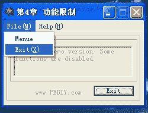  
可以看到，menu 子菜单已经激活了，点击后，出现一个对话框，如下图：  
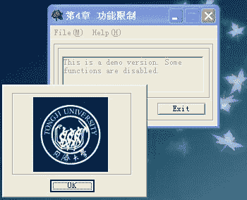  
好了，菜单限制已经完了。  
下面再看下这个全代码如何逆向：  
我们在断点处向前找，代码如下：  
代码:

```
004011B9   >  8B15 90544000 mov     edx, dword ptr \[405490\]           ;  EnableMe.00400000; Case 110 (WM\_INITDIALOG) of switch 00401124
004011BF   .  56            push    esi
004011C0   .  6A 70         push    70                                ; /RsrcName = 112.
004011C2   .  52            push    edx                               ; |hInst => 00400000
004011C3   .  FF15 94404000 call    dword ptr \[<&USER32.LoadIconA>\]   ; \\LoadIconA
004011C9   .  50            push    eax                               ; /lParam
004011CA   .  6A 01         push    1                                 ; |wParam = 1
004011CC   .  8B7424 10     mov     esi, dword ptr \[esp+10\]           ; |
004011D0   .  68 80000000   push    80                                ; |Message = WM\_SETICON
004011D5   .  56            push    esi                               ; |hWnd
004011D6   .  FF15 AC404000 call    dword ptr \[<&USER32.SendMessageA>>; \\SendMessageA
004011DC   .  56            push    esi                               ; /hWnd
004011DD   .  FF15 98404000 call    dword ptr \[<&USER32.GetMenu>\]     ; \\GetMenu
004011E3      6A 01         push    1
004011E5   .  68 459C0000   push    9C45                              ; |ItemID = 9C45 (40005.)
004011EA   .  50            push    eax                               ; |hMenu
004011EB   .  FF15 9C404000 call    dword ptr \[<&USER32.EnableMenuIte>; \\EnableMenuItem       断在此处 004011F1   .  5E            pop     esi
004011F2   .  B8 01000000   mov     eax, 1
004011F7   .  C2 1000       ret     10

```

其实上面就是 WM\_INITDIALOG 消息的处理函数。  
为什么这么说呢？ 因为我们可以查资料得知 WM\_INITDIALOG 的常为 110h，所以我们来确定这个跳转是不是从 CMP ESI,110 后面过来的。  
(其实 OD 已经帮我们分析好了，可以直观的看到注释，但我还是自己去分析下。)  
我们看看第一行：  
004011B9   >  8B15 90544000 mov     edx, dword ptr \[405490\]           ;  EnableMe.00400000; Case 110 (WM\_INITDIALOG) of switch 00401124  
它是从  
代码:

```
00401120   .  8B4424 08     mov     eax, dword ptr \[esp+8\]
00401124   .  83E8 10       sub     eax, 10                           ;  Switch (cases 10..111)
00401127   .  0F84 CD000000 je      EnableMe.004011FA
0040112D   .  2D 00010000   sub     eax, 100
00401132   .  0F84 81000000 je      EnableMe.004011B9

```

跳过来的，EAX 先是减 10，再减 100，之后跳，不就是减了 110 吗？所以就是 WM\_INITDIALOG 分支。  
也即是说，用源代码是在 WM\_INITDIALOG 中进行加载程序图标 和 将菜单设置为禁止的。  
  
好了，其它就不分析了。 

riusksk:感谢你的关注。  
时间只要去挤，总会有的，只是每天加班回来都快 10 只有 1、2 个小时，我一定要坚持!!!  
\---总是觉得从《加》书中的例子过一遍是很快的，但觉得学完例子后，自己的体会和总结才是自己的莫大收获，所以笔记的正文会很“嗦”。  
   
5.5 KeyFile 保护  
额，这个第一章进展好慢哪!!!要提速。  
   
首先，查壳。  
不得不说，PEID 比 pe-scan 要强大，PEID 查出来是 MASM32 / TASM32 汇编写的，无壳。  
   
运行试下，如下图  
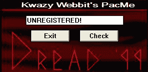  
没有任何反应，特别之处：是这个 CM 没有任何供输入的地方。  
　　虽然书中已经说了这个是文件保护的，但我在想，如果我面对一个新的 CM，我如何得知它是什么保护机制呢？  
　　呵呵，这个问题先保留，继续搞下去，也许就分析明朗了。  
\----------------------------------------------------------------------  
好了，下面我们还推测是否是文件保护。  
打开 Filemon\_fix.7.03.exe(从看雪工具集中下载)  
过滤器设置如下图：  
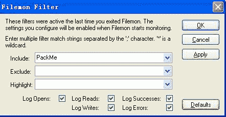  
进入 Filemon 的界面后，说下我的使用心得：  
注意 Filemon 会记录与 PackMe 相关的文件操作，我本以为不会很多，可是 360 等文件监控程序会不断地查看文件，所以会产生相关多的信息，有时会多到几百条，虽然 Filemon 的 process 列表会有程序的图标显示，我们可以看到是哪个程序在跑，但是我觉得还是进行一点技巧，让分析的结果少些(当然，重要的分析不能少)  
　　本例的 CM 中是按下 Check 按钮后，才会进行文件保护机制的检查，所以我们可以先运行 PackMe.exe。  
　　这时会产生一些分析结果，我们 Ctrl+E 停止分析，再 Ctrl+X 清空(因为这些都不是我们要的)  
然后再 Ctrl+E 开始分析，然后迅速点 Check 按钮，半秒后我们就 Ctrl+E 停止，呵呵，此时该出来的都出来了，总分析数据也不是很大，如下图：  
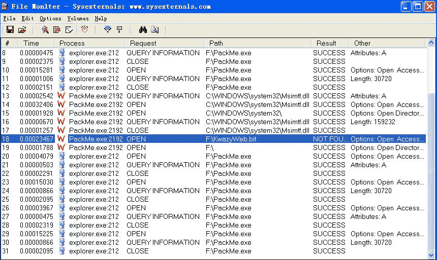  
我们一下就可以定位是哪个文件了。  
0.00023467 PackMe.exe:2192 OPEN F:\\KwazyWeb.bit NOT FOUND Options: Open Access: Read   
上面这行是重要的信息，分析如下，以 OPEN 方式操作 F:\\KwazyWeb.bit 文件，操作结果是 NOT FOUND，权限是 Read  
   
感觉就是这个 KwazyWeb.bit 文件了。  
\------------------------ 　以上是用 Filemon.exe 来查文件，其实，我现在遇到的好多软件已经相当有意识了，其本查不到个什么了。  
   
下面 OD 载入。  
Ctrl+N,对 CreateFileA 下参考断点，断下代码  
   
004016D8 . 52 push edx ; |FileName => "KwazyWeb.bit"  
004016D9 . E8 1C010000 call <jmp.&KERNEL32.CreateFileA> ; \\CreateFileA  
004016DE . 83F8 FF cmp eax, -1 ; 断下返回到此  
004016E1 . 74 64 je short PackMe.00401747  
   
从 004016D8 . 52 push edx ; |FileName => "KwazyWeb.bit"可知，就是这个 KwazyWeb,bit 文件了。  
   
用 C32Asm 创建一个 KwazyWeb.bit 文件，然后我们在 16 进制文件下写数据 123456789，这样的有明显顺序的数据可以方便我们进行分析和识别(当然，正确的注册码不可能是这种数据，一定有点复杂)。  
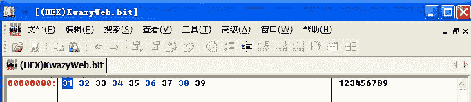  
   
好，重新 OD 载入。  
   
F9 运行，之后点 Check 按钮，因为 Check 之后，程序才会执行注册码的判断。  
断在了 Kernel.dll 的领空，这里没我们的事，出去(alt+F9).F8 前进，  
   

代码:

```
 
004016D8 . 52 push edx ; |FileName => "KwazyWeb.bit"
004016D9 . E8 1C010000 call <jmp.&KERNEL32.CreateFileA> ; \\CreateFileA
004016DE . 83F8 FF cmp eax, -1 ; 断下返回到此，EAX 是文件句柄
004016E1 . 74 64 je short PackMe.00401747 ; 没有注册文件就跳，跳了就完蛋
004016E3 . A3 44344000 mov dword ptr \[403444\], eax ; 保存文件句柄到全局变量
004016E8 . 6A 00 push 0 ; /pOverlapped = NULL
004016EA . 68 48344000 push PackMe.00403448 ; |pBytesRead = PackMe.00403448
004016EF . 6A 01 push 1 ; |BytesToRead = 1
004016F1 . 68 FA344000 push PackMe.004034FA ; |Buffer = PackMe.004034FA
004016F6 . FF35 44344000 push dword ptr \[403444\] ; |hFile = NULL
004016FC . E8 11010000 call <jmp.&KERNEL32.ReadFile> ; \\ReadFile　　从注册文件读取一个字节，送到 004034FA
00401701 . 0FB605 FA3440>movzx eax, byte ptr \[4034FA\] ; 把读来的字节扩展送 EAX
00401708 . 85C0 test eax, eax
0040170A . 74 3B je short PackMe.00401747 ; 字符为 0　就跳，跳就完蛋
0040170C . 6A 00 push 0 ; /pOverlapped = NULL
0040170E . 68 48344000 push PackMe.00403448 ; |pBytesRead = PackMe.00403448
00401713 . 50 push eax ; |BytesToRead
00401714 . 68 88324000 push PackMe.00403288 ; |Buffer = PackMe.00403288
00401719 . FF35 44344000 push dword ptr \[403444\] ; |hFile = NULL
0040171F . E8 EE000000 call <jmp.&KERNEL32.ReadFile> ; \\ReadFile 再接着读取 49 个字节，送到 00403288
00401724 . E8 D7F8FFFF call PackMe.00401000 ; 以首字节大小为次数，计算后面的字节数据和，取和的低 8 位
{00401000 /$ 33C0 xor eax, eax
00401002 |. 33D2 xor edx, edx
00401004 |. 33C9 xor ecx, ecx
00401006 |. 8A0D FA344000 mov cl, byte ptr \[4034FA\] ; 注册文件第一字节送 CL
0040100C |. BE 88324000 mov esi, PackMe.00403288 ; ASCII "23456789"
00401011 |> AC /lods byte ptr \[esi\]
00401012 |. 03D0 |add edx, eax ; 每字节数据累加存于 EDX
00401014 |.^ E2 FB \\loopd short PackMe.00401011 ; 循环次数是 CL=注册文件第一字节数值
00401016 |. 8815 FB344000 mov byte ptr \[4034FB\], dl ; DL 送 004034FB 保存
0040101C \\. C3 ret
}
00401729 . 6A 00 push 0 ; /pOverlapped = NULL
0040172B . 68 48344000 push PackMe.00403448 ; |pBytesRead = PackMe.00403448
00401730 . 6A 12 push 12 ; |BytesToRead = 12 (18.)
00401732 . 68 E8344000 push PackMe.004034E8 ; |Buffer = PackMe.004034E8
00401737 . FF35 44344000 push dword ptr \[403444\] ; |hFile = NULL
0040173D . E8 D0000000 call <jmp.&KERNEL32.ReadFile> ; \\ReadFile 再读取 18 个字节，存于 004034E8
00401742 . E8 82F9FFFF call PackMe.004010C9 ; 这里是一个算法，我们跟 F7 进去
{004010C9 处的函数，参见下面的“最核心算法”分析
也就是在这个算法里，我们一步一步观察 OD，就可以发现迷宫的数据源：
004010CF |. 68 65334000 push PackMe.00403365 ; /String2 = 
 
"\*\*\*\*\*\*\*\*\*\*\*\*\*\*\*\*C\*......\*...\*\*\*\*.\*.\*\*\*\*...\*....\*.\*..\*\*\*\*\*\*\*\*\*\*.\*..\*....\*...\*...\*\*.\*\*\*\*.\*.\*...\*\*\*\*.\*....\*.\*\*\*\*\*\*\*..\*.\*\*\*..\*..
 
...\*.\*..\*\*\*.\*\*.\*\*\*.\*...\*\*\*\*....\*X..\*\*\*\*\*\*\*\*\*\*\*\*\*\*\*\*\*"
/-------------------------------------------------------------------------------------------\\
00403365 2A 2A 2A 2A 2A 2A 2A 2A 2A 2A 2A 2A 2A 2A 2A 2A \*\*\*\*\*\*\*\*\*\*\*\*\*\*\*\*
00403375 43 2A 2E 2E 2E 2E 2E 2E 2A 2E 2E 2E 2A 2A 2A 2A C\*......\*...\*\*\*\*
00403385 2E 2A 2E 2A 2A 2A 2A 2E 2E 2E 2A 2E 2E 2E 2E 2A .\*.\*\*\*\*...\*....\*
00403395 2E 2A 2E 2E 2A 2A 2A 2A 2A 2A 2A 2A 2A 2A 2E 2A .\*..\*\*\*\*\*\*\*\*\*\*.\*
004033A5 2E 2E 2A 2E 2E 2E 2E 2A 2E 2E 2E 2A 2E 2E 2E 2A ..\*....\*...\*...\*
004033B5 2A 2E 2A 2A 2A 2A 2E 2A 2E 2A 2E 2E 2E 2A 2A 2A \*.\*\*\*\*.\*.\*...\*\*\*
004033C5 2A 2E 2A 2E 2E 2E 2E 2A 2E 2A 2A 2A 2A 2A 2A 2A \*.\*....\*.\*\*\*\*\*\*\*
004033D5 2E 2E 2A 2E 2A 2A 2A 2E 2E 2A 2E 2E 2E 2E 2E 2A ..\*.\*\*\*..\*.....\*
004033E5 2E 2A 2E 2E 2A 2A 2A 2E 2A 2A 2E 2A 2A 2A 2E 2A .\*..\*\*\*.\*\*.\*\*\*.\*
004033F5 2E 2E 2E 2A 2A 2A 2A 2E 2E 2E 2E 2A 58 2E 2E 2A ...\*\*\*\*....\*X..\*
00403405 2A 2A 2A 2A 2A 2A 2A 2A 2A 2A 2A 2A 2A 2A 2A 2A \*\*\*\*\*\*\*\*\*\*\*\*\*\*\*\*
\\-------------------------------------------------------------------------------------------/
}
00401747 > FF35 44344000 push dword ptr \[403444\] ; /hObject = NULL
0040174D . E8 A2000000 call <jmp.&KERNEL32.CloseHandle> ; \\CloseHandle
00401752 > EB 15 jmp short PackMe.00401769
00401754 > FF75 14 push dword ptr \[ebp+14\] ; /lParam; Default case of switch 004012D8
00401757 . FF75 10 push dword ptr \[ebp+10\] ; |wParam
0040175A . FF75 0C push dword ptr \[ebp+C\] ; |Message
0040175D . FF75 08 push dword ptr \[ebp+8\] ; |hWnd
00401760 . E8 17000000 call <jmp.&USER32.DefWindowProcA> ; \\DefWindowProcA
00401765 . C9 leave
00401766 . C2 1000 ret 10
00401769 > 33C0 xor eax, eax
0040176B . C9 leave
0040176C . C2 1000 ret 10

```

  
/-----------------------------------最核心的算法-----------------------------------------------\\  
代码:

```
 
00401033 $ 55 push ebp
00401034 . 8BEC mov ebp, esp
00401036 . 83C4 F8 add esp, -8
00401039 . 8B15 84314000 mov edx, dword ptr \[403184\] ; 一看就是一个全局变量，用直接寻址，设为 lpCursor(因为一会儿就会发现，这是保存当前所在迷宫位置的指针)
0040103F . 8955 FC mov dword ptr \[ebp-4\], edx ; 一看\[EBP-4\]就是用局部变量，设为\_dwCur，即 dwCursor=\_dwCur
00401042 . 0AC0 or al, al ; 或运算，就是检查 AL 是否为 0; Switch (cases 0..2)
00401044 . 75 09 jnz short PackMe.0040104F ; AL 不为 0 就跳
00401046 . 832D 84314000>sub dword ptr \[403184\], 10 ; lpCursor-10h，因为迷宫一行是 16 个字符，所以可知道是向上移动一步。说明 0 是向上; Case 0 of switch 00401042
0040104D . EB 1F jmp short PackMe.0040106E ; 移动完毕，跳之
0040104F > 3C 01 cmp al, 1
00401051 . 75 08 jnz short PackMe.0040105B ; AL 不为 1 就跳
00401053 . FF05 84314000 inc dword ptr \[403184\] ; AL 为 1 就 lpCursor+1,即向右移动一位，说明 AL=1 是向右移动; Case 1 of switch 00401042
00401059 . EB 13 jmp short PackMe.0040106E ; 移动完毕，跳之
0040105B > 3C 02 cmp al, 2
0040105D . 75 09 jnz short PackMe.00401068 ; AL 不为 2 就跳
0040105F . 8305 84314000>add dword ptr \[403184\], 10 ; lpCursor+10h,一行迷宫是 16 个字符，所以可知 AL=2 是向下移动一位; Case 2 of switch 00401042
00401066 . EB 06 jmp short PackMe.0040106E ; 移动完毕，跳之
00401068 > FF0D 84314000 dec dword ptr \[403184\] ; 因为 AL 是对 3 求余，所以取值只能为 0~3，运行到这条代码，说明只能 AL=3 了，说明是向左移动一位，即 lpCursor-1; Default case of switch 00401042
0040106E > 8B15 84314000 mov edx, dword ptr \[403184\] ; 在此 F4，运行到此
00401074 . 8A02 mov al, byte ptr \[edx\] ; 本条和上面一条代码一起看，发现，这不就是取指针嘛！果然明白了，取移动后，当前所以地的值。
00401076 . 3C 2A cmp al, 2A ; 与 2Ah 即'\*'比较
00401078 . 75 06 jnz short PackMe.00401080 ; 撞墙啦，说明没走出迷宫，隔屁了。
0040107A . 33C0 xor eax, eax
0040107C . C9 leave
0040107D . C3 ret ; 隔屁(就是挂了的意思。)
0040107E . EB 33 jmp short PackMe.004010B3
00401080 > 3C 58 cmp al, 58 ; 58h 即 ASCII 的'X',观察迷宫可知道，X 多半是表示出口。
00401082 ^\\75 90 jnz short PackMe.00401014 ; 不是出口，说明还要继续走(注意，此处可以爆破)
00401084 . 6A 00 push 0 ; /Style = MB\_OK|MB\_APPLMODAL
00401086 . 8D15 59334000 lea edx, dword ptr \[403359\] ; |
0040108C . 52 push edx ; |Title => "Success.."
0040108D . 8D15 EC324000 lea edx, dword ptr \[4032EC\] ; |
00401093 . 52 push edx ; |Text => "Congratulations!",LF,CR,"Mail me (KwazyWebbit@hotmail.com) how you did it.",LF,CR,"Dont forget to include your keyfile! =\]"
00401094 . 6A 00 push 0 ; |hOwner = NULL
00401096 . 8D15 AC174000 lea edx, dword ptr \[4017AC\] ; |
0040109C . FFD2 call edx ; \\MessageBoxA
0040109E . 8D15 7B324000 lea edx, dword ptr \[40327B\]
004010A4 . 52 push edx ; /Text => "Cracked by : 23456789"
004010A5 . FF35 20344000 push dword ptr \[403420\] ; |hWnd = 000204C2 ('UNREGISTERED!',class='Edit',parent=000204CA)
004010AB . 8D15 DC174000 lea edx, dword ptr \[4017DC\] ; |
004010B1 . FFD2 call edx ; \\SetWindowTextA
004010B3 > 8B15 84314000 mov edx, dword ptr \[403184\] ;PackMe.004031DC
004010B9 . C602 43 mov byte ptr \[edx\], 43
004010BC . 8B55 FC mov edx, dword ptr \[ebp-4\]
004010BF . C602 20 mov byte ptr \[edx\], 20
004010C2 . B8 01000000 mov eax, 1
004010C7 . C9 leave
004010C8 . C3 ret
 

```

  
先爆破之，看看未来胜利的果实：  
代码:

```
 
00401080 > \\3C 58 cmp al, 58 ; 58h 即 ASCII 的'X',观察迷宫可知道，X 多半是表示迷宫出口。
00401082 90 nop ; 不是出口，说明还要继续走(注意，此处可以爆破)
00401083 90 nop
00401084 . 6A 00 push 0 ; /Style = MB\_OK|MB\_APPLMODAL
00401086 . 8D15 59334000 lea edx, dword ptr \[403359\] ; |
0040108C . 52 push edx ; |Title => "Success.."
0040108D . 8D15 EC324000 lea edx, dword ptr \[4032EC\] ; |
00401093 . 52 push edx ; |Text => "Congratulations!",LF,CR,"Mail me (KwazyWebbit@hotmail.com) how you did it.",LF,CR,"Dont forget to include your keyfile! =\]"
00401094 . 6A 00 push 0 ; |hOwner = NULL
00401096 . 8D15 AC174000 lea edx, dword ptr \[4017AC\] ; |
0040109C . FFD2 call edx ; \\MessageBoxA

```

  
爆破效果图：  
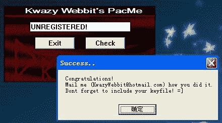  
  
好，我们还原代码，毕竟逆向算法才是更有价值的东东,继续向下走,是一个循环。  
代码:

```
 
00401000 /$ 33C0 xor eax, eax
00401002 |. 33D2 xor edx, edx
00401004 |. 33C9 xor ecx, ecx
00401006 |. 8A0D FA344000 mov cl, byte ptr \[4034FA\] ; 注册文件第一字节送 CL
0040100C |. BE 88324000 mov esi, PackMe.00403288 ; ASCII "23456789"
00401011 |> AC /lods byte ptr \[esi\]
00401012 |. 03D0 |add edx, eax ; 每字节数据累加存于 EDX
00401014 |.^ E2 FB \\loopd short PackMe.00401011 ; 循环次数是 CL=注册文件第一字节数值
00401016 |. 8815 FB344000 mov byte ptr \[4034FB\], dl ; DL 送 004034FB 保存
0040101C \\. C3 ret
0040101D /$ 8A15 FB344000 mov dl, byte ptr \[4034FB\] ; 取出第 1 步加密 004034FB 中的数据,记为 m
00401023 |. B9 12000000 mov ecx, 12 ; 循环 12h=18 次
00401028 |. B8 E8344000 mov eax, PackMe.004034E8 ; char \*p=0x004034E8
0040102D |> 3010 /xor byte ptr \[eax\], dl ; \*p=\*p 与 m 异或
0040102F |. 40 |inc eax ; p++
00401030 |.^ E2 FB \\loopd short PackMe.0040102D
00401032 \\. C3 ret
00401033 $ 55 push ebp
00401034 . 8BEC mov ebp, esp
00401036 . 83C4 F8 add esp, -8
00401039 . 8B15 84314000 mov edx, dword ptr \[403184\] ; 一看就是一个全局变量，用直接寻址，设为 lpCursor(因为一会儿就会发现，这是保存当前所在迷宫位置的指针)
0040103F . 8955 FC mov dword ptr \[ebp-4\], edx ; 一看\[EBP-4\]就是用局部变量，设为\_dwCur，即 dwCursor=\_dwCur
00401042 . 0AC0 or al, al ; 或运算，就是检查 AL 是否为 0; Switch (cases 0..2)
00401044 . 75 09 jnz short PackMe.0040104F ; AL 不为 0 就跳
00401046 . 832D 84314000>sub dword ptr \[403184\], 10 ; lpCursor-10h，因为迷宫一行是 16 个字符，所以可知道是向上移动一步。说明 0 是向上; Case 0 of switch 00401042
0040104D . EB 1F jmp short PackMe.0040106E ; 移动完毕，跳之
0040104F > 3C 01 cmp al, 1
00401051 . 75 08 jnz short PackMe.0040105B ; AL 不为 1 就跳
00401053 . FF05 84314000 inc dword ptr \[403184\] ; AL 为 1 就 lpCursor+1,即向右移动一位，说明 AL=1 是向右移动; Case 1 of switch 00401042
00401059 . EB 13 jmp short PackMe.0040106E ; 移动完毕，跳之
0040105B > 3C 02 cmp al, 2
0040105D . 75 09 jnz short PackMe.00401068 ; AL 不为 2 就跳
0040105F . 8305 84314000>add dword ptr \[403184\], 10 ; lpCursor+10h,一行迷宫是 16 个字符，所以可知 AL=2 是向下移动一位; Case 2 of switch 00401042
00401066 . EB 06 jmp short PackMe.0040106E ; 移动完毕，跳之
00401068 > FF0D 84314000 dec dword ptr \[403184\] ; 因为 AL 是对 3 求余，所以取值只能为 0~3，运行到这条代码，说明只能 AL=3 了，说明是向左移动一位，即 lpCursor-1; Default case of switch 00401042
0040106E > 8B15 84314000 mov edx, dword ptr \[403184\] ; 在此 F4，运行到此
00401074 . 8A02 mov al, byte ptr \[edx\] ; 本条和上面一条代码一起看，发现，这不就是取指针嘛！果然明白了，取移动后，当前所以地的值。
00401076 . 3C 2A cmp al, 2A ; 与 2Ah 即'\*'比较
00401078 . 75 06 jnz short PackMe.00401080 ; 撞墙啦，说明没走出迷宫，隔屁了。
0040107A . 33C0 xor eax, eax
0040107C . C9 leave
0040107D . C3 ret ; 隔屁(就是挂了的意思。)
0040107E . EB 33 jmp short PackMe.004010B3
00401080 > 3C 58 cmp al, 58 ; 58h 即 ASCII 的'X',观察迷宫可知道，X 多半是表示出口。
00401082 ^ 75 90 jnz short PackMe.00401014 ; 不是出口，说明还要继续走(注意，此处可以爆破)

```

  
这段算法就是最后的核心判断算法了。  
  
代码:

```
//下面开始总结一下，并试着写写注册机。
//首先，我用文字(或者看作是伪代码)说明一下：
void main()
{
    char a\[100\];
    char b\[100\];
    int sum;
    int local len=0;
    int local d=0;
    int \*ptr\_b=&b;
    int \*ptr\_local=null;
    int temp=0;

    
    char migong\[\]\[\]={
        \*\*\*\*\*\*\*\*\*\*\*\*\*\*\*\*,
        "C\*......\*...\*\*\*\*",
        ".\*.\*\*\*\*...\*....\*",
        ".\*..\*\*\*\*\*\*\*\*\*\*.\*",
        "..\*....\*...\*...\*",
        "\*.\*\*\*\*.\*.\*...\*\*\*",
        "\*.\*....\*.\*\*\*\*\*\*\*",
        "..\*.\*\*\*..\*.....\*",
        ".\*..\*\*\*.\*\*.\*\*\*.\*",
        "...\*\*\*\*....\*X..\*",
        "\*\*\*\*\*\*\*\*\*\*\*\*\*\*\*\*"
    };
    if(exist(KwazyWeb.bit)==true)
    {
        int total=Read(KwazyWeb.bit,第 1 个字节数据)
        if(total==0)
        {
            return false;
        }
        else
        {
            a\[\]=Read(KwazyWeb.bit,第 2 ~ total 位的数据)
            for(i=0;i<total;i++)
            {
                sum+=a\[i\];
            }
            sum=sum & 0x0ff    //取低 8 位
            
            b\[\]=Read(KwazyWeb.bit,第 total+1 ~ 第 total+1+18 位的数据)
        
            lstrcpy(二维数组 map\[\]\[\],迷宫数组 migong\[\]\[\]);

            lpCursor=map\[1\]\[0\];    //即迷宫起点处

            //b\[\]的前 18 个数据分别与 sum 异或
            for(j=0;j<18;j++)
            {
                b\[j\]=b\[j\] ^ sum;
            }
            
            len=0;

            do
            {
                d=8;
                do
                {
                    d=d-2;
                    len=len+ptr\_b;
                    temp=(\*ptr\_b)>>d;    
                    temp=temp & 0x011;

                    \*ptr\_local=\*ptr\_b;
                    switch(temp)
                    {
                        case 0:lpCursor=lpCursor-10h;break;    //迷宫中向上移动
                        case 1:lpCursor=lpCursorr+1h;break;    //迷宫中向右移动
                        case 2:lpCursor=lpCursor+10h;break;    //迷宫中向下移动
                        default:lpCursor=lpCursor-1h;        //迷宫中向左移动
                    }
                    if(\*lpCursor=='\*')
                    {
                        flag=0;
                    }
                    else if(\*lpCursor=='X')
                    {
                        MessageBox("成功，逆向出来了!");
                    }
                    else
                    {
                        \*lpCursor='C';    //表示移动后,当前所在地
                        \*ptr\_local=' ';    //表示移动前,走过的地方为空格    
                        flag=1;
                    }
                    if(flag==0) return false;
                }while(d!=0);
                len++;
            }while(len<18);
        }
    }
    else
    {
        return false;
    }
}
//算法就是这样，和书中是一回事，只是书中更加简洁明了。我的语言就不是那么直白。
//明天写写注册机吧，晚安。

```

  
用 C 写了一个注册机  
说下写的思路  
\---------------------------------  
首先，我们可以得知，这个程序是静态的(，不就是字符数组常量嘛！还整个“静态的”...)  

代码:

```
"\*\*\*\*\*\*\*\*\*\*\*\*\*\*\*\*",
"C\*......\*...\*\*\*\*",
".\*.\*\*\*\*...\*....\*",
".\*..\*\*\*\*\*\*\*\*\*\*.\*",
"..\*....\*...\*...\*",
"\*.\*\*\*\*.\*.\*...\*\*\*",
"\*.\*....\*.\*\*\*\*\*\*\*",
"..\*.\*\*\*..\*.....\*",
".\*..\*\*\*.\*\*.\*\*\*.\*",
"...\*\*\*\*....\*X..\*",

```

所以，我们可以看图，知道迷宫的走法是：  
(为了方理观看，我四步为一组，记录的时候，要细心，不要数错了，不然怎么对得起我们的幼儿园老师和小学老师呢？)下下下右　下下下左　下下右右　上右上上　右右右上　上左左左　上左上上  
右右右右　右下右右　上右右下　右右右下　下左左下　左左上左　左下下下  
左下下右　右右上上　右右右右　下下左左  
  
  
好，然后，我们又知道：  
上=0  
右=1  
下=2  
左=3  
  
所以，对应的是：  
2221 2223 2211 0100 1110 0333 0300  
1111 1211 0112 1112 2332 3303 3222  
3221 1100 1111 2233  
  
  
好，能写到这里的朋友，为自己鼓掌，你已经小学毕业了，不过有点头晕。  
  
我们写个程序来检查一下，是否有错。  
C 语言实现，如下：  
代码:

```
#include<stdio.h>
voidmain()
{
    unsigned char string\[\]={"下下下右下下下左下下右右上右上右右右右上上左左左上左上上右右右右右下右右上右右下右右右下下左左下左左上左左下下下左下下右右右上上右右右右下下左左 e"};
    inti;
    intlen=0;
    for(i=0;string\[i\]!='e';i+=2)//因为一个汉字占 2 个字节，所以加 2
    {
        switch(string\[i\]){
        case0x0c9:printf("0");len++;break;//0x0c9 是"上"的高位数据，存放在低地址。
        case0x0d3:printf("1");len++;break;//0x0d3 是"右"的高位数据，存放在低地址。
        case0x0cf:printf("2");len++;break;//0x0cf 是"下"的高位数据，存放在低地址。
        case0x0d7:printf("3");len++;break;//0x0d7 是"左"的高位数据，存放在低地址。
        default:break;
        }
        if(len%4==0)//4 步一组，方便观看
        {
            printf("");
        }
    }
}

```

  
好，我们看看结果:(图片还是被压缩了，可以双击，在新窗口查看)  
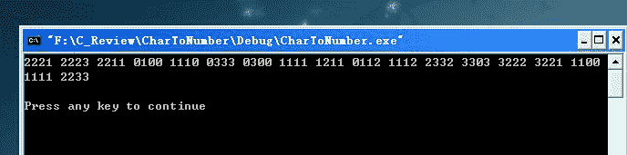  
与之前的比较：  
2221 2223 2211 0100 1110 0333 0300  
1111 1211 0112 1112 2332 3303 3222  
3221 1100 1111 2233  
是一样的，说明，嗯，不错，小弟逆向时的注意力很集中，没有写错。  
  
好，现在我们  
已知：  
1.迷宫数径的数据。  
2.注册文件的数据被分为三个部分，即  
  
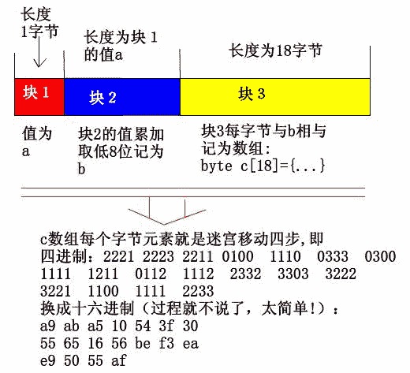  
  
a9aba510543f3055651656bef3eae95055af  
  
我们知道　公式：a^b^b=a，所以:  
知道 块 1 和 块 2 就可以推算出块 3 了。  
由于块 1 和块 2 可以自定义，没有限制，只要块 2 的长度=块 1 的值，即可。  
书中，是把块 2 当用　用户名。  
呵呵，这里我就设为任意 16 进制数，作为用户名.  
就用我的看学 ID 吧: licshword  
  
注册机代码如下：  
代码:

```
#include<stdio.h>
#include<string.h>
void main()
{
    unsigned char name\[256\];
    unsigned int part3\[18\];
    //这是迷宫路径数据
    unsigned int key\[18\]={0xa9,0xab,0xa5,0x10,0x54,0x3f,0x30,0x55,0x65,
                    0x16,0x56,0xbe,0xf3,0xea,0xe9,0x50,0x55,0xaf};
    int i=0,j=0;
    int len=0;
    int sum=0;
    printf("请输入用户名以'#'结束:\\n\\t");
    //输入块 2 的数据，以'#'号结束
    gets(name);
    //取得块 2 的长度,即块 1 的数据值
    len=strlen(name);
    if(len<=15)
    {
        printf("0");
    }
    printf("块 1 的数据为:\\t%2X\\n",len);
    printf("块 2 的数据为:\\t");
    for(i=0;name\[i\]!='\\0';i++)
    {
        if(name\[i\]<=15)
        {
            printf("0");
        }
        printf("%X ",name\[i\]);
    }
    printf("\\n");
 
    //块 2 数据累加，取低 8 位
    for(i=0;name\[i\]!='\\0';i++)
    {
        if(name\[i\]<=15)
        {
            printf("0");
        }
        sum+=name\[i\];
    }
    sum=sum & 0xff;
 
    //下面，根据 a^b^b=a 来算出块 3 的数据
    printf("块 3 的数据为:\\t");
    for(i=0;i<18;i++)
    {
        part3\[i\]=sum^key\[i\];
        if(part3\[i\]<=15)
        {
            printf("0");
        }
        printf("%X ",part3\[i\]);
    }
    printf("\\n");
    printf("----------------------------------------\\n");
    printf("注册文件的数据流为:\\n\\t");
    //输出块 1 数据
    if(len<=15)
    {
        printf("0");
    }
    printf("%X",len);
    //输出块 2 数据
    for(i=0;name\[i\]!='\\0';i++)
    {    
        if(name\[i\]<=15)
        {
            printf("0");
        }
        printf("%X",name\[i\]);
    }
    //输出块 3 数据
    for(i=0;i<18;i++)
    {
        if(part3\[i\]<=15)
        {
            printf("0");
        }
        part3\[i\]=sum^key\[i\];
        printf("%X",part3\[i\]);
    }
    printf("\\n\\t 您可以复制出上面的数据，保存为十六进制文件\\n 命名为:KwazyWeb.bit\\n\\t 则破解文件保护。");
}

```

  
运行，输入 lichsword  
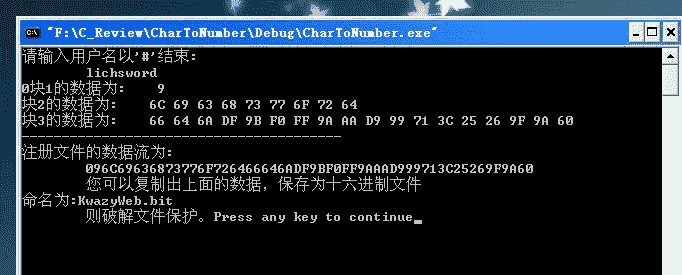  
  
我们复制出　数据流  
096C69636873776F726466646ADF9BF0FF9AAAD999713C25269F9A60  
  
在 hiew32.exe 中添加数据流：  
  
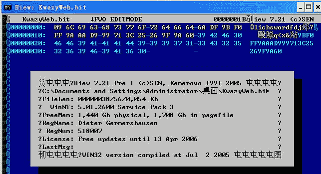  
\-----------------------------------------  
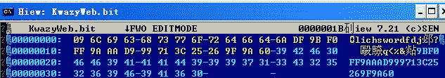  
  
保存后，命名为 KwazyWeb.bit  
  
叮咚！大家晚安，哎。。。又搞到１点多：  
  
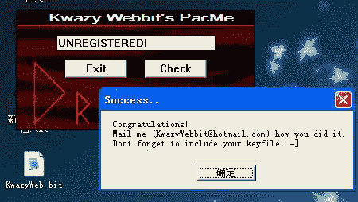  
  
注册机测试下载：CharToNumber.rar