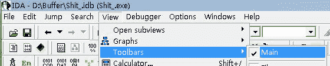

# 《加密与解密(第三版)》学习指引(第三章)静态分析技术

> 原文：[`www.pediy.com/kssd/pediy10/71271.html`](https://www.pediy.com/kssd/pediy10/71271.html)

知识就像一个圆,知道的越多，不知道的也越多.如果对于初学者来说 IDA 有什么困难的地方，那就是它的默认界面，按钮太多，给人一种很复杂的感觉。  
  
   
  
点一下上图中的 Main。恩，现在简单多了。一个软件可以流行起来，绝对不是因为它的高深，而是简单易用。如果你只想给人一种很专业的感觉， OD 就足够了，如果你想把事情变得简单。那么请往下看。  
    
首先让我们来回顾各小节隐藏的信息，我以为猜测每个功能存在的理由，是一件有趣的事。  
  

引用: **3.2.5 交叉参考：**  程序各部分存在联系,而只要定位到其中一部分,便可以顺藤摸瓜找到关键代码.  
**3.2.6 参考重命名、3.2.7 标签用法：**记录分析结果，备忘之用  
**3.2.8 进制的转换：**为满足不同人理解数字的习惯服务。  
**3.2.9 代码和数据转换、3.2.10 字符串：**现在，即使 IDA 不能很好处理，我们也可以自己处理了。   
**3.2.11 数组、3.2.12 结构体、3.2.13 枚举类型、3.2.14 堆栈变量和 3.2.16 FLIRT：**程序由高级语言编译而来，自然保留着某种高级语言的特性。更细致的分析记录功能，更可读的汇编代码。  
**3.2.15 IDC 脚本：**可编程的，自动完成任务的接口。更高的自由度，使自动解决重复劳动变成可能 

什么时候使用 IDA？  
  

引用: 更细致的备忘功能，意味着可以应付耗时更长的程序分析任务。例如你希望得到杀软客户端的反病毒技术细节，IDA 会是你最好的选择。  
更自由的交互功能，意味着用户可以完成更复杂的分析任务。例如你希望得到某网游保护系统的技术细节，IDA 会是你最好的选择。 

现在让我们忘记书中低级功能到高级功能的介绍顺序，看看一般静态分析流程：  
  

引用: 1．  使用 PEID 或 FILEINFO 识别出程序所使用的高级语言  
2．  按照**3.2.16 FLIRT**的介绍，选择对应的高级语言函数识别库  
3．  按照**3.4.2 逆向工程初步**中介绍的方法使用**3.2.5 交叉参考**功能  
4．  找到关键代码之后尝试使用**3.2.17**介绍的 Hex-Rays Decompiler，通过 F5 取得更易于阅读的源代码  
5．  为了应付复杂的情况，可能需要**3.2.9 代码和数据转换**、**3.2.10 字符串**，甚至自由度更高的**3.2.15 IDC 脚本**  
6．  通过**3.2.6 参考重命名**、**3.2.7 标签的用法**、**3.2.11 数组**、**3.2.12 结构体**和**3.2.13 枚据类型**，记录分析结果，作备忘之用。  
7．  使用**3.3 可执行文件的修改介绍**的方法完成任务 

给没有编程经验读者的阅读建议：  
  

引用: 你可能需要一本系统的书（如《Windows 编程循序渐进》）补充相关知识。再回头看这一章的内容，由于篇幅限制。书中第一章的内容只能供有基础的人作回顾之用。 

给希望了解 IDA 更多细节的读者一点额外的阅读资料：  
  

引用: 首先你可以在 IDA 的安装目录下找到 idahelp.chm。下面 URL 则是来自官方网站的资料：  
  
[`www.hex-rays.com/idapro/idasupport.htm`](http://www.hex-rays.com/idapro/idasupport.htm)  
  
**或许你也对本论坛的这些资源有兴趣：**  
  
[`bbs.pediy.com/showthread.php?t=40765 `](http://bbs.pediy.com/showthread.php?t=40765 )  
IDA 逆向工程入门  
  
[`bbs.pediy.com/showthread.php?t=52445`](http://bbs.pediy.com/showthread.php?t=52445)  
【翻译】翻译的几篇 IDA 小教程  
  
[`bbs.pediy.com/showthread.php?t=63292`](http://bbs.pediy.com/showthread.php?t=63292)  
关于 FLIRT 制作的文章  
  
[`bbs.pediy.com/showthread.php?t=7244`](http://bbs.pediy.com/showthread.php?t=7244)  
【翻译】IDA 数据分析简易教程  
  
[`bbs.pediy.com/showthread.php?t=31023`](http://bbs.pediy.com/showthread.php?t=31023)  
IDA 相关文章的翻译主题集合 

如果你关注 IDA 的高级应用，你或许会对下面资料感兴趣：  
  

引用: [`bbs.pediy.com/showthread.php?t=31441`](http://bbs.pediy.com/showthread.php?t=31441)  
IDA Pro 的插件开发 SDK，及其教程等相关资料  
  
[`bbs.pediy.com/showthread.php?t=38900 `](http://bbs.pediy.com/showthread.php?t=38900 )  
\[翻译\]IDA Plugin 编写基础  
  
[`bbs.pediy.com/showthread.php?t=51278`](http://bbs.pediy.com/showthread.php?t=51278)  
从不同的需求出发，将 IDA 的另一面呈现给你。文中使用 IDC 脱壳的示例会给你另一种脱壳体验  
  
[`www.openrce.org/articles/full\_view/28`](http://www.openrce.org/articles/full_view/28)  
编写 IDA Processor 模块，反编译分析受虚拟机保护的程序。