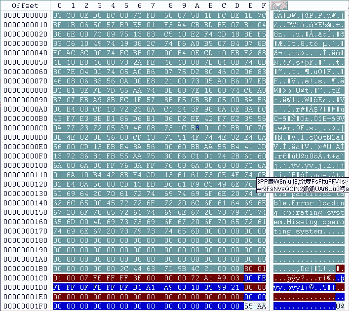
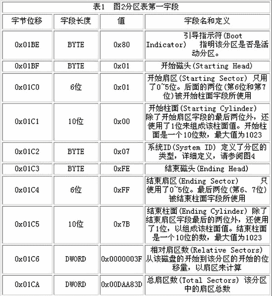
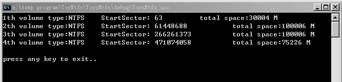

# 解析 NTFS(一) MBR 部分

> 原文：[`www.pediy.com/kssd/pediy11/112459.html`](https://www.pediy.com/kssd/pediy11/112459.html)

比较基础，权作笔记。  
前一阵子用工具在扇区级修改了下文件的属性，现在编程解析文件系统，一来作为学习实践，而来解决工作当中的一些实际问题。解析文件系统设计问题比较多，所有分几个小节进行。（关于使用工具，见：http://bbs.pediy.com/showthread.php?t=111821&highlight=）  
  
  安装双系统的时候，尤其是安装 WIN,LINUX 双系统的时候，卸载时操作不慎可能会损坏 MBR，导致无法进入系统，甚至都不能进行全盘格式化，因为 PQ 可能不认；很多病毒也对 MBR 进行下手；各种安全软件的保护手段也针对 MBR 进行操作；所有，熟悉了解 MBR，手动修复 MBR 是很有必要的，尤其是要解析文件系统的话，MBR 更是最重要最基础的。  
    
  一块硬盘（磁盘）在未经分区格式化之前，只是一块裸磁盘；仅可以用基本的方法来读写磁盘数据(CreateFile（"\\\\\\\\.\\\\PhysicalDrive0",……）)，而不能通过文件系统接口，读出的数据全部是字节流，属于最原始的数据形态。  
  平时我们之所以能看到文件、目录，是因为文件系统将其下层的存储空间数据虚拟成文件的方式向其上层呈现，故而我们用 API 接口处理的对象不再是数据流，而是文件或目录。  
    
  分区格式化，就是将硬盘划分为一个个的逻辑区域，分区粒度为一个柱面，也就是说，一个柱面只能属于某一个分区，而不能从属于多个分区。每一个分区都有一个确定的起、止位置，在起止位置之间的那些连续的扇区都归该分区所有，不同分区的起止位置互不交错。  
    
  计算机系统为管理好硬盘，需要维护有关各分区的基本信息，建立在 0 柱面、0 磁头、1 扇区上的硬盘分区表用来保存这些信息。该扇区是系统中的一个特殊扇区，是完成系统主板 BIOS 向操作系统交接的重要入口，称为硬盘主引导记录 MBR(Master Boot Recorder)或主引导扇区。  
  所谓特殊，是因为计算机启动时执行完 BOIS 的启动代码，检查各硬件设备正常后，JMP 到 MBR 的引导代码进行执行；然后定位到活动分区的 DBR，进行加载操作系统相关的组件。  
  
  现在来解析硬盘的第一个扇区，也就是 MBR 在磁盘上的结构，进而解析该磁盘的分区情况。获取了每个分区卷在磁盘上的分区信息后，就可以直接读取各分区的扇区信息，进而按照文件系统格式解析分区数据。（这样做的意义不言自明，了解系统底层，透过文件系统读写数据，自己编写文件系统驱动等）  
  
  MBR 占一个扇区，分三部分：  
    系统引导代码,  占 446 字节；  
    分区表信息,    占 64 字节  
    结束标志 55AA  占 2 字节  
  总过 512 字节  
  
  其中，分区表占 64 字节，每个分区占 16 个字节，可定义一个主分区；这也就是为什么一块硬盘只能定义四个主分区的原因。在主分区内，又支持扩展分区，这样对于分区就比较灵活了。  
  
  关于 MBR 扇区全貌，如下图：  
  其中，自偏移 0X1BE 以后的 64 字节，红蓝色相间，分别为 4 个分区表信息；  
  最后 2 字节是结束标记，55AA；  
  最前面的大块淡绿色区域是 446 字节的引导代码。  
  
  
        可使用 winHex 查看 MBR，操作方式如下：  
  打开硬盘：Tools->OpenDIsk->HDO；定位到 MBR：Position->Go to Sector,填写 0，即可。   
  
  分区表结构表示如下：  
  #pragma pack(1)  
typedef struct \_PARTITION\_ENTRY {  
  unsigned char boot\_ind;    /\* 0x80 - active \*/  
  unsigned char head;      /\* starting head \*/  
  unsigned char sector;    /\* starting sector \*/  
  unsigned char cyl;      /\* starting cylinder \*/  
  unsigned char sys\_ind;    /\* What partition type \*/  
  unsigned char end\_head;    /\* end head \*/  
  unsigned char end\_sector;  /\* end sector \*/  
  unsigned char end\_cyl;    /\* end cylinder \*/  
  unsigned int  start\_sect;  /\* starting sector counting from 0 \*/  
  unsigned int  length;    /\* nr of sectors in partition, length \*/  
}PARTITION\_ENTRY,\* PPARTITION\_ENTRY;  
#pragma pack()  
       
           
  
其中，关心的字段是分区类型，分区开始扇区，分区长度，激活状态等。  
  
用程序打开硬盘，读写 MBR，定位到分区表，解析分区信息，运行截图如下：  
   
  
可见，本机有四个分区，其中第一个分区是从 63 号扇区开始，大小约为 30G；  
其他扇区依次。  
  
  
读取了分区表信息后，现在就可以定位到每个分区的第一个扇区，即所属分区的 DBR，也称为分区引导扇区，解析分区引导扇区，如下结构：   
typedef struct \_PACKED\_BOOT\_SECTOR {  
  
    UCHAR Jump\[3\];                                     //  offset = 0x000  
    UCHAR Oem\[8\];                                     //  offset = 0x003  
    BIOS\_PARAMETER\_BLOCK PackedBpb;                   //  offset = 0x00B  
    UCHAR Unused\[4\];                                   //  offset = 0x024  
    LONGLONG NumberSectors;                           //  offset = 0x028  
    LCN MftStartLcn;                                    //  offset = 0x030  
    LCN Mft2StartLcn;                                   //  offset = 0x038  
    CHAR ClustersPerFileRecordSegment;                   //  offset = 0x040  
    UCHAR Reserved0\[3\];  
    CHAR DefaultClustersPerIndexAllocationBuffer;           //  offset = 0x044  
    UCHAR Reserved1\[3\];  
    LONGLONG SerialNumber;                            //  offset = 0x048  
    ULONG Checksum;                                  //  offset = 0x050  
    UCHAR BootStrap\[0x200-0x044\];                       //  offset = 0x054  
  
} PACKED\_BOOT\_SECTOR;  
  通过解析 DBR，就能得到该分区加载 mount 的文件系统类型，每扇区的字节数，每簇的大小等信息。如果是 NTFS 文件系统，则直接定位到 5 号 MFT 记录，$root 根目录文件，进行解析。  
  在下一篇中记录解析 MFT,MFT 常规属性。  
    
代码相关：ToysNtfs1.rar