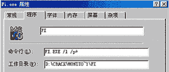
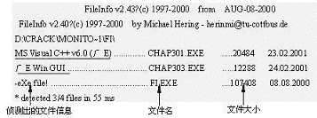

# 文件类型分析 

> 原文：[`www.pediy.com/kssd/tutorial/chap4-11.htm`](https://www.pediy.com/kssd/tutorial/chap4-11.htm)

文件类型分析

　　文件分析是静态分析程序的第一步，通过相关工具显示欲调试文件的信息，如它是用什么语言写的，是否加壳等。常用的文件分析工具有 TYP、Gtw 或 FileInfo。其中 FileInfo（光盘\\tools\\file\\File analysers）由于识别文件类型较多，使用方便，在这一节简单地讲讲它的用法。  
FileInfo 运行时是 DOS 界面，支持 Windows 长文件名，能识别 DOS、NE、PE 等各种文件类型和壳。  
　　语法：fi <drive:\\path\\><\*.\*> </r> </f> </d-> </l+> </p+>  
　　　 　"fi /r"or "/s" 列出当前目录和子目录所有的文件信息；  
　　　 　"fi /f" 仅列出能识别的文件  
　　由于每次要进入 DOS 窗口运行程序相当不便，在这可创建快捷方式，把要分析的文章复制到 FileInfo 目录下，用鼠标双击 FileInfo 主文件即可。FileInfo 快捷方式如图二。在快捷方式中的命令行中可以键入相关参数，如：FI.EXE /l /p+，此后用鼠标双击 FileInfo 快捷方式，会自动分析出 FileInfo 当前目录内的所有文件，不包含子目录。

  
  
图二 FileInfo 快捷方式中命令参数配制

　　双击此快捷方式就可执行带参数的 FileInfo，显示结果如图三所示。

  
  
图三 FileInfo 分析文件的报告

　　在此例中，文件 CHAP301.EXE 被分析出是用 VC6.0 编译的, CHAP303.EXE 文件类型是 Win GUI，就是 Windows 图形用户界面程序（一般 FileInfo 分析不出类型就报此类型）。另外此工具也可分析出程序是被何种软件所加密的等。  

 4dd466d0e1e0cc123afbe504da2462ca