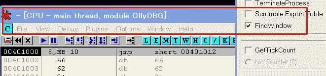
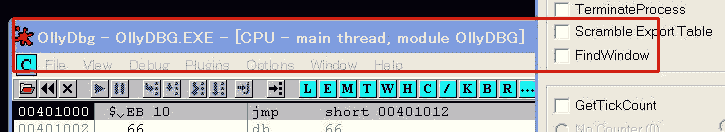

# OD 插件 - Olly Advanced 1.26 Beta 12 \[Bug 修正\]

> 原文：[`www.pediy.com/kssd/pediy10/91562.html`](https://www.pediy.com/kssd/pediy10/91562.html)

开个新帖给有在用 Olly Advanced 1.26 Beta 12 插件的朋友做个参考  
  
Bug: 在 Anti-Debug 里面的 FindWindow 没有打勾的情况下，OllDbg 的窗口标题却跟有打勾一样：  
  
      - \[CPU - main thread, module NOTEPAD\]  
  
     少了前面的模组名称, 其实正常在 FindWindow 没有打勾时应是：  
  
     OllyDbg - NOTEPAD.EXE - \[CPU - main thread, module NOTEPAD\]  
  
这个 Bug 有改也好没改也好，应该影响不大．  
下列是以 FindWindow 没有打勾的情况来讲解的．  
  
这是英文原版 OllyDbg (2004/5/23) 的代码：  

代码:

```
0047794E  |.  52            push    edx
0047794F  |.  6A 00         push    0
00477951  |.  6A 00         push    0
00477953  |.  6A 00         push    0
00477955  |.  51            push    ecx
00477956  |.  6A 00         push    0
00477958  |.  E8 73760300   call    <jmp.&KERNEL32.CreateProcessA>
0047795D  |.  85C0          test    eax, eax
0047795F  |.  75 1E         jnz     short 0047797F
00477961  |.  8D85 E0FEFFFF lea     eax, \[ebp-120\]
00477967  |.  50            push    eax
00477968  |.  8D96 74090000 lea     edx, \[esi+974\]
0047796E  |.  52            push    edx
0047796F  |.  E8 A8C6FDFF   call    \_Error
00477974  |.  83C4 08       add     esp, 8
00477977  |.  83C8 FF       or      eax, FFFFFFFF
0047797A  |.  E9 08010000   jmp     00477A87
0047797F  > 8B95 14E4FFFF   mov     edx, \[ebp-1BEC\]

```

若有用到 Olly Advanced 这个插件的话，会被他用 WriteProcessMemory 改成这副模样：  
  
代码:

```
0047794E   . 52              push    edx
0047794F   . 6A 00           push    0
00477951   . 6A 00           push    0
00477953   . 6A 00           push    0
00477955   . 51              push    ecx
00477956   . 6A 00           push    0
00477958   . 68 BD290010     push    100029BD          ;到 advancedolly.dll 领空
0047795D   . C3              ret
0047795E     C0              db      C0                \\
0047795F   . 75 1E           jnz     short 0047797F    |这
00477961   . 8D85 E0FEFFFF   lea     eax, \[ebp-120\]    |些
00477967   . 50              push    eax               |已
00477968   . 8D96 74090000   lea     edx, \[esi+974\]    |没
0047796E   . 52              push    edx               |有
0047796F   . E8 A8C6FDFF     call    \_Error            |用
00477974   . 83C4 08         add     esp, 8            |到
00477977   . 83C8 FF         or      eax, FFFFFFFF     |了
0047797A   . E9 08010000     jmp     00477A87          /
0047797F   > 8B95 14E4FFFF   mov     edx, \[ebp-1BEC\]   ;advancedolly 将会回到此
00477985   . 8915 605A4D00   mov     \[4D5A60\], edx
0047798B   . 8B8D 18E4FFFF   mov     ecx, \[ebp-1BE8\]
00477991   . 890D 645A4D00   mov     \[4D5A64\], ecx
00477997   . C705 685A4D00 0>mov     dword ptr \[4D5A68\], 6
004779A1   . C705 6C5A4D00 0>mov     dword ptr \[4D5A6C\], 6
004779AB   . 8B85 1CE4FFFF   mov     eax, \[ebp-1BE4\]
004779B1   . A3 705A4D00     mov     \[4D5A70\], eax
004779B6   . 8B95 20E4FFFF   mov     edx, \[ebp-1BE0\]
004779BC   . 8915 745A4D00   mov     \[4D5A74\], edx
004779C2   . 8B4D F0         mov     ecx, \[ebp-10\]
004779C5   . 51              push    ecx                 ; /Arg4
004779C6   . 8D86 A5030000   lea     eax, \[esi+3A5\]      ; |
004779CC   . 50              push    eax                 ; |Arg3
004779CD   . 8D96 8E090000   lea     edx, \[esi+98E\]      ; |
004779D3   . 52              push    edx                 ; |Arg2 "%s - %s"
004779D4   . 8D8D E0FEFFFF   lea     ecx, \[ebp-120\]      ; |
004779DA   . 51              push    ecx                 ; |Arg1
004779DB   . E8 4CF20200     call    004A6C2C            ;\_sprintf
004779E0   . 83C4 10         add     esp, 10
004779E3   . 8D85 E0FEFFFF   lea     eax, \[ebp-120\]
004779E9   . 50              push    eax
004779EA   . 8B15 7C3B4D00   mov     edx, \[4D3B7C\]
004779F0   . 52              push    edx
004779F1   . E8 C87B0300     call    <jmp.&USER32.SetWindowTextA>

```

我们来看一下他跳到 advancedolly.dll 领空的代码：  
请特别注意一下 10002A1B 开始的５行，他有用到(改到) ESI 寄存器．  
  
代码:

```
100029BD   8B4424 24         mov     eax, \[esp+24\]
100029C1   A3 3FC00010       mov     \[1000C03F\], eax
100029C6   E8 4B620000       call    <jmp.&kernel32.CreateProcessA>
100029CB   0BC0              or      eax, eax
100029CD   0F84 84000000     je      10002A57
100029D3   A1 3FC00010       mov     eax, \[1000C03F\]
100029D8   8B00              mov     eax, \[eax\]
100029DA   A3 9BC10010       mov     \[1000C19B\], eax
100029DF   A1 3FC00010       mov     eax, \[1000C03F\]
100029E4   8B40 08           mov     eax, \[eax+8\]
100029E7   A3 9FC10010       mov     \[1000C19F\], eax
100029EC   33C0              xor     eax, eax
100029EE   40                inc     eax
100029EF   E8 05430000       call    10006CF9
100029F4   68 EDA40010       push    1000A4ED          ;ASCII "ntdll.dll"
100029F9   E8 6C620000       call    <jmp.&kernel32.GetModuleHandleA>
100029FE   A3 BAD70010       mov     \[1000D7BA\], eax
10002A03   8BF8              mov     edi, eax
10002A05   33DB              xor     ebx, ebx
10002A07   66:8B5F 3C        mov     bx, \[edi+3C\]
10002A0B   03FB              add     edi, ebx
10002A0D   33DB              xor     ebx, ebx
10002A0F   66:8B5F 14        mov     bx, \[edi+14\]
10002A13   03FB              add     edi, ebx
10002A15   83C7 18           add     edi, 18
10002A18   83C7 08           add     edi, 8
10002A1B   8BF7              mov     esi, edi           ;/---------------
10002A1D   8B3E              mov     edi, \[esi\]         ;
10002A1F   893D B2D70010     mov     \[1000D7B2\], edi    ;用到(改到)  ESI
10002A25   83C6 04           add     esi, 4             ;
10002A28   8B3E              mov     edi, \[esi\]         ;\\---------------
10002A2A   033D BAD70010     add     edi, \[1000D7BA\]
10002A30   893D B6D70010     mov     \[1000D7B6\], edi
10002A36   9C                pushfd
10002A37   A3 16C00010       mov     \[1000C016\], eax
10002A3C   A1 8BC00010       mov     eax, \[1000C08B\]    ;/------------------
10002A41   05 7F790700       add     eax, 7797F         ;
10002A46   A3 1AC00010       mov     \[1000C01A\], eax    ;跳回 OllyDbg
10002A4B   A1 16C00010       mov     eax, \[1000C016\]    ;400000+7797F=47797F
10002A50   9D                popfd                      ;
10002A51  -FF25 1AC00010     jmp     \[1000C01A\]         ;\\------------------

```

如上所见，完事后他会跳回 OllyDbg 的领空 400000 + 7797F = 47797F  
请翻到上面由 47797F 往下看一下程序码，这里我再列一次重点：  
  
代码:

```
004779C2   . 8B4D F0         mov     ecx, \[ebp-10\]
004779C5   . 51              push    ecx                 ; /Arg4 "NOTEPAD.EXE"
004779C6   . 8D86 A5030000   lea     eax, \[esi+3A5\]      ; |
004779CC   . 50              push    eax                 ; |Arg3 "OllyDbg"
004779CD   . 8D96 8E090000   lea     edx, \[esi+98E\]      ; |
004779D3   . 52              push    edx                 ; |Arg2 "%s - %s"
004779D4   . 8D8D E0FEFFFF   lea     ecx, \[ebp-120\]      ; |
004779DA   . 51              push    ecx                 ; |Arg1 输出 Buffer
004779DB   . E8 4CF20200     call    004A6C2C            ;\_sprintf

```

亦即执行 \_sprintf(buffer, "%s - %s", "OllyDbg", "NOTEPAD.EXE");  
此函数会得到 buffer 内容为 "OllyDbg - NOTEPAD.EXE" 的字符串,  
并马上接着 SetWindowTextA．  
  
注意这里的 Arg2 ' Arg3 是以 ESI 为参考点的，而 ESI 早在之前就被  
advancedolly.dll 破坏掉了(ESI<=ntdll.text)．导致 \_sprintf 看似无任何动作到．  
如大多数的字符串处理函数一样，\_sprintf 一开头会先做清空动作：OutBuffer\[0\]=00h  
所以本应得到 "OllyDbg - NOTEPAD.EXE"，就因为 ESI 被破坏掉而得到空字符串．  
  
修正：  
　　即然 ESI 不能用，我们可看一下 OD 的程序码了解应该可换成 ECX 来用．  
  
\[原版 Olly Advanced 1.26 Beta 12\] 会有 Bug  
代码:

```
  10002A1B   8BF7             mov     esi, edi
  10002A1D   8B3E             mov     edi, \[esi\]
  10002A1F   893D B2D70010    mov     \[1000D7B2\], edi
  10002A25   83C6 04          add     esi, 4
  10002A28   8B3E             mov     edi, \[esi\]

```

\[用 ECX 取代 ESI\]  
代码:

```
  10002A1B   8BCF             mov     ecx, edi
  10002A1D   8B39             mov     edi, \[ecx\]
  10002A1F   893D B2D70010    mov     \[1000D7B2\], edi
  10002A25   83C1 04          add     ecx, 4
  10002A28   8B39             mov     edi, \[ecx\]

```

若我们无法确定 ECX 是否真的没被使用，可用个 Stack 的小技巧来完成相同的动作：  
代码:

```
  10002A1B     FF37           push    dword ptr \[edi\]
  10002A1D     90             nop
  10002A1E     90             nop
  10002A1F     8F05 B2D70010  pop     dword ptr \[1000D7B2\]
  10002A25     8B7F 04        mov     edi, \[edi+4\]
  10002A28     90             nop
  10002A29     90             nop

```

前面 2 个 nop 是为了要将 \[1000D7B2\] 堆到原来的位址, 以防重定位出问题.  
  
  
现在已是正常的：  
　FindWindow 没打勾: OllyDbg - NOTEPAD.EXE - \[CPU - main thread, module NOTEPAD\]  
　FindWindow 有打勾: - \[CPU - main thread, module NOTEPAD\]  
  
最后附上我用 Stack 改法改的完成品





上传的附件
|  |
|  || advancedolly.rar  
 |