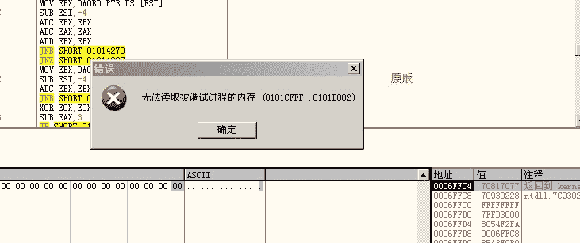
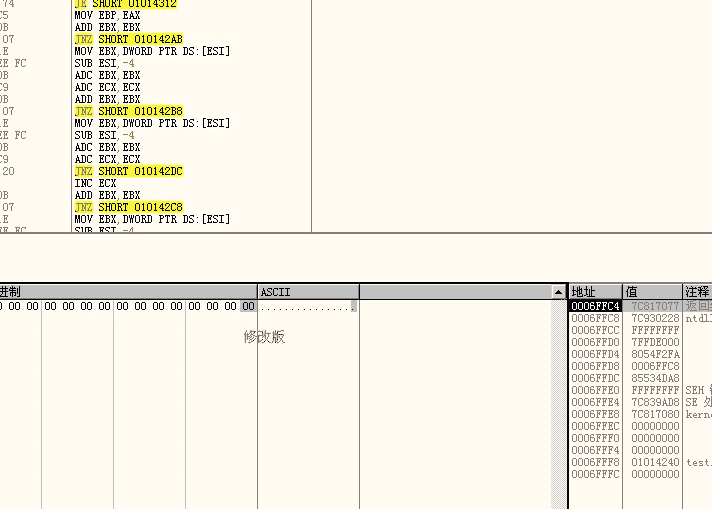

# 修正 SeVen 版本 OD 的一个内存访问 Bug！

> 原文：[`www.pediy.com/kssd/pediy12/140219.html`](https://www.pediy.com/kssd/pediy12/140219.html)

症状：当我们用此版本 OD 查看数据框口的时候，用鼠标双击最后一个位置的的时候，会一直弹出错误对话框，并且鼠标一指向数据区域就会出现错误对话框。  
引发条件：使用了 TEST 指令来判断是否等于 2，JNZ 就跳，当 TEST 指令的第一个操作数为 5 的时候，ZF 标志位发生变化，条件为假，也就是不跳，向下执行，具体看代码：  

代码:

```
004615D5  |.  F645 14 02    TEST BYTE PTR SS:\[EBP+14\],2              ;  当这里的是 5 的时候，ZF 标志位位 1，表示条件为假，这里应该改为 CMP
004615D9  |.  75 12         JNZ SHORT 004615ED
004615DB  |.  03FE          ADD EDI,ESI                              ;  此处谈错误对话框
004615DD  |.  4F            DEC EDI
004615DE  |.  57            PUSH EDI                                 ; /Arg3
004615DF  |.  56            PUSH ESI                                 ; |Arg2
004615E0  |.  68 49C44B00   PUSH 004BC449                            ; |Arg1 = 004BC449
004615E5  |.  E8 322AFFFF   CALL \_Error                              ; \\\_Error

```

修改后的代码代码:

```
004615D5      807D 14 02    CMP BYTE PTR SS:\[EBP+14\],2               ;  当这里的是 5 的时候，ZF 标志位位 1 表示条件为假，这里应该改为 CMP
004615D9  |.  75 12         JNZ SHORT 004615ED
004615DB  |.  03FE          ADD EDI,ESI                              ;  此处谈错误对话框
004615DD  |.  4F            DEC EDI
004615DE  |.  57            PUSH EDI                                 ; /Arg3
004615DF  |.  56            PUSH ESI                                 ; |Arg2
004615E0  |.  68 49C44B00   PUSH 004BC449                            ; |Arg1 = 004BC449
004615E5  |.  E8 322AFFFF   CALL \_Error                              ; \\\_Error

```

修改版和原版地址下载：  
测试方法：  
Ollydbg 源版.exe   表示原来没修改过的 OD，命名为：Ollydbg.EXE，然后放在 OllyDbg 目录下测试  
Ollydbg 修改版.exe  表示修改过的 OD，命名为：Ollydbg.EXE，放在 Ollydbg 目录下测试  
方法：随便打开一个文件，双击数据窗口的最后一个位置，就会弹出错误对话框，然后鼠标指向数据窗口，还是会弹出此窗口，  
由于附件大小问题，脚本和 UDD 文件夹我删除了  
请看图片：  
  
  
  


上传的附件
|  || B(文件相关).rar  
 |
|  || A（文件夹相关）.rar  
 |