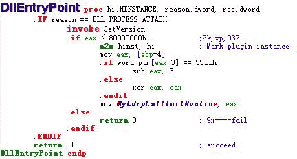
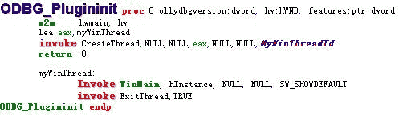
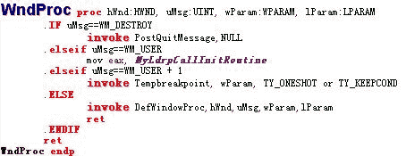
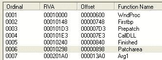
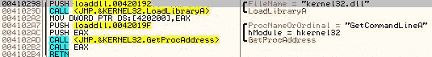
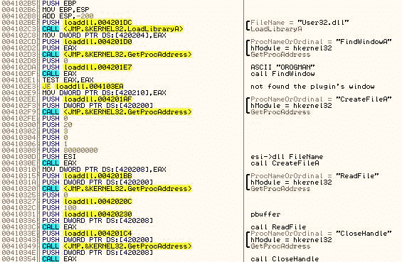
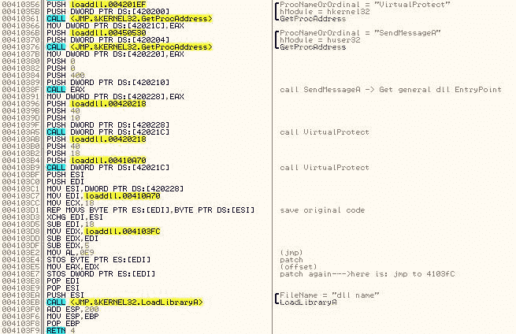
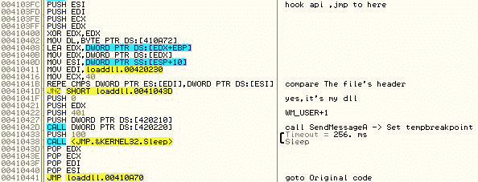

# Diy OllyDbg's Loaddll.exe

> 原文：[`www.pediy.com/kssd/pediy07/pediy7-613.htm`](https://www.pediy.com/kssd/pediy07/pediy7-613.htm)

目的：用 OllDbg 中断在 dll 的入口  
程序下载：http://bbs.pediy.com/showthread.php?s=&threadid=16082   
  
一、编写 plugin :  
1.  DllEntryPoint 如图：  
   
2．ODBG\_Plugininit 如图：新启一个线程，由此线程的函数 WinMain 创建一个（隐藏）窗口。  
   
3．窗口回调函数如图：  
   
至此，plugin 设计完成，它所起的作用是：  
1．  当得到 WM\_USER 消息时返回 dll 入口地址（在 MyLdrpCallInitRoutine 中）  
2．  当得到 WM\_USER＋1 消息时在 wParam 指示的地址（就是你调试点 dll 入口点）设置临时断点（Tempbreakpoint）。  
  
二、  在 dll 的加载进程中与 plugin 通讯。  
    为此，可以写一个加载程序（就好像 DLL\_Loader），我这里选择 diy llyDbg 配套的 loaddll.exe，因为只有它可与 OD“无缝对接”。用 LordPE 打开程序看看结构，当看到它的 ExportTable 时，感觉实在妙！下面是其截图：  
   
    每个导出函数名称叫人看了都如此受用，特别是 PatchArea！Oleh Yuschuk 为我们考虑得实在周到。Thanks  
Diy 过程：  
1．  把 ImportTable 中的 GetCommandLineA 改成 GetProcAddress  
2．  Patch   
   
   为：  
   
并在 Patcharea（410298）处键入：  
   
以完成原语句的功能。这里程序中原来没有的字符串（如“GetCommandLineA”）等在 data 区或 rsrc 区段空白处录入。  
3．Patch  
   
为 call  4102B5，并在 4102B5 开始写入如下代码：  
   
   
   
以上代码完成的主要任务是 hook dll entrypoint，当程序查到入口处是调试点 dll oep 时通知 plugin 设置断点，使 OllyDbg 中断在那里，这样我们可以少飞许多手脚。

 4dd466d0e1e0cc123afbe504da2462ca