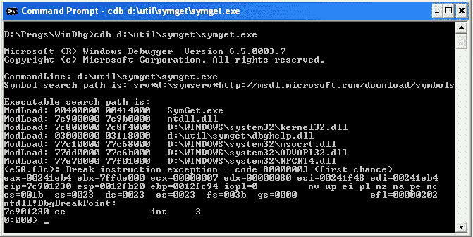

# 翻译：通往 WinDbg 的捷径（一）

> 原文：[`www.pediy.com/kssd/pediy08/pediy8-770.htm`](https://www.pediy.com/kssd/pediy08/pediy8-770.htm)

通往 WinDbg 的捷径（一）  
  
原文：http://www.debuginfo.com/articles/easywindbg.html  
译者：arhat  
时间：2006 年 4 月 13 日  
关键词：CDB WinDbg   
  
**导言**  
你钟情什么样的调试器？如果你问我这个问题，我会回答是“Visual Studio + WinDbg”。我比较喜欢 Visual Studio 那朴实无华且易操作的接口，更喜欢它能迅速把我需要的信息以可视的形式展示出来。但遗憾的是，Visual Studio 调试器无法获取某些信息。例如，假设我想知道哪个线程正在占用特殊的临界区？或者是哪个函数占用了大部分的栈空间？不用担心，有 WinDbg 呢。它的命令能回答这些问题，以及调试过程中出现的其它有趣的问题。甚至不退出 Visual Studio，WinDbg 就可以附上目标应用程序――谢谢 WinDbg 支持入侵模式的调试（本文后面会详细讨论），我们可以把 Visual Studio GUI 和 WinDbg 的命令行结合起来使用。  
唯一的问题是 WinDbg 不太好用。需要花些时间适应它的用户界面，而掌握它的命令则要花更多的时间。但是假设你现在就需要它，马上用它调试紧急的问题？有什么快速简便的方法吗？当然。WinDbg 的小弟 CDB，功能和 WinDbg 差不多；因为它是基于命令行的，所以用起来更简单一些。在这篇文章里，我将把 CDB 作为 Visual Studio 调试器的补充，介绍怎样使用 CDB。在这篇文章里，你将会看到怎样配置 CDB，怎样用它解决实际的问题。另外，我还会提供一些批处理文件，它们可以隐藏 CDB 命令行接口的大部分复杂性，也让你少打几个字。  
  
**安装与配置  
安装**  
当然，在使用 CDB 前，必须先安装并配置它。WinDbg 和 CDB 是[Debugging Tools for Windows](http://www.microsoft.com/whdc/ddk/debugging/default.mspx) 的一部分，可以从[这里](http://www.microsoft.com/whdc/ddk/debugging/default.mspx)下载。安装很简单，你可以用默认设置安装，除非你准备用 WinDbg SDK 开发应用程序。（如果你准备用 SDK，需要选择定制安装，并启用 SDK 安装；推荐你把它安装在不包含空格的目录名的目录中）。安装完成后，安装目录里将包含所有必需的文件，包括 WinDbg（windbg.exe）和 CDB（cdb.exe）。  
调试工具也支持“xcopy”类型的安装。也就是说，在一台机器上安装后，如果你想在其它的机器上使用，不用再安装，直接把已经安装的目录直接拷过去就行了。  
  
**符号文件服务器路径**   
如果不能访问操作系统 DLL 的最新的符号文件，有些重要的 WinDbg 命令将不能正常工作。在以往，我们可以从微软的 FTP 服务器上下载巨大的符号文件包，然后从中找出需要的符号文件。这非常浪费时间，而且在操作系统更新或升级后，符号文件就过时了（因此也就变得毫无用处）。幸运的是，现在有更简便的方法来获得符号文件――符号文件服务器。WinDbg 和 Visual Studio 都支持这个方法，在需要时直接从微软维护的服务上下载最新的符号文件。有了符号文件服务器，我们再也不用下载整个符号文件包了（那实在是太大了），因为调试器知道需要用到哪个 DLLs，所以直接下载单个符号文件就行了。如果符号文件在操作系统更新或升级以后过时了，调试器会注意到这种情形，并再次下载必需的符号文件。  
为了使符号文件服务器起作用，我们应该让调试器知道符号文件服务器的路径。最简单的方法是在\_NT\_SYMBOL\_PATH 环境变量里指定符号文件服务器的路径。可以用如下的路径：  
"srv\*c:\\symbolcache\*http://msdl.microsoft.com/download/symbols"   
（c:\\symbolcache 目录将被用来保存从符号文件服务器下载下来的符号文件；当然，你可以用任何有效的本地或网络路径）。例如：  
  set \_NT\_SYMBOL\_PATH=srv\*c:\\symbols\*http://msdl.microsoft.com/download/symbols  
在你设置\_NT\_SYMBOL\_PATH 环境变量之后，就可以使用符号文件服务器了。关于符号文件服务器的更多信息，相关设置，以及可能会用到的排除故障的小技巧，可以从 WinDbg 的文档中找到（Debuggers | Symbols section）。  
如果你需要从一台需登录的代理服务器后访问符号文件服务器。参见本篇文章中 CDB and proxy servers 部分，以了解更多信息。  
  
**CDB 命令行基础介绍   
启动调试会话**  
当我们使用新的调试器时，第一个问题通常是：怎样开始调试会话呢？像大多数调试器一样，CDB 允许我们调试应用程序的新实例，或者附上一个已经运行的过程。启动新实例就象下面一样简单：  
  cdb c:\\myapp.exe  
如果我们想附上已经运行的过程，可能会用上下列某个选项：  
\----------------------------------------------------------------------------------------------------------------------  
选项                描述                                                                            例子  
\----------------------------------------------------------------------------------------------------------------------  
\-p Pid              这个选项允许 CDB 附上指定进程 ID 的进程。可以用任务管理器或类似的工具得到进程 ID。   cdb -p 1034  
\----------------------------------------------------------------------------------------------------------------------  
\-pn ExeName         这个选项允许 CDB 用指定的可执行文件名（.exe）附上进程。这个选项比“-p Pid”更  
                    方便，因为我们通常知道执行的程序名，不必在任务管理器中寻找进程的 ID。但是如果  
                    多个进程使用同一个名字（CDB 将报错），就不能用这个选项了。                       cdb -pn myapp.exe  
\----------------------------------------------------------------------------------------------------------------------  
\-psn ServiceName    这个选项允许 CDB 附上指定服务的进程。例如，假如你想附上 Windows Management   
                    Instrumentation 服务，应该用 WinMgmt 作为服务名。                                  cdb -psn MyService  
\----------------------------------------------------------------------------------------------------------------------  
  
CDB 也可以分析故障转储。用-z 选项打开故障转储：  
  cdb -z DumpFile  
例如：  
  cdb -z c:\\myapp.dmp  
  
**结束调试会话**   
启动新的调试会话后，CDB 会显示它自己的命令行提示符。你可以在这个提示符下执行 CDB 支持的任何命令。  
    
'q'命令结束调试会话并退出 CDB：  
0:000> q  
quit:  
\>  
警告：当你结束调试会话，退出 CDB 时，操作系统也将终止被调试的程序。如果你想退出 CDB 并保持被调试程序，可以用.detach 命令（Windows XP 或更新的操作系统才支持），或者用非入侵的模式（下面讨论）。  
  
**运行命令**   
虽然可以在 CDB 命令行提示符下执行调试器命令，但在命令行里指定需要的命令通常更快一些，用-c 选项。  
  cdb -pn myapp.exe -c "command1;command2"  
（用分号分隔多个命令）  
例如，下列命令行将把 CDB 附上我们的应用程序，显示已加载的模块，然后退出：  
  cdb -pn myapp.exe -c "lm;q"  
注意，在命令列表的结尾加上'q'命令――将在所有的调试器命令执行后关闭 CDB。  
  
**入侵模式调试**  
在默认情况下，当我们用 CDB 调试一个已经运行的进程时，它通常作为全功能的调试器附上进程（使用 Win32 Debugging API）。在这种模式下，可以设置断点，单步调试代码，得到各种调试事件的通知（例如，异常，加载/卸载模块，启动/退出线程，等等）。Visual Studio 也可以做到这些，并提供更友好的用户界面。另外，每个进程每次只能被一个调试器附上。这是否意味着如果我们用 Visual Studio 调试器调试应用程序，就不能再用 CDB 得到它的附加信息了？不，不完全是这样，因为除了全功能调试模式外，CDB 还支持入侵调试模式。  
CDB 以入侵模式附上目标进程时，并没有使用 Win32 Debugging API，而是先暂停目标进程的所有线程，执行用户指定的命令。在所有的命令执行之后，CDB 退出之前，恢复暂停的线程。因此，目标进程可以继续运行，好像什么事也没发生一样。即使像 Visual Studio 之类的全功能调试器正在调试目标进程，CDB 仍可以用入侵模式附上它，并获得所需要的信息。在 CDB 完成任务并分离附上的进程后，我们可以继续用 Visual Studio 调试器调试这个应用程序。  
怎么启用 CDB 的入侵模式？用-pv 命令行选项。例如，下列命令行将以入侵模式附上应用程序，显示已加载模块的列表，然后退出。在 CDB 退出之后，应用程序将继续运行。  
  cdb -pv -pn myapp.exe -c "lm;q"  
  
**把输出内容保存到日志文件**   
有些 CDB 命令的输出内容可能会很长，从控制台窗口阅读十分不便。因此，把输出内容保存到日志文件，再用其它的编辑器查看会更好一些，CDB 允许我们用-loga 和-logo 选项来实现（'-loga <filename>'把输出内容追加到指定文件的结尾；而'-logo <filename>'将覆盖原有的文件，如果文件已经存在的话）。  
在我们的例子命令（列出目标进程里的模块）里增加记录功能，把输出内容保存到当前目录的 out.txt 文件里：  
  cdb -pv -pn myapp.exe -logo out.txt -c "lm;q"  
  
**源行号信息**   
CDB 支持的另外一个重要选项是-lines。这个选项打开源行号信息支持，例如，当报告调用栈时，允许 CDB 显示源文件及源行号。（在默认情况下，源行号支持是关闭的，CDB 不显示源文件/行号信息）。  
  
**CDB 和代理服务器**   
如果你在需要登录的代理服务器后用 CDB，在默认情况下，将不能访问符号文件服务器。原因是在默认配置下，当 CDB 尝试连接符号文件服务器时，不显示代理服务器的登录提示。为了更改这个行为，使我们可以访问符号文件服务器，需要在命令行之前加上两条命令：  
  !sym prompts;.reload  
例如：  
  cdb -pv -pn myapp.exe -logo out.txt -c "!sym prompts;.reload;lm;q"  
  
**启动消息**  
当 CDB 调试新应用程序，附上已经存在的进程，或打开故障转储时，将显示一系列的启动消息。CBD 命令（可以用-c 选项指定，或手动输入）的输出内容跟在这些消息之后。通常情况下，启动消息只显示一些无关紧要信息；但是如果在执行时出错了，它将包含这个问题的描述，有时候也会提供解决方法。  
例如，下列输出内容通知我们没有设置符号路径，因此，有些调试器命令不能工作：  
D:\\Progs\\DbgTools>cdb myapp.exe  
  
Microsoft (R) Windows Debugger  Version 6.5.0003.7  
Copyright (c) Microsoft Corporation. All rights reserved.  
  
CommandLine: myapp.exe  
Symbol search path is: \*\*\* Invalid \*\*\*  
\*\*\*\*\*\*\*\*\*\*\*\*\*\*\*\*\*\*\*\*\*\*\*\*\*\*\*\*\*\*\*\*\*\*\*\*\*\*\*\*\*\*\*\*\*\*\*\*\*\*\*\*\*\*\*\*\*\*\*\*\*\*\*\*\*\*\*\*\*\*\*\*\*\*\*\*  
\* Symbol loading may be unreliable without a symbol search path.           \*  
\* Use .symfix to have the debugger choose a symbol path.                   \*  
\* After setting your symbol path, use .reload to refresh symbol locations. \*  
\*\*\*\*\*\*\*\*\*\*\*\*\*\*\*\*\*\*\*\*\*\*\*\*\*\*\*\*\*\*\*\*\*\*\*\*\*\*\*\*\*\*\*\*\*\*\*\*\*\*\*\*\*\*\*\*\*\*\*\*\*\*\*\*\*\*\*\*\*\*\*\*\*\*\*\*  
  
**总结**  
这里是一些常见的 CDB 命令行模板，本篇文章的剩下部分将会用到它们（我们总是用同样的模板，然后根据我们要解决的问题，改变-c 选项内部的命令行列表）。  
用入侵模式附上运行的进程（通常是进程 ID），执行一组命令，并把输出内容保存在 out.txt 文件里：  
  cdb -pv -p <processid> -logo out.txt -lines -c "command1;command2;...;commandN;q"  
用入侵模式附上运行的进程（用可执行文件名），执行一组命令，并把输出内容保存在 out.txt 文件里：  
  cdb -pv -pn <exename> -logo out.txt -lines -c "command1;command2;...;commandN;q"  
用入侵模式附上运行的进程（通常是服务名），执行一组命令，并把输出内容保存在 out.txt 文件里：  
  cdb -pv -psn <servicename> -logo out.txt -lines -c "command1;command2;...;commandN;q"  
打开故障转储文件，执行一组命令，并把输出内容保存在 out.txt 文件里：  
  cdb -z <dumpfile> -logo out.txt -lines -c "command1;command2;...;commandN;q"  
如果我们在需要登录的代理服务器后使用 CDB，要访问符号文件服务器，需要增加两条命令。例如：  
  cdb -pv -pn <exename> -logo out.txt -lines -c "!sym prompts;.reload;command1;command2;...;commandN;q"  
好像要打好多字？其实不是这样，稍后，我将提供一些批处理文件，它们将为我们隐藏重复的命令行选项，把要我们输入的内容减至最小。  
  
**解决实际的问题  
调试死锁问题**  
当我们的应用程序挂起或停止响应时，最自然的问题是：它现在正在做什么？它在哪里被困住了？当然，我们可以用 Visual Studio 调试器附上应用程序，检查所有线程的调用栈。但我们同样可以用 CDB，而且会更快一些。下列命令将使 CDB 以入侵模式附上应用程序，打印所有的调用栈，把结果保存在日志文件里，然后退出：  
  cdb -pv -pn myapp.exe -logo out.txt -lines -c "~\*kb;q"  
（'kb'命令要求 CDB 打印当前线程的调用栈；'~\*'前缀要求 CDB 在进程所有已存在的线程里重复执行'kb'命令）。  
\[/URL\] [DeadLockDemo.cpp](http://www.debuginfo.com/examples/src/DeadLockDemo.cpp)是一个演示典型的死锁问题的例子。如果你编译并运行，它的工作线程马上会被困住，如果我们运行上述的命令来查看应用程序的线程正在做什么，将看到下列类似的内容（在这，以及后面，我们将省略启动消息）：  
.  0  Id: 6fc.4fc Suspend: 1 Teb: 7ffdf000 Unfrozen  
ChildEBP RetAddr  Args to Child                
0012fdf8 7c90d85c 7c8023ed 00000000 0012fe2c ntdll!KiFastSystemCallRet  
0012fdfc 7c8023ed 00000000 0012fe2c 0012ff54 ntdll!NtDelayExecution+0xc  
0012fe54 7c802451 0036ee80 00000000 0012ff54 kernel32!SleepEx+0x61  
0012fe64 004308a9 0036ee80 a0f63080 01c63442 kernel32!Sleep+0xf  
0012ff54 00432342 00000001 003336e8 003337c8 DeadLockDemo!wmain+0xd9   
  \[c:\\tests\\deadlockdemo\\deadlockdemo.cpp @ 154\]  
0012ffb8 004320fd 0012fff0 7c816d4f a0f63080 DeadLockDemo!\_\_tmainCRTStartup+0x232   
  \[f:\\rtm\\vctools\\crt\_bld\\self\_x86\\crt\\src\\crt0.c @ 318\]  
0012ffc0 7c816d4f a0f63080 01c63442 7ffdd000 DeadLockDemo!wmainCRTStartup+0xd   
  \[f:\\rtm\\vctools\\crt\_bld\\self\_x86\\crt\\src\\crt0.c @ 187\]  
0012fff0 00000000 0042e5aa 00000000 78746341 kernel32!BaseProcessStart+0x23  
  
   1  Id: 6fc.**3d8** Suspend: 1 Teb: 7ffde000 Unfrozen  
ChildEBP RetAddr  Args to Child                
005afc14 7c90e9c0 7c91901b 000007d4 00000000 ntdll!KiFastSystemCallRet  
005afc18 7c91901b 000007d4 00000000 00000000 ntdll!ZwWaitForSingleObject+0xc  
005afca0 7c90104b 004a0638 00430b7f 004a0638 ntdll!RtlpWaitForCriticalSection+0x132  
005afca8 00430b7f 004a0638 005afe6c 005afe78 ntdll!RtlEnterCriticalSection+0x46  
005afd8c 00430b15 005aff60 005afe78 003330a0 DeadLockDemo!CCriticalSection::Lock+0x2f   
  \[c:\\tests\\deadlockdemo\\deadlockdemo.cpp @ 62\]  
005afe6c 004309f1 004a0638 f3d065d5 00334fc8 DeadLockDemo!CCritSecLock::CCritSecLock+0x35   
  \[c:\\tests\\deadlockdemo\\deadlockdemo.cpp @ 90\]  
005aff6c 004311b1 00000000 f3d06511 00334fc8 DeadLockDemo!ThreadOne+0xa1   
  \[c:\\tests\\deadlockdemo\\deadlockdemo.cpp @ 182\]  
005affa8 00431122 00000000 005affec 7c80b50b DeadLockDemo!\_callthreadstartex+0x51   
  \[f:\\rtm\\vctools\\crt\_bld\\self\_x86\\crt\\src\\threadex.c @ 348\]  
005affb4 7c80b50b 003330a0 00334fc8 00330001 DeadLockDemo!\_threadstartex+0xa2   
  \[f:\\rtm\\vctools\\crt\_bld\\self\_x86\\crt\\src\\threadex.c @ 331\]  
005affec 00000000 00431080 003330a0 00000000 kernel32!BaseThreadStart+0x37  
  
   2  Id: 6fc.**284** Suspend: 1 Teb: 7ffdc000 Unfrozen  
ChildEBP RetAddr  Args to Child                
006afc14 7c90e9c0 7c91901b 000007d8 00000000 ntdll!KiFastSystemCallRet  
006afc18 7c91901b 000007d8 00000000 00000000 ntdll!ZwWaitForSingleObject+0xc  
006afca0 7c90104b 004a0620 00430b7f 004a0620 ntdll!RtlpWaitForCriticalSection+0x132  
006afca8 00430b7f 004a0620 006afe6c 006afe78 ntdll!RtlEnterCriticalSection+0x46  
006afd8c 00430b15 006aff60 006afe78 003332e0 DeadLockDemo!CCriticalSection::Lock+0x2f   
  \[c:\\tests\\deadlockdemo\\deadlockdemo.cpp @ 62\]  
006afe6c 00430d11 004a0620 f3e065d5 00334fc8 DeadLockDemo!CCritSecLock::CCritSecLock+0x35   
  \[c:\\tests\\deadlockdemo\\deadlockdemo.cpp @ 90\]  
006aff6c 004311b1 00000000 f3e06511 00334fc8 DeadLockDemo!ThreadTwo+0xa1   
  \[c:\\tests\\deadlockdemo\\deadlockdemo.cpp @ 202\]  
006affa8 00431122 00000000 006affec 7c80b50b DeadLockDemo!\_callthreadstartex+0x51   
  \[f:\\rtm\\vctools\\crt\_bld\\self\_x86\\crt\\src\\threadex.c @ 348\]  
006affb4 7c80b50b 003332e0 00334fc8 00330001 DeadLockDemo!\_threadstartex+0xa2   
  \[f:\\rtm\\vctools\\crt\_bld\\self\_x86\\crt\\src\\threadex.c @ 331\]  
006affec 00000000 00431080 003332e0 00000000 kernel32!BaseThreadStart+0x37  
调用栈（和源行号）暗示 ThreadOne 正在占用临界区 CritSecOne 并等待临界区 CritSecTwo，然而 ThreadTwo 正占用临界区 CritSecTwo 并等待临界区 CritSecOne。这是典型的“lock acquisition order”死锁例子，在那里，两个线程需要得到同一组同步的对象，以不同的顺序使用。如果你想避免这种类型的死锁，必须保证所有的线程以相同的顺序得到所需的同步对象（在这个例子里，ThreadOne 和 ThreadTwo 能同意首先得到 CritSecOne，然后得到 CritSecTwo 来避免死锁）。  
在默认情况下，'kb'命令只显示调用栈的前 20 帧。如果你想查看更多的栈帧，你可以显式指明显示的栈帧数量（例如，'kb100'命令要求调试器显示 100 帧）。在 WinDbg 会话里，可以用.kframes 命令改变随后命令的默认限制。  
我们的例子只包含了三个简单的线程，很容易看出哪个线程应该为死锁负责。在大应用程序里，很难找出可疑的线程并进行验证。那我们应该怎么做呢？在大部分情况下，我们应该知道那个没有正常运转的线程（否则，我们怎么会注意到应用程序出现异常了呢？）。通常，这个线程是在等待同步对象，这个对象因为某些原因暂时不可用。这个对象为什么不可用呢？如果我们知道哪个线程正在占用这个对象（拥有它，换句话说），应该能答出这个问题。如果这个对象碰巧在临界区，!locks 命令应该能帮助我们识别出它的当前所有者。当不带参数使用时，这条命令显示应用程序线程正在占用的临界区的列表。输出的内容不包括已释放的临界区。  
让我看看实际使用中的!locks 命令：  
  cdb -pv -pn myapp.exe -logo out.txt -lines -c "!locks;q"  
下面是这条命令的输出内容（同样以[DeadLockDemo.cpp](http://www.debuginfo.com/examples/src/DeadLockDemo.cpp)为例）：  
CritSec DeadLockDemo!CritSecOne+0 at 004A0620  
LockCount          1  
RecursionCount     1  
**OwningThread       3d8**  
EntryCount         1  
ContentionCount    1  
\*\*\* Locked  
  
CritSec DeadLockDemo!CritSecTwo+0 at 004A0638  
LockCount          1  
RecursionCount     1  
**OwningThread       284**  
EntryCount         1  
ContentionCount    1  
\*\*\* Locked  
  
仔细查看了 40 个临界区  
查看!locks 命令的输出（尤其是 OwningThread 字段），我们可以推断出临界区 CritSecOne 被 ID 为 0x3d8 的线程占用，临界区 CritSecTwo 被 ID 为 0x284 的线程占用。我们可以在'kb'命令的输出内容（在前面的输出里）里找出这些 IDs 对应的线程。  
如果应用程序使用其它种类的同步对象（例如，互斥），识别它们的所有者将更难一些（需要内核调试器），我准备在以后的文章中再介绍这部分内容。  
  
**调试 CPU 高消耗的问题**   
对大多数软件来说，太高的 CPU 消耗率（根据任务管理器的显示，在单 CPU 上接近 100%）明显指出软件中有 bug。通常意味着应用程序的某个线程陷入了死循环。当然，调试这个问题的、最普通的方法是用 Visual Studio 调试器附上这个进程，查找哪个线程在捣乱。但是我们应该检查哪个线程呢？CDB 为我们提供了简便的方法――!runaway 命令。当不带参数使用时，这条命令显示应用程序每个线程执行用户模式代码时所花的时间（使用另外的参数，可以显示在内核模式下所花的时间，自线程启动后占用的时间等）。  
如下是在 CDB 下使用这条命令的示例：  
  cdb -pv -pn myapp.exe -logo out.txt -c "!runaway;q"  
下面是!runaway 命令的输出示例：  
0:000> !runaway  
 User Mode Time  
  Thread       Time  
   1:358       0 days 0:00:47.408  
**   2:150       0 days 0:00:03.495**  
   0:d8        0 days 0:00:00.000  
看起来好像是 ID 为 0x358 的线程占用了大部分的 CPU 时间。但这个消息还不足以证明线程 0x358 就是罪魁祸首，因为这条命令显示的 CPU 时间是线程在它整个生命期中所花的。我们还需要进一步查看线程所用 CPU 时间的变化情况。让我们再次运行这条命令。这次，我们可以看到类似于下列的内容：  
0:000> !runaway  
 User Mode Time  
  Thread       Time  
   1:358       0 days 0:00:47.408  
   2:150       0 days 0:00:06.859  
   0:d8        0 days 0:00:00.000  
现在，我们可以把这个输出内容与上次的输出内容做个比较，找出 CPU 时间增长最快的线程。在这个例子里，很明显就是线程 0x150。现在，我们可以用 Visual Studio 调试器附上这个应用程序，切换到这个线程下，检查它为什么转个不停。  
  
**调试栈溢出**  
当我们想找出栈溢出异常的原因时，CDB 也非常有帮助。当然，无控制的递归调用是栈溢出最典型的原因，通常来说，查看损坏了的线程的调用栈，找出它从哪里脱离控制就可以了。Visual Studio 在这方面可以做的很好，那为什么还要用 CDB 呢？让我们设想一个更复杂的例子。例如，假设我们的应用程序中包含一个依赖递归的算法？我们在设计算法时使用有符号数，在所有可能的情形下控制递归的运行，但某个时候栈仍溢出了。为什么？或许是因为在某种情况下，算法使用的某些函数占用了太多的栈空间。我们怎么确定函数占用的总的栈空间呢？不幸地是，Visual Studio 调试器没有简便的方法可以做到。  
即使调用栈没有显示任何递归的迹象时，应用程序也可能会出现栈溢出异常。例如，查看[StackOvfDemo.cpp](http://www.debuginfo.com/examples/src/StackOvfDemo.cpp)例子。如果你编译，并在调试器下运行它，将立刻出现栈溢出。但此刻的调用栈看起来一切正常：  
StackOvfDemo.exe!\_woutput  
StackOvfDemo.exe!wprintf  
StackOvfDemo.exe!ProcessStringW  
StackOvfDemo.exe!ProcessStrings  
StackOvfDemo.exe!main  
StackOvfDemo.exe!mainCRTStartup  
KERNEL32.DLL!\_BaseProcessStart@4  
显然，调用栈上的某个函数使用了太多的栈空间。但是我们怎么找出这个函数呢？不用担心，有了 CDB 的'kf'命令的帮助，可以显示每个函数在调用栈上占用的字节数。在应用程序还停在 Visual Studio 调试器里的时候，我们可以运行下列命令：  
  cdb -pv -pn stackovfdemo.exe -logo out.txt -c "~\*kf;q"  
（'kf'默认显示调用栈上最后的 20 帧，像我们在“调试死锁问题”部分讨论的那样。如果你想多显示一些，可以增加前缀，例如，~\*kf1000。另外要注意的是，~\*kf 将报告所有线程的调用栈。如果应用包含大量的线程，它就不太适合了，这时，可以把它改成'~~\[tid\]kf', 'tid'是目标线程的线程 ID（例如，'~~\[0x3a8\]kf'））  
这条命令显示的内容如下：  
.  0  Id: 210.3a8 Suspend: 1 Teb: 7ffde000 Unfrozen  
  Memory  ChildEBP RetAddr    
          00033440 0041aca5 StackOvfDemo!\_woutput+0x22  
       44 00033484 00415eed StackOvfDemo!wprintf+0x85  
       d8 0003355c 00415cc5 StackOvfDemo!ProcessStringW+0x2d  
    **fc878** 0012fdd4 00415a44 **StackOvfDemo!ProcessStrings**+0xe5  
      108 0012fedc 0041c043 StackOvfDemo!main+0x64  
       e4 0012ffc0 7c4e87f5 StackOvfDemo!mainCRTStartup+0x183  
       30 0012fff0 00000000 KERNEL32!BaseProcessStart+0x3d  
注意第一列的内容――它报告栈上函数所占用的字节数。很显然，ProcessStrings 函数用了可用栈空间的最大份额，因此，它可能要为栈溢出负责。  
  
如果你想知道 ProcessStrings 函数为什么需要如此多的栈空间，这里有一些解释。这个函数使用 ATL 的 A2W 宏把字符串从 ANSI 格式转换成 Unicode 格式，这个宏在内部用\_alloca 函数在栈上分配内存。用\_alloca 分配的内存只有当它的调用者（在这个例子里是 ProcessStrings）返回后才被释放。直到 ProcessStrings 返回控制之前，A2W（因此，也就是\_alloca）在栈上为每个后续的调用分配另外的空间，这将迅速耗尽栈空间。  
底线：不要在循环里使用\_alloca。 

**通往 WinDbg 的捷径（二）**   
  
原文：http://www.debuginfo.com/articles/easywindbg2.html  
译者：arhat  
时间：2006 年 4 月 14 日  
关键词：CDB WinDbg   
  
**保存 dumps**   
在我们调试不容易重现的问题时，可能想把应用程序状态的快照（内存内容，打开名柄的列表，等等）保存起来，以便日后分析。例如，当我怀疑当前的状态可能包含我试图解决的问题的关键点，而想继续运行应用程序来查看情形怎样发展时，它就很有用了。有时候，我会做一系列的快照，一个接一个，以便稍后我能比较它们，查看在应用程序运行时有些数据结构怎样变化。当我最终能重现这个问题时，我总是创建一个快照来确保我没有因为某些错误（错误关闭了调试会话）而丢失有价值的信息。或许，大家不难猜到当我说“快照”时，我真正的意思是“minidump”，因为 minidump 为随时保存应用程序的状态提供了便利。  
下面是创建 minidump 的命令行示例：  
  cdb -pv -pn myapp.exe -c ".dump /m c:\\myapp.dmp;q"  
让我们仔细看一下.dump 命令。在上面的例子里，我们只用到这条命令的一个选项（/m），后面跟着 minidump 的文件名。用/m 来指定 minidump 里应当包括哪种信息。最重要的（依我之见）/m 选项的变量列在下表中：  
\---------------------------------------------------------------------------------------------------------------------------  
选项      描述                                                                                              例子  
\---------------------------------------------------------------------------------------------------------------------------  
/m        默认就是这个选项。它创建标准的 minidump，等同于 MiniDumpNormal minidump 类型。由此生成的 minidump  
          一般很小，因此，如果你想通过慢速的网络传输 minidump，那么这个选项非常有用。但不幸地是，小体积的  
          minidump 也意味着在大多数情况下，它包含的信息不足以进行完整的分析（你可以在[这篇文章](http://www.debuginfo.com/articles/effminidumps.html)里找到更多有  
          关 minidump 内容的信息）。                                                                     dump /m c:\\myapp.dmp  
\---------------------------------------------------------------------------------------------------------------------------  
/ma       带所有可选项的 Minidump（完整的内存内容，名柄，已卸载的模块，等等），由此生成的 minidump 将非常  
          大。如果可以随意使用磁盘空间，这个选项将非常适合本地调试。                               .dump /ma c:\\myapp.dmp  
\---------------------------------------------------------------------------------------------------------------------------  
/mFhutwd  这个选项将生成带数据段，非共享读/写内存页和其它有用信息的 minidump。如果你想尽可能的收集信息，  
          但仍想使 minidump 保持小体积（并压缩），就可以用这个选项。                                .dump /mFhutwd c:\\myapp.dmp  
\---------------------------------------------------------------------------------------------------------------------------  
下面的命令生成包含所有信息的 minidump：  
  cdb -pv -pn myapp.exe -c ".dump /ma c:\\myapp.dmp;q"  
如果我们想生成一个新 minidump，并覆盖已有的，该怎么办呢？在默认情况下，.dump 命令不允许这样做――它会抱怨文件已经存在。为了改变默认行为，覆盖已存在的.dump 文件，我们可以用/o 选项：  
  cdb -pv -pn myapp.exe -c ".dump /ma /o c:\\myapp.dmp;q"  
如果我们想生成一系列的 minidump，一个接一个，那么它能很方便的为 minidump 命名，并使文件名反映生成 minidump 时的时间吗。嗯，如果我们指定了/u 选项，.dump 命令就可以自动为我们这样做，这真是一个好消息，不是吗？例如，下面的命令可以生成名为 myapp\_02CC\_**2006-01-28\_04-11-18-171**\_0158.dmp 的 minidump（0158 是进程 ID）：  
  cdb -pv -pn myapp.exe -c ".dump /m /u c:\\myapp.dmp;q"  
.dump 命令也支持其它有趣的选项（你可以在文档里发现它们）。  
如果你想生成运行在 Visual Studio 调试器下的进程的 minidump，我建议在生成 dump 前，先在 Visual Studio 里临时禁用所有的断点。如果没有禁用断点，生成的 minidump 将包含 Visual Studio 调试器插入目标进程代码里的断点指令（int 3）。  
  
**分析故障转储**  
CDB 也可以用于自动分析故障转储。当我们分析故障转储时，通常会执行同样的操作，所以可以把这些操作自动化。什么样的操作呢？这要看故障转储的类型。我把所有的故障转储分成两大类：  
•  带异常信息的故障转储  
•  不带异常信息的故障转储  
当应用程序引发未经处理的异常并调用 just-in-time 调试器(Dr. Watson,[NTSD](http://www.debuginfo.com/articles/ntsdwatson.html)  , 或其它的调试器)，或者用为[未经处理的异常定制的过滤器](http://msdn.microsoft.com/library/en-us/debug/base/setunhandledexceptionfilter.asp) 生成 minidump 时，通常会生成带异常信息的故障转储。通过写入故障转储里的异常信息，我们可以确定异常的类型和发生时它在代码里的位置。当我们想为以后的分析生成进程的快照时（例如，这方面的描述参见本文的前一部分“保存 dumps”），通常手动生成不带异常信息的故障转储。  
当我们调试带异常信息的故障转储时，通常想知道下面这些信息：  
•  异常在代码中出现的位置（地址，源文件和行号）  
•  异常发生时的调用栈  
•  调用栈上一些或所有函数的参数值和局部变量  
WinDbg 和 CDB 为调试故障转储提供了非常有用的命令――!analyze。这条命令分析故障转储里的异常信息，确定异常发生的位置，调用栈，并显示详细的报告。下面是这条命令的示例：  
  cdb -z c:\\myapp.dmp -logo out.txt -lines -c "!analyze -v;q"  
（-v 选项要求!analyze 输出详细的内容）  
[CrashDemo.cpp](http://www.debuginfo.com/examples/src/CrashDemo.cpp) 例子演示了怎样用定制的过滤器捕获未经处理的异常并生成 minidumps。如果你编译并运行它，然后用上述的 CDB 命令分析生成的 minidump，你将可以得到和下面类似的输出内容：  
0:001> !analyze -v  
\*\*\*\*\*\*\*\*\*\*\*\*\*\*\*\*\*\*\*\*\*\*\*\*\*\*\*\*\*\*\*\*\*\*\*\*\*\*\*\*\*\*\*\*\*\*\*\*\*\*\*\*\*\*\*\*\*\*\*\*\*\*\*\*\*\*\*\*\*\*\*\*\*\*\*\*\*\*\*  
\*                                                                             \*  
\*                        Exception Analysis                                   \*  
\*                                                                             \*  
\*\*\*\*\*\*\*\*\*\*\*\*\*\*\*\*\*\*\*\*\*\*\*\*\*\*\*\*\*\*\*\*\*\*\*\*\*\*\*\*\*\*\*\*\*\*\*\*\*\*\*\*\*\*\*\*\*\*\*\*\*\*\*\*\*\*\*\*\*\*\*\*\*\*\*\*\*\*\*  
  
FAULTING\_IP:   
CrashDemo!TestFunc+2e \[c:\\tests\\crashdemo\\crashdemo.cpp @ 124\]  
004309de c70000000000     mov     dword ptr \[eax\],0x0  
  
EXCEPTION\_RECORD:  ffffffff -- (.exr ffffffffffffffff)  
.exr ffffffffffffffff  
**ExceptionAddress: 004309de** (CrashDemo!TestFunc+0x0000002e)  
**ExceptionCode: c0000005 (Access violation)**  
ExceptionFlags: 00000000  
NumberParameters: 2  
Parameter\[0\]: 00000001  
Parameter\[1\]: 00000000  
Attempt to write to address 00000000  
  
DEFAULT\_BUCKET\_ID:  APPLICATION\_FAULT  
  
PROCESS\_NAME:  CrashDemo.exe  
  
ERROR\_CODE: (NTSTATUS) 0xc0000005 - The instruction at "0x%08lx" referenced memory   
  at "0x%08lx". The memory could not be "%s".  
  
WRITE\_ADDRESS:  00000000   
  
BUGCHECK\_STR:  ACCESS\_VIOLATION  
  
LAST\_CONTROL\_TRANSFER:  from 0043096e to 004309de  
  
**STACK\_TEXT:**  
006afe88 0043096e 00000000 00354130 00350001 CrashDemo!TestFunc+0x2e   
  \[c:\\tests\\crashdemo\\crashdemo.cpp @ 124\]  
006aff6c 00430f31 00000000 52319518 00354130 CrashDemo!WorkerThread+0x5e   
  \[c:\\tests\\crashdemo\\crashdemo.cpp @ 115\]  
006affa8 00430ea2 00000000 006affec 7c80b50b CrashDemo!\_callthreadstartex+0x51   
  \[f:\\rtm\\vctools\\crt\_bld\\self\_x86\\crt\\src\\threadex.c @ 348\]  
006affb4 7c80b50b 00355188 00354130 00350001 CrashDemo!\_threadstartex+0xa2   
  \[f:\\rtm\\vctools\\crt\_bld\\self\_x86\\crt\\src\\threadex.c @ 331\]  
006affec 00000000 00430e00 00355188 00000000 kernel32!BaseThreadStart+0x37  
  
  
FOLLOWUP\_IP:   
CrashDemo!TestFunc+2e \[c:\\tests\\crashdemo\\crashdemo.cpp @ 124\]  
004309de c70000000000     mov     dword ptr \[eax\],0x0  
  
SYMBOL\_STACK\_INDEX:  0  
  
FOLLOWUP\_NAME:  MachineOwner  
  
SYMBOL\_NAME:  CrashDemo!TestFunc+2e  
  
MODULE\_NAME:  CrashDemo  
  
IMAGE\_NAME:  CrashDemo.exe  
  
DEBUG\_FLR\_IMAGE\_TIMESTAMP:  43dc6ee7  
  
**STACK\_COMMAND:  .ecxr ; kb**  
  
FAILURE\_BUCKET\_ID:  ACCESS\_VIOLATION\_CrashDemo!TestFunc+2e  
  
BUCKET\_ID:  ACCESS\_VIOLATION\_CrashDemo!TestFunc+2e  
  
Followup: MachineOwner  
\---------  
注意用粗体表示的内容。第一处报告了异常的地址和类型。第二外报告调用栈。第三处为我们提供了怎样访问保存在故障转储里的异常信息的额外信息。  
现在，我们知道异常发生的位置，甚至可以查看调用栈。那么，是得到函数的参数值及局部变量的时候了。在开始之前，让我们注意!analyze 报告中的第三处信息。这里再重复一下第三处所包含的内容：  
STACK\_COMMAND:  .ecxr ; kb  
对'kb'命令我们已经不陌生了（它显示调用栈）。但.ecxr 是什么？这条命令要求调试器把当前的内容切换到保存在故障转储里的异常信息。我们执行这条命令后，将能访问异常抛出时调用栈和局部变量的值。  
在我们要求调试使用异常的上下文后，我们可以用'dv'命令显示函数的参数值以及局部变量。因为我们通常想查看调用栈上每一个函数的信息，因此，我们可以用'!for\_each\_frame dv /t'命令（/t 选项要求'dv'显示有用的类型信息）。（当然，我们必须记住，使用优化编译时，在函数的整个生存期中，局部变量有可能会被取消，重注册或被重用来保存其它的数据，因此，可能会导致'dv'命令输出错误的值）。  
下面是分析带异常信息的故障转储的命令行示例：  
  cdb -z c:\\myapp.dmp -logo out.txt -lines -c "!analyze -v;.ecxr;!for\_each\_frame dv /t;q"  
下面是'!for\_each\_frame dv /t'命令输出的例子：  
\_ \_ \_ \_ \_ \_ \_ \_ \_ \_ \_ \_ \_ \_ \_ \_  
00 006afe88 0043096e CrashDemo!TestFunc+0x2e \[c:\\tests\\crashdemo\\crashdemo.cpp @ 124\]  
int \* pParam = 0x00000000  
\_ \_ \_ \_ \_ \_ \_ \_ \_ \_ \_ \_ \_ \_ \_ \_  
01 006aff6c 00430f31 CrashDemo!WorkerThread+0x5e \[c:\\tests\\crashdemo\\crashdemo.cpp @ 115\]  
void \* lpParam = 0x00000000  
int \* TempPtr = 0x00000000  
\_ \_ \_ \_ \_ \_ \_ \_ \_ \_ \_ \_ \_ \_ \_ \_  
02 006affa8 00430ea2 CrashDemo!\_callthreadstartex+0x51   
  \[f:\\rtm\\vctools\\crt\_bld\\self\_x86\\crt\\src\\threadex.c @ 348\]  
struct \_tiddata \* ptd = 0x00355188  
\_ \_ \_ \_ \_ \_ \_ \_ \_ \_ \_ \_ \_ \_ \_ \_  
03 006affb4 7c80b50b CrashDemo!\_threadstartex+0xa2   
  \[f:\\rtm\\vctools\\crt\_bld\\self\_x86\\crt\\src\\threadex.c @ 331\]  
void \* ptd = 0x00355188  
struct \_tiddata \* \_ptd = 0x00000000  
\_ \_ \_ \_ \_ \_ \_ \_ \_ \_ \_ \_ \_ \_ \_ \_  
04 006affec 00000000 kernel32!BaseThreadStart+0x37  
Unable to enumerate locals, HRESULT 0x80004005  
Private symbols (symbols.pri) are required for locals.  
Type ".hh dbgerr005" for details.  
\_ \_ \_ \_ \_ \_ \_ \_ \_ \_ \_ \_ \_ \_ \_ \_  
00 006afe88 0043096e CrashDemo!TestFunc+0x2e \[c:\\tests\\crashdemo\\crashdemo.cpp @ 124\]  
如果 minidump 没有包括目标进程内存的完整内容，那么只有当调试器能正确发现被目标进程加载的、相同版本的可执行模块时，才能分析 dump。在某些情形下，你必须帮助调试器定位这些模块――通过指定模块搜索路径。关于模块搜索路径的详细信息和相关内容可以在[这篇文章](http://www.debuginfo.com/articles/matchmodules.html) 中找到。  
  
现在，我们来处理不带异常信息的故障转储。当我们分析这样的 dump 时，通常想知道所有线程的调用栈。下面是怎样得到这些信息：  
  cdb -z c:\\myapp.dmp -logo out.txt -lines -c "~\*kb;q"  
如果我们不知道故障转储是否包含异常信息，该怎么做呢？对于 minidumps 来说，我们可以用[MiniDumpView](http://www.debuginfo.com/tools/minidumpview.html) 打印 dump 的内容，查看它里面是否包含异常信息。对于过时的'full user dumps'，或许唯一的选择是，照现在的样子启动包含异常信息的 dump，并查看!analyze 是否报告了有意义的内容。  
有一个有趣的特例――因为未经处理的异常生成故障转储，但因为某些原因没有包含异常信息是有可能的。在这种情形下，在下面过程的帮助下，仍可能找出异常发生的位置：  
1.  打印所有线程的调用栈（用前面提过的 CDB 命令）。  
2.  找出包含 kernel32!UnhandledExceptionFilter 函数调用栈的线程。  
3.  使用[UnhandledExceptionFilter](http://msdn.microsoft.com/library/en-us/debug/base/unhandledexceptionfilter.asp) 函数的第一个参数（包含一个指向 EXCEPTION\_POINTERS 结构的指针）的实际值。  
下面是 EXCEPTION\_POINTERS 结构的声明：  
typedef struct \_EXCEPTION\_POINTERS   
{    
    PEXCEPTION\_RECORD ExceptionRecord;    
    PCONTEXT ContextRecord;  
} EXCEPTION\_POINTERS, \*PEXCEPTION\_POINTERS;  
如果我们知道这个结构的地址，就能得到指向异常上下文的指针（保存在 ContextRecord 字段里），把它传递给.cxr 命令，从而把调试器上下文切换到异常发生的位置。在.cxr 命令执行后，我们可以用'kb'命令得到异常发生时的调用栈。下面是一个例子：  
1.  打印所有线程的调用栈。  
  cdb -z c:\\myapp.dmp -logo out.txt -c "~\*kb;q"  
0:000> ~\*kb  
  
.  0  Id: 6c4.73c Suspend: 1 Teb: 7ffdf000 Unfrozen  
ChildEBP RetAddr  Args to Child                
0012fdf8 7c90d85c 7c8023ed 00000000 0012fe2c ntdll!KiFastSystemCallRet  
0012fdfc 7c8023ed 00000000 0012fe2c 0012ff54 ntdll!NtDelayExecution+0xc  
0012fe54 7c802451 0036ee80 00000000 0012ff54 kernel32!SleepEx+0x61  
0012fe64 00430856 0036ee80 00330033 00300037 kernel32!Sleep+0xf  
0012ff54 00431702 00000001 00352ed0 00352fb0 CrashDemo!wmain+0x96  
0012ffb8 004314bd 0012fff0 7c816d4f 00330033 CrashDemo!\_\_tmainCRTStartup+0x232  
0012ffc0 7c816d4f 00330033 00300037 7ffd9000 CrashDemo!wmainCRTStartup+0xd  
0012fff0 00000000 0042e5a5 00000000 00000000 kernel32!BaseProcessStart+0x23  
  
   1  Id: 6c4.5cc Suspend: 1 Teb: 7ffde000 Unfrozen  
ChildEBP RetAddr  Args to Child                
006af6e4 7c90e273 7c863130 d0000144 00000004 ntdll!KiFastSystemCallRet  
006af6e8 7c863130 d0000144 00000004 00000000 ntdll!NtRaiseHardError+0xc  
006af96c 00438951 **006af9e0** 5d343834 00000000 **kernel32!UnhandledExceptionFilter+0x59c**  
006af990 00430f2a c0000005 006af9e0 0044ad30 CrashDemo!\_XcptFilter+0x61  
006af99c 0044ad30 00000000 00000000 00000000 CrashDemo!\_callthreadstartex+0x7a  
006af9b0 00438c67 00430f13 0049a230 00000000 CrashDemo!\_EH4\_CallFilterFunc+0x12  
006af9e8 7c9037bf 006afad4 006aff98 006afaf0 CrashDemo!\_except\_handler4+0xb7  
006afa0c 7c90378b 006afad4 006aff98 006afaf0 ntdll!ExecuteHandler2+0x26  
006afabc 7c90eafa 00000000 006afaf0 006afad4 ntdll!ExecuteHandler+0x24  
006afabc 004309be 00000000 006afaf0 006afad4 ntdll!KiUserExceptionDispatcher+0xe  
006afe88 0043094e 00000000 00354130 00350001 CrashDemo!TestFunc+0x2e  
006aff6c 00430f01 00000000 647bff58 00354130 CrashDemo!WorkerThread+0x5e  
006affa8 00430e72 00000000 006affec 7c80b50b CrashDemo!\_callthreadstartex+0x51  
006affb4 7c80b50b 00355188 00354130 00350001 CrashDemo!\_threadstartex+0xa2  
006affec 00000000 00430dd0 00355188 00000000 kernel32!BaseThreadStart+0x37  
2.  改变调试器的上下文，得到异常的调用栈。  
  cdb -z c:\\myapp.dmp -logo out.txt -lines -c ".cxr dwo(0x006af9e0+4);kb;q"  
（'dwo'操作符返回保存在指定地址里的 double word，并把它传递给.cxr 命令）  
本篇文章后面提供的批处理文件（实际上是 DumpStackCtx.bat）将简化这个任务。  
还有另外的方法可以解决这个问题――你可以在[这里](http://blogs.msdn.com/jmstall/archive/2005/01/18/355697.aspx) 找到更多的信息。  
  
**分析虚拟内存**  
当我们想审查被调试进程的虚拟内存布局时，CDB 可以协助 Visual Studio 调试器。下面的命令显示进程完整的虚拟内存映射：  
  cdb -pv -pn myapp.exe -logo out.txt -c "!vadump -v;q"  
（!vadump 命令负责打印虚拟内存映射，照常，用-v 选项要求它显示详细的内容）  
下面是!vadump 输出的例子：  
BaseAddress:       00040000  
AllocationBase:    00040000  
AllocationProtect: 00000004  PAGE\_READWRITE  
RegionSize:        0002e000  
State:             00002000  MEM\_RESERVE  
Type:              00020000  MEM\_PRIVATE  
  
BaseAddress:       0006e000  
AllocationBase:    00040000  
AllocationProtect: 00000004  PAGE\_READWRITE  
RegionSize:        00001000  
State:             00001000  MEM\_COMMIT  
Protect:           00000104  PAGE\_READWRITE + PAGE\_GUARD  
Type:              00020000  MEM\_PRIVATE  
  
BaseAddress:       0006f000  
AllocationBase:    00040000  
AllocationProtect: 00000004  PAGE\_READWRITE  
RegionSize:        00011000  
State:             00001000  MEM\_COMMIT  
Protect:           00000004  PAGE\_READWRITE  
Type:              00020000  MEM\_PRIVATE  
在 Windows XP 和 Windows Server 2003 上，CDB 为审查虚拟内存布局提供了一条更好的命令――!address。这条命令可以完成下面的任务：  
•  显示进程的虚拟内存映射（依我之见，比!vadump 的输出内容更易阅读）  
•  显示有用的、虚拟内存使用的统计数据  
•  确定指定的地址属于哪种虚拟内存区域（例如，它是属于栈，堆，还是可执行映象？）  
下面是怎样用!address 报告虚拟内存映射的示例：  
  cdb -pv -pn myapp.exe -logo out.txt -c "!address;q"  
下面显示被线程的栈占用的内存区域：  
    00040000 : 00040000 - 0002e000  
                    Type     00020000 MEM\_PRIVATE  
                    Protect  00000000   
                    State    00002000 MEM\_RESERVE  
                    Usage    RegionUsageStack  
                    Pid.Tid  658.644  
               0006e000 - 00001000  
                    Type     00020000 MEM\_PRIVATE  
                    Protect  00000104 PAGE\_READWRITE | PAGE\_GUARD  
                    State    00001000 MEM\_COMMIT  
                    Usage    RegionUsageStack  
                    Pid.Tid  658.644  
               0006f000 - 00011000  
                    Type     00020000 MEM\_PRIVATE  
                    Protect  00000004 PAGE\_READWRITE  
                    State    00001000 MEM\_COMMIT  
                    Usage    RegionUsageStack  
                    **Pid.Tid  658.644**  
注意，!address 非常智能，可以报告属于栈的线程的线程 ID。  
在!address 报告虚拟内存区域之后，它也能报告有趣的、虚拟内存使用的统计数据：  
\-------------------- Usage SUMMARY --------------------------  
    TotSize   Pct(Tots) Pct(Busy)   Usage  
   00838000 : 0.40%       27.96%      : RegionUsageIsVAD  
   7e28c000 : 98.56%      0.00%       : RegionUsageFree  
   01348000 : 0.94%       65.60%      : RegionUsageImage  
   00040000 : 0.01%       0.85%       : RegionUsageStack  
   00001000 : 0.00%       0.01%       : RegionUsageTeb  
   001a0000 : 0.08%       5.53%       : RegionUsageHeap  
   00000000 : 0.00%       0.00%       : RegionUsagePageHeap  
   00001000 : 0.00%       0.01%       : RegionUsagePeb  
   00001000 : 0.00%       0.01%       : RegionUsageProcessParametrs  
   00001000 : 0.00%       0.01%       : RegionUsageEnvironmentBlock  
       Tot: 7fff0000 Busy: 01d64000  
  
\-------------------- Type SUMMARY --------------------------  
    TotSize   Pct(Tots) Usage  
   7e28c000 : 98.56%     : <free>  
   01348000 : 0.94%      : MEM\_IMAGE  
   007b6000 : 0.38%      : MEM\_MAPPED  
   00266000 : 0.12%      : MEM\_PRIVATE  
  
\-------------------- State SUMMARY --------------------------  
    TotSize   Pct(Tots) Usage  
   01647000 : 1.09%      : MEM\_COMMIT  
   7e28c000 : 98.56%     : MEM\_FREE  
   0071d000 : 0.35%      : MEM\_RESERVE  
  
Largest free region: Base 01014000 - Size 59d5c000  
当我们正在调试内存泄露，以及想确定内存泄露的类型（堆，栈，原始的虚拟内存，等等）时，这些统计数据非常有用。通过最后一行，我们可以确定虚拟内存中最大的空闲区域的大小，这在我们必须设计请求大量内存的应用程序时非常有帮助。  
如果你只想查看统计数据，而不想看虚拟内存映射，可以用-summary 参数：  
  cdb -pv -pn myapp.exe -logo out.txt -c "!address -summary;q"  
如果我们想确定给定地址的虚拟内存属于哪种类型，可以把这个地址作为参数传递给!address 命令。下面是一个例子：  
0:000> !address 0x000a2480;q  
    000a0000 : 000a0000 - 000d7000  
                    Type     00020000 MEM\_PRIVATE  
                    Protect  00000004 PAGE\_READWRITE  
                    State    00001000 MEM\_COMMIT  
                    Usage    **RegionUsageHeap**  
                    Handle   000a0000  
  
**搜索符号**  
有时候，我们可能需要确定符号（函数或变量）的地址。如果我们知道准确的符号名，可以把它输入 Visual Studio 调试器的反汇编窗口，从中找出它对应的地址。但是，假设我们忘了准确的符号名呢？或者想找出名字上有相同规律的、一组符号的地址（例如，类的所有成员函数）？CDB 很容易解决这个问题――它提供'x'命令，可以列出匹配指定掩码的所有符号名：  
  x Module!Symbol  
下面的命令设法定位位于 kernel32.dll 中的 UnhandledExceptionFilter 函数的地址：  
  cdb -pv -pn notepad.exe -logo out.txt -c "x kernel32!UnhandledExceptionFilter;q"  
下面是输出内容：  
0:000> x kernel32!UnhandledExceptionFilter;q  
7c862b8a kernel32!UnhandledExceptionFilter = <no type information>  
'x'命令可以接受多个通配符，提供一些有用的选项，可用于排序输出内容以及输出符号的额外信息――你可以在 WinDbg 文档里找到更多的信息。例如，下面的命令可以把我们在应用程序的主可执行模块中定义的 CmainFrame 类所有的成员函数和统计数据列出来：  
0:000> x myapp!\*CMainFrame\*  
004542f8 MyApp!CMainFrame::classCMainFrame = struct CRuntimeClass  
00401100 MyApp!CMainFrame::\`scalar deleting destructor' (void)  
004011a0 MyApp!CMainFrame::OnCreate (struct tagCREATESTRUCTW \*)  
00401000 MyApp!CMainFrame::CreateObject (void)  
00401280 MyApp!CMainFrame::PreCreateWindow (struct tagCREATESTRUCTW \*)  
00401070 MyApp!CMainFrame::GetRuntimeClass (void)  
00401120 MyApp!CMainFrame::~CMainFrame (void)  
00401090 MyApp!CMainFrame::CMainFrame (void)  
00401080 MyApp!CMainFrame::GetMessageMap (void)  
004578ec MyApp!CMainFrame::\`RTTI Base Class Array' = <no type information>  
004578dc MyApp!CMainFrame::\`RTTI Class Hierarchy Descriptor' = <no type information>  
004578c8 MyApp!CMainFrame::\`RTTI Complete Object Locator' = <no type information>  
004579ec MyApp!CMainFrame::\`RTTI Base Class Descriptor at (0,-1,0,64)' = <no type information>  
00461e94 MyApp!CMainFrame \`RTTI Type Descriptor' = <no type information>  
00454354 MyApp!CMainFrame::\`vftable' = <no type information>  
CDB 也可以反着做――通过地址找符号，使用'ln'命令：  
  ln Address  
下面是它的用法：  
  cdb -pv -pn notepad.exe -logo out.txt -c "ln 0x77d491c8;q"  
下面是它的输出内容：  
0:000> ln 0x77d491c8;q  
(77d491c6)   USER32!GetMessageW+0x2   |  (77d49216)   USER32!CharUpperBuffW  
注意，我们不必指定符号的起始地址（在这个例子里，是函数），而可以用符号占用的地址范围内的任何地址。'ln'将找出符号，报告它的地址，另外还报告跟在指定内容后面的地址和符号名。  
  
**显示数据结构**  
如果我们想研究数据结构的内容，通常会用 Visual Studio 的 Watch，QuickWatch 或其它类似的窗口。这些窗口允许我们查看结构成员变量的类型和值。但是假设我们也需要知道结构的精确布局，包括它的成员的偏移量？Visual Studio 不提供易用的解决方法，但幸运的是，CDB 可以。在'dt'命令的帮助下，我们可以显示数据结构或类的精确布局。  
如果我们只想了解数据类型的布局，可以用下面这条命令：  
  dt -b TypeName  
（-b 选项启用递归显示，显示结构或类的成员类型的嵌入式数据结构）。  
下面是命令的示例：  
  cdb -pv -pn myapp.exe -logo out.txt -c "dt -b CSymbolInfoPackage;q"  
下面是输出内容（在运行[SymFromAddr](http://www.debuginfo.com/examples/src/SymFromAddr.cpp) 应用程序时得到的）：  
0:000> dt /b CSymbolInfoPackage;q  
   +0x000 si               : \_SYMBOL\_INFO  
      +0x000 SizeOfStruct     : Uint4B  
      +0x004 TypeIndex        : Uint4B  
      +0x008 Reserved         : Uint8B  
      +0x018 Index            : Uint4B  
      +0x01c Size             : Uint4B  
      +0x020 ModBase          : Uint8B  
      +0x028 Flags            : Uint4B  
      +0x030 Value            : Uint8B  
      +0x038 Address          : Uint8B  
      +0x040 Register         : Uint4B  
      +0x044 Scope            : Uint4B  
      +0x048 Tag              : Uint4B  
      +0x04c NameLen          : Uint4B  
      +0x050 MaxNameLen       : Uint4B  
      +0x054 Name             : Char  
   +0x058 name             : Char  
如果你想显示特殊变量的布局，可以把它的地址传递给'dt'命令：  
  dt -b TypeName Address  
下面是例子：  
  cdb -pv -pn myapp.exe -logo out.txt -c "dt -b CSymbolInfoPackage 0x0012f6d0;q"  
0:000> dt /b CSymbolInfoPackage 0x0012f6d0;q  
   +0x000 si               : \_SYMBOL\_INFO  
      +0x000 SizeOfStruct     : 0x58  
      +0x004 TypeIndex        : 2  
      +0x008 Reserved         :   
       \[00\] 0  
       \[01\] 0  
      +0x018 Index            : 1  
      +0x01c Size             : 0x428  
      +0x020 ModBase          : 0x400000  
      +0x028 Flags            : 0  
      +0x030 Value            : 0  
      +0x038 Address          : 0x411d30  
      +0x040 Register         : 0  
      +0x044 Scope            : 0  
      +0x048 Tag              : 5  
      +0x04c NameLen          : 0xe  
      +0x050 MaxNameLen       : 0x7d1  
      +0x054 Name             :  "S"  
       \[00\] 83 'S'  
   +0x058 name             :  "SymbolInfo"  
    \[00\] 83 'S'  
    \[01\] 121 'y'  
    \[02\] 109 'm'  
    \[03\] 98 'b'  
    \[04\] 111 'o'  
    \[05\] 108 'l'  
    \[06\] 73 'I'  
    \[07\] 110 'n'  
    \[08\] 102 'f'  
    \[09\] 111 'o'  
    \[10\] 0 ''  
    \[11\] 0 ''  
    \[12\] 0 ''  
    \[13\] 0 ''  
    \[14\] 0 ''  
    \[15\] 0 ''  
    \[16\] 0 ''  
    \[17\] 0 ''  
    ... 省略部分输出内容  
    \[1990\] 0 ''  
    \[1991\] 0 ''  
    \[1992\] 0 ''  
    \[1993\] 0 ''  
    \[1994\] 0 ''  
    \[1995\] 0 ''  
    \[1996\] 0 ''  
    \[1997\] -52 ''  
    \[1998\] -52 ''  
    \[1999\] -52 ''  
    \[2000\] -52 ''  
注意，'dt'也显示结构成员变量的值。  
  
**批处理文件**  
我们已经知道怎样用 CDB 解决一些有趣的调试问题了。现在可以用它解决更多的问题了――用易用的批处理文件代替难记的 CDB 命令行。考虑我们在本文开始部分使用的命令行示例：  
  cdb -pv -pn myapp.exe -logo out.txt -c "lm;q"  
这条命令中的大部分是固定的，用不着改变。唯一可变的部分是目标信息(-pn myapp.exe)，我们可能会用另外的可执行文件名，或另外的附着方式（例如，通过进程 ID）替换它。  
下面介绍了怎样用批处理文件代替这条命令：  
  ; lm.bat  
  cdb -pv %1 %2 -logo out.txt -c "lm;q"  
如果我们运行这个批处理文件，通过进程来得到已加载模块的列表，可以用下面的方法：  
通过可执行文件名附上进程：  
  lm -pn myapp.exe  
通过进程 ID 附上进程：  
  lm -p 1234  
通过服务名附上进程：  
  lm -psn MyService  
打开故障转储文件：  
  lm -z c:\\myapp.dmp  
这条命令与具体的目标无关，只做同样的事情――打印已加载模块的列表。  
如果我们想为 CDB 命令指定另外的参数，我们可以用同样的方法。考虑下面用于显示数据结构布局的命令：  
  cdb -pv -pn myapp.exe -logo out.txt -c "dt /b MyStruct;q"  
当然，我们可能想使用任何数据类型运行这条命令，而不仅仅是 MyStruct。下面是怎样做的示例：  
  ; dt.bat  
  cdb -pv %1 %2 -logo out.txt -c "dt /b %3;q"  
现在，我们可以象下面这样运行这条命令：  
  dt -pn myapp.exe CTestClass  
或者象这样：  
  dt -p 1234 SYMBOL\_INFO  
或者，也可以象这样：  
  dt -z c:\\myapp.dmp EXCEPTION\_POINTERS  
我们可以用同样的方法处理其它的命令。你可以从[这里](http://www.debuginfo.com/tools/cdbbatch.html) 找到本文曾讨论过的批处理文件。在以后，我准备用另外有用的命令扩充它。  
  
将理论与实践相结合－－译者语  
  
（全文完）

 4dd466d0e1e0cc123afbe504da2462ca