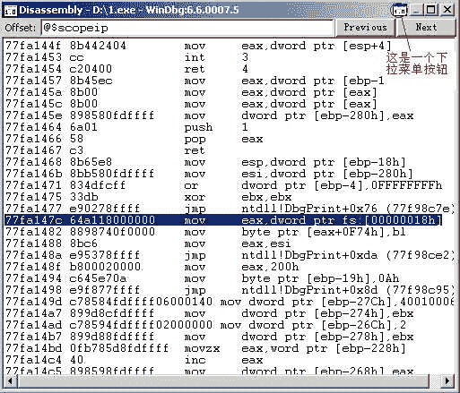
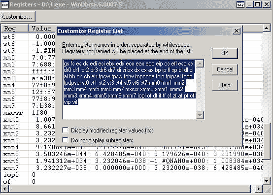
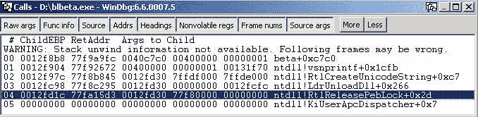
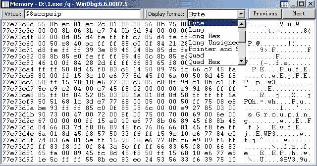
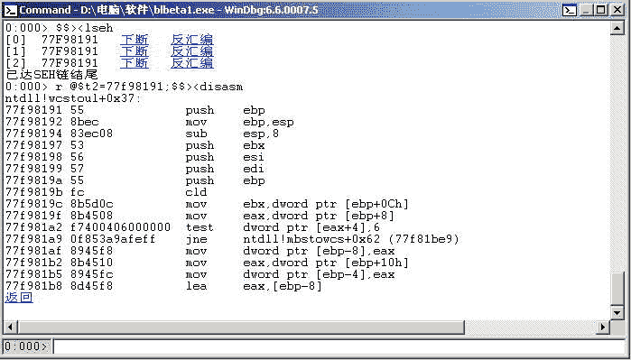

# 从 Ollydbg 说起-----WinDbg 用户态调试教程{看雪学院 2006 金秋读书季}

> 原文：[`www.pediy.com/kssd/pediy08/pediy8-466.htm`](https://www.pediy.com/kssd/pediy08/pediy8-466.htm)

【文章标题】: 【原创】从 Ollydbg 说起-----WinDbg 用户态调试教程  
【文章作者】: 笨笨雄  
【作者邮箱】: nemo314@gmail.com  
【工具】:Windbg 6.6.7.5;Ollydbg 1.10  
  
    我假设你已经掌握 Ollydbg 的使用，并且希望用 WinDbg 进行内核级的调试。这篇教程将会以 Ollydbg 为线索，帮助你尽快掌握 WinDbg 的使用，并简单介绍它的一些特性。我把这篇文章定位为 Ollydbg 到 WinDbg 内核调试之间的过渡。假如你是新手，那么本文同样适用，因为我会提到这两种调试器各自的一些特点，方便选择。全文分为 3 部分，每部分各占 1 楼。1 是讲解界面及其设置，2 是讲解调试中常用的指令，3 是调试实例，目标是增加对 TLSCALLBACK 了解。我在 4 楼放了附件和一些资源的连接方便大家深入学习。希望大家会喜欢这篇文章。  
  
1．  调试界面  
1．1  反汇编窗口  
在 Ollydbg 中，反汇编窗口占的位置最大，功能也很强大。不过在 WinDbg 中，反汇编窗口很简陋，也更容易受花指令影响。界面如图：  
   
这是一个文本框，唯一的功能，也是几乎所有在 WinDbg 中的文本框共有的特性：鼠标左键选中文本，点右键就自动复制选中内容到剪贴板。另外一个共同的特点，红色圈处是一个下拉菜单，里面提供一些功能，针对源码调试的，作为逆向工作者，我们不关心这个。”offset”指定反汇编的地址，默认值为@$scopeip，伪寄存，它的值等于当前 EIP。“Previous”=上一页；“Next”=下一页。此窗口不是默认打开的（只有命令窗口是默认打开的），你需要 ALT+7 来打开它，如果你希望它能自动打开，你可以通过程序的菜单栏：  
  
Windows =>Automatically Open Disassembly  
  
你可以在命令窗口中输入下面命令来完成一些 OllyDbg 反汇编窗口中的一些功能  
  
u\[b\] Address len 以给出的地址为起点向前反汇编，LEN 指定指令的个数，格式为 L+NUM。如果你使用 ub 则反汇编的方向相反。例如你可以使用下面指令汇编入口点的头 10 条指令（@$exentry 伪寄存器，总是等于 EP）。  
U @$exentry L10  
  
uf Address 反汇编指定函数  
  
a \[Address\] 进入汇编模式。不输入任何内容，按 ENTER 结束汇编模式。  
  
r $ip=address   $ip 伪寄存器，修改它的值将会影响命令指针。r 指令用于修改或显示寄存器   
  
WinDbg 也有查找指令，功能比 Ollydbg 差，而且有点复杂，让我们来看看下面 3 条指令  
s 0012ff40 L20 'H' 'e' 'l' 'l' 'o'   
s 0012ff40 L20 48 65 6c 6c 6f   
s -a 0012ff40 L20 "Hello"   
  
它们都是等效的。意为在 0012ff40 到 0012ff60 之间搜索 hello 字符，-a 参数指定以 ACSII 的方式搜索字符，类似的还有-u，它指定以 UNICODE 的方式搜索字符。  
  
注意：这里是字符，而不是 Ollydbg 的字符参考。如果你了解 PE 结构，或者你可以搜索资源段，找出字符的首址，下内存访问断点。如果你希望查找某一条指令，你需要知道它的机器码。  
  
1．2  寄存器窗口  
  
    如图，它同样简陋，而且不方便。尽管我们能用“Customize…”对寄存器重新排序。  
   
它的快捷键是 ALT+4。由于命令窗口会显示当前 EIP 的所有 X86 寄存器状态，所以我们一般不会用到这个窗口。为了使 WinDbg 象 Ollydbg 一样可以显示出寄存器所指向的字符。可以用以下命令：  
  
.pcmd -s ".if(eax<70000000 and eax>00120000){da eax;du eax}; .if(edx<70000000 and edx>00120000){da edx;du edx}"  
  
它的功能是当 EAX，EDX 指向指定内存范围（这里的设置是 70000000 以上，00120000 一下。）时，就以 ASCII 和 UNICODE 显示内存中的字符。  
  
.pcmd 不带参数则显示每条指令之后自动使用的指令。-s "命令" 设置命令。-c 清除命令。你可以不必每次启动都重新设置它。  
  
1．3  调用栈窗口  
  
在 WinDbg 中没有堆栈窗口，取而代之的是调用栈窗口（ALT+6）。下面让我们来看看怎么用。  
   
如图，我以号码为 04 的调用来说明。“ntdll!RtlReleasePebLock+0x2d”调用函数的名称，77fa15d3 是函数返回地址，0012fd30 是函数第一个参数，如此类推。这里其实是将堆栈横排，也就是说当你进入 ntdll!RtlReleasePebLock+0x2d，该窗口就会生成一个项目，并且把堆栈中的内容横排，其实就是下面的数据：  
  
77fa15d3   
0012fd30   
77f80000   
00000000   
  
调用窗口中最左边的 0012fd1c=ESP。  
  
在命令窗口输入 kb，然后你会看到跟调用栈窗口一模一样的内容。最后，此窗口功能同样没有 Ollydbg 强大。  
  
1．4  内存窗口  
  
按 ALT+5，然后你会看到下图所示的窗口：  
   
它提供多种风格的显示，可惜它仍然是一个文本框，你只能复制粘贴，不能象 Ollydbg 那样能下断点，也能直接改内存。  
同样地，你可以使用 d\*指令来达到同样多样化的内存显示。例如 db address,将会以内存窗口的默认风格显示给出地址的数据。  
  
要改变内存数据，你需要使用 e\*命令，格式如下：  
  
e Address \[Values\]   
例如改变 00100000 的数据  
Eb 00100000 01 02 03 04      数据类型为 BYTE  
Ed 00100000 0201 0403       数据类型为 DWORD  
Ea 00100000 ‘hello’           数据类型为 ASCII  
Eu 00100000 ‘你好’           数据类型为 UNICODE  
  
1．5  命令窗口  
  
在 Ollydbg 中，命令行只是一个默认插件。这也是 WinDbg 唯一比 Ollydbg 好的界面了。它的快捷键是 alt+1。  
  
由于是文本框，所以你可以很容易就翻查当前调试记录。例如单步到某一步的时候，想知道之前经过的某一条指令的某个寄存器的值，向上滚动窗口就可以了，你甚至可以 CTRL+F 打开查找窗口，并按 F3 查找下一个。同时因为是文本框的关系，把整个过程复制下来，做点文字编辑，就可以成为一篇破文了。而且 WinDbg 也提供了把命令窗口内容保存到文件的功能，你可以通过菜单“EDIT=>Write windows text to file”。假如你需要重复使用某一命令，也可以通过上箭头或者下箭头翻查历史记录。按 ENTER 则自动重复上一条指令的操作。  
  
Ollydbg 通过各种窗口提供额外的信息，而 WinDbg 则是提供各种命令以让你了解相关信息。下面来简单介绍一下这些指令：  
  
.prompt\_allow 设置单步过程中，是否显示一些附带信息，通过+/-控制。  
      dis  反汇编当前指令  
      ea  当前指令地址  
      reg  寄存器  
      src  源代码行中位置  
      sym 符号  
例如关闭所有单步过程中的显示，可以输入.prompt\_allow –dis –ea –reg –src -sym  
  
特别地，你可以通过 rm 指令来设置显示哪些寄存器，你可以通过 rm ?来显示可以设置的值。  
       1  32 位寄存器  
       2  64 位寄存器，如果支持  
       4  浮点寄存器  
       8  段寄存器  
      10  MMX 寄存器  
      20  Debug 寄存器，如果在内核模式，还能显示 CR 类的寄存器  
      40  SSE XMM 寄存器  
如果需要同时显示几类寄存器，只要把对应的数字加起来就可以了，例如你希望同时显示 MMX 寄存器和 SSE XMM 寄存器，你可以输入 rm 50。显示效果如下：  
  
mm0=0007000077f89964  mm1=000706880134f708  
mm2=ffffffff77f899a0  mm3=0009bbd000070b38  
mm4=77f8996400000000  mm5=0134f74c00000000  
mm6=77f899a077f98191  mm7=00070b3877fcc882  
xmm0=1.00797e+034 8.40779e-045 2.8026e-045 8.7191e-040  
xmm1=8.68054e-040 8.68099e-040 1.00797e+034 1.02606e+034  
xmm2=3.32387e-038 0 0 8.72056e-040  
xmm3=3.32387e-038 -1.#QNAN 6.42848e-040 1.01212e+034  
xmm4=8.7191e-040 8.7208e-040 8.40779e-045 1.00798e+034  
xmm5=3.50325e-044 6.42848e-040 8.71989e-040 3.32383e-038  
xmm6=1.94131e+034 3.32388e-038 -1.#QNAN 1.00838e+034  
xmm7=3.32406e-038 0 3.32384e-038 6.42848e-040  
ntdll!DbgBreakPoint+0x1:  
77fa144c c3              ret  
  
.dml\_start   以 DML 的方式显示一些自定义功能，默认情况下会显示各类命令帮助已经关于调试进程的一些基本信息。DML 命令在命令浏览窗口将会得到更好的支持。你能使用 CTRL+N 打开该窗口并使用此指令。  
lm /D      以 DML 的方式显示当前加载模块的详细信息。  
!teb       显示 TEB 的主要信息  
!peb       显示 PEB 的主要信息  
!handle     显示 handle 信息 

2．  一般调试流程  
2．1  调试目标  
  
CTRL+E 相当于 Ollydbg 的菜单“文件=>打开”，WinDbg 除了能设启动参数之外，还能设起始文件夹，还有一个调试子进程的额外选项。  
  
F6 相当于 Ollydbg 的“文件=>附加”  
  
CTRL+K 内核调试模式。分 4 种模式，分别是 COM，1394，USB2.0 和本地调试，头 3 种都是双机调试，最后一种调试需要 XP 以上版本。  
Ollydbg 有 3 个入口点可以选择，而 WinDbg 只能停在系统断点。要使 WinDbg 停在 EP，可以使用 g @$exentry。  
  
2．2  调试功能  
2．2．1  基本调试功能  
F11 或者 F8  步入  
F10         步过  
SHIFT+F11    步出（注：这个功能最好少用，尤其在 TLSCALLBACK 中，100%出错）  
F5      运行  
CTRL+SHIFT+F5  重新运行  
SHIFT+F5     关闭  
CTRL+BREAK 停止  
  
Ollydbg 的两个功能，执行到返回和执行到用户代码，WinDbg 没有。我用两个 SCRIPT 来实现它，你将能在附件中找到，分别为 gr 和 guc，把他们复制到 WinDbg 的安装目录下，可以通过输入“$$><gr”来使用执行到返回功能，输入“$$><guc”则对应执行到用户代码。假如你把文件复制到别的地方，那么你需要输入完整的文件路径。  
  
由于执行到返回的 SCRIPT 已经在我的另一篇教程中提到，现在我们来看看 guc 的代码，简单了解一下 WinDbg 的 SCRIPT 功能。  
  
r @$t0=@$peb+8  
r @$t0=poi(@$t0)                         ;$$ 通过 PEB 取得 MZ 头，程序上界  
r @$t1=@$t0+3c  
r @$t1=poi(@$t1)+@$t0                    ;$$ 取得 PE 头  
r @$t1=@$t1+50  
r @$t1=poi(@$t1)+@$t0                    ;$$ 取得程序在内存中的下界  
.while(@$ip>@$t1 or @$ip<@$t0){           ;$$ 超过下界或者超过上界进入循环  
.if(@$ip<@$t1 and @$ip>@$t0){             ;$$ 在程序范围之内则跳出循环  
.break  
}  
p                                      ;$$ 单步步过  
}  
  
注意：这个 SCRIPT 并没有判断是否处于系统断点，假如你在进入程序区域之前使用这个 SCRIPT，效果则等同运行。如果永远都不会进入用户区域，例如你在调试 ExitProcess，那么将会导致死循环。  
  
2．2．2  断点功能  
  
软中断，即 INT3：  
  
\[~Thread\] bp\[ID\] \[Options\] \[Address \[Passes\]\] \["CommandString"\]   
  
~Thread 指定线程，可缺省  
ID       指定断点 ID，可缺省。内核调试限 32 个断点，用户模式不限  
Options 可缺省  
/1  中断后自动删除该断点。  
      /c  指定最大调用深度，大于这个深度则断点不工作。  
          /C 指定最小调用深度，小于这个深度则断点不工作。/C 和/c 不能同时使用。  
        
Address   地址或符号。例如 MessageBoxW.  
Passes    忽略中断的次数，可缺省。例：  
bp messageboxw 1  
则程序会忽略第一次调用 messageboxw 产生的中断，其后激活断点。  
CommandString  可缺省。每次中断后都会运行该命令行。一般用于设置条件断点，也用于 HOOK 某些用于 ANTI DEBUG 的 API  
  
硬件断点：  
  
\[~Thread\] ba\[ID\] Access Size \[Options\] \[Address \[Passes\]\] \["CommandString"\]   
  
Access r 读写；w 写；e 运行；I I/O 操作断点，只限 XP 或以后版本，内核调试，X86 系列。  
Size    大小，只能是 1，2，4，8。如果 Access 为 e，则只能是 1。  
  
例：Ba e1 0040c7c0;             $$运行断点  
    Ba w4 0040c7c0;             $$0040c7c0 和 0040c7c4 范围内进行写操作则断   
  
除了 ba 和 bp，还有以下两个断点相关指令  
  
bl 显示当前断点状态及 ID  
  
bc ID 删除断点,例如 bc \*;    $$删除所有断点。  
  
异常断点：  
  
菜单“debug=>event filters”，在这里你能设置包括断点异常在内的所有异常的处理方式。一般我们不关心那个。Ollydbg 提供了 SHIFT+F7/F8/F9，而 WinDbg 就只提供了一个指令 gN。注意 WinDbg 某些指令是区分大小写的。把这个放在这里说是因为你也可以用该命令下断，下面让我们来看看 gN 的用法  
  
\[~Thread\] gN\[a\] \[= StartAddress\] \[BreakAddress ... \[; BreakCommands\]\]   
  
a     如果你使用了 gNa 那么将会以内存断点的方式中断，缺省则以软中断的方式  
BreakCommands     中断产生之后便会运行该命令  
  
这相当于 Ollydbg 中的 SHIFT+F9  
  
消息断点：  
  
WinDbg 并没有提供这个功能，不过你可以写一个 SCRIPT 对 RegisterClass 或 RegisterClassEx 设断，取得 WNDPROC 的首址，并设条件断点。由于我对消息机制了解不多，这里就不给出 SCRIPT 了。  
  
2.2.3  自动跟踪  
  
\[~Thread\] t \[r\] \[= StartAddress\] \[Count\] \["Command"\]  
\[~Thread\] 设置其影响的线程。可缺省  
\[= StartAddress\] 设置起始地址。要注意在地址前面加上=，否则会被当作 COUNT 参数。此外还会以当前环境（堆栈和寄存器），直接跳到该地址执行跟踪。可缺省  
\[Count\]    跟踪步数，可缺省  
\["Command"\]       跟踪完毕之后会在结果显示之前执行的命令，可缺省  
  
这里并不会象 Ollydbg 那样统计次数。一般这个指令用于单步步入，类似的还有 P，单步步过。较有特色的命令是 PC 和 TC，到 CALL 就自动暂停。当然 WinDbg 也有能统计的命令。  
  
wt \[WatchOptions\] \[= StartAddress\] \[EndAddress\]   
  
跟踪，并显示统计结果。  
WatchOptions   可缺省，可选参数如下   
\-l num 跟踪深度限制,例如限制跟踪深度为 10 则 wt -l10 00402312  
        -nc 不显示单独 CALL 的信息  
        -ns 不显示累计信息  
        -nw 不显示在跟踪过程中的警告信息  
EndAddress    终点地址。当 wt 在模块或者函数入口点，此项可缺省。  
  
现在我们来看看它的显示效果（从帮助文件中复制过来的:P）  
  
0:000> wt                 函数的开始，现在使用"wt"  
Tracing MyModule!myFunction to return address 00401137  
 141 \[  0\]  MyModule!myFunction  
  20 \[  1\]    MyModule!anotherFunction  
   5 \[  2\]      MyModule!deeperFunction  
  10 \[  1\]    MyModule!anotherFunction  
   3 \[  2\]      MyModule!deeperFunction  
  30 \[  1\]    MyModule!anotherFunction  
   4 \[  0\]  MyModule!myFunction  
  
147 Instructions were executed 146(0 from other threads) traces 147 sums  
  
Function Name           Invocations  MinInstr  MaxInstr  AvgInstr  
  
MyModule!deeperFunction        2           3          5         4  
MyModule!anotherFunction       1          68         68        68  
MyModule!myFunction            1         213        213       213  
0 system calls were executed  
  
System Call:  
  

3．  调试示例  
  
首先要说明的是 WinDbg 中的某些指令是区分大小写的。最后我将以实际调试过程来说明 Ollydbg 与 WinDbg 的差别。先介绍一下目标软件，black light beta 版。自动查 ROOTKIT，使用修改文件名并重新启动系统的方法清除 ROOTKIT。国庆节到期，爆破时间限制不难，设断改跳转就可以了，如果写这个，就没什么好写了。用 PEID 查了一下，没有壳，有 TLS 表。这个才是这次调试的主角，我希望通过调试来增强对 TLSCALLBACK 的了解。  
  
先使用 Ollydbg 载入目标程序，如果你的设置是首次暂停在 WINMAIN，并且没有使用任何关于 TLS 的增强插件，那么你会看到窗口出来了，但是 Ollydbg 却提示“进程已经终止，退出代码 0”。  
  
现在用 WinDbg 载入程序，选中“debug child processes also”。程序一开始停在系统断点。输入 g $exentry.没断成功，落在子进程的系统断点。再次输入 g $exentry，产生了一个非法访问的错误。gN $exentry，终于能断在 EP 了。好了，如果你喜欢用这个软件，你可以爆破它的时间限制了。  
  
Ollydbg 与 WinDbg 的第一次较量，在没有任何插件的情况，WinDbg 由于支持子进程调试，使得它在这个特例里要简单一些。  
  
现在我们可以知道，程序在入口点之前就已经被运行，很可能是 TLSCALLBACK，并在建立新进程后退出。  
  
\-------------------------------------------------------关于多进程调试-------------------------------------------------------------  
  
0:000> |                    ;$$查询当前进程数,注意 0:000 表示当前调试的进程的识别号是 0  
.  0  id: 46c  create  name: beta.exe  
#  1  id: 410  child  name: beta.exe  
  
0:000> | 1 s                 ;$$切换到子进程 1。S 是切换参数，当前状态是默认显示的。  
eax=00000000 ebx=7ffdf000 ecx=00010101 edx=ffffffff esi=00000000 edi=00000000  
eip=0041e3ec esp=0012ffc4 ebp=0012fff0 iopl=0         nv up ei pl zr na pe nc  
cs=001b  ss=0023  ds=0023  es=0023  fs=0038  gs=0000             efl=00000246  
beta+0x1e3ec:  
0041e3ec 6a60            push    60h  
  
1:001>                     ;$$切换之后命令提示符变成 1:001 了。  
  
\--------------------------------------------------------------回到正题------------------------------------------------------------  
  
现在我们需要调试 TLS 处的代码。回到 Ollydbg，我用的插件是 shoooo 大大的 WMOS，能显示 TLSCALLBACK 的首址。为了方便每次都停在 TLSCALLBACK，我在入口处设了硬断，重新运行之后，我们可以开始调试了。  
  
0040C7C0    8B4424 08       mov eax,dword ptr ss:\[esp+8\]          一开始便从初试栈中读取数据  
0040C7C4    83EC 54         sub esp,54  
0040C7C7    56              push esi                             初始栈-58  
0040C7C8    BE 01000000     mov esi,1  
0040C7CD    3BC6            cmp eax,esi              比较初始栈+8 是否为 1  
0040C7CF    0F85 E4010000   jnz blbeta.0040C9B9                   没有跳转  
0040C7D5    53              push ebx                             初始栈-5c  
0040C7D6    8D4424 64       lea eax,dword ptr ss:\[esp+64\]            EAX=初始栈+8  
0040C7DA    50              push eax                             此处是 0040c7e2 的参数  
0040C7DB    FF15 ACA34300   call dword ptr ds:\[<&KERNEL32.GetCommandLineW>;   
0040C7E1    50              push eax  
0040C7E2    FF15 60A44300   call dword ptr ds:\[<&SHELL32.CommandLineToArg>;   
0040C7E8    8BD8            mov ebx,eax                          EBX=参数首址  
0040C7EA    397424 64       cmp dword ptr ss:\[esp+64\],esi             参数长度与 1 比较  
0040C7EE    76 19           jbe short blbeta.0040C809                跳了  
  
\----------------------------------------------------------如果没有跳会怎么样？----------------------------------------------------  
0040C7F0    8B4B 04         mov ecx,dword ptr ds:\[ebx+4\]  
0040C7F3    68 74364400     push blbeta.00443674                          ; UNICODE "/q"  
0040C7F8    51              push ecx  
0040C7F9    E8 B1290100     call blbeta.0041F1AF    从传入参数看，此 CALL 判断运行参数是否为/q  
0040C7FE    83C4 08         add esp,8  
0040C801    85C0            test eax,eax  
0040C803    0F84 AF010000   je blbeta.0040C9B8      可能是参数/q 对应的功能模块  
  
Ollydbg 的参考字符功能，基本可以猜到该程序能以参数启动，格式为“/ 参数”，长度不等于 1  
\--------------------------------------------------------------回到正题------------------------------------------------------------  
  
0040C809    33D2            xor edx,edx  
0040C80B    55              push ebp                            初始栈-60  
0040C80C    57              push edi                            初始栈-64  
0040C80D    33C0            xor eax,eax  
0040C80F    895424 10       mov dword ptr ss:\[esp+10\],edx  
0040C813    B9 11000000     mov ecx,11  
0040C818    8D7C24 20       lea edi,dword ptr ss:\[esp+20\]  
0040C81C    F3:AB           rep stos dword ptr es:\[edi\]  
0040C81E    397424 6C       cmp dword ptr ss:\[esp+6C\],esi          仍然是跟初始栈+8 比较  
0040C822    895424 14       mov dword ptr ss:\[esp+14\],edx  
0040C826    895424 18       mov dword ptr ss:\[esp+18\],edx  
0040C82A    C74424 20 44000>mov dword ptr ss:\[esp+20\],44  
0040C832    895424 1C       mov dword ptr ss:\[esp+1C\],edx  
0040C836    76 70           jbe short blbeta.0040C8A8              ESI 没有改变过，此处相当于 JMP  
\-----------------------------------------------junk code 如何引诱你改变 EIP 跟进去？------------------------------------------------  
0040C838    8B43 04         mov eax,dword ptr ds:\[ebx+4\]  
0040C83B    68 64364400     push blbeta.00443664                          ; UNICODE "/expert"  
0040C840    50              push eax  
0040C841    E8 69290100     call blbeta.0041F1AF  
0040C846    83C4 08         add esp,8  
0040C849    85C0            test eax,eax  
0040C84B    75 5B           jnz short blbeta.0040C8A8              
首先是一个非常引诱的字符参考“/expert”，跟进去仿佛能开启高级功能。然后是 0040C8A8 由于跟上面跳转一样，或者会让你觉得不跳转，继续跟下去便是开启高级功能的关键。攻城为下攻心为上，如果我在这里安排一些破坏性的代码。。。。。。  
\--------------------------------------------------------------回到正题------------------------------------------------------------  
  
虽然跳过了一大堆 junk code 不过我猜肯定不止那么少。  
  
0040C8A8    8B0B            mov ecx,dword ptr ds:\[ebx\]  
0040C8AA    51              push ecx  
0040C8AB    E8 21200100     call blbeta.0041E8D1  
0040C8B0    68 74364400     push blbeta.00443674                          ; UNICODE "/q"  
0040C8B5    8BF0            mov esi,eax  
0040C8B7    E8 15200100     call blbeta.0041E8D1  前面已经有处理/q 的例程了，这里还处理？忽略  
0040C8BC    83C4 08         add esp,8  
0040C8BF    6A 04           push 4  
0040C8C1    8D6C06 04       lea ebp,dword ptr ds:\[esi+eax+4\]  
0040C8C5    68 00100000     push 1000  
0040C8CA    8D7C2D 00       lea edi,dword ptr ss:\[ebp+ebp\]  
0040C8CE    57              push edi  
0040C8CF    6A 00           push 0  
0040C8D1    FF15 B0A34300   call dword ptr ds:\[<&KERNEL32.VirtualAlloc>\]  ; KERNEL32.VirtualAlloc  
0040C8D7    8BCF            mov ecx,edi       这条指令跟下一条指令相当于 mov edx,edi  
0040C8D9    8BD1            mov edx,ecx       到这里还有 junk code  
0040C8DB    8BF0            mov esi,eax       又是一个 junk code  
0040C8DD    C1E9 02         shr ecx,2  
0040C8E0    33C0            xor eax,eax  
0040C8E2    8BFE            mov edi,esi        相当于 mov edi,eax  
0040C8E4    F3:AB           rep stos dword ptr es:\[edi\]    
  
代码分析=体力活，本文重点介绍工具使用，而不是代码还原。现在忽略细节，直接看它用了什么 API。  
  
CALL KERNEL32.VirtualAlloc  
Call KERNEL32.GetModuleFileNameW  
call KERNEL32.CreateEventW  
call KERNEL32.CreateProcessW    其中|CommandLine = ""D:\\blbeta.exe" /q"  
call KERNEL32.WaitForSingleObject  
call KERNEL32.CloseHandle  
call KERNEL32.VirtualFree  
call KERNEL32.ExitProcess  
  
ExitProcess 之后又来到一开始的地方了。  
  
0040C7C0    8B4424 08       mov eax,dword ptr ss:\[esp+8\]  
0040C7C4    83EC 54         sub esp,54  
0040C7C7    56              push esi  
0040C7C8    BE 01000000     mov esi,1  
0040C7CD    3BC6            cmp eax,esi  
0040C7CF    0F85 E4010000   jnz blbeta.0040C9B9              这次跳转成功了  
  
0040C9B9    5E              pop esi  
0040C9BA    83C4 54         add esp,54  
0040C9BD    C2 0C00         retn 0C                         retn 后 ESP-0c  
  
关于 TLS：现在我们知道 TLSCALLBACK 通过初始栈+8 的数据来判断是什么情况下被调用。当它的值为 1 时，代表 TLS 被首次运行。假如只是简单判断是否第一次被运行，只要判断是否为 1 就够了。为什么结束时是 retn 0c?现在让我们单步进入系统区域看看：  
  
77F86209    FF75 14         push dword ptr ss:\[ebp+14\]  
77F8620C    FF75 10         push dword ptr ss:\[ebp+10\]  
77F8620F    FF75 0C         push dword ptr ss:\[ebp+C\]  
77F86212    FF55 08         call dword ptr ss:\[ebp+8\]  
77F86215    8BE6            mov esp,esi  
  
现在可以知道 call dword ptr ss:\[ebp+8\]的最后是调用 TLSCALLBACK，所以结束时必须代替系统释放堆栈，通过这次调试，我们可以用汇编写 TLSCALLBACK，并把 ANTI DEBUG 代码放在这里欺负新人了: P  
  
我们来看看，如果在 WinDbg 中，应该怎么做。为了让 WinDbg 看起来容易用一点，我又写了个 SCRIPT，它在附件里的名字是 gs。复制到程序安装目录，输入$$><gs，然后按 ENTER。如果程序有 TLSCALLBACK，将会断在那里(用了 bp 设断，然后 g 的方法，以后也会自动断在那里)，没有就断在 EP。   
\--------------------------------------------------------------gs 的注释------------------------------------------------------------  
r @$t0=@$peb+8  
r @$t0=poi(@$t0)                     ;$$通过 peb 获得基址  
r @$t1=@$t0+3c  
r @$t1=poi(@$t1)+@$t0  
r @$t1=@$t1+c0  
r @$t1=poi(@$t1)            ;$$取得 TLS 表基址  
.if (@$t1!=0){                         ;$$判断 TLS 表是否存在  
r @$t1=@$t1+@$t0  
r @$t1=@$t1+c  
r @$t1=poi(@$t1)  
r @$t1=poi(@$t1)  
.if(@$t1!=0){                         ;$$判断 TLSCALLBACK 是否存在  
r @$t0=0                ;$$是否有 TLSCALLBACK 的标记  
bp @$t1  
g  
}  
}  
.if (@$t0!=0){                         ;$$没有 TLSCALLBACK 就 GO EP  
g $exentry  
}  
\-------------------------------------------------------------注释结束------------------------------------------------------------  
  
现在程序停在入口点了。我用 OD 的时候习惯静态分析，然后分析到我感兴趣的地方，设断，F9，看寄存器看堆栈。这在 WinDbg 中不可能，它的反汇编功能真的不怎么样。例如我单步到这里：  
  
call    dword ptr \[beta+0x3a3ac (0043a3ac)\] ds:0023:0043a3ac={KERNEL32!GetCommandLineW (77e7386f)}  
  
才会显示这个是 API 调用，在反汇编窗口里面只是单纯显示 call    dword ptr \[beta+0x3a3ac (0043a3ac)\]。你必须跟进那个 call，调用栈才有反应，还不如直接用 db esp 查看堆栈。而且进去之后也不会提示那些是什么参数。所以我一般在使用的时候，同时打开 MSDN 的搜索页面，当然还有 IDA。  
  
0040c7cf 0f85e4010000    jne     beta+0xc9b9 (0040c9b9)                  \[br=0\]  
  
后面 br=0 代表没有跳转成功，如果是 1，那么就是成功跳转。当然 WinDbg 也有方便的地方。在 Ollydbg 的例子中，我是下拉反汇编窗口直接看后面用什么 API。而在 WinDbg 中，你可以使用 pc 命令，现在直接自动单步到 CALL，然后停下来，而不需要关心在这中间遇到多少个条件跳转。  
  
第二次较量，在进行代码分析时 WinDbg 要逊色一点，它的 SCRIPT 功能倒是不错，可以弥补一些差距。  
  
关于目标程序：现在我们知道程序通过参数/q 启动一个新的进程。用 Ollydbg 和 WinDbg 带参数/q 重新载入程序。开始的时候，我们曾经用 WinDbg 双进程调试过，当时新进程产生了一个错误，忽略错误运行之后，我们能停在 EP。我希望知道系统是怎么处理这个错误的。  
  
Ollydbg 中按 F9 到达错误处，然后按 SHIFT+F7 进入 SEH 链中的第一个例程  
  
WinDbg 中按 F5 到达错误处，然后还是 SCRIPT，对应附件中的 lseh 和 disasm 这两个文件。一定要复制到安装目录下。$$><lseh 使用 SCRIPT，效果如图：  
   
这个 SCRIPT 的功能是列举所有 SEH 例程，可以下断，也可以反汇编该例程的前 10 条命令。我用 DML 做了一个简单的可视化界面。显然可以做一个界面，通过点鼠标来单步之类的，这样 HOOK 快捷键 ANTI DEBUG 就不可行了。如果你点一下反汇编，你会发现系统 DLL 里面有很多符号标记，相反 Ollydbg 却认不出来。也许 Micro$oft 开发 WinDbg 就是鼓励别人调试它的产品。  
\-----------------------------------------------------------SCRIPT 注释------------------------------------------------------------  
r @$t0=poi(@$teb)                                ;$$取得 SEH 链表的第一个元素  
.for (r $t3 = 0; @$t0 !=-1; r $t3 = @$t3 + 1){            ;$$到达终点则停止循环  
r @$t1=poi(@$t0+4)  
.printf /D "\[%x\]  %X   <link cmd=\\"bp /1 %x\\">下断</link>   <link cmd=\\"r @$t2=%x;$$><disasm \\">反汇编</link>\\n",@$t3,@$t1,@$t1,@$t1    ;$$dml 的标记跟 HTML 很象。在””中使用”你需要在”前面加\\  
r @$t0=poi(@$t0)                   ;$$ 即\\”\\”=””。.printf 的用法跟 C 语言中的一样，我希望你懂 C 语言   
}  
.if (@$t0=-1){  
.echo "已达 SEH 链结尾"  
}  
  
反汇编的链接命令是使用 disasm 这个 SCRIPT，并以@$t2 来传递参数，下面来看看它的代码：  
  
u @$t2 l10                                              ;$$反汇编@$t2 指向的地址  
.printf /D "<link cmd=\\"$$><Lseh\\">返回</link>\\n"             ;$$使用 lseh  
\--------------------------------------------------------------结束----------------------------------------------------------------  
这有点花俏，我写了另外一个 SCRIPT，对应附件中的 SEH。它的功能是在第一个 SEH 例程下断了。gN，断下来。  
  
我们看到处理错误的函数在系统区域，由于忽略错误能回到 EP，也就是说该系统 SEH 例程可以处理错误，然后返回到某处用户代码，于是我在 WinDbg 中使用 guc 这个 SCRIPT，运行到用户代码为止，结果窗体出来了还没停下来。现在换 Ollydbg 取消了入口处的断点之后，使用执行到用户代码，效果跟 WinDbg 一样。重新开始，经过层层跟踪之后发现出问题的地方是 INT 2E，单步过去就变成运行。看来 R3 调试器跟我一样，不认识那东西。也就是说，可以用 INT 2E 等调用来对抗模拟跟踪，当然这需要你掌握它的使用。至于 TLSCALLBACK，或者我们可以假定它出错，系统就会把控制权交回 EP，有待实践证明或高手调试证明了。  
  
第三次较量，算是平手了。  
  
最后简单的总结一下 WinDbg 在 R3 下的表现：  
1．  强大的 script 功能，适用于自动化完成一些任务。  
2．  DML，提供一个简陋的可视化界面与用户进行简单的互动。  
3．  HTML 文件输出支持，这是我在学习 DML 的过程中发现的。“.logopen”建立 HTML 文件，“.printf”输出 HTML 标记，“.logclose”关闭文件。  
4．  适合调试系统内核，它对内核的符号标记比 Ollydbg 要多。为了获得更多 WINDOWS 内核的符号支持，你需要通过菜单"File=>Symbol File Path"  
  
然后输入  
“srv\*%SystemRoot%\\symbols\*http://msdl.microsoft.com/download/symbols”  
  
注意：此命令行使 WinDbg 到 micro$oft 的网站下载符号文件，由于网速以及符号文件库比较大的关系，会导致初次使用时较费时（我这里校园网，等了几分钟）。此外假如程序也加载了一些非 micro$oft 的模块，WinDbg 也会尝试在该网站查找，因此假如你对内核不感兴趣，请把路径设为空格。 

这里列出一些资源方便大家学习  
  
关于 SCRIPT  
  
http://bbs.pediy.com/showthread.php?s=&threadid=33663  
  
WINDBG Script 简易教程  
  
关于 DML  
  
http://bbs.pediy.com/showthread.php?s=&threadid=34145  
  
这个是 DML 帮助文档的翻译  
  
http://bbs.pediy.com/showthread.php?s=&threadid=34018  
  
一个 DML 的例子“写了个小的 WinDbg 脚本，可以显示 SSDT”  
  
关于 WinDbg 的插件制作方法  
  
请看 Debugging Help 中的 Debuggers\\Debuggers Operation\\Debugger Extensions  
  
关于内核调试  
  
在安装目录下 kernel\_debugging\_tutorial.doc  
  
关于 WinDbg 的最大特点  
  
Micro$oft 设计这个东西是用于排错，有大量针对排错优化的指令。尤其是在拥有源代码的情况下，有符号文件的情况，它的易用性不比 OD 差，如果你对这方面有兴趣，或者想体验一下它在该方面的功能表现，我推荐你看  
  
《Windows 用户态程序高效排错》  
  
你将能从作者的 BLOG 下载到：http://www.cnblogs.com/lixiong  
  
WinDbg 的下载链接  
  
http://www.microsoft.com/whdc/devtools/debugging/installx86.mspx  
  
\---------------------------------------------------关于符号文件------------------------------------------------------  
由于我还没接触内核调试，还没有细看这方面的设置，感谢小喂的意见  
  

引用:  *最初由** 小喂 **发布*  
  
感觉把符号路径设为 srv\*xxx\*http://xxx 的形式不太好，碰到某些符号识别不了 WinDbg 会挨个模块查找符号，找不到就到网上找，直到把所有模块的符号都下载下来找不到为止。这时候死在这里什么也干不了。不如调试前把需要用到的系统符号先下载下来，然后调试的时候就很爽了。  
  
cd /d c:\\windbg  
symchk c:\\windows\\system32\\ntoskrnl.exe /s src\*c:\\symbols\*http://msdl.microsoft.com/download/symbols  
......  
  
然后把符号路径设为 c:\\symbols  
  
只是个人意见，呵呵  

  
  
纠正一下错误。WINDBG 中，BA 指令为硬件断点。似乎没有内存断点功能。。。 

 4dd466d0e1e0cc123afbe504da2462ca