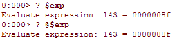
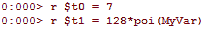
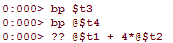
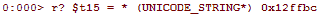
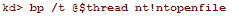

# 伪寄存器语法(Pseudo-Register Syntax)

> 原文：[`www.pediy.com/kssd/pediy08/pediy8-747.htm`](https://www.pediy.com/kssd/pediy08/pediy8-747.htm)

注：原文是 WinDBG v6.6.7.5 帮助中的一篇文档 

# 伪寄存器语法(Pseudo-Register Syntax)

调试器支持许多具有特定值的伪寄存器。

自动变化伪寄存器（*Automatic pseudo-registers*）被调试器设置为特定的有用值。自定义伪寄存器（*User-defined pseudo-registers*）是能够被调试器操作码（operator）读写的整型变量。

所有伪寄存器都以一个美元标记（**$**）打头。如果你使用 MASM 语法，你可以在** $ **标记前加一个 at 标记（**@**）。这告诉调试器紧接着的记号是一个寄存器或者伪寄存器，不是一个符号。如果省略 **@ **标记，调试器反映会慢一点，因为它要搜索整个符号表。

例如，下面两条命令产生一样的输出结果，但第二条命令更快：

 

如果有一个实际的符号和伪寄存器名字相同，则 **@ ** 标记是必须的。

如果你使用 C++ 表达式语法，则 **@** 标记始终是必须的。

**r(Registers)** 命令是一个例外。它的第一个参数总是被解释为寄存器或者伪寄存器；**@ ** 标记不是必须的，有也是允许的。如果有第二个参数，会根据缺省的表达式语法来解释。所以，如果缺省的表达式语法是 C++，你应该采用下面的命令把  **$t2** 伪寄存器的值复制给  **$t1** 伪寄存器。

#### 自动变化伪寄存器（Automatic Pseudo-Registers）

下表列出了会自动赋值的伪寄存器。

| 伪寄存器 || 描述 |
| --- | --- |
| **$ea ** || 最后一条被执行指令的有效地址（effective address）。如果这条指令没有一个有效地址，将显示"Bad register error"。如果这条指令有两个有效地址，则显示第一个地址。 |
| **$ea2 ** || 最后一条被执行指令的第二个有效地址，如果这条指令没有两个有效地址，将显示"Bad register error"。 |
| **$exp ** || 最后一个被求值的表达式。 |
| **$ra ** || 当前堆栈的返回地址。  
  
这个在执行命令中特别有用。例如，**g 燖$ra ** 将一直执行到返回地址处（虽然，对于“步出(*stepping out*)”当前函数  **gu(Go Up)** 是一个更加准备有效的方法）。  
 |
| **$ip ** || 指令指针寄存器：  
  
*x86 * 处理器：和  **eip **相同 * Itanium *处理器：涉及  **iip**（请看表后的注解）*x64 *处理器：和  **rip ** 相同  
 |
| **$eventip ** || 当前事件发生时的指令指针，通常和  **$ip ** 匹配，除非你切换了线程或者手动改变了指令指针的值。 |
| **$previp ** || 前一个事件发生时的指令指针。（中断进入调试器算做一个事件。） |
| **$relip ** || 和当前事件相关的指令指针，当你正在跟踪分支指令时，这个是分支来源指针。 |
| **$scopeip ** || The instruction pointer for the currently-set local context (also known as *scope*). （译注：这句不会翻，保留原文）。 |
| **$exentry ** || 当前进程的第一个可执行的入口点地址。 |
| **$retreg ** || 主要的返回值寄存器：  
  
*x86 * 处理器：和  **eax **相同 * Itanium *处理器：和  **ret0 ** 相同*x64 *处理器：和  **rax ** 相同  
 |
| **$retreg64 ** || 64 位格式下的主要的返回值寄存器。  
  
*x86 * 处理器：和  **edx:eax **  对相同  
 |
| **$csp ** || 当前调用堆栈指针，是一个通常表示调用堆栈深度的寄存器。  
  
*x86 *处理器：和  **esp** 相同 *Itanium *处理器：和  **bsp** 相同*x64 *处理器：和  **rsp** 相同  
 |
| **$p ** || 最后一条  **d\*(Display Memory)** 命令打印的值。 |
| **$proc ** || 当前进程的地址（换句话说，就是 EPROCESS 块的地址）。 |
| **$thread ** || 当前线程的地址（换句话说，就是 ETHREAD 块的地址）。 |
| **$peb ** || 当前进程的进程环境块（PEB）的地址。 |
| **$teb ** || 当前线程的线程环境块（TEB）的地址。 |
| **$tpid ** || 当前线程所在进程的进程 ID（PID）。 |
| **$tid ** || 当前线程的线程 ID。 |
| **$bp***Number* || 对应断点的地址。例如，**$bp3**（或者  **$bp03**）引用断点 ID 为 3 的断点。*Number * 总是一个十进制数，如果没有哪个断点的  ID 为  *Number*，则  **$bp***Number * 求值为 0，详细请看  Using Breakpoints。 |
| **$frame** || 当前帧索引，这个和 **.frame�(Set Local Context)** 命令常用的 frame number 相同。 |
| **$dbgtime** || 当前时间，根据调试器运行的计算机。 |
| **$callret** || 被  **.call�(Call Function)** 命令调用的或者被  **.fnret�/s** 命令使用的最后函数得到的返回值，**$callret ** 的数据类型就是返回值的数据类型。 |
| **$ptrsize** || 指针大小。在内核模式下，指目标计算机上的指针大小。 |
| **$pagesize** || 一个内存页的大小（也就是占用的字节数目），在内核模式下，指目标计算机上的页大小。 |

在某些调试情景下这些伪寄存器有一部分是不可用的。例如，在调试一个用户模式 minidump 或者调试某些内核模式 dump 文件时  **$peb**, **$tid** 和 **$tpid ** 不能用 － 所以这种情况你能够从  **~(Thread Status)** 得到线程信息，而不能从  **$tid ** 得到。当第一个真正的调试器事件发生时  **$previp ** 伪寄存器不能用，除非你正在跟踪分支指令，否则  **$relip ** 伪寄存器也不能用。使用一个无效的伪寄存器会导致一个语法错误。

在 Itanium 处理器上，**iip ** 寄存器是紧凑对齐的（bundle-aligned），所以不是一个完整的指令指针。**$ip ** 伪寄存器是有效的指令指针（actual instruction pointer），包括有效位和空位（the bundle and the slot）。其它具有地址指针的伪寄存器（**$ra**, **$retreg**, **$eventip**, **$previp**, **$relip ** 和  **$exentry**）在所有的处理器上都和  **$ip ** 有相同的结构。

你可以用  **r ** 命令改变  **$ip ** 的值，它会自动修改对应的寄存器值。当恢复执行时，会恢复到新的指令指针地址处执行。这是唯一一个可以手动修改的自动变化伪寄存器。

**注解** 在 MASM 语法中，**$ip **  伪寄存器也可以用单个点号（**.**）表示。这个点号前面不需要跟一个** @ ** 标记，不能做为  **r **  命令的第一个参数。在 C++ 表达式中不允许使用该语法。

自动变化伪寄存器与  automatic aliases 相似，除了自动变化别名（automatic aliases）可以使用别名相关的记号如  **${}**，而伪寄存器不能使用之外。

#### 自定义伪寄存器（User-Defined Pseudo-Registers）

有二十个自定义伪寄存器：**$t0**, **$t1**, ..., **$t19**。它们是可以通过调试器读写的变量。能用来保存任意整数值。做为循环变量时非常有用。

要赋值给伪寄存器，使用  **r�(Registers)** 命令：

  
  

和所有伪寄存器一样，自定义伪寄存器可以在任意表达式中使用：

  

除非  **r ** 命令使用了  **? ** 开关选项，否则一个伪寄存器总是具有整数类型。如果用到了  **? ** 选项，则伪寄存器可以获得赋给它的任意类型。例如，下面的命令把 UNICODE\_STRING\*\* 类型和 0x0012FFBC 值赋给了  **$t15**（译注：这里好像是 UNICODE\_STRING 类型吧！另外，如果 UNICODE\_STRING 解析不了，可以用 \_UNICODE\_STRING）。

  
  

当调试器启动时，自定义伪寄存器缺省为零。

**注解** 别名 **$u0**, **$u1**, ..., **$u9 ** 不是伪寄存器，尽管它们外表很相似，详细请看  Using Aliases。

#### 示例

下面的例子设置了一个断点，每次当前线程调用  **NtOpenFile ** 函数时会断下来，其它线程的调用则不会。

 

 4dd466d0e1e0cc123afbe504da2462ca